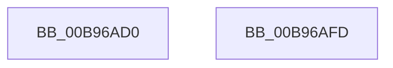

# VfGetDmaAdapterInfo

- RVA: `0x00B96AD0`–`0x00B96AFE` (길이 `46` bytes)
- VA: `0x0000000140B96AD0`
- 실행 섹션: `PAGEVRFY`
- PDB 이름 있음: `예`; PDB Function 태그: `아니요`
- unwind 정보 RVA: `0x0005CF00`
- 디코드: `14`개 명령, `46/46` bytes 표시
- 미해석 바이트: `0` (있으면 어셈블리에 `.byte`로 보존)

> 이 문서는 커널 이미지의 기계어와 PDB 기호를 분석해 생성했습니다. 4번과 5번은 함수 원형과 자료형을 바이너리 사용 방식에서 추정한 C 해석이며 원본 소스 복구 결과는 아닙니다.

## 1. Dependencies

- 직접 호출 지점: **2**; 고유 호출 대상: **2**
- 직접 호출자로 확인된 함수: **0**
- RIP 상대 이미지 참조: **0**

### Outgoing calls
- `0x00B96AD9` → [ViGetRealDmaAdapter](ViGetRealDmaAdapter_function_00B990DC.md) (function, `0x00B990DC`)
- `0x00B96AF2` → [guard_dispatch_icall](../../text/6B/guard_dispatch_icall_function_006BAAD0.md) (function, `0x006BAAD0`)

### Direct callers
- 이 함수 시작 RVA로 연결되는 직접 call은 확인되지 않았습니다. 간접 호출은 완전히 역산할 수 없습니다.

### Static image references
- 디코드된 RIP-relative 메모리 참조가 없습니다.

## 2. Other-region calls and transfers

- 다른 실행 섹션으로 향하는 call: **1**
  - `0x00B96AF2` → [guard_dispatch_icall](../../text/6B/guard_dispatch_icall_function_006BAAD0.md) (`PAGEVRFY` → `.text`)
- 별도 외부 분기/꼬리 이동을 확인하지 못했습니다.

## 3. Assembly (complete function range)

```asm
00B96AD0  40 53                           push rbx
00B96AD2  48 83 EC 20                     sub rsp, 0x20
00B96AD6  48 8B DA                        mov rbx, rdx
00B96AD9  E8 FE 25 00 00                  call 0x140b990dc
00B96ADE  4C 8B C0                        mov r8, rax
00B96AE1  48 8B D3                        mov rdx, rbx
00B96AE4  48 8B 48 08                     mov rcx, qword ptr [rax + 8]
00B96AE8  48 8B 81 80 00 00 00            mov rax, qword ptr [rcx + 0x80]
00B96AEF  49 8B C8                        mov rcx, r8
00B96AF2  E8 D9 3F B2 FF                  call 0x1406baad0
00B96AF7  48 83 C4 20                     add rsp, 0x20
00B96AFB  5B                              pop rbx
00B96AFC  C3                              ret
00B96AFD  CC                              int3
```

## 4. C-style interpretation (structured pseudocode)

```c
__int64 __fastcall VfGetDmaAdapterInfo(__int64 a1, __int64 a2)
{
    __int64 result;
    __int64 v_rsp;

    v_rsp = (v_rsp) - (32);
    result = ViGetRealDmaAdapter(a1, a2, a3, a4);
    result = guard_dispatch_icall(result, a2, result, a4);
    v_rsp = (v_rsp) + (32);
    return result;
}
```

## 5. (Beta) C Style

```c
int64_t VfGetDmaAdapterInfo(int64_t Arg1, int64_t Arg2)
{
    int64_t result;
    int64_t local_rsp;

    local_rsp = (local_rsp) - (32);
    result = ViGetRealDmaAdapter(Arg1, Arg2, a3, a4);
    result = guard_dispatch_icall(result, Arg2, result, a4);
    local_rsp = (local_rsp) + (32);
    return result;
}
```

## 6. Execution-region graph

[열기: 2D/3D 그래프와 함수 탐색 컨트롤 패널](../../../control-panel.html?section=pagevrfy&rva=0x00B96AD0&view=graph)

- 2D 그래프는 위에서 아래로 흐르고, 3D 그래프는 빈 공간을 드래그해 회전합니다. Shift+드래그는 이동, 휠은 확대·축소, 함수 노드 선택은 대상 보고서 이동입니다.

### Static fallback


