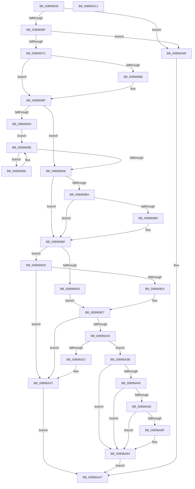

# VfGetDmaAdapter

- RVA: `0x00B96930`–`0x00B96AC2` (길이 `402` bytes)
- VA: `0x0000000140B96930`
- 실행 섹션: `PAGEVRFY`
- PDB 이름 있음: `예`; PDB Function 태그: `아니요`
- unwind 정보 RVA: `0x0007EE78`
- 디코드: `107`개 명령, `402/402` bytes 표시
- 미해석 바이트: `0` (있으면 어셈블리에 `.byte`로 보존)

> 이 문서는 커널 이미지의 기계어와 PDB 기호를 분석해 생성했습니다. 4번과 5번은 함수 원형과 자료형을 바이너리 사용 방식에서 추정한 C 해석이며 원본 소스 복구 결과는 아닙니다.

## 1. Dependencies

- 직접 호출 지점: **10**; 고유 호출 대상: **8**
- 직접 호출자로 확인된 함수: **0**
- RIP 상대 이미지 참조: **6**

### Outgoing calls
- `0x00B9696F` → [VfIsPCIBus](VfIsPCIBus_function_00B97274.md) (function, `0x00B97274`)
- `0x00B9698A` → [VF_ASSERT_IRQL](VF_ASSERT_IRQL_function_00B94F30.md) (function, `0x00B94F30`)
- `0x00B96999` → [ViReleaseDmaAdapter](ViReleaseDmaAdapter_function_00B99A0C.md) (function, `0x00B99A0C`)
- `0x00B969A1` → [VF_FIND_INACTIVE_ADAPTER_AND_REMOVE](VF_FIND_INACTIVE_ADAPTER_AND_REMOVE_function_00B950B0.md) (function, `0x00B950B0`)
- `0x00B969CF` → [guard_dispatch_icall](../../text/6B/guard_dispatch_icall_function_006BAAD0.md) (function, `0x006BAAD0`)
- `0x00B969F7` → [guard_dispatch_icall](../../text/6B/guard_dispatch_icall_function_006BAAD0.md) (function, `0x006BAAD0`)
- `0x00B96A1A` → [ViHookDmaAdapter](ViHookDmaAdapter_function_00B993D8.md) (function, `0x00B993D8`)
- `0x00B96A32` → [guard_dispatch_icall](../../text/6B/guard_dispatch_icall_function_006BAAD0.md) (function, `0x006BAAD0`)
- `0x00B96A79` → [IoGetDevicePropertyData](../../page/90/IoGetDevicePropertyData_function_009005E0.md) (function, `0x009005E0`)
- `0x00B96AA2` → [IoGetDmaAdapter](../../page/72/IoGetDmaAdapter_function_00729450.md) (function, `0x00729450`)

### Direct callers
- 이 함수 시작 RVA로 연결되는 직접 call은 확인되지 않았습니다. 간접 호출은 완전히 역산할 수 없습니다.

### Static image references
- `0x00B9695D` → RVA `0x00F03FA4` (`.data`; read)
- `0x00B9697C` → RVA `0x00F04A20` (`.data`; read)
- `0x00B969AB` → RVA `0x00FF4004` (`PAGEVRFD`; read)
- `0x00B969C8` → RVA `0x00E00B70` (`.data`; read)
- `0x00B969E7` → RVA `0x00FFE6D8` (`PAGEVRFD`; read)
- `0x00B96A4D` → RVA `0x000142D8` (`.rdata`; read)

## 2. Other-region calls and transfers

- 다른 실행 섹션으로 향하는 call: **5**
  - `0x00B969CF` → [guard_dispatch_icall](../../text/6B/guard_dispatch_icall_function_006BAAD0.md) (`PAGEVRFY` → `.text`)
  - `0x00B969F7` → [guard_dispatch_icall](../../text/6B/guard_dispatch_icall_function_006BAAD0.md) (`PAGEVRFY` → `.text`)
  - `0x00B96A32` → [guard_dispatch_icall](../../text/6B/guard_dispatch_icall_function_006BAAD0.md) (`PAGEVRFY` → `.text`)
  - `0x00B96A79` → [IoGetDevicePropertyData](../../page/90/IoGetDevicePropertyData_function_009005E0.md) (`PAGEVRFY` → `PAGE`)
  - `0x00B96AA2` → [IoGetDmaAdapter](../../page/72/IoGetDmaAdapter_function_00729450.md) (`PAGEVRFY` → `PAGE`)
- 별도 외부 분기/꼬리 이동을 확인하지 못했습니다.

## 3. Assembly (complete function range)

```asm
00B96930  48 8B C4                        mov rax, rsp
00B96933  48 89 58 08                     mov qword ptr [rax + 8], rbx
00B96937  48 89 68 10                     mov qword ptr [rax + 0x10], rbp
00B9693B  48 89 70 18                     mov qword ptr [rax + 0x18], rsi
00B9693F  57                              push rdi
00B96940  41 56                           push r14
00B96942  41 57                           push r15
00B96944  48 83 EC 50                     sub rsp, 0x50
00B96948  83 60 20 00                     and dword ptr [rax + 0x20], 0
00B9694C  49 8B F8                        mov rdi, r8
00B9694F  83 60 DC 00                     and dword ptr [rax - 0x24], 0
00B96953  4C 8B F2                        mov r14, rdx
00B96956  83 60 D8 00                     and dword ptr [rax - 0x28], 0
00B9695A  48 8B D9                        mov rbx, rcx
00B9695D  83 3D 40 D6 36 00 00            cmp dword ptr [rip + 0x36d640], 0
00B96964  4C 8B 7C 24 68                  mov r15, qword ptr [rsp + 0x68]
00B96969  0F 84 2A 01 00 00               je 0x140b96a99
00B9696F  E8 00 09 00 00                  call 0x140b97274
00B96974  85 C0                           test eax, eax
00B96976  0F 85 1D 01 00 00               jne 0x140b96a99
00B9697C  F7 05 9A E0 36 00 00 00 02 00   test dword ptr [rip + 0x36e09a], 0x20000
00B96986  75 07                           jne 0x140b9698f
00B96988  33 C9                           xor ecx, ecx
00B9698A  E8 A1 E5 FF FF                  call 0x140b94f30
00B9698F  48 85 DB                        test rbx, rbx
00B96992  74 17                           je 0x140b969ab
00B96994  EB 08                           jmp 0x140b9699e
00B96996  48 8B C8                        mov rcx, rax
00B96999  E8 6E 30 00 00                  call 0x140b99a0c
00B9699E  48 8B CB                        mov rcx, rbx
00B969A1  E8 0A E7 FF FF                  call 0x140b950b0
00B969A6  48 85 C0                        test rax, rax
00B969A9  75 EB                           jne 0x140b96996
00B969AB  83 3D 52 D6 45 00 00            cmp dword ptr [rip + 0x45d652], 0
00B969B2  74 0B                           je 0x140b969bf
00B969B4  83 3F 20                        cmp dword ptr [rdi], 0x20
00B969B7  76 06                           jbe 0x140b969bf
00B969B9  C7 07 20 00 00 00               mov dword ptr [rdi], 0x20
00B969BF  65 48 8B 0C 25 88 01 00 00      mov rcx, qword ptr gs:[0x188]
00B969C8  48 8B 05 A1 A1 26 00            mov rax, qword ptr [rip + 0x26a1a1]
00B969CF  E8 FC 40 B2 FF                  call 0x1406baad0
00B969D4  85 C0                           test eax, eax
00B969D6  78 05                           js 0x140b969dd
00B969D8  40 32 ED                        xor bpl, bpl
00B969DB  EB 0A                           jmp 0x140b969e7
00B969DD  3D 25 02 00 C0                  cmp eax, 0xc0000225
00B969E2  75 53                           jne 0x140b96a37
00B969E4  40 B5 01                        mov bpl, 1
00B969E7  48 8B 05 EA 7C 46 00            mov rax, qword ptr [rip + 0x467cea]
00B969EE  4C 8B C7                        mov r8, rdi
00B969F1  49 8B D6                        mov rdx, r14
00B969F4  48 8B CB                        mov rcx, rbx
00B969F7  E8 D4 40 B2 FF                  call 0x1406baad0
00B969FC  48 8B F0                        mov rsi, rax
00B969FF  48 85 C0                        test rax, rax
00B96A02  74 33                           je 0x140b96a37
00B96A04  44 8B 07                        mov r8d, dword ptr [rdi]
00B96A07  4C 8B CB                        mov r9, rbx
00B96A0A  40 88 6C 24 28                  mov byte ptr [rsp + 0x28], bpl
00B96A0F  49 8B D6                        mov rdx, r14
00B96A12  48 8B C8                        mov rcx, rax
00B96A15  4C 89 7C 24 20                  mov qword ptr [rsp + 0x20], r15
00B96A1A  E8 B9 29 00 00                  call 0x140b993d8
00B96A1F  48 8B F8                        mov rdi, rax
00B96A22  48 85 C0                        test rax, rax
00B96A25  75 14                           jne 0x140b96a3b
00B96A27  48 8B 46 08                     mov rax, qword ptr [rsi + 8]
00B96A2B  48 8B CE                        mov rcx, rsi
00B96A2E  48 8B 40 08                     mov rax, qword ptr [rax + 8]
00B96A32  E8 99 40 B2 FF                  call 0x1406baad0
00B96A37  33 C0                           xor eax, eax
00B96A39  EB 6C                           jmp 0x140b96aa7
00B96A3B  48 85 DB                        test rbx, rbx
00B96A3E  74 53                           je 0x140b96a93
00B96A40  48 8D 44 24 40                  lea rax, [rsp + 0x40]
00B96A45  45 33 C9                        xor r9d, r9d
00B96A48  48 89 44 24 38                  mov qword ptr [rsp + 0x38], rax
00B96A4D  48 8D 15 84 D8 47 FF            lea rdx, [rip - 0xb8277c]
00B96A54  48 8D 44 24 44                  lea rax, [rsp + 0x44]
00B96A59  45 33 C0                        xor r8d, r8d
00B96A5C  48 89 44 24 30                  mov qword ptr [rsp + 0x30], rax
00B96A61  48 8B CB                        mov rcx, rbx
00B96A64  48 8D 84 24 88 00 00 00         lea rax, [rsp + 0x88]
00B96A6C  48 89 44 24 28                  mov qword ptr [rsp + 0x28], rax
00B96A71  C7 44 24 20 04 00 00 00         mov dword ptr [rsp + 0x20], 4
00B96A79  E8 62 9B D6 FF                  call 0x1409005e0
00B96A7E  85 C0                           test eax, eax
00B96A80  78 11                           js 0x140b96a93
00B96A82  F7 84 24 88 00 00 00 00 04 00 00  test dword ptr [rsp + 0x88], 0x400
00B96A8D  74 04                           je 0x140b96a93
00B96A8F  C6 47 4B 01                     mov byte ptr [rdi + 0x4b], 1
00B96A93  48 8D 47 10                     lea rax, [rdi + 0x10]
00B96A97  EB 0E                           jmp 0x140b96aa7
00B96A99  4C 8B C7                        mov r8, rdi
00B96A9C  49 8B D6                        mov rdx, r14
00B96A9F  48 8B CB                        mov rcx, rbx
00B96AA2  E8 A9 29 B9 FF                  call 0x140729450
00B96AA7  4C 8D 5C 24 50                  lea r11, [rsp + 0x50]
00B96AAC  49 8B 5B 20                     mov rbx, qword ptr [r11 + 0x20]
00B96AB0  49 8B 6B 28                     mov rbp, qword ptr [r11 + 0x28]
00B96AB4  49 8B 73 30                     mov rsi, qword ptr [r11 + 0x30]
00B96AB8  49 8B E3                        mov rsp, r11
00B96ABB  41 5F                           pop r15
00B96ABD  41 5E                           pop r14
00B96ABF  5F                              pop rdi
00B96AC0  C3                              ret
00B96AC1  CC                              int3
```

## 4. C-style interpretation (structured pseudocode)

```c
__int64 __fastcall VfGetDmaAdapter(__int64 a1, __int64 a2, __int64 a3)
{
    __int64 result;
    __int64 v_rbp;
    __int64 v_rsp;
    unsigned __int64 v_stack_m18;
    unsigned __int64 v_stack_m24;
    unsigned __int64 v_stack_m28;
    unsigned __int64 v_stack_m30;
    unsigned __int64 v_stack_m38;
    unsigned __int8 v_stack_m40;
    unsigned __int64 v_stack_m48;
    unsigned __int64 v_stack_p0;
    unsigned __int64 v_stack_p20;

    *(unsigned __int64 *)(v_rsp + 8) = v_rbx;
    *(unsigned __int64 *)(v_rsp + 16) = v_rbp;
    *(unsigned __int64 *)(v_rsp + 24) = v_rsi;
    v_rsp = (v_rsp) - (80);
    if ((*(unsigned int *)(v_rip + 3593792)) == 0) goto loc_00B96A99;
    result = VfIsPCIBus(a1, a2, a3, a4);
    if ((unsigned int)(result) != 0) goto loc_00B96A99;
    if (((*(unsigned int *)(v_rip + 3596442)) & (0x20000ULL)) == 0) {
        a1 = 0;
        result = VF_ASSERT_IRQL(a1, a2, a3, a4);
    }
    if (0 == 0) goto loc_00B969AB;
    goto loc_00B9699E;
loc_00B96996:
    result = ViReleaseDmaAdapter(result, a2, a3, a4);
loc_00B9699E:
    result = VF_FIND_INACTIVE_ADAPTER_AND_REMOVE(0, a2, a3, a4);
    if (result != 0) goto loc_00B96996;
loc_00B969AB:
    if ((*(unsigned int *)(v_rip + 4576850)) == 0) goto loc_00B969BF;
    if ((*(unsigned int *)(a3)) >= = 32) {
        *(unsigned int *)(a3) = 32;
    }
    result = guard_dispatch_icall(*(unsigned __int64 *)(gs_base + (0 + 392)), a2, a3, a4);
    if (sign_flag) goto loc_00B969DD;
    v_rbp = 0;
    goto loc_00B969E7;
loc_00B969DD:
    if (((unsigned int)(result)) != 0xC0000225ULL) goto loc_00B96A37;
loc_00B969E7:
    result = guard_dispatch_icall(0, a2, a3, a4);
    if (result == 0) goto loc_00B96A37;
    v_stack_m40 = 1;
    v_stack_m48 = v_stack_p0;
    result = ViHookDmaAdapter(result, a2, (unsigned int)(*(unsigned int *)(a3)), 0);
    if (result != 0) goto loc_00B96A3B;
    result = guard_dispatch_icall(result, a2, (unsigned int)(*(unsigned int *)(a3)), 0);
loc_00B96A37:
    result = 0;
    goto loc_00B96AA7;
loc_00B96A3B:
    if (0 == 0) goto loc_00B96A93;
    a4 = 0;
    v_stack_m30 = v_stack_m28;
    a3 = 0;
    v_stack_m38 = v_stack_m24;
    v_stack_m40 = v_stack_p20;
    v_stack_m48 = 4;
    result = IoGetDevicePropertyData(0, v_rip - 12068732, a3, a4);
    if (sign_flag) goto loc_00B96A93;
    if (((v_stack_p20) & (0x400ULL)) != 0) {
        *(unsigned __int8 *)(result + 75) = 1;
    }
    goto loc_00B96AA7;
loc_00B96A99:
    result = IoGetDmaAdapter(0, a2, result, a4);
loc_00B96AA7:
    return result;
}
```

## 5. (Beta) C Style

```c
int64_t VfGetDmaAdapter(int64_t Arg1, int64_t Arg2, void *Arg3)
{
    uint8_t *arg3 = (uint8_t *)Arg3;

    int64_t result;
    int64_t local_rbp;
    int64_t local_rsp;
    uint64_t v_stack_m18;
    uint64_t v_stack_m24;
    uint64_t v_stack_m28;
    uint64_t v_stack_m30;
    uint64_t v_stack_m38;
    uint8_t v_stack_m40;
    uint64_t v_stack_m48;
    uint64_t v_stack_p0;
    uint64_t v_stack_p20;

    *(uint64_t *)(local_rsp + 0x8) = local_rbx;
    *(uint64_t *)(local_rsp + 0x10) = local_rbp;
    *(uint64_t *)(local_rsp + 0x18) = local_rsi;
    local_rsp = (local_rsp) - (80);
    if ((*(uint32_t *)(v_rip + 0x36D640)) == 0) goto loc_00B96A99;
    result = VfIsPCIBus(Arg1, Arg2, Arg3, a4);
    if ((uint32_t)(result) != 0) goto loc_00B96A99;
    if (((*(uint32_t *)(v_rip + 0x36E09A)) & (0x20000ULL)) == 0) {
        Arg1 = 0;
        result = VF_ASSERT_IRQL(Arg1, Arg2, Arg3, a4);
    }
    if (0 == 0) goto loc_00B969AB;
    goto loc_00B9699E;
loc_00B96996:
    result = ViReleaseDmaAdapter(result, Arg2, Arg3, a4);
loc_00B9699E:
    result = VF_FIND_INACTIVE_ADAPTER_AND_REMOVE(0, Arg2, Arg3, a4);
    if (result != 0) goto loc_00B96996;
loc_00B969AB:
    if ((*(uint32_t *)(v_rip + 0x45D652)) == 0) goto loc_00B969BF;
    if ((*(uint32_t *)(arg3)) >= = 32) {
        *(uint32_t *)(arg3) = 32;
    }
    result = guard_dispatch_icall(*(uint64_t *)(gs_base + (0 + 0x188)), Arg2, Arg3, a4);
    if (sign_flag) goto loc_00B969DD;
    local_rbp = 0;
    goto loc_00B969E7;
loc_00B969DD:
    if (((uint32_t)(result)) != 0xC0000225ULL) goto loc_00B96A37;
loc_00B969E7:
    result = guard_dispatch_icall(0, Arg2, Arg3, a4);
    if (result == 0) goto loc_00B96A37;
    v_stack_m40 = 1;
    v_stack_m48 = v_stack_p0;
    result = ViHookDmaAdapter(result, Arg2, (uint32_t)(*(uint32_t *)(arg3)), 0);
    if (result != 0) goto loc_00B96A3B;
    result = guard_dispatch_icall(result, Arg2, (uint32_t)(*(uint32_t *)(arg3)), 0);
loc_00B96A37:
    result = 0;
    goto loc_00B96AA7;
loc_00B96A3B:
    if (0 == 0) goto loc_00B96A93;
    a4 = 0;
    v_stack_m30 = v_stack_m28;
    Arg3 = 0;
    v_stack_m38 = v_stack_m24;
    v_stack_m40 = v_stack_p20;
    v_stack_m48 = 4;
    result = IoGetDevicePropertyData(0, v_rip - 12068732, Arg3, a4);
    if (sign_flag) goto loc_00B96A93;
    if (((v_stack_p20) & (0x400ULL)) != 0) {
        *(uint8_t *)(result + 0x4B) = 1;
    }
    goto loc_00B96AA7;
loc_00B96A99:
    result = IoGetDmaAdapter(0, Arg2, result, a4);
loc_00B96AA7:
    return result;
}
```

### 관측된 메모리 오프셋

구조체 형식이 확인되지 않은 접근은 인자 기준의 오프셋으로만 기록했습니다.

| 기준 인자 | 오프셋 표현 | 폭 (bit) | 접근 |
|---|---:|---:|---|
| `Arg3` | `+ 0x0` | `32` | `R` |
| `Arg3` | `+ 0x0` | `32` | `W` |

## 6. Execution-region graph

[열기: 2D/3D 그래프와 함수 탐색 컨트롤 패널](../../../control-panel.html?section=pagevrfy&rva=0x00B96930&view=graph)

- 2D 그래프는 위에서 아래로 흐르고, 3D 그래프는 빈 공간을 드래그해 회전합니다. Shift+드래그는 이동, 휠은 확대·축소, 함수 노드 선택은 대상 보고서 이동입니다.

### Static fallback


