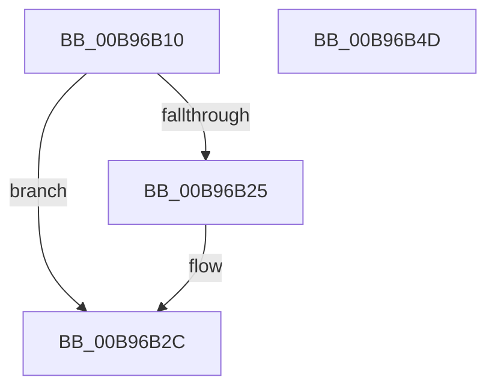

# VfGetDmaAlignment

- RVA: `0x00B96B10`–`0x00B96B4E` (길이 `62` bytes)
- VA: `0x0000000140B96B10`
- 실행 섹션: `PAGEVRFY`
- PDB 이름 있음: `예`; PDB Function 태그: `아니요`
- unwind 정보 RVA: `0x0005CF00`
- 디코드: `20`개 명령, `62/62` bytes 표시
- 미해석 바이트: `0` (있으면 어셈블리에 `.byte`로 보존)

> 이 문서는 커널 이미지의 기계어와 PDB 기호를 분석해 생성했습니다. 4번과 5번은 함수 원형과 자료형을 바이너리 사용 방식에서 추정한 C 해석이며 원본 소스 복구 결과는 아닙니다.

## 1. Dependencies

- 직접 호출 지점: **4**; 고유 호출 대상: **4**
- 직접 호출자로 확인된 함수: **0**
- RIP 상대 이미지 참조: **0**

### Outgoing calls
- `0x00B96B1B` → [ViGetAdapterInformationInternal](ViGetAdapterInformationInternal_function_00B98E88.md) (function, `0x00B98E88`)
- `0x00B96B27` → [VF_ASSERT_IRQL](VF_ASSERT_IRQL_function_00B94F30.md) (function, `0x00B94F30`)
- `0x00B96B2F` → [ViGetRealDmaAdapter](ViGetRealDmaAdapter_function_00B990DC.md) (function, `0x00B990DC`)
- `0x00B96B42` → [guard_dispatch_icall](../../text/6B/guard_dispatch_icall_function_006BAAD0.md) (function, `0x006BAAD0`)

### Direct callers
- 이 함수 시작 RVA로 연결되는 직접 call은 확인되지 않았습니다. 간접 호출은 완전히 역산할 수 없습니다.

### Static image references
- 디코드된 RIP-relative 메모리 참조가 없습니다.

## 2. Other-region calls and transfers

- 다른 실행 섹션으로 향하는 call: **1**
  - `0x00B96B42` → [guard_dispatch_icall](../../text/6B/guard_dispatch_icall_function_006BAAD0.md) (`PAGEVRFY` → `.text`)
- 별도 외부 분기/꼬리 이동을 확인하지 못했습니다.

## 3. Assembly (complete function range)

```asm
00B96B10  40 53                           push rbx
00B96B12  48 83 EC 20                     sub rsp, 0x20
00B96B16  B2 01                           mov dl, 1
00B96B18  48 8B D9                        mov rbx, rcx
00B96B1B  E8 68 23 00 00                  call 0x140b98e88
00B96B20  48 85 C0                        test rax, rax
00B96B23  74 07                           je 0x140b96b2c
00B96B25  33 C9                           xor ecx, ecx
00B96B27  E8 04 E4 FF FF                  call 0x140b94f30
00B96B2C  48 8B CB                        mov rcx, rbx
00B96B2F  E8 A8 25 00 00                  call 0x140b990dc
00B96B34  48 8B D0                        mov rdx, rax
00B96B37  48 8B 48 08                     mov rcx, qword ptr [rax + 8]
00B96B3B  48 8B 41 48                     mov rax, qword ptr [rcx + 0x48]
00B96B3F  48 8B CA                        mov rcx, rdx
00B96B42  E8 89 3F B2 FF                  call 0x1406baad0
00B96B47  48 83 C4 20                     add rsp, 0x20
00B96B4B  5B                              pop rbx
00B96B4C  C3                              ret
00B96B4D  CC                              int3
```

## 4. C-style interpretation (structured pseudocode)

```c
__int64 __fastcall VfGetDmaAlignment(__int64 a1)
{
    __int64 result;
    __int64 v_rsp;

    v_rsp = (v_rsp) - (32);
    result = ViGetAdapterInformationInternal(a1, 1, a3, a4);
    if (result != 0) {
        a1 = 0;
        result = VF_ASSERT_IRQL(a1, 1, a3, a4);
    }
    result = ViGetRealDmaAdapter(0, 1, a3, a4);
    result = guard_dispatch_icall(result, result, a3, a4);
    v_rsp = (v_rsp) + (32);
    return result;
}
```

## 5. (Beta) C Style

```c
int64_t VfGetDmaAlignment(int64_t Arg1)
{
    int64_t result;
    int64_t local_rsp;

    local_rsp = (local_rsp) - (32);
    result = ViGetAdapterInformationInternal(Arg1, 1, a3, a4);
    if (result != 0) {
        Arg1 = 0;
        result = VF_ASSERT_IRQL(Arg1, 1, a3, a4);
    }
    result = ViGetRealDmaAdapter(0, 1, a3, a4);
    result = guard_dispatch_icall(result, result, a3, a4);
    local_rsp = (local_rsp) + (32);
    return result;
}
```

## 6. Execution-region graph

[열기: 2D/3D 그래프와 함수 탐색 컨트롤 패널](../../../control-panel.html?section=pagevrfy&rva=0x00B96B10&view=graph)

- 2D 그래프는 위에서 아래로 흐르고, 3D 그래프는 빈 공간을 드래그해 회전합니다. Shift+드래그는 이동, 휠은 확대·축소, 함수 노드 선택은 대상 보고서 이동입니다.

### Static fallback


