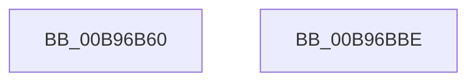

# VfGetDmaTransferInfo

- RVA: `0x00B96B60`–`0x00B96BBF` (길이 `95` bytes)
- VA: `0x0000000140B96B60`
- 실행 섹션: `PAGEVRFY`
- PDB 이름 있음: `예`; PDB Function 태그: `아니요`
- unwind 정보 RVA: `0x00086C28`
- 디코드: `26`개 명령, `95/95` bytes 표시
- 미해석 바이트: `0` (있으면 어셈블리에 `.byte`로 보존)

> 이 문서는 커널 이미지의 기계어와 PDB 기호를 분석해 생성했습니다. 4번과 5번은 함수 원형과 자료형을 바이너리 사용 방식에서 추정한 C 해석이며 원본 소스 복구 결과는 아닙니다.

## 1. Dependencies

- 직접 호출 지점: **2**; 고유 호출 대상: **2**
- 직접 호출자로 확인된 함수: **0**
- RIP 상대 이미지 참조: **0**

### Outgoing calls
- `0x00B96B78` → [ViGetRealDmaAdapter](ViGetRealDmaAdapter_function_00B990DC.md) (function, `0x00B990DC`)
- `0x00B96BA9` → [guard_dispatch_icall](../../text/6B/guard_dispatch_icall_function_006BAAD0.md) (function, `0x006BAAD0`)

### Direct callers
- 이 함수 시작 RVA로 연결되는 직접 call은 확인되지 않았습니다. 간접 호출은 완전히 역산할 수 없습니다.

### Static image references
- 디코드된 RIP-relative 메모리 참조가 없습니다.

## 2. Other-region calls and transfers

- 다른 실행 섹션으로 향하는 call: **1**
  - `0x00B96BA9` → [guard_dispatch_icall](../../text/6B/guard_dispatch_icall_function_006BAAD0.md) (`PAGEVRFY` → `.text`)
- 별도 외부 분기/꼬리 이동을 확인하지 못했습니다.

## 3. Assembly (complete function range)

```asm
00B96B60  48 89 5C 24 08                  mov qword ptr [rsp + 8], rbx
00B96B65  48 89 74 24 10                  mov qword ptr [rsp + 0x10], rsi
00B96B6A  57                              push rdi
00B96B6B  48 83 EC 40                     sub rsp, 0x40
00B96B6F  41 8B D9                        mov ebx, r9d
00B96B72  49 8B F8                        mov rdi, r8
00B96B75  48 8B F2                        mov rsi, rdx
00B96B78  E8 5F 25 00 00                  call 0x140b990dc
00B96B7D  4C 8B D0                        mov r10, rax
00B96B80  44 8B CB                        mov r9d, ebx
00B96B83  4C 8B C7                        mov r8, rdi
00B96B86  48 8B D6                        mov rdx, rsi
00B96B89  48 8B 48 08                     mov rcx, qword ptr [rax + 8]
00B96B8D  48 8B 81 88 00 00 00            mov rax, qword ptr [rcx + 0x88]
00B96B94  48 8B 4C 24 78                  mov rcx, qword ptr [rsp + 0x78]
00B96B99  48 89 4C 24 28                  mov qword ptr [rsp + 0x28], rcx
00B96B9E  8A 4C 24 70                     mov cl, byte ptr [rsp + 0x70]
00B96BA2  88 4C 24 20                     mov byte ptr [rsp + 0x20], cl
00B96BA6  49 8B CA                        mov rcx, r10
00B96BA9  E8 22 3F B2 FF                  call 0x1406baad0
00B96BAE  48 8B 5C 24 50                  mov rbx, qword ptr [rsp + 0x50]
00B96BB3  48 8B 74 24 58                  mov rsi, qword ptr [rsp + 0x58]
00B96BB8  48 83 C4 40                     add rsp, 0x40
00B96BBC  5F                              pop rdi
00B96BBD  C3                              ret
00B96BBE  CC                              int3
```

## 4. C-style interpretation (structured pseudocode)

```c
__int64 __fastcall VfGetDmaTransferInfo(__int64 a1, __int64 a2, __int64 a3, int a4, unsigned __int8 a5, __int64 a6)
{
    __int64 result;
    __int64 v_rsp;
    unsigned __int64 v_stack_m20;
    unsigned __int8 v_stack_m28;
    unsigned __int64 v_stack_p10;
    unsigned __int64 v_stack_p8;

    v_stack_p8 = v_rbx;
    v_stack_p10 = v_rsi;
    v_rsp = (v_rsp) - (64);
    result = ViGetRealDmaAdapter(a1, a2, a3, a4);
    v_stack_m20 = a6;
    v_stack_m28 = a5;
    result = guard_dispatch_icall(result, a2, a3, (unsigned int)((unsigned int)((unsigned int)(a4))));
    v_rsp = (v_rsp) + (64);
    return result;
}
```

## 5. (Beta) C Style

```c
int64_t VfGetDmaTransferInfo(int64_t Arg1, int64_t Arg2, int64_t Arg3, int32_t Arg4, uint8_t Arg5, int64_t Arg6)
{
    int64_t result;
    int64_t local_rsp;
    uint64_t v_stack_m20;
    uint8_t v_stack_m28;
    uint64_t v_stack_p10;
    uint64_t v_stack_p8;

    v_stack_p8 = local_rbx;
    v_stack_p10 = local_rsi;
    local_rsp = (local_rsp) - (64);
    result = ViGetRealDmaAdapter(Arg1, Arg2, Arg3, Arg4);
    v_stack_m20 = Arg6;
    v_stack_m28 = Arg5;
    result = guard_dispatch_icall(result, Arg2, Arg3, (uint32_t)((uint32_t)((uint32_t)(Arg4))));
    local_rsp = (local_rsp) + (64);
    return result;
}
```

## 6. Execution-region graph

[열기: 2D/3D 그래프와 함수 탐색 컨트롤 패널](../../../control-panel.html?section=pagevrfy&rva=0x00B96B60&view=graph)

- 2D 그래프는 위에서 아래로 흐르고, 3D 그래프는 빈 공간을 드래그해 회전합니다. Shift+드래그는 이동, 휠은 확대·축소, 함수 노드 선택은 대상 보고서 이동입니다.

### Static fallback


