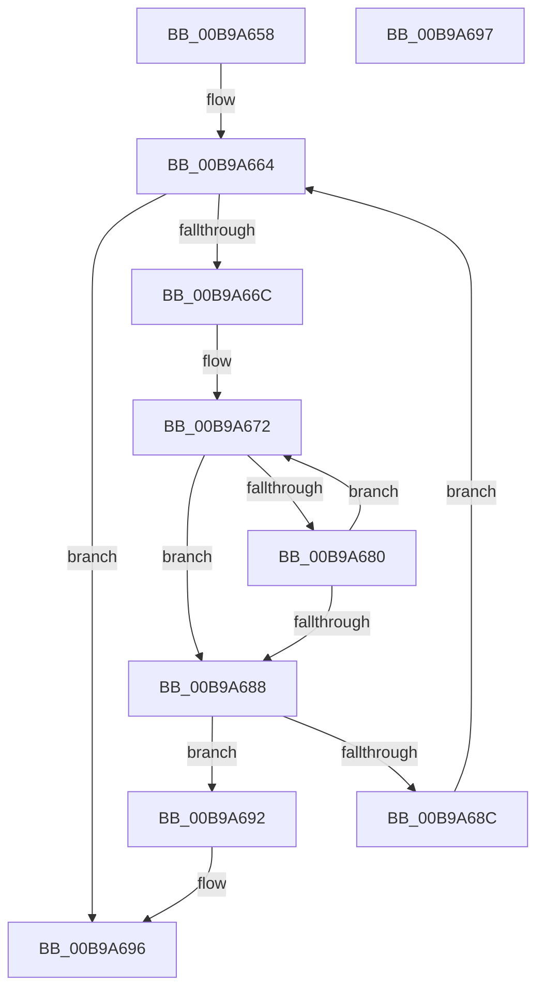

# VfGetHookAddressForOriginal

- RVA: `0x00B9A658`–`0x00B9A698` (길이 `64` bytes)
- VA: `0x0000000140B9A658`
- 실행 섹션: `PAGEVRFY`
- PDB 이름 있음: `예`; PDB Function 태그: `아니요`
- unwind 정보 RVA: `0x000DB714`
- 디코드: `22`개 명령, `64/64` bytes 표시
- 미해석 바이트: `0` (있으면 어셈블리에 `.byte`로 보존)

> 이 문서는 커널 이미지의 기계어와 PDB 기호를 분석해 생성했습니다. 4번과 5번은 함수 원형과 자료형을 바이너리 사용 방식에서 추정한 C 해석이며 원본 소스 복구 결과는 아닙니다.

## 1. Dependencies

- 직접 호출 지점: **0**; 고유 호출 대상: **0**
- 직접 호출자로 확인된 함수: **1**
- RIP 상대 이미지 참조: **1**

### Outgoing calls
- 직접 디코드된 call 명령이 없습니다.

### Direct callers
- [KsepPatchDriverImportsTable](../../page/74/KsepPatchDriverImportsTable_function_00749F64.md) at `0x0074A06B`

### Static image references
- `0x00B9A65B` → RVA `0x00FF51B0` (`PAGEVRFD`; read)

## 2. Other-region calls and transfers

- 다른 실행 섹션으로 향하는 call: **0**
- 별도 외부 분기/꼬리 이동을 확인하지 못했습니다.

## 3. Assembly (complete function range)

```asm
00B9A658  4C 8B D9                        mov r11, rcx
00B9A65B  48 8D 15 4E AB 45 00            lea rdx, [rip + 0x45ab4e]
00B9A662  33 C0                           xor eax, eax
00B9A664  4C 8B 02                        mov r8, qword ptr [rdx]
00B9A667  4D 85 C0                        test r8, r8
00B9A66A  74 2A                           je 0x140b9a696
00B9A66C  4D 8B D3                        mov r10, r11
00B9A66F  4D 2B D0                        sub r10, r8
00B9A672  41 0F B6 08                     movzx ecx, byte ptr [r8]
00B9A676  47 0F B6 0C 10                  movzx r9d, byte ptr [r8 + r10]
00B9A67B  41 2B C9                        sub ecx, r9d
00B9A67E  75 08                           jne 0x140b9a688
00B9A680  49 FF C0                        inc r8
00B9A683  45 85 C9                        test r9d, r9d
00B9A686  75 EA                           jne 0x140b9a672
00B9A688  85 C9                           test ecx, ecx
00B9A68A  74 06                           je 0x140b9a692
00B9A68C  48 83 C2 38                     add rdx, 0x38
00B9A690  EB D2                           jmp 0x140b9a664
00B9A692  48 8B 42 08                     mov rax, qword ptr [rdx + 8]
00B9A696  C3                              ret
00B9A697  CC                              int3
```

## 4. C-style interpretation (structured pseudocode)

```c
__int64 __fastcall VfGetHookAddressForOriginal(__int64 a1)
{
    __int64 result;
    __int64 v_r10;

    result = 0;
loc_00B9A664:
    if (*(unsigned __int64 *)(v_rip + 4565838) == 0) goto loc_00B9A696;
    v_r10 = (a1) - (*(unsigned __int64 *)(v_rip + 4565838));
loc_00B9A672:
    a1 = (unsigned int)((*(unsigned __int8 *)(*(unsigned __int64 *)(v_rip + 4565838))) - ((unsigned int)(*(unsigned __int8 *)(*(unsigned __int64 *)(v_rip + 4565838) + v_r10 * 1))));
    if (condition_is_not_equal) goto loc_00B9A688;
    a3 = (*(unsigned __int64 *)(v_rip + 4565838)) + 1;
    if ((unsigned int)(*(unsigned __int8 *)(*(unsigned __int64 *)(v_rip + 4565838) + v_r10 * 1)) != 0) goto loc_00B9A672;
loc_00B9A688:
    if ((unsigned int)(a1) == 0) goto loc_00B9A692;
    a2 = (v_rip + 4565838) + (56);
    goto loc_00B9A664;
loc_00B9A692:
loc_00B9A696:
    return *(unsigned __int64 *)(a2 + 8);
}
```

## 5. (Beta) C Style

```c
int64_t VfGetHookAddressForOriginal(int64_t Arg1)
{
    int64_t result;
    int64_t local_r10;

    result = 0;
loc_00B9A664:
    if (*(uint64_t *)(v_rip + 0x45AB4E) == 0) goto loc_00B9A696;
    local_r10 = (Arg1) - (*(uint64_t *)(v_rip + 0x45AB4E));
loc_00B9A672:
    Arg1 = (uint32_t)((*(uint8_t *)(*(uint64_t *)(v_rip + 0x45AB4E))) - ((uint32_t)(*(uint8_t *)(*(uint64_t *)(v_rip + 0x45AB4E) + local_r10 * 1))));
    if (condition_is_not_equal) goto loc_00B9A688;
    a3 = (*(uint64_t *)(v_rip + 0x45AB4E)) + 1;
    if ((uint32_t)(*(uint8_t *)(*(uint64_t *)(v_rip + 0x45AB4E) + local_r10 * 1)) != 0) goto loc_00B9A672;
loc_00B9A688:
    if ((uint32_t)(Arg1) == 0) goto loc_00B9A692;
    a2 = (v_rip + 4565838) + (56);
    goto loc_00B9A664;
loc_00B9A692:
loc_00B9A696:
    return *(uint64_t *)(a2 + 0x8);
}
```

## 6. Execution-region graph

[열기: 2D/3D 그래프와 함수 탐색 컨트롤 패널](../../../control-panel.html?section=pagevrfy&rva=0x00B9A658&view=graph)

- 2D 그래프는 위에서 아래로 흐르고, 3D 그래프는 빈 공간을 드래그해 회전합니다. Shift+드래그는 이동, 휠은 확대·축소, 함수 노드 선택은 대상 보고서 이동입니다.

### Static fallback


