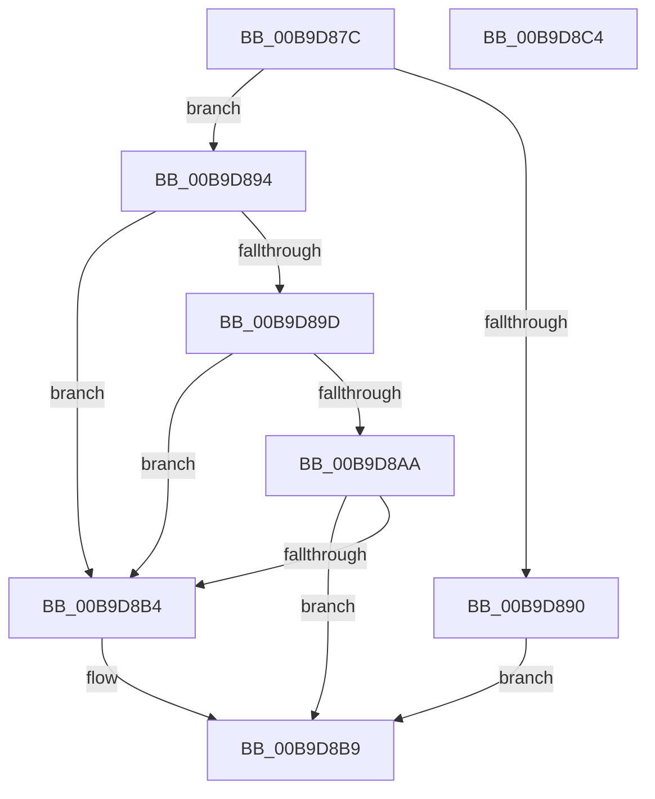

# VfGetPristineDispatchRoutine

- RVA: `0x00B9D87C`–`0x00B9D8C5` (길이 `73` bytes)
- VA: `0x0000000140B9D87C`
- 실행 섹션: `PAGEVRFY`
- PDB 이름 있음: `예`; PDB Function 태그: `아니요`
- unwind 정보 RVA: `0x0005CAAC`
- 디코드: `25`개 명령, `73/73` bytes 표시
- 미해석 바이트: `0` (있으면 어셈블리에 `.byte`로 보존)

> 이 문서는 커널 이미지의 기계어와 PDB 기호를 분석해 생성했습니다. 4번과 5번은 함수 원형과 자료형을 바이너리 사용 방식에서 추정한 C 해석이며 원본 소스 복구 결과는 아닙니다.

## 1. Dependencies

- 직접 호출 지점: **1**; 고유 호출 대상: **1**
- 직접 호출자로 확인된 함수: **2**
- RIP 상대 이미지 참조: **0**

### Outgoing calls
- `0x00B9D894` → [MmIsDriverVerifying](../../text/4A/MmIsDriverVerifying_function_004A8770.md) (function, `0x004A8770`)

### Direct callers
- [IovpCallDriver1](IovpCallDriver1_function_00B9CCA4.md) at `0x00B9CFDB`
- [VfBeforeCallDriver](VfBeforeCallDriver_function_00B9DC58.md) at `0x00B9DD0E`

### Static image references
- 디코드된 RIP-relative 메모리 참조가 없습니다.

## 2. Other-region calls and transfers

- 다른 실행 섹션으로 향하는 call: **1**
  - `0x00B9D894` → [MmIsDriverVerifying](../../text/4A/MmIsDriverVerifying_function_004A8770.md) (`PAGEVRFY` → `.text`)
- 별도 외부 분기/꼬리 이동을 확인하지 못했습니다.

## 3. Assembly (complete function range)

```asm
00B9D87C  48 89 5C 24 08                  mov qword ptr [rsp + 8], rbx
00B9D881  57                              push rdi
00B9D882  48 83 EC 20                     sub rsp, 0x20
00B9D886  8B DA                           mov ebx, edx
00B9D888  48 8B F9                        mov rdi, rcx
00B9D88B  83 FA 1B                        cmp edx, 0x1b
00B9D88E  76 04                           jbe 0x140b9d894
00B9D890  33 C0                           xor eax, eax
00B9D892  EB 25                           jmp 0x140b9d8b9
00B9D894  E8 D7 AE 90 FF                  call 0x1404a8770
00B9D899  85 C0                           test eax, eax
00B9D89B  74 17                           je 0x140b9d8b4
00B9D89D  48 8B 47 30                     mov rax, qword ptr [rdi + 0x30]
00B9D8A1  48 8B 48 40                     mov rcx, qword ptr [rax + 0x40]
00B9D8A5  48 85 C9                        test rcx, rcx
00B9D8A8  74 0A                           je 0x140b9d8b4
00B9D8AA  48 8B 44 D9 20                  mov rax, qword ptr [rcx + rbx*8 + 0x20]
00B9D8AF  48 85 C0                        test rax, rax
00B9D8B2  75 05                           jne 0x140b9d8b9
00B9D8B4  48 8B 44 DF 70                  mov rax, qword ptr [rdi + rbx*8 + 0x70]
00B9D8B9  48 8B 5C 24 30                  mov rbx, qword ptr [rsp + 0x30]
00B9D8BE  48 83 C4 20                     add rsp, 0x20
00B9D8C2  5F                              pop rdi
00B9D8C3  C3                              ret
00B9D8C4  CC                              int3
```

## 4. C-style interpretation (structured pseudocode)

```c
__int64 __fastcall VfGetPristineDispatchRoutine(__int64 a1, int a2)
{
    __int64 result;
    __int64 v_rsp;
    unsigned __int64 v_stack_p8;

    v_stack_p8 = v_rbx;
    v_rsp = (v_rsp) - (32);
    if (a2 <= 27) goto loc_00B9D894;
    result = 0;
    goto loc_00B9D8B9;
loc_00B9D894:
    result = MmIsDriverVerifying(a1, a2, a3, a4);
    if ((unsigned int)(result) == 0) goto loc_00B9D8B4;
    if (*(unsigned __int64 *)(*(unsigned __int64 *)(a1 + 48) + 64) == 0) goto loc_00B9D8B4;
    result = *(unsigned __int64 *)(*(unsigned __int64 *)(*(unsigned __int64 *)(a1 + 48) + 64) + (unsigned int)(a2) * 8 + 32);
    if (*(unsigned __int64 *)(*(unsigned __int64 *)(*(unsigned __int64 *)(a1 + 48) + 64) + (unsigned int)(a2) * 8 + 32) == 0) {
        result = *(unsigned __int64 *)(a1 + (unsigned int)(a2) * 8 + 112);
    }
    v_rsp = (v_rsp) + (32);
    return result;
}
```

## 5. (Beta) C Style

```c
int64_t VfGetPristineDispatchRoutine(void *Arg1, int32_t Arg2)
{
    uint8_t *arg1 = (uint8_t *)Arg1;

    int64_t result;
    int64_t local_rsp;
    uint64_t v_stack_p8;

    v_stack_p8 = local_rbx;
    local_rsp = (local_rsp) - (32);
    if (Arg2 <= 27) goto loc_00B9D894;
    result = 0;
    goto loc_00B9D8B9;
loc_00B9D894:
    result = MmIsDriverVerifying(Arg1, Arg2, a3, a4);
    if ((uint32_t)(result) == 0) goto loc_00B9D8B4;
    if (*(uint64_t *)(*(uint64_t *)(arg1 + 0x30) + 0x40) == 0) goto loc_00B9D8B4;
    result = *(uint64_t *)(*(uint64_t *)(*(uint64_t *)(arg1 + 0x30) + 0x40) + (uint32_t)(Arg2) * 8 + 0x20);
    if (*(uint64_t *)(*(uint64_t *)(*(uint64_t *)(arg1 + 0x30) + 0x40) + (uint32_t)(Arg2) * 8 + 0x20) == 0) {
        result = *(uint64_t *)(arg1 + (uint32_t)(Arg2) * 8 + 0x70);
    }
    local_rsp = (local_rsp) + (32);
    return result;
}
```

### 관측된 메모리 오프셋

구조체 형식이 확인되지 않은 접근은 인자 기준의 오프셋으로만 기록했습니다.

| 기준 인자 | 오프셋 표현 | 폭 (bit) | 접근 |
|---|---:|---:|---|
| `Arg1` | `+ 0x30` | `64` | `R` |
| `Arg1` | `+ 0x70 + rbx*8` | `64` | `R` |

## 6. Execution-region graph

[열기: 2D/3D 그래프와 함수 탐색 컨트롤 패널](../../../control-panel.html?section=pagevrfy&rva=0x00B9D87C&view=graph)

- 2D 그래프는 위에서 아래로 흐르고, 3D 그래프는 빈 공간을 드래그해 회전합니다. Shift+드래그는 이동, 휠은 확대·축소, 함수 노드 선택은 대상 보고서 이동입니다.

### Static fallback


