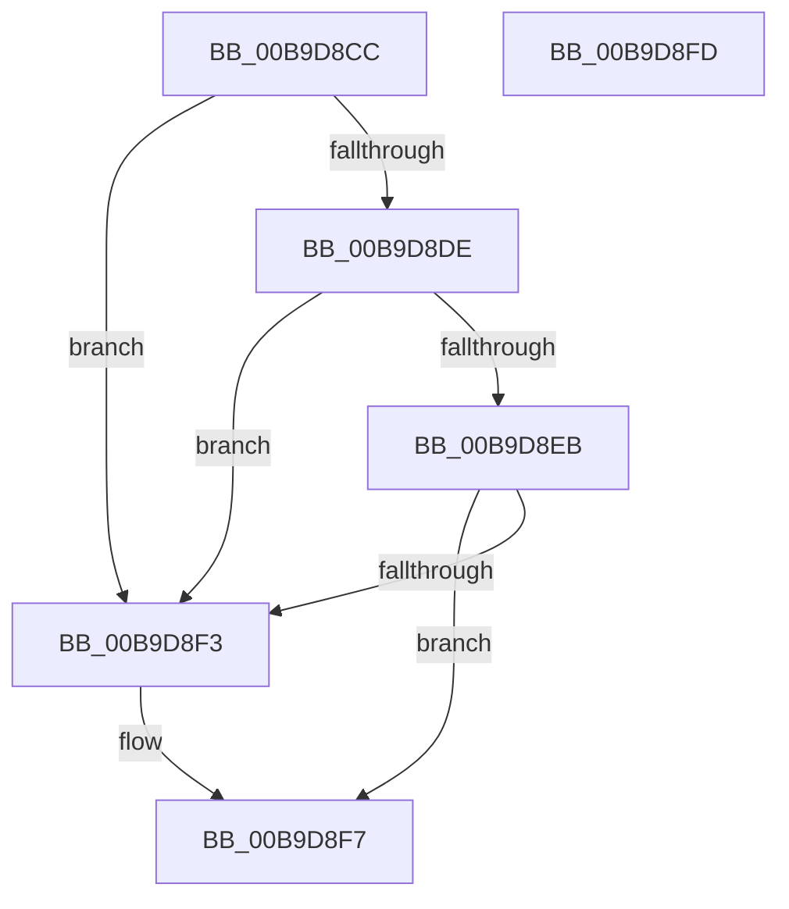

# VfGetPristineDriverInit

- RVA: `0x00B9D8CC`–`0x00B9D8FE` (길이 `50` bytes)
- VA: `0x0000000140B9D8CC`
- 실행 섹션: `PAGEVRFY`
- PDB 이름 있음: `예`; PDB Function 태그: `아니요`
- unwind 정보 RVA: `0x0005CF00`
- 디코드: `18`개 명령, `50/50` bytes 표시
- 미해석 바이트: `0` (있으면 어셈블리에 `.byte`로 보존)

> 이 문서는 커널 이미지의 기계어와 PDB 기호를 분석해 생성했습니다. 4번과 5번은 함수 원형과 자료형을 바이너리 사용 방식에서 추정한 C 해석이며 원본 소스 복구 결과는 아닙니다.

## 1. Dependencies

- 직접 호출 지점: **1**; 고유 호출 대상: **1**
- 직접 호출자로 확인된 함수: **3**
- RIP 상대 이미지 참조: **0**

### Outgoing calls
- `0x00B9D8D5` → [MmIsDriverVerifying](../../text/4A/MmIsDriverVerifying_function_004A8770.md) (function, `0x004A8770`)

### Direct callers
- [VfPnpVerifyIrpStackDownward](../BB/VfPnpVerifyIrpStackDownward_function_00BB5750.md) at `0x00BB57DD`
- [VfPowerVerifyIrpStackDownward](../BB/VfPowerVerifyIrpStackDownward_function_00BB5F50.md) at `0x00BB5FB6`
- [VfWmiVerifyIrpStackDownward](../BB/VfWmiVerifyIrpStackDownward_function_00BB6180.md) at `0x00BB61CD`

### Static image references
- 디코드된 RIP-relative 메모리 참조가 없습니다.

## 2. Other-region calls and transfers

- 다른 실행 섹션으로 향하는 call: **1**
  - `0x00B9D8D5` → [MmIsDriverVerifying](../../text/4A/MmIsDriverVerifying_function_004A8770.md) (`PAGEVRFY` → `.text`)
- 별도 외부 분기/꼬리 이동을 확인하지 못했습니다.

## 3. Assembly (complete function range)

```asm
00B9D8CC  40 53                           push rbx
00B9D8CE  48 83 EC 20                     sub rsp, 0x20
00B9D8D2  48 8B D9                        mov rbx, rcx
00B9D8D5  E8 96 AE 90 FF                  call 0x1404a8770
00B9D8DA  85 C0                           test eax, eax
00B9D8DC  74 15                           je 0x140b9d8f3
00B9D8DE  48 8B 43 30                     mov rax, qword ptr [rbx + 0x30]
00B9D8E2  48 8B 40 40                     mov rax, qword ptr [rax + 0x40]
00B9D8E6  48 85 C0                        test rax, rax
00B9D8E9  74 08                           je 0x140b9d8f3
00B9D8EB  48 8B 00                        mov rax, qword ptr [rax]
00B9D8EE  48 85 C0                        test rax, rax
00B9D8F1  75 04                           jne 0x140b9d8f7
00B9D8F3  48 8B 43 58                     mov rax, qword ptr [rbx + 0x58]
00B9D8F7  48 83 C4 20                     add rsp, 0x20
00B9D8FB  5B                              pop rbx
00B9D8FC  C3                              ret
00B9D8FD  CC                              int3
```

## 4. C-style interpretation (structured pseudocode)

```c
__int64 __fastcall VfGetPristineDriverInit(__int64 a1)
{
    __int64 result;
    __int64 v_rsp;

    v_rsp = (v_rsp) - (32);
    result = MmIsDriverVerifying(a1, a2, a3, a4);
    if ((unsigned int)(result) == 0) goto loc_00B9D8F3;
    if (*(unsigned __int64 *)(*(unsigned __int64 *)(a1 + 48) + 64) == 0) goto loc_00B9D8F3;
    result = *(unsigned __int64 *)(*(unsigned __int64 *)(*(unsigned __int64 *)(a1 + 48) + 64));
    if (*(unsigned __int64 *)(*(unsigned __int64 *)(*(unsigned __int64 *)(a1 + 48) + 64)) == 0) {
        result = *(unsigned __int64 *)(a1 + 88);
    }
    v_rsp = (v_rsp) + (32);
    return result;
}
```

## 5. (Beta) C Style

```c
int64_t VfGetPristineDriverInit(void *Arg1)
{
    uint8_t *arg1 = (uint8_t *)Arg1;

    int64_t result;
    int64_t local_rsp;

    local_rsp = (local_rsp) - (32);
    result = MmIsDriverVerifying(Arg1, a2, a3, a4);
    if ((uint32_t)(result) == 0) goto loc_00B9D8F3;
    if (*(uint64_t *)(*(uint64_t *)(arg1 + 0x30) + 0x40) == 0) goto loc_00B9D8F3;
    result = *(uint64_t *)(*(uint64_t *)(*(uint64_t *)(arg1 + 0x30) + 0x40));
    if (*(uint64_t *)(*(uint64_t *)(*(uint64_t *)(arg1 + 0x30) + 0x40)) == 0) {
        result = *(uint64_t *)(arg1 + 0x58);
    }
    local_rsp = (local_rsp) + (32);
    return result;
}
```

### 관측된 메모리 오프셋

구조체 형식이 확인되지 않은 접근은 인자 기준의 오프셋으로만 기록했습니다.

| 기준 인자 | 오프셋 표현 | 폭 (bit) | 접근 |
|---|---:|---:|---|
| `Arg1` | `+ 0x30` | `64` | `R` |
| `Arg1` | `+ 0x58` | `64` | `R` |

## 6. Execution-region graph

[열기: 2D/3D 그래프와 함수 탐색 컨트롤 패널](../../../control-panel.html?section=pagevrfy&rva=0x00B9D8CC&view=graph)

- 2D 그래프는 위에서 아래로 흐르고, 3D 그래프는 빈 공간을 드래그해 회전합니다. Shift+드래그는 이동, 휠은 확대·축소, 함수 노드 선택은 대상 보고서 이동입니다.

### Static fallback


