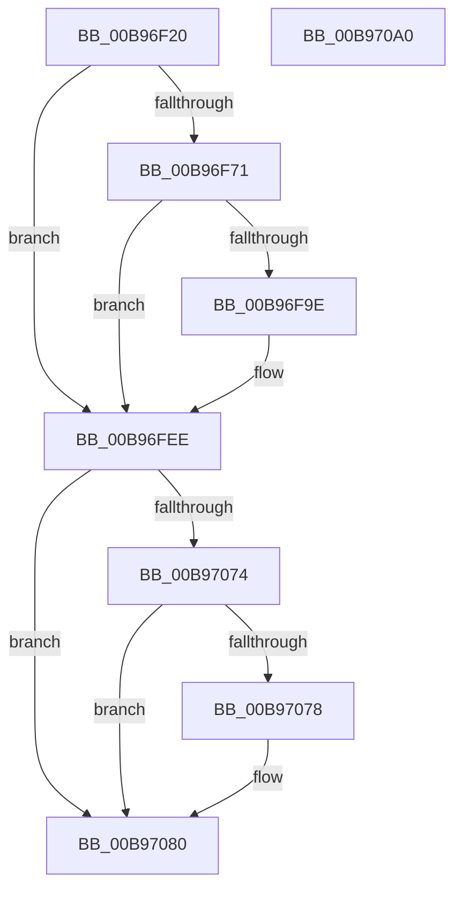

# VfGetScatterGatherListEx

- RVA: `0x00B96F20`–`0x00B970A1` (길이 `385` bytes)
- VA: `0x0000000140B96F20`
- 실행 섹션: `PAGEVRFY`
- PDB 이름 있음: `예`; PDB Function 태그: `아니요`
- unwind 정보 RVA: `0x000C4294`
- 디코드: `94`개 명령, `385/385` bytes 표시
- 미해석 바이트: `0` (있으면 어셈블리에 `.byte`로 보존)

> 이 문서는 커널 이미지의 기계어와 PDB 기호를 분석해 생성했습니다. 4번과 5번은 함수 원형과 자료형을 바이너리 사용 방식에서 추정한 C 해석이며 원본 소스 복구 결과는 아닙니다.

## 1. Dependencies

- 직접 호출 지점: **9**; 고유 호출 대상: **9**
- 직접 호출자로 확인된 함수: **0**
- RIP 상대 이미지 참조: **2**

### Outgoing calls
- `0x00B96F48` → [ViGetRealDmaAdapter](ViGetRealDmaAdapter_function_00B990DC.md) (function, `0x00B990DC`)
- `0x00B96F55` → [ViGetAdapterInformationInternal](ViGetAdapterInformationInternal_function_00B98E88.md) (function, `0x00B98E88`)
- `0x00B96F71` → [VF_ASSERT_MAX_IRQL](VF_ASSERT_MAX_IRQL_function_00B94FB0.md) (function, `0x00B94FB0`)
- `0x00B96F87` → [VERIFY_BUFFER_LOCKED](VERIFY_BUFFER_LOCKED_function_00B94EA4.md) (function, `0x00B94EA4`)
- `0x00B96F95` → [ViCheckMdlLength](ViCheckMdlLength_function_00B9841C.md) (function, `0x00B9841C`)
- `0x00B96FC3` → [ViHalPreprocessOptions](ViHalPreprocessOptions_function_00B9920C.md) (function, `0x00B9920C`)
- `0x00B96FE9` → [VfReportIssueWithOptions](../../text/61/VfReportIssueWithOptions_function_00614444.md) (function, `0x00614444`)
- `0x00B97068` → [guard_dispatch_icall](../../text/6B/guard_dispatch_icall_function_006BAAD0.md) (function, `0x006BAAD0`)
- `0x00B9707B` → [DECREMENT_SCATTER_GATHER_LISTS](DECREMENT_SCATTER_GATHER_LISTS_function_00B94C44.md) (function, `0x00B94C44`)

### Direct callers
- 이 함수 시작 RVA로 연결되는 직접 call은 확인되지 않았습니다. 간접 호출은 완전히 역산할 수 없습니다.

### Static image references
- `0x00B96FA4` → RVA `0x00BB9C20` (` ?? ::JKADOLAD::`string'`; read)
- `0x00B96FB1` → RVA `0x00E0E964` (`.data`; read)

## 2. Other-region calls and transfers

- 다른 실행 섹션으로 향하는 call: **2**
  - `0x00B96FE9` → [VfReportIssueWithOptions](../../text/61/VfReportIssueWithOptions_function_00614444.md) (`PAGEVRFY` → `.text`)
  - `0x00B97068` → [guard_dispatch_icall](../../text/6B/guard_dispatch_icall_function_006BAAD0.md) (`PAGEVRFY` → `.text`)
- 별도 외부 분기/꼬리 이동을 확인하지 못했습니다.

## 3. Assembly (complete function range)

```asm
00B96F20  48 89 5C 24 08                  mov qword ptr [rsp + 8], rbx
00B96F25  48 89 6C 24 10                  mov qword ptr [rsp + 0x10], rbp
00B96F2A  48 89 74 24 18                  mov qword ptr [rsp + 0x18], rsi
00B96F2F  57                              push rdi
00B96F30  41 54                           push r12
00B96F32  41 55                           push r13
00B96F34  41 56                           push r14
00B96F36  41 57                           push r15
00B96F38  48 83 EC 70                     sub rsp, 0x70
00B96F3C  49 8B F1                        mov rsi, r9
00B96F3F  4D 8B E0                        mov r12, r8
00B96F42  4C 8B EA                        mov r13, rdx
00B96F45  48 8B D9                        mov rbx, rcx
00B96F48  E8 8F 21 00 00                  call 0x140b990dc
00B96F4D  B2 01                           mov dl, 1
00B96F4F  48 8B CB                        mov rcx, rbx
00B96F52  4C 8B F8                        mov r15, rax
00B96F55  E8 2E 1F 00 00                  call 0x140b98e88
00B96F5A  8B AC 24 C8 00 00 00            mov ebp, dword ptr [rsp + 0xc8]
00B96F61  48 8B F8                        mov rdi, rax
00B96F64  4C 8B B4 24 C0 00 00 00         mov r14, qword ptr [rsp + 0xc0]
00B96F6C  48 85 C0                        test rax, rax
00B96F6F  74 7D                           je 0x140b96fee
00B96F71  E8 3A E0 FF FF                  call 0x140b94fb0
00B96F76  F0 FF 87 C4 00 00 00            lock inc dword ptr [rdi + 0xc4]
00B96F7D  F0 FF 87 C8 00 00 00            lock inc dword ptr [rdi + 0xc8]
00B96F84  48 8B CE                        mov rcx, rsi
00B96F87  E8 18 DF FF FF                  call 0x140b94ea4
00B96F8C  44 8B C5                        mov r8d, ebp
00B96F8F  49 8B D6                        mov rdx, r14
00B96F92  48 8B CE                        mov rcx, rsi
00B96F95  E8 82 14 00 00                  call 0x140b9841c
00B96F9A  85 C0                           test eax, eax
00B96F9C  74 50                           je 0x140b96fee
00B96F9E  48 83 64 24 28 00               and qword ptr [rsp + 0x28], 0
00B96FA4  48 8D 15 75 2C 02 00            lea rdx, [rip + 0x22c75]
00B96FAB  48 83 64 24 20 00               and qword ptr [rsp + 0x20], 0
00B96FB1  48 8D 0D AC 79 27 00            lea rcx, [rip + 0x2779ac]
00B96FB8  44 8B C8                        mov r9d, eax
00B96FBB  41 B8 24 00 00 00               mov r8d, 0x24
00B96FC1  8B D8                           mov ebx, eax
00B96FC3  E8 44 22 00 00                  call 0x140b9920c
00B96FC8  45 33 C9                        xor r9d, r9d
00B96FCB  48 8D 05 92 79 27 00            lea rax, [rip + 0x277992]
00B96FD2  48 89 44 24 28                  mov qword ptr [rsp + 0x28], rax
00B96FD7  44 8B C3                        mov r8d, ebx
00B96FDA  48 83 64 24 20 00               and qword ptr [rsp + 0x20], 0
00B96FE0  B9 E6 00 00 00                  mov ecx, 0xe6
00B96FE5  41 8D 51 24                     lea edx, [r9 + 0x24]
00B96FE9  E8 56 D4 A7 FF                  call 0x140614444
00B96FEE  49 8B 47 08                     mov rax, qword ptr [r15 + 8]
00B96FF2  4C 8B CE                        mov r9, rsi
00B96FF5  8A 8C 24 E8 00 00 00            mov cl, byte ptr [rsp + 0xe8]
00B96FFC  4D 8B C4                        mov r8, r12
00B96FFF  49 8B D5                        mov rdx, r13
00B97002  4C 8B 90 C0 00 00 00            mov r10, qword ptr [rax + 0xc0]
00B97009  48 8B 84 24 00 01 00 00         mov rax, qword ptr [rsp + 0x100]
00B97011  48 89 44 24 60                  mov qword ptr [rsp + 0x60], rax
00B97016  48 8B 84 24 F8 00 00 00         mov rax, qword ptr [rsp + 0xf8]
00B9701E  48 89 44 24 58                  mov qword ptr [rsp + 0x58], rax
00B97023  48 8B 84 24 F0 00 00 00         mov rax, qword ptr [rsp + 0xf0]
00B9702B  48 89 44 24 50                  mov qword ptr [rsp + 0x50], rax
00B97030  49 8B C2                        mov rax, r10
00B97033  88 4C 24 48                     mov byte ptr [rsp + 0x48], cl
00B97037  48 8B 8C 24 E0 00 00 00         mov rcx, qword ptr [rsp + 0xe0]
00B9703F  48 89 4C 24 40                  mov qword ptr [rsp + 0x40], rcx
00B97044  48 8B 8C 24 D8 00 00 00         mov rcx, qword ptr [rsp + 0xd8]
00B9704C  48 89 4C 24 38                  mov qword ptr [rsp + 0x38], rcx
00B97051  8B 8C 24 D0 00 00 00            mov ecx, dword ptr [rsp + 0xd0]
00B97058  89 4C 24 30                     mov dword ptr [rsp + 0x30], ecx
00B9705C  49 8B CF                        mov rcx, r15
00B9705F  89 6C 24 28                     mov dword ptr [rsp + 0x28], ebp
00B97063  4C 89 74 24 20                  mov qword ptr [rsp + 0x20], r14
00B97068  E8 63 3A B2 FF                  call 0x1406baad0
00B9706D  8B D8                           mov ebx, eax
00B9706F  48 85 FF                        test rdi, rdi
00B97072  74 0C                           je 0x140b97080
00B97074  85 C0                           test eax, eax
00B97076  79 08                           jns 0x140b97080
00B97078  48 8B CF                        mov rcx, rdi
00B9707B  E8 C4 DB FF FF                  call 0x140b94c44
00B97080  4C 8D 5C 24 70                  lea r11, [rsp + 0x70]
00B97085  8B C3                           mov eax, ebx
00B97087  49 8B 5B 30                     mov rbx, qword ptr [r11 + 0x30]
00B9708B  49 8B 6B 38                     mov rbp, qword ptr [r11 + 0x38]
00B9708F  49 8B 73 40                     mov rsi, qword ptr [r11 + 0x40]
00B97093  49 8B E3                        mov rsp, r11
00B97096  41 5F                           pop r15
00B97098  41 5E                           pop r14
00B9709A  41 5D                           pop r13
00B9709C  41 5C                           pop r12
00B9709E  5F                              pop rdi
00B9709F  C3                              ret
00B970A0  CC                              int3
```

## 4. C-style interpretation (structured pseudocode)

```c
__int64 __fastcall VfGetScatterGatherListEx(__int64 a1, __int64 a2, __int64 a3, __int64 a4, __int64 a5, unsigned int a6, unsigned int a7, __int64 a8, __int64 a9, unsigned __int8 a10, __int64 a11, __int64 a12, __int64 a13)
{
    __int64 result;
    __int64 v_rbx;
    __int64 v_rsp;
    unsigned __int64 v_stack_m28;
    unsigned __int64 v_stack_m38;
    unsigned __int64 v_stack_m40;
    unsigned __int64 v_stack_m48;
    unsigned __int8 v_stack_m50;
    unsigned __int64 v_stack_m58;
    unsigned __int64 v_stack_m60;
    unsigned int v_stack_m68;
    unsigned __int64 v_stack_m70;
    unsigned __int64 v_stack_m78;
    unsigned __int64 v_stack_p10;
    unsigned __int64 v_stack_p18;
    unsigned __int64 v_stack_p8;

    v_stack_p8 = v_rbx;
    v_stack_p10 = v_rbp;
    v_stack_p18 = v_rsi;
    v_rsp = (v_rsp) - (112);
    result = ViGetRealDmaAdapter(a1, a2, a3, a4);
    result = ViGetAdapterInformationInternal(a1, 1, a3, a4);
    if (result == 0) goto loc_00B96FEE;
    result = VF_ASSERT_MAX_IRQL(a1, 1, a3, a4);
    result = VERIFY_BUFFER_LOCKED(a4, 1, a3, a4);
    result = ViCheckMdlLength(a4, a5, (unsigned int)((unsigned int)((unsigned int)(a6))), a4);
    v_rbx = a1;
    if ((unsigned int)(result) != 0) {
        a2 = v_rip + 142453;
        a1 = v_rip + 2587052;
        a4 = (unsigned int)(result);
        a3 = 36;
        v_rbx = (unsigned int)(result);
        result = ViHalPreprocessOptions(a1, a2, a3, a4);
        a4 = 0;
        result = v_rip + 2587026;
        v_stack_m70 = result;
        a3 = (unsigned int)(v_rbx);
        a1 = 230;
        a2 = a4 + 36;
        result = VfReportIssueWithOptions(a1, a2, a3, a4);
    }
    v_stack_m38 = a13;
    v_stack_m40 = a12;
    v_stack_m48 = a11;
    v_stack_m50 = a10;
    v_stack_m58 = a9;
    v_stack_m60 = a8;
    v_stack_m68 = (unsigned int)((unsigned int)(a7));
    v_stack_m70 = (unsigned int)((unsigned int)(a6));
    v_stack_m78 = a5;
    result = guard_dispatch_icall(result, a2, a3, 0);
    if (result == 0) goto loc_00B97080;
    if (sign_flag) {
        a1 = result;
        result = DECREMENT_SCATTER_GATHER_LISTS(a1, a2, a3, 0);
    }
    return (unsigned int)((unsigned int)((unsigned int)((unsigned int)(result))));
}
```

## 5. (Beta) C Style

```c
int64_t VfGetScatterGatherListEx(int64_t Arg1, int64_t Arg2, int64_t Arg3, int64_t Arg4, int64_t Arg5, uint32_t Arg6, uint32_t Arg7, int64_t Arg8, int64_t Arg9, uint8_t Arg10, int64_t Arg11, int64_t Arg12, int64_t Arg13)
{
    int64_t result;
    int64_t local_rbx;
    int64_t local_rsp;
    uint64_t v_stack_m28;
    uint64_t v_stack_m38;
    uint64_t v_stack_m40;
    uint64_t v_stack_m48;
    uint8_t v_stack_m50;
    uint64_t v_stack_m58;
    uint64_t v_stack_m60;
    uint32_t v_stack_m68;
    uint64_t v_stack_m70;
    uint64_t v_stack_m78;
    uint64_t v_stack_p10;
    uint64_t v_stack_p18;
    uint64_t v_stack_p8;

    v_stack_p8 = local_rbx;
    v_stack_p10 = local_rbp;
    v_stack_p18 = local_rsi;
    local_rsp = (local_rsp) - (112);
    result = ViGetRealDmaAdapter(Arg1, Arg2, Arg3, Arg4);
    result = ViGetAdapterInformationInternal(Arg1, 1, Arg3, Arg4);
    if (result == 0) goto loc_00B96FEE;
    result = VF_ASSERT_MAX_IRQL(Arg1, 1, Arg3, Arg4);
    result = VERIFY_BUFFER_LOCKED(Arg4, 1, Arg3, Arg4);
    result = ViCheckMdlLength(Arg4, Arg5, (uint32_t)((uint32_t)((uint32_t)(Arg6))), Arg4);
    local_rbx = Arg1;
    if ((uint32_t)(result) != 0) {
        Arg2 = v_rip + 142453;
        Arg1 = v_rip + 2587052;
        Arg4 = (uint32_t)(result);
        Arg3 = 36;
        local_rbx = (uint32_t)(result);
        result = ViHalPreprocessOptions(Arg1, Arg2, Arg3, Arg4);
        Arg4 = 0;
        result = v_rip + 2587026;
        v_stack_m70 = result;
        Arg3 = (uint32_t)(local_rbx);
        Arg1 = 230;
        Arg2 = Arg4 + 36;
        result = VfReportIssueWithOptions(Arg1, Arg2, Arg3, Arg4);
    }
    v_stack_m38 = Arg13;
    v_stack_m40 = Arg12;
    v_stack_m48 = Arg11;
    v_stack_m50 = Arg10;
    v_stack_m58 = Arg9;
    v_stack_m60 = Arg8;
    v_stack_m68 = (uint32_t)((uint32_t)(Arg7));
    v_stack_m70 = (uint32_t)((uint32_t)(Arg6));
    v_stack_m78 = Arg5;
    result = guard_dispatch_icall(result, Arg2, Arg3, 0);
    if (result == 0) goto loc_00B97080;
    if (sign_flag) {
        Arg1 = result;
        result = DECREMENT_SCATTER_GATHER_LISTS(Arg1, Arg2, Arg3, 0);
    }
    return (uint32_t)((uint32_t)((uint32_t)((uint32_t)(result))));
}
```

## 6. Execution-region graph

[열기: 2D/3D 그래프와 함수 탐색 컨트롤 패널](../../../control-panel.html?section=pagevrfy&rva=0x00B96F20&view=graph)

- 2D 그래프는 위에서 아래로 흐르고, 3D 그래프는 빈 공간을 드래그해 회전합니다. Shift+드래그는 이동, 휠은 확대·축소, 함수 노드 선택은 대상 보고서 이동입니다.

### Static fallback


