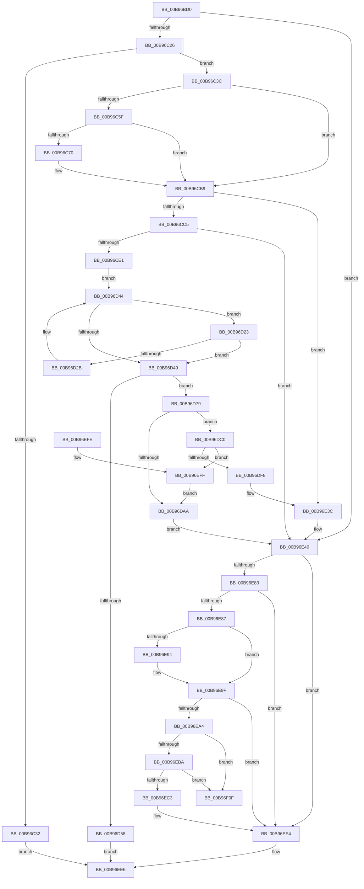

# VfGetScatterGatherList

- RVA: `0x00B96BD0`–`0x00B96F16` (길이 `838` bytes)
- VA: `0x0000000140B96BD0`
- 실행 섹션: `PAGEVRFY`
- PDB 이름 있음: `예`; PDB Function 태그: `아니요`
- unwind 정보 RVA: `0x000D2384`
- 디코드: `227`개 명령, `838/838` bytes 표시
- 미해석 바이트: `0` (있으면 어셈블리에 `.byte`로 보존)

> 이 문서는 커널 이미지의 기계어와 PDB 기호를 분석해 생성했습니다. 4번과 5번은 함수 원형과 자료형을 바이너리 사용 방식에서 추정한 C 해석이며 원본 소스 복구 결과는 아닙니다.

## 1. Dependencies

- 직접 호출 지점: **21**; 고유 호출 대상: **17**
- 직접 호출자로 확인된 함수: **0**
- RIP 상대 이미지 참조: **5**

### Outgoing calls
- `0x00B96C03` → [ViGetRealDmaAdapter](ViGetRealDmaAdapter_function_00B990DC.md) (function, `0x00B990DC`)
- `0x00B96C11` → [ViGetAdapterInformationInternal](ViGetAdapterInformationInternal_function_00B98E88.md) (function, `0x00B98E88`)
- `0x00B96C28` → [VF_ASSERT_IRQL](VF_ASSERT_IRQL_function_00B94F30.md) (function, `0x00B94F30`)
- `0x00B96C51` → [VERIFY_BUFFER_LOCKED](VERIFY_BUFFER_LOCKED_function_00B94EA4.md) (function, `0x00B94EA4`)
- `0x00B96C67` → [ViCheckMdlLength](ViCheckMdlLength_function_00B9841C.md) (function, `0x00B9841C`)
- `0x00B96C96` → [ViHalPreprocessOptions](ViHalPreprocessOptions_function_00B9920C.md) (function, `0x00B9920C`)
- `0x00B96CB4` → [VfReportIssueWithOptions](../../text/61/VfReportIssueWithOptions_function_00614444.md) (function, `0x00614444`)
- `0x00B96CCC` → [ExAllocateFromNPagedLookasideList](../../text/38/ExAllocateFromNPagedLookasideList_function_0038E6C0.md) (function, `0x0038E6C0`)
- `0x00B96D5B` → [DECREMENT_SCATTER_GATHER_LISTS](DECREMENT_SCATTER_GATHER_LISTS_function_00B94C44.md) (function, `0x00B94C44`)
- `0x00B96D6A` → [ExFreeToNPagedLookasideList](../../text/38/ExFreeToNPagedLookasideList_function_0038D9D0.md) (function, `0x0038D9D0`)
- `0x00B96D99` → [ViAllocateMapRegisterFile](ViAllocateMapRegisterFile_function_00B97E9C.md) (function, `0x00B97E9C`)
- `0x00B96DB4` → [ExFreeToNPagedLookasideList](../../text/38/ExFreeToNPagedLookasideList_function_0038D9D0.md) (function, `0x0038D9D0`)
- `0x00B96DEB` → [ViMapDoubleBuffer](ViMapDoubleBuffer_function_00B99640.md) (function, `0x00B99640`)
- `0x00B96E30` → [ViSwap](ViSwap_function_00B99E54.md) (function, `0x00B99E54`)
- `0x00B96E77` → [guard_dispatch_icall](../../text/6B/guard_dispatch_icall_function_006BAAD0.md) (function, `0x006BAAD0`)
- `0x00B96E8A` → [DECREMENT_SCATTER_GATHER_LISTS](DECREMENT_SCATTER_GATHER_LISTS_function_00B94C44.md) (function, `0x00B94C44`)
- `0x00B96E9A` → [ViFreeMapRegisterFile](ViFreeMapRegisterFile_function_00B98B8C.md) (function, `0x00B98B8C`)
- `0x00B96EA8` → [KeAcquireSpinLockRaiseToDpc](../../text/20/KeAcquireSpinLockRaiseToDpc_function_00208470.md) (function, `0x00208470`)
- `0x00B96ED0` → [KeReleaseSpinLock](../../text/39/KeReleaseSpinLock_function_00392BA0.md) (function, `0x00392BA0`)
- `0x00B96EDF` → [ExFreeToNPagedLookasideList](../../text/38/ExFreeToNPagedLookasideList_function_0038D9D0.md) (function, `0x0038D9D0`)
- `0x00B96F05` → [ViFreeMapRegisterFile](ViFreeMapRegisterFile_function_00B98B8C.md) (function, `0x00B98B8C`)

### Direct callers
- 이 함수 시작 RVA로 연결되는 직접 call은 확인되지 않았습니다. 간접 호출은 완전히 역산할 수 없습니다.

### Static image references
- `0x00B96C75` → RVA `0x00E0E9E0` (`.data`; read)
- `0x00B96C81` → RVA `0x00BB9C20` (` ?? ::JKADOLAD::`string'`; read)
- `0x00B96CB9` → RVA `0x00FF4004` (`PAGEVRFD`; read)
- `0x00B96CC5` → RVA `0x00E28A80` (`.data`; read)
- `0x00B96DFC` → RVA `0x00B99B20` (`ViScatterGatherCallback`; read)

## 2. Other-region calls and transfers

- 다른 실행 섹션으로 향하는 call: **8**
  - `0x00B96CB4` → [VfReportIssueWithOptions](../../text/61/VfReportIssueWithOptions_function_00614444.md) (`PAGEVRFY` → `.text`)
  - `0x00B96CCC` → [ExAllocateFromNPagedLookasideList](../../text/38/ExAllocateFromNPagedLookasideList_function_0038E6C0.md) (`PAGEVRFY` → `.text`)
  - `0x00B96D6A` → [ExFreeToNPagedLookasideList](../../text/38/ExFreeToNPagedLookasideList_function_0038D9D0.md) (`PAGEVRFY` → `.text`)
  - `0x00B96DB4` → [ExFreeToNPagedLookasideList](../../text/38/ExFreeToNPagedLookasideList_function_0038D9D0.md) (`PAGEVRFY` → `.text`)
  - `0x00B96E77` → [guard_dispatch_icall](../../text/6B/guard_dispatch_icall_function_006BAAD0.md) (`PAGEVRFY` → `.text`)
  - `0x00B96EA8` → [KeAcquireSpinLockRaiseToDpc](../../text/20/KeAcquireSpinLockRaiseToDpc_function_00208470.md) (`PAGEVRFY` → `.text`)
  - `0x00B96ED0` → [KeReleaseSpinLock](../../text/39/KeReleaseSpinLock_function_00392BA0.md) (`PAGEVRFY` → `.text`)
  - `0x00B96EDF` → [ExFreeToNPagedLookasideList](../../text/38/ExFreeToNPagedLookasideList_function_0038D9D0.md) (`PAGEVRFY` → `.text`)
- 별도 외부 분기/꼬리 이동을 확인하지 못했습니다.

## 3. Assembly (complete function range)

```asm
00B96BD0  48 8B C4                        mov rax, rsp
00B96BD3  48 89 58 08                     mov qword ptr [rax + 8], rbx
00B96BD7  4C 89 48 20                     mov qword ptr [rax + 0x20], r9
00B96BDB  4C 89 40 18                     mov qword ptr [rax + 0x18], r8
00B96BDF  48 89 50 10                     mov qword ptr [rax + 0x10], rdx
00B96BE3  55                              push rbp
00B96BE4  56                              push rsi
00B96BE5  57                              push rdi
00B96BE6  41 54                           push r12
00B96BE8  41 55                           push r13
00B96BEA  41 56                           push r14
00B96BEC  41 57                           push r15
00B96BEE  48 8B EC                        mov rbp, rsp
00B96BF1  48 83 EC 60                     sub rsp, 0x60
00B96BF5  4D 8B F9                        mov r15, r9
00B96BF8  4D 8B F0                        mov r14, r8
00B96BFB  48 8B D9                        mov rbx, rcx
00B96BFE  33 FF                           xor edi, edi
00B96C00  45 33 ED                        xor r13d, r13d
00B96C03  E8 D4 24 00 00                  call 0x140b990dc
00B96C08  B2 01                           mov dl, 1
00B96C0A  48 89 45 F8                     mov qword ptr [rbp - 8], rax
00B96C0E  48 8B CB                        mov rcx, rbx
00B96C11  E8 72 22 00 00                  call 0x140b98e88
00B96C16  44 8B 65 60                     mov r12d, dword ptr [rbp + 0x60]
00B96C1A  48 8B F0                        mov rsi, rax
00B96C1D  48 85 C0                        test rax, rax
00B96C20  0F 84 1A 02 00 00               je 0x140b96e40
00B96C26  B1 02                           mov cl, 2
00B96C28  E8 03 E3 FF FF                  call 0x140b94f30
00B96C2D  4D 85 F6                        test r14, r14
00B96C30  75 0A                           jne 0x140b96c3c
00B96C32  B8 0D 00 00 C0                  mov eax, 0xc000000d
00B96C37  E9 AA 02 00 00                  jmp 0x140b96ee6
00B96C3C  F0 FF 86 C4 00 00 00            lock inc dword ptr [rsi + 0xc4]
00B96C43  F0 FF 86 C8 00 00 00            lock inc dword ptr [rsi + 0xc8]
00B96C4A  4C 8B 75 50                     mov r14, qword ptr [rbp + 0x50]
00B96C4E  49 8B CE                        mov rcx, r14
00B96C51  E8 4E E2 FF FF                  call 0x140b94ea4
00B96C56  83 BE E0 00 00 00 03            cmp dword ptr [rsi + 0xe0], 3
00B96C5D  75 5A                           jne 0x140b96cb9
00B96C5F  45 8B C4                        mov r8d, r12d
00B96C62  33 D2                           xor edx, edx
00B96C64  49 8B CE                        mov rcx, r14
00B96C67  E8 B0 17 00 00                  call 0x140b9841c
00B96C6C  85 C0                           test eax, eax
00B96C6E  74 49                           je 0x140b96cb9
00B96C70  48 21 7C 24 28                  and qword ptr [rsp + 0x28], rdi
00B96C75  4C 8D 3D 64 7D 27 00            lea r15, [rip + 0x277d64]
00B96C7C  48 21 7C 24 20                  and qword ptr [rsp + 0x20], rdi
00B96C81  48 8D 15 98 2F 02 00            lea rdx, [rip + 0x22f98]
00B96C88  49 8B CF                        mov rcx, r15
00B96C8B  44 8B C8                        mov r9d, eax
00B96C8E  41 B8 24 00 00 00               mov r8d, 0x24
00B96C94  8B D8                           mov ebx, eax
00B96C96  E8 71 25 00 00                  call 0x140b9920c
00B96C9B  45 33 C9                        xor r9d, r9d
00B96C9E  4C 89 7C 24 28                  mov qword ptr [rsp + 0x28], r15
00B96CA3  48 21 7C 24 20                  and qword ptr [rsp + 0x20], rdi
00B96CA8  44 8B C3                        mov r8d, ebx
00B96CAB  B9 E6 00 00 00                  mov ecx, 0xe6
00B96CB0  41 8D 51 24                     lea edx, [r9 + 0x24]
00B96CB4  E8 8B D7 A7 FF                  call 0x140614444
00B96CB9  39 3D 45 D3 45 00               cmp dword ptr [rip + 0x45d345], edi
00B96CBF  0F 84 77 01 00 00               je 0x140b96e3c
00B96CC5  48 8D 0D B4 1D 29 00            lea rcx, [rip + 0x291db4]
00B96CCC  E8 EF 79 7F FF                  call 0x14038e6c0
00B96CD1  4C 8B 7D 58                     mov r15, qword ptr [rbp + 0x58]
00B96CD5  48 8B F8                        mov rdi, rax
00B96CD8  48 85 C0                        test rax, rax
00B96CDB  0F 84 5F 01 00 00               je 0x140b96e40
00B96CE1  4C 21 68 40                     and qword ptr [rax + 0x40], r13
00B96CE5  45 8B CF                        mov r9d, r15d
00B96CE8  48 8B 4D 70                     mov rcx, qword ptr [rbp + 0x70]
00B96CEC  41 81 E1 FF 0F 00 00            and r9d, 0xfff
00B96CF3  48 89 08                        mov qword ptr [rax], rcx
00B96CF6  49 8B D6                        mov rdx, r14
00B96CF9  48 8B 4D 68                     mov rcx, qword ptr [rbp + 0x68]
00B96CFD  48 89 48 08                     mov qword ptr [rax + 8], rcx
00B96D01  48 8D 48 48                     lea rcx, [rax + 0x48]
00B96D05  48 89 49 08                     mov qword ptr [rcx + 8], rcx
00B96D09  48 89 09                        mov qword ptr [rcx], rcx
00B96D0C  45 8B 46 2C                     mov r8d, dword ptr [r14 + 0x2c]
00B96D10  45 03 46 28                     add r8d, dword ptr [r14 + 0x28]
00B96D14  45 03 46 20                     add r8d, dword ptr [r14 + 0x20]
00B96D18  45 2B C7                        sub r8d, r15d
00B96D1B  41 8B C8                        mov ecx, r8d
00B96D1E  45 33 D2                        xor r10d, r10d
00B96D21  EB 21                           jmp 0x140b96d44
00B96D23  48 8B 12                        mov rdx, qword ptr [rdx]
00B96D26  48 85 D2                        test rdx, rdx
00B96D29  74 1E                           je 0x140b96d49
00B96D2B  41 8D 81 FF 0F 00 00            lea eax, [r9 + 0xfff]
00B96D32  44 8B 4A 2C                     mov r9d, dword ptr [rdx + 0x2c]
00B96D36  03 C1                           add eax, ecx
00B96D38  8B 4A 28                        mov ecx, dword ptr [rdx + 0x28]
00B96D3B  C1 E8 0C                        shr eax, 0xc
00B96D3E  44 03 D0                        add r10d, eax
00B96D41  44 03 C1                        add r8d, ecx
00B96D44  45 3B C4                        cmp r8d, r12d
00B96D47  72 DA                           jb 0x140b96d23
00B96D49  43 8D 14 21                     lea edx, [r9 + r12]
00B96D4D  41 8D 80 00 10 00 00            lea eax, [r8 + 0x1000]
00B96D54  3B C2                           cmp eax, edx
00B96D56  73 21                           jae 0x140b96d79
00B96D58  48 8B CE                        mov rcx, rsi
00B96D5B  E8 E4 DE FF FF                  call 0x140b94c44
00B96D60  48 8B D7                        mov rdx, rdi
00B96D63  48 8D 0D 16 1D 29 00            lea rcx, [rip + 0x291d16]
00B96D6A  E8 61 6C 7F FF                  call 0x14038d9d0
00B96D6F  B8 23 00 00 C0                  mov eax, 0xc0000023
00B96D74  E9 6D 01 00 00                  jmp 0x140b96ee6
00B96D79  41 2B C8                        sub ecx, r8d
00B96D7C  48 89 77 38                     mov qword ptr [rdi + 0x38], rsi
00B96D80  41 8D 14 09                     lea edx, [r9 + rcx]
00B96D84  48 8B CE                        mov rcx, rsi
00B96D87  81 C2 FF 0F 00 00               add edx, 0xfff
00B96D8D  41 03 D4                        add edx, r12d
00B96D90  C1 EA 0C                        shr edx, 0xc
00B96D93  41 03 D2                        add edx, r10d
00B96D96  89 57 30                        mov dword ptr [rdi + 0x30], edx
00B96D99  E8 FE 10 00 00                  call 0x140b97e9c
00B96D9E  48 89 45 F0                     mov qword ptr [rbp - 0x10], rax
00B96DA2  48 8B D8                        mov rbx, rax
00B96DA5  48 85 C0                        test rax, rax
00B96DA8  75 16                           jne 0x140b96dc0
00B96DAA  48 8B D7                        mov rdx, rdi
00B96DAD  48 8D 0D CC 1C 29 00            lea rcx, [rip + 0x291ccc]
00B96DB4  E8 17 6C 7F FF                  call 0x14038d9d0
00B96DB9  33 FF                           xor edi, edi
00B96DBB  E9 80 00 00 00                  jmp 0x140b96e40
00B96DC0  C6 40 19 01                     mov byte ptr [rax + 0x19], 1
00B96DC4  45 8B CC                        mov r9d, r12d
00B96DC7  48 8D 47 68                     lea rax, [rdi + 0x68]
00B96DCB  48 89 5F 60                     mov qword ptr [rdi + 0x60], rbx
00B96DCF  48 89 47 10                     mov qword ptr [rdi + 0x10], rax
00B96DD3  4D 8B C7                        mov r8, r15
00B96DD6  8A 45 78                        mov al, byte ptr [rbp + 0x78]
00B96DD9  49 8B D6                        mov rdx, r14
00B96DDC  48 8B CB                        mov rcx, rbx
00B96DDF  88 44 24 20                     mov byte ptr [rsp + 0x20], al
00B96DE3  4C 89 7F 18                     mov qword ptr [rdi + 0x18], r15
00B96DE7  44 89 67 20                     mov dword ptr [rdi + 0x20], r12d
00B96DEB  E8 50 28 00 00                  call 0x140b99640
00B96DF0  85 C0                           test eax, eax
00B96DF2  0F 84 07 01 00 00               je 0x140b96eff
00B96DF8  41 0F 10 06                     movups xmm0, xmmword ptr [r14]
00B96DFC  48 8D 05 1D 2D 00 00            lea rax, [rip + 0x2d1d]
00B96E03  48 89 7D 70                     mov qword ptr [rbp + 0x70], rdi
00B96E07  48 89 45 68                     mov qword ptr [rbp + 0x68], rax
00B96E0B  4C 8D 45 58                     lea r8, [rbp + 0x58]
00B96E0F  48 8B 47 10                     mov rax, qword ptr [rdi + 0x10]
00B96E13  48 8D 55 50                     lea rdx, [rbp + 0x50]
00B96E17  48 8D 4D F0                     lea rcx, [rbp - 0x10]
00B96E1B  0F 11 00                        movups xmmword ptr [rax], xmm0
00B96E1E  41 0F 10 4E 10                  movups xmm1, xmmword ptr [r14 + 0x10]
00B96E23  0F 11 48 10                     movups xmmword ptr [rax + 0x10], xmm1
00B96E27  41 0F 10 46 20                  movups xmm0, xmmword ptr [r14 + 0x20]
00B96E2C  0F 11 40 20                     movups xmmword ptr [rax + 0x20], xmm0
00B96E30  E8 1F 30 00 00                  call 0x140b99e54
00B96E35  4C 8B 75 50                     mov r14, qword ptr [rbp + 0x50]
00B96E39  4C 8B EB                        mov r13, rbx
00B96E3C  4C 8B 7D 58                     mov r15, qword ptr [rbp + 0x58]
00B96E40  4C 8B 55 F8                     mov r10, qword ptr [rbp - 8]
00B96E44  4D 8B CF                        mov r9, r15
00B96E47  8A 4D 78                        mov cl, byte ptr [rbp + 0x78]
00B96E4A  4D 8B C6                        mov r8, r14
00B96E4D  48 8B 55 48                     mov rdx, qword ptr [rbp + 0x48]
00B96E51  88 4C 24 38                     mov byte ptr [rsp + 0x38], cl
00B96E55  48 8B 4D 70                     mov rcx, qword ptr [rbp + 0x70]
00B96E59  49 8B 42 08                     mov rax, qword ptr [r10 + 8]
00B96E5D  48 89 4C 24 30                  mov qword ptr [rsp + 0x30], rcx
00B96E62  48 8B 4D 68                     mov rcx, qword ptr [rbp + 0x68]
00B96E66  48 89 4C 24 28                  mov qword ptr [rsp + 0x28], rcx
00B96E6B  49 8B CA                        mov rcx, r10
00B96E6E  48 8B 40 58                     mov rax, qword ptr [rax + 0x58]
00B96E72  44 89 64 24 20                  mov dword ptr [rsp + 0x20], r12d
00B96E77  E8 54 3C B2 FF                  call 0x1406baad0
00B96E7C  8B D8                           mov ebx, eax
00B96E7E  48 85 F6                        test rsi, rsi
00B96E81  74 61                           je 0x140b96ee4
00B96E83  85 C0                           test eax, eax
00B96E85  79 5D                           jns 0x140b96ee4
00B96E87  48 8B CE                        mov rcx, rsi
00B96E8A  E8 B5 DD FF FF                  call 0x140b94c44
00B96E8F  4D 85 ED                        test r13, r13
00B96E92  74 0B                           je 0x140b96e9f
00B96E94  49 8B D5                        mov rdx, r13
00B96E97  48 8B CE                        mov rcx, rsi
00B96E9A  E8 ED 1C 00 00                  call 0x140b98b8c
00B96E9F  48 85 FF                        test rdi, rdi
00B96EA2  74 40                           je 0x140b96ee4
00B96EA4  48 8D 4E 68                     lea rcx, [rsi + 0x68]
00B96EA8  E8 C3 15 67 FF                  call 0x140208470
00B96EAD  48 8D 57 48                     lea rdx, [rdi + 0x48]
00B96EB1  4C 8B 0A                        mov r9, qword ptr [rdx]
00B96EB4  49 39 51 08                     cmp qword ptr [r9 + 8], rdx
00B96EB8  75 55                           jne 0x140b96f0f
00B96EBA  4C 8B 42 08                     mov r8, qword ptr [rdx + 8]
00B96EBE  49 39 10                        cmp qword ptr [r8], rdx
00B96EC1  75 4C                           jne 0x140b96f0f
00B96EC3  4D 89 08                        mov qword ptr [r8], r9
00B96EC6  48 8D 4E 68                     lea rcx, [rsi + 0x68]
00B96ECA  8A D0                           mov dl, al
00B96ECC  4D 89 41 08                     mov qword ptr [r9 + 8], r8
00B96ED0  E8 CB BC 7F FF                  call 0x140392ba0
00B96ED5  48 8B D7                        mov rdx, rdi
00B96ED8  48 8D 0D A1 1B 29 00            lea rcx, [rip + 0x291ba1]
00B96EDF  E8 EC 6A 7F FF                  call 0x14038d9d0
00B96EE4  8B C3                           mov eax, ebx
00B96EE6  48 8B 9C 24 A0 00 00 00         mov rbx, qword ptr [rsp + 0xa0]
00B96EEE  48 83 C4 60                     add rsp, 0x60
00B96EF2  41 5F                           pop r15
00B96EF4  41 5E                           pop r14
00B96EF6  41 5D                           pop r13
00B96EF8  41 5C                           pop r12
00B96EFA  5F                              pop rdi
00B96EFB  5E                              pop rsi
00B96EFC  5D                              pop rbp
00B96EFD  C3                              ret
00B96EFE  CC                              int3
00B96EFF  48 8B D3                        mov rdx, rbx
00B96F02  48 8B CE                        mov rcx, rsi
00B96F05  E8 82 1C 00 00                  call 0x140b98b8c
00B96F0A  E9 9B FE FF FF                  jmp 0x140b96daa
00B96F0F  B9 03 00 00 00                  mov ecx, 3
00B96F14  CD 29                           int 0x29
```

## 4. C-style interpretation (structured pseudocode)

```c
__int64 __fastcall VfGetScatterGatherList(__int64 a1, __int64 a2, __int64 a3, __int64 a4, unsigned int a5, __int64 a6, __int64 a7, unsigned __int8 a8)
{
    __int64 result;
    __int64 v_r10;
    __int64 v_r13;
    __int64 v_r15;
    __int64 v_rbx;
    __int64 v_rdi;
    __int64 v_rsp;
    unsigned __int64 v_stack_m40;
    unsigned __int64 v_stack_m48;
    unsigned __int8 v_stack_m60;
    unsigned __int64 v_stack_m68;
    unsigned __int64 v_stack_m70;
    unsigned __int64 v_stack_m78;
    unsigned __int64 v_stack_p10;
    unsigned __int64 v_stack_p18;
    unsigned __int64 v_stack_p20;
    unsigned __int64 v_stack_p30;
    unsigned __int64 v_stack_p38;
    unsigned __int64 v_stack_p8;

    *(unsigned __int64 *)(v_rsp + 8) = v_rbx;
    *(unsigned __int64 *)(v_rsp + 32) = a4;
    *(unsigned __int64 *)(v_rsp + 24) = a3;
    *(unsigned __int64 *)(v_rsp + 16) = a2;
    v_rsp = (v_rsp) - (96);
    v_rdi = 0;
    v_r13 = 0;
    result = ViGetRealDmaAdapter(a1, a2, a3, a4);
    v_stack_m40 = result;
    result = ViGetAdapterInformationInternal(a1, 1, a3, a4);
    if (result == 0) goto loc_00B96E40;
    result = VF_ASSERT_IRQL(2, 1, a3, a4);
    if (a3 != 0) goto loc_00B96C3C;
    goto loc_00B96EE6;
loc_00B96C3C:
    result = VERIFY_BUFFER_LOCKED(v_stack_p18, 1, a3, a4);
    if ((*(unsigned int *)(result + 224)) != 3) goto loc_00B96CB9;
    a2 = 0;
    result = ViCheckMdlLength(v_stack_p18, a2, (unsigned int)((unsigned int)((unsigned int)(a5))), a4);
    v_rbx = a1;
    v_r15 = a4;
    if ((unsigned int)(result) != 0) {
        v_r15 = v_rip + 2588004;
        a2 = v_rip + 143256;
        a1 = v_r15;
        a4 = (unsigned int)(result);
        a3 = 36;
        v_rbx = (unsigned int)(result);
        result = ViHalPreprocessOptions(a1, a2, a3, a4);
        a4 = 0;
        v_stack_m70 = v_r15;
        a3 = (unsigned int)(v_rbx);
        a1 = 230;
        a2 = a4 + 36;
        result = VfReportIssueWithOptions(a1, a2, a3, a4);
    }
    if ((*(unsigned int *)(v_rip + 4576069)) == 0) goto loc_00B96E3C;
    result = ExAllocateFromNPagedLookasideList(v_rip + 2694580, a2, a3, a4);
    if (result == 0) goto loc_00B96E40;
    a4 = (unsigned int)(((unsigned int)((unsigned int)(v_stack_p20))) & (0xFFFULL));
    *(unsigned __int64 *)(result) = a7;
    *(unsigned __int64 *)(result + 8) = a6;
    *(unsigned __int64 *)(result + 72 + 8) = result + 72;
    *(unsigned __int64 *)(result + 72) = result + 72;
    a3 = (unsigned int)(((unsigned int)(*(unsigned int *)(v_stack_p18 + 44))) + (*(unsigned int *)(v_stack_p18 + 40)));
    a3 = (unsigned int)((a3) + (*(unsigned int *)(v_stack_p18 + 32)));
    a3 = (unsigned int)((a3) - ((unsigned int)(v_stack_p20)));
    v_r10 = 0;
    goto loc_00B96D44;
loc_00B96D23:
    if (*(unsigned __int64 *)(v_stack_p18) == 0) goto loc_00B96D49;
    result = (unsigned int)((a4 + 4095) + ((unsigned int)((unsigned int)((unsigned int)(a3)))));
    result = (unsigned int)((result) >> (12));
    v_r10 = (unsigned int)((v_r10) + ((unsigned int)(result)));
    a3 = (unsigned int)((a3) + ((unsigned int)((unsigned int)(*(unsigned int *)(*(unsigned __int64 *)(v_stack_p18) + 40)))));
loc_00B96D44:
    if (((unsigned int)(a3)) < ((unsigned int)((unsigned int)(a5)))) goto loc_00B96D23;
loc_00B96D49:
    if (((unsigned int)(a3 + 4096)) >= ((unsigned int)((unsigned int)(*(unsigned int *)(*(unsigned __int64 *)(v_stack_p18) + 44)) + (unsigned int)(a5) * 1))) goto loc_00B96D79;
    result = DECREMENT_SCATTER_GATHER_LISTS(result, (unsigned int)(*(unsigned int *)(*(unsigned __int64 *)(v_stack_p18) + 44)) + (unsigned int)(a5) * 1, a3, (unsigned int)(*(unsigned int *)(*(unsigned __int64 *)(v_stack_p18) + 44)));
    result = ExFreeToNPagedLookasideList(v_rip + 2694422, result, a3, (unsigned int)(*(unsigned int *)(*(unsigned __int64 *)(v_stack_p18) + 44)));
    goto loc_00B96EE6;
loc_00B96D79:
    a1 = (unsigned int)((v_rip + 2694422) - ((unsigned int)(a3)));
    *(unsigned __int64 *)(result + 56) = result;
    a2 = (unsigned int)(((unsigned int)(*(unsigned int *)(*(unsigned __int64 *)(v_stack_p18) + 44)) + a1 * 1) + (0xFFFULL));
    a2 = (unsigned int)((a2) + ((unsigned int)((unsigned int)(a5))));
    a2 = (unsigned int)((a2) >> (12));
    a2 = (unsigned int)((a2) + ((unsigned int)(v_r10)));
    *(unsigned int *)(result + 48) = (unsigned int)(a2);
    result = ViAllocateMapRegisterFile(result, a2, a3, (unsigned int)(*(unsigned int *)(*(unsigned __int64 *)(v_stack_p18) + 44)));
    v_stack_m48 = result;
    if (result != 0) goto loc_00B96DC0;
loc_00B96DAA:
    result = ExFreeToNPagedLookasideList(v_rip + 2694348, result, a3, (unsigned int)(*(unsigned int *)(*(unsigned __int64 *)(v_stack_p18) + 44)));
    v_rdi = 0;
    goto loc_00B96E40;
loc_00B96DC0:
    *(unsigned __int8 *)(result + 25) = 1;
    *(unsigned __int64 *)(v_rdi + 96) = result;
    *(unsigned __int64 *)(v_rdi + 16) = v_rdi + 104;
    v_stack_m78 = a8;
    *(unsigned __int64 *)(v_rdi + 24) = v_stack_p20;
    *(unsigned int *)(v_rdi + 32) = (unsigned int)((unsigned int)(a5));
    result = ViMapDoubleBuffer(result, v_stack_p18, v_stack_p20, (unsigned int)((unsigned int)((unsigned int)(a5))));
    if ((unsigned int)(result) == 0) goto loc_00B96EFF;
    v_stack_p38 = 0;
    v_stack_p30 = v_rip + 11549;
    *(unsigned __int64 *)(*(unsigned __int64 *)(v_rdi + 16)) = v_xmm0;
    *(unsigned __int64 *)(*(unsigned __int64 *)(v_rdi + 16) + 16) = v_xmm1;
    *(unsigned __int64 *)(*(unsigned __int64 *)(v_rdi + 16) + 32) = v_xmm0;
    result = ViSwap(v_stack_m48, v_stack_p18, v_stack_p20, (unsigned int)((unsigned int)((unsigned int)(a5))));
loc_00B96E3C:
loc_00B96E40:
    v_stack_m60 = a8;
    v_stack_m68 = a7;
    v_stack_m70 = a6;
    v_stack_m78 = (unsigned int)((unsigned int)(a5));
    result = guard_dispatch_icall(v_stack_m40, v_stack_p10, v_stack_p18, v_stack_p20);
    if (result == 0) goto loc_00B96EE4;
    if (!sign_flag) goto loc_00B96EE4;
    result = DECREMENT_SCATTER_GATHER_LISTS(result, v_stack_p10, v_stack_p18, v_stack_p20);
    if (result != 0) {
        a2 = result;
        a1 = result;
        result = ViFreeMapRegisterFile(a1, a2, v_stack_p18, v_stack_p20);
    }
    if (0 == 0) goto loc_00B96EE4;
    result = KeAcquireSpinLockRaiseToDpc(result + 104, a2, v_stack_p18, v_stack_p20);
    if ((*(unsigned __int64 *)(*(unsigned __int64 *)(v_rdi + 72) + 8)) != (v_rdi + 72)) goto loc_00B96F0F;
    if ((*(unsigned __int64 *)(*(unsigned __int64 *)(v_rdi + 72 + 8))) != (v_rdi + 72)) goto loc_00B96F0F;
    *(unsigned __int64 *)(*(unsigned __int64 *)(v_rdi + 72 + 8)) = *(unsigned __int64 *)(v_rdi + 72);
    *(unsigned __int64 *)(*(unsigned __int64 *)(v_rdi + 72) + 8) = *(unsigned __int64 *)(v_rdi + 72 + 8);
    result = KeReleaseSpinLock(result + 104, (unsigned __int8)(result), *(unsigned __int64 *)(v_rdi + 72 + 8), *(unsigned __int64 *)(v_rdi + 72));
    result = ExFreeToNPagedLookasideList(v_rip + 2694049, 0, *(unsigned __int64 *)(v_rdi + 72 + 8), *(unsigned __int64 *)(v_rdi + 72));
loc_00B96EE4:
loc_00B96EE6:
    v_rsp = (v_rsp) + (96);
    return (unsigned int)((unsigned int)((unsigned int)((unsigned int)(result))));
loc_00B96EFF:
    result = ViFreeMapRegisterFile(result, v_stack_p8, *(unsigned __int64 *)(v_rdi + 72 + 8), *(unsigned __int64 *)(v_rdi + 72));
    goto loc_00B96DAA;
loc_00B96F0F:
    return result;
}
```

## 5. (Beta) C Style

```c
int64_t VfGetScatterGatherList(int64_t Arg1, int64_t Arg2, int64_t Arg3, int64_t Arg4, uint32_t Arg5, int64_t Arg6, int64_t Arg7, uint8_t Arg8)
{
    int64_t result;
    int64_t local_r10;
    int64_t local_r13;
    int64_t local_r15;
    int64_t local_rbx;
    int64_t local_rdi;
    int64_t local_rsp;
    uint64_t v_stack_m40;
    uint64_t v_stack_m48;
    uint8_t v_stack_m60;
    uint64_t v_stack_m68;
    uint64_t v_stack_m70;
    uint64_t v_stack_m78;
    uint64_t v_stack_p10;
    uint64_t v_stack_p18;
    uint64_t v_stack_p20;
    uint64_t v_stack_p30;
    uint64_t v_stack_p38;
    uint64_t v_stack_p8;

    *(uint64_t *)(local_rsp + 0x8) = local_rbx;
    *(uint64_t *)(local_rsp + 0x20) = Arg4;
    *(uint64_t *)(local_rsp + 0x18) = Arg3;
    *(uint64_t *)(local_rsp + 0x10) = Arg2;
    local_rsp = (local_rsp) - (96);
    local_rdi = 0;
    local_r13 = 0;
    result = ViGetRealDmaAdapter(Arg1, Arg2, Arg3, Arg4);
    v_stack_m40 = result;
    result = ViGetAdapterInformationInternal(Arg1, 1, Arg3, Arg4);
    if (result == 0) goto loc_00B96E40;
    result = VF_ASSERT_IRQL(2, 1, Arg3, Arg4);
    if (Arg3 != 0) goto loc_00B96C3C;
    goto loc_00B96EE6;
loc_00B96C3C:
    result = VERIFY_BUFFER_LOCKED(v_stack_p18, 1, Arg3, Arg4);
    if ((*(uint32_t *)(result + 0xE0)) != 3) goto loc_00B96CB9;
    Arg2 = 0;
    result = ViCheckMdlLength(v_stack_p18, Arg2, (uint32_t)((uint32_t)((uint32_t)(Arg5))), Arg4);
    local_rbx = Arg1;
    local_r15 = Arg4;
    if ((uint32_t)(result) != 0) {
        local_r15 = v_rip + 2588004;
        Arg2 = v_rip + 143256;
        Arg1 = local_r15;
        Arg4 = (uint32_t)(result);
        Arg3 = 36;
        local_rbx = (uint32_t)(result);
        result = ViHalPreprocessOptions(Arg1, Arg2, Arg3, Arg4);
        Arg4 = 0;
        v_stack_m70 = local_r15;
        Arg3 = (uint32_t)(local_rbx);
        Arg1 = 230;
        Arg2 = Arg4 + 36;
        result = VfReportIssueWithOptions(Arg1, Arg2, Arg3, Arg4);
    }
    if ((*(uint32_t *)(v_rip + 0x45D345)) == 0) goto loc_00B96E3C;
    result = ExAllocateFromNPagedLookasideList(v_rip + 2694580, Arg2, Arg3, Arg4);
    if (result == 0) goto loc_00B96E40;
    Arg4 = (uint32_t)(((uint32_t)((uint32_t)(v_stack_p20))) & (0xFFFULL));
    *(uint64_t *)(result) = Arg7;
    *(uint64_t *)(result + 0x8) = Arg6;
    *(uint64_t *)(result + 0x48 + 0x8) = result + 72;
    *(uint64_t *)(result + 0x48) = result + 72;
    Arg3 = (uint32_t)(((uint32_t)(*(uint32_t *)(v_stack_p18 + 0x2C))) + (*(uint32_t *)(v_stack_p18 + 0x28)));
    Arg3 = (uint32_t)((Arg3) + (*(uint32_t *)(v_stack_p18 + 0x20)));
    Arg3 = (uint32_t)((Arg3) - ((uint32_t)(v_stack_p20)));
    local_r10 = 0;
    goto loc_00B96D44;
loc_00B96D23:
    if (*(uint64_t *)(v_stack_p18) == 0) goto loc_00B96D49;
    result = (uint32_t)((Arg4 + 4095) + ((uint32_t)((uint32_t)((uint32_t)(Arg3)))));
    result = (uint32_t)((result) >> (12));
    local_r10 = (uint32_t)((local_r10) + ((uint32_t)(result)));
    Arg3 = (uint32_t)((Arg3) + ((uint32_t)((uint32_t)(*(uint32_t *)(*(uint64_t *)(v_stack_p18) + 0x28)))));
loc_00B96D44:
    if (((uint32_t)(Arg3)) < ((uint32_t)((uint32_t)(Arg5)))) goto loc_00B96D23;
loc_00B96D49:
    if (((uint32_t)(Arg3 + 4096)) >= ((uint32_t)((uint32_t)(*(uint32_t *)(*(uint64_t *)(v_stack_p18) + 0x2C)) + (uint32_t)(Arg5) * 1))) goto loc_00B96D79;
    result = DECREMENT_SCATTER_GATHER_LISTS(result, (uint32_t)(*(uint32_t *)(*(uint64_t *)(v_stack_p18) + 0x2C)) + (uint32_t)(Arg5) * 1, Arg3, (uint32_t)(*(uint32_t *)(*(uint64_t *)(v_stack_p18) + 0x2C)));
    result = ExFreeToNPagedLookasideList(v_rip + 2694422, result, Arg3, (uint32_t)(*(uint32_t *)(*(uint64_t *)(v_stack_p18) + 0x2C)));
    goto loc_00B96EE6;
loc_00B96D79:
    Arg1 = (uint32_t)((v_rip + 2694422) - ((uint32_t)(Arg3)));
    *(uint64_t *)(result + 0x38) = result;
    Arg2 = (uint32_t)(((uint32_t)(*(uint32_t *)(*(uint64_t *)(v_stack_p18) + 0x2C)) + Arg1 * 1) + (0xFFFULL));
    Arg2 = (uint32_t)((Arg2) + ((uint32_t)((uint32_t)(Arg5))));
    Arg2 = (uint32_t)((Arg2) >> (12));
    Arg2 = (uint32_t)((Arg2) + ((uint32_t)(local_r10)));
    *(uint32_t *)(result + 0x30) = (uint32_t)(Arg2);
    result = ViAllocateMapRegisterFile(result, Arg2, Arg3, (uint32_t)(*(uint32_t *)(*(uint64_t *)(v_stack_p18) + 0x2C)));
    v_stack_m48 = result;
    if (result != 0) goto loc_00B96DC0;
loc_00B96DAA:
    result = ExFreeToNPagedLookasideList(v_rip + 2694348, result, Arg3, (uint32_t)(*(uint32_t *)(*(uint64_t *)(v_stack_p18) + 0x2C)));
    local_rdi = 0;
    goto loc_00B96E40;
loc_00B96DC0:
    *(uint8_t *)(result + 0x19) = 1;
    *(uint64_t *)(local_rdi + 0x60) = result;
    *(uint64_t *)(local_rdi + 0x10) = local_rdi + 104;
    v_stack_m78 = Arg8;
    *(uint64_t *)(local_rdi + 0x18) = v_stack_p20;
    *(uint32_t *)(local_rdi + 0x20) = (uint32_t)((uint32_t)(Arg5));
    result = ViMapDoubleBuffer(result, v_stack_p18, v_stack_p20, (uint32_t)((uint32_t)((uint32_t)(Arg5))));
    if ((uint32_t)(result) == 0) goto loc_00B96EFF;
    v_stack_p38 = 0;
    v_stack_p30 = v_rip + 11549;
    *(uint64_t *)(*(uint64_t *)(local_rdi + 0x10)) = v_xmm0;
    *(uint64_t *)(*(uint64_t *)(local_rdi + 0x10) + 0x10) = v_xmm1;
    *(uint64_t *)(*(uint64_t *)(local_rdi + 0x10) + 0x20) = v_xmm0;
    result = ViSwap(v_stack_m48, v_stack_p18, v_stack_p20, (uint32_t)((uint32_t)((uint32_t)(Arg5))));
loc_00B96E3C:
loc_00B96E40:
    v_stack_m60 = Arg8;
    v_stack_m68 = Arg7;
    v_stack_m70 = Arg6;
    v_stack_m78 = (uint32_t)((uint32_t)(Arg5));
    result = guard_dispatch_icall(v_stack_m40, v_stack_p10, v_stack_p18, v_stack_p20);
    if (result == 0) goto loc_00B96EE4;
    if (!sign_flag) goto loc_00B96EE4;
    result = DECREMENT_SCATTER_GATHER_LISTS(result, v_stack_p10, v_stack_p18, v_stack_p20);
    if (result != 0) {
        Arg2 = result;
        Arg1 = result;
        result = ViFreeMapRegisterFile(Arg1, Arg2, v_stack_p18, v_stack_p20);
    }
    if (0 == 0) goto loc_00B96EE4;
    result = KeAcquireSpinLockRaiseToDpc(result + 104, Arg2, v_stack_p18, v_stack_p20);
    if ((*(uint64_t *)(*(uint64_t *)(local_rdi + 0x48) + 0x8)) != (local_rdi + 72)) goto loc_00B96F0F;
    if ((*(uint64_t *)(*(uint64_t *)(local_rdi + 0x48 + 0x8))) != (local_rdi + 72)) goto loc_00B96F0F;
    *(uint64_t *)(*(uint64_t *)(local_rdi + 0x48 + 0x8)) = *(uint64_t *)(local_rdi + 0x48);
    *(uint64_t *)(*(uint64_t *)(local_rdi + 0x48) + 0x8) = *(uint64_t *)(local_rdi + 0x48 + 0x8);
    result = KeReleaseSpinLock(result + 104, (uint8_t)(result), *(uint64_t *)(local_rdi + 0x48 + 0x8), *(uint64_t *)(local_rdi + 0x48));
    result = ExFreeToNPagedLookasideList(v_rip + 2694049, 0, *(uint64_t *)(local_rdi + 0x48 + 0x8), *(uint64_t *)(local_rdi + 0x48));
loc_00B96EE4:
loc_00B96EE6:
    local_rsp = (local_rsp) + (96);
    return (uint32_t)((uint32_t)((uint32_t)((uint32_t)(result))));
loc_00B96EFF:
    result = ViFreeMapRegisterFile(result, v_stack_p8, *(uint64_t *)(local_rdi + 0x48 + 0x8), *(uint64_t *)(local_rdi + 0x48));
    goto loc_00B96DAA;
loc_00B96F0F:
    return result;
}
```

## 6. Execution-region graph

[열기: 2D/3D 그래프와 함수 탐색 컨트롤 패널](../../../control-panel.html?section=pagevrfy&rva=0x00B96BD0&view=graph)

- 2D 그래프는 위에서 아래로 흐르고, 3D 그래프는 빈 공간을 드래그해 회전합니다. Shift+드래그는 이동, 휠은 확대·축소, 함수 노드 선택은 대상 보고서 이동입니다.

### Static fallback


