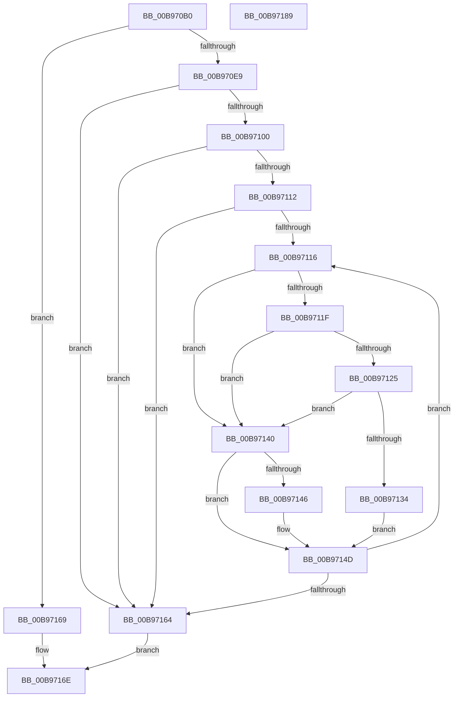

# VfHalAllocateMapRegisters

- RVA: `0x00B970B0`–`0x00B9718A` (길이 `218` bytes)
- VA: `0x0000000140B970B0`
- 실행 섹션: `PAGEVRFY`
- PDB 이름 있음: `예`; PDB Function 태그: `아니요`
- unwind 정보 RVA: `0x0005D7BC`
- 디코드: `65`개 명령, `218/218` bytes 표시
- 미해석 바이트: `0` (있으면 어셈블리에 `.byte`로 보존)

> 이 문서는 커널 이미지의 기계어와 PDB 기호를 분석해 생성했습니다. 4번과 5번은 함수 원형과 자료형을 바이너리 사용 방식에서 추정한 C 해석이며 원본 소스 복구 결과는 아닙니다.

## 1. Dependencies

- 직접 호출 지점: **5**; 고유 호출 대상: **5**
- 직접 호출자로 확인된 함수: **0**
- RIP 상대 이미지 참조: **2**

### Outgoing calls
- `0x00B970D1` → [ViGetRealDmaAdapter](ViGetRealDmaAdapter_function_00B990DC.md) (function, `0x00B990DC`)
- `0x00B970F4` → [guard_dispatch_icall](../../text/6B/guard_dispatch_icall_function_006BAAD0.md) (function, `0x006BAAD0`)
- `0x00B97105` → [ViGetAdapterInformationInternal](ViGetAdapterInformationInternal_function_00B98E88.md) (function, `0x00B98E88`)
- `0x00B9712A` → [ViAllocateMapRegisterFile](ViAllocateMapRegisterFile_function_00B97E9C.md) (function, `0x00B97E9C`)
- `0x00B97155` → [ADD_MAP_REGISTERS](ADD_MAP_REGISTERS_function_00B94A08.md) (function, `0x00B94A08`)

### Direct callers
- 이 함수 시작 RVA로 연결되는 직접 call은 확인되지 않았습니다. 간접 호출은 완전히 역산할 수 없습니다.

### Static image references
- `0x00B970D9` → RVA `0x00F03FD8` (`.data`; read)
- `0x00B97116` → RVA `0x00FF4004` (`PAGEVRFD`; read)

## 2. Other-region calls and transfers

- 다른 실행 섹션으로 향하는 call: **1**
  - `0x00B970F4` → [guard_dispatch_icall](../../text/6B/guard_dispatch_icall_function_006BAAD0.md) (`PAGEVRFY` → `.text`)
- 별도 외부 분기/꼬리 이동을 확인하지 못했습니다.

## 3. Assembly (complete function range)

```asm
00B970B0  48 8B C4                        mov rax, rsp
00B970B3  48 89 58 08                     mov qword ptr [rax + 8], rbx
00B970B7  48 89 68 10                     mov qword ptr [rax + 0x10], rbp
00B970BB  48 89 70 18                     mov qword ptr [rax + 0x18], rsi
00B970BF  48 89 78 20                     mov qword ptr [rax + 0x20], rdi
00B970C3  41 56                           push r14
00B970C5  48 83 EC 30                     sub rsp, 0x30
00B970C9  49 8B D9                        mov rbx, r9
00B970CC  41 8B F0                        mov esi, r8d
00B970CF  8B EA                           mov ebp, edx
00B970D1  E8 06 20 00 00                  call 0x140b990dc
00B970D6  48 8B F8                        mov rdi, rax
00B970D9  48 8B 05 F8 CE 36 00            mov rax, qword ptr [rip + 0x36cef8]
00B970E0  48 85 C0                        test rax, rax
00B970E3  0F 84 80 00 00 00               je 0x140b97169
00B970E9  4C 8B CB                        mov r9, rbx
00B970EC  44 8B C6                        mov r8d, esi
00B970EF  8B D5                           mov edx, ebp
00B970F1  48 8B CF                        mov rcx, rdi
00B970F4  E8 D7 39 B2 FF                  call 0x1406baad0
00B970F9  44 8B F0                        mov r14d, eax
00B970FC  85 C0                           test eax, eax
00B970FE  78 64                           js 0x140b97164
00B97100  B2 01                           mov dl, 1
00B97102  48 8B CF                        mov rcx, rdi
00B97105  E8 7E 1D 00 00                  call 0x140b98e88
00B9710A  48 8B F8                        mov rdi, rax
00B9710D  48 85 C0                        test rax, rax
00B97110  74 52                           je 0x140b97164
00B97112  85 F6                           test esi, esi
00B97114  74 4E                           je 0x140b97164
00B97116  83 3D E7 CE 45 00 00            cmp dword ptr [rip + 0x45cee7], 0
00B9711D  74 21                           je 0x140b97140
00B9711F  80 7F 49 00                     cmp byte ptr [rdi + 0x49], 0
00B97123  75 1B                           jne 0x140b97140
00B97125  8B D5                           mov edx, ebp
00B97127  48 8B CF                        mov rcx, rdi
00B9712A  E8 6D 0D 00 00                  call 0x140b97e9c
00B9712F  48 85 C0                        test rax, rax
00B97132  74 0C                           je 0x140b97140
00B97134  48 8B 0B                        mov rcx, qword ptr [rbx]
00B97137  48 89 48 30                     mov qword ptr [rax + 0x30], rcx
00B9713B  48 89 03                        mov qword ptr [rbx], rax
00B9713E  EB 0D                           jmp 0x140b9714d
00B97140  48 83 3B 00                     cmp qword ptr [rbx], 0
00B97144  75 07                           jne 0x140b9714d
00B97146  48 C7 03 0D F0 AD DE            mov qword ptr [rbx], 0xffffffffdeadf00d
00B9714D  41 B0 01                        mov r8b, 1
00B97150  8B D5                           mov edx, ebp
00B97152  48 8B CF                        mov rcx, rdi
00B97155  E8 AE D8 FF FF                  call 0x140b94a08
00B9715A  48 83 C3 10                     add rbx, 0x10
00B9715E  48 83 EE 01                     sub rsi, 1
00B97162  75 B2                           jne 0x140b97116
00B97164  41 8B C6                        mov eax, r14d
00B97167  EB 05                           jmp 0x140b9716e
00B97169  B8 01 00 00 C0                  mov eax, 0xc0000001
00B9716E  48 8B 5C 24 40                  mov rbx, qword ptr [rsp + 0x40]
00B97173  48 8B 6C 24 48                  mov rbp, qword ptr [rsp + 0x48]
00B97178  48 8B 74 24 50                  mov rsi, qword ptr [rsp + 0x50]
00B9717D  48 8B 7C 24 58                  mov rdi, qword ptr [rsp + 0x58]
00B97182  48 83 C4 30                     add rsp, 0x30
00B97186  41 5E                           pop r14
00B97188  C3                              ret
00B97189  CC                              int3
```

## 4. C-style interpretation (structured pseudocode)

```c
__int64 __fastcall VfHalAllocateMapRegisters(__int64 a1, int a2, int a3, __int64 a4)
{
    __int64 result;
    __int64 v_rbx;
    __int64 v_rsi;
    __int64 v_rsp;
    unsigned __int64 v_stack_p10;
    unsigned __int64 v_stack_p18;
    unsigned __int64 v_stack_p20;
    unsigned __int64 v_stack_p8;

    *(unsigned __int64 *)(v_rsp + 8) = v_rbx;
    *(unsigned __int64 *)(v_rsp + 16) = v_rbp;
    *(unsigned __int64 *)(v_rsp + 24) = v_rsi;
    *(unsigned __int64 *)(v_rsp + 32) = v_rdi;
    v_rsp = (v_rsp) - (48);
    result = ViGetRealDmaAdapter(a1, a2, a3, a4);
    if (*(unsigned __int64 *)(v_rip + 3591928) == 0) goto loc_00B97169;
    result = guard_dispatch_icall(result, (unsigned int)((unsigned int)((unsigned int)(a2))), (unsigned int)((unsigned int)((unsigned int)(a3))), a4);
    if (sign_flag) goto loc_00B97164;
    result = ViGetAdapterInformationInternal(result, 1, (unsigned int)((unsigned int)((unsigned int)(a3))), a4);
    if (result == 0) goto loc_00B97164;
    if ((unsigned int)((unsigned int)(a3)) == 0) goto loc_00B97164;
loc_00B97116:
    if ((*(unsigned int *)(v_rip + 4574951)) == 0) goto loc_00B97140;
    if ((*(unsigned __int8 *)(result + 73)) != 0) goto loc_00B97140;
    result = ViAllocateMapRegisterFile(result, (unsigned int)((unsigned int)((unsigned int)(a2))), (unsigned int)((unsigned int)((unsigned int)(a3))), a4);
    if (result == 0) goto loc_00B97140;
    *(unsigned __int64 *)(result + 48) = *(unsigned __int64 *)(a4);
    *(unsigned __int64 *)(a4) = result;
    goto loc_00B9714D;
loc_00B97140:
    if ((*(unsigned __int64 *)(a4)) == 0) {
        *(unsigned __int64 *)(a4) = 0xFFFFFFFFDEADF00DULL;
    }
    result = ADD_MAP_REGISTERS(result, (unsigned int)((unsigned int)((unsigned int)(a2))), 1, a4);
    v_rbx = (a4) + (16);
    v_rsi = ((unsigned int)(a3)) - (1);
    if (condition_is_not_equal) goto loc_00B97116;
loc_00B97164:
    goto loc_00B9716E;
loc_00B97169:
loc_00B9716E:
    v_rsp = (v_rsp) + (48);
    return (unsigned int)(0xC0000001ULL);
}
```

## 5. (Beta) C Style

```c
int64_t VfHalAllocateMapRegisters(int64_t Arg1, int32_t Arg2, int32_t Arg3, void *Arg4)
{
    uint8_t *arg4 = (uint8_t *)Arg4;

    int64_t result;
    int64_t local_rbx;
    int64_t local_rsi;
    int64_t local_rsp;
    uint64_t v_stack_p10;
    uint64_t v_stack_p18;
    uint64_t v_stack_p20;
    uint64_t v_stack_p8;

    *(uint64_t *)(local_rsp + 0x8) = local_rbx;
    *(uint64_t *)(local_rsp + 0x10) = local_rbp;
    *(uint64_t *)(local_rsp + 0x18) = local_rsi;
    *(uint64_t *)(local_rsp + 0x20) = local_rdi;
    local_rsp = (local_rsp) - (48);
    result = ViGetRealDmaAdapter(Arg1, Arg2, Arg3, Arg4);
    if (*(uint64_t *)(v_rip + 0x36CEF8) == 0) goto loc_00B97169;
    result = guard_dispatch_icall(result, (uint32_t)((uint32_t)((uint32_t)(Arg2))), (uint32_t)((uint32_t)((uint32_t)(Arg3))), Arg4);
    if (sign_flag) goto loc_00B97164;
    result = ViGetAdapterInformationInternal(result, 1, (uint32_t)((uint32_t)((uint32_t)(Arg3))), Arg4);
    if (result == 0) goto loc_00B97164;
    if ((uint32_t)((uint32_t)(Arg3)) == 0) goto loc_00B97164;
loc_00B97116:
    if ((*(uint32_t *)(v_rip + 0x45CEE7)) == 0) goto loc_00B97140;
    if ((*(uint8_t *)(result + 0x49)) != 0) goto loc_00B97140;
    result = ViAllocateMapRegisterFile(result, (uint32_t)((uint32_t)((uint32_t)(Arg2))), (uint32_t)((uint32_t)((uint32_t)(Arg3))), Arg4);
    if (result == 0) goto loc_00B97140;
    *(uint64_t *)(result + 0x30) = *(uint64_t *)(arg4);
    *(uint64_t *)(arg4) = result;
    goto loc_00B9714D;
loc_00B97140:
    if ((*(uint64_t *)(arg4)) == 0) {
        *(uint64_t *)(arg4) = 0xFFFFFFFFDEADF00DULL;
    }
    result = ADD_MAP_REGISTERS(result, (uint32_t)((uint32_t)((uint32_t)(Arg2))), 1, Arg4);
    local_rbx = (Arg4) + (16);
    local_rsi = ((uint32_t)(Arg3)) - (1);
    if (condition_is_not_equal) goto loc_00B97116;
loc_00B97164:
    goto loc_00B9716E;
loc_00B97169:
loc_00B9716E:
    local_rsp = (local_rsp) + (48);
    return (uint32_t)(0xC0000001ULL);
}
```

### 관측된 메모리 오프셋

구조체 형식이 확인되지 않은 접근은 인자 기준의 오프셋으로만 기록했습니다.

| 기준 인자 | 오프셋 표현 | 폭 (bit) | 접근 |
|---|---:|---:|---|
| `Arg4` | `+ 0x0` | `64` | `R` |
| `Arg4` | `+ 0x0` | `64` | `W` |

## 6. Execution-region graph

[열기: 2D/3D 그래프와 함수 탐색 컨트롤 패널](../../../control-panel.html?section=pagevrfy&rva=0x00B970B0&view=graph)

- 2D 그래프는 위에서 아래로 흐르고, 3D 그래프는 빈 공간을 드래그해 회전합니다. Shift+드래그는 이동, 휠은 확대·축소, 함수 노드 선택은 대상 보고서 이동입니다.

### Static fallback


