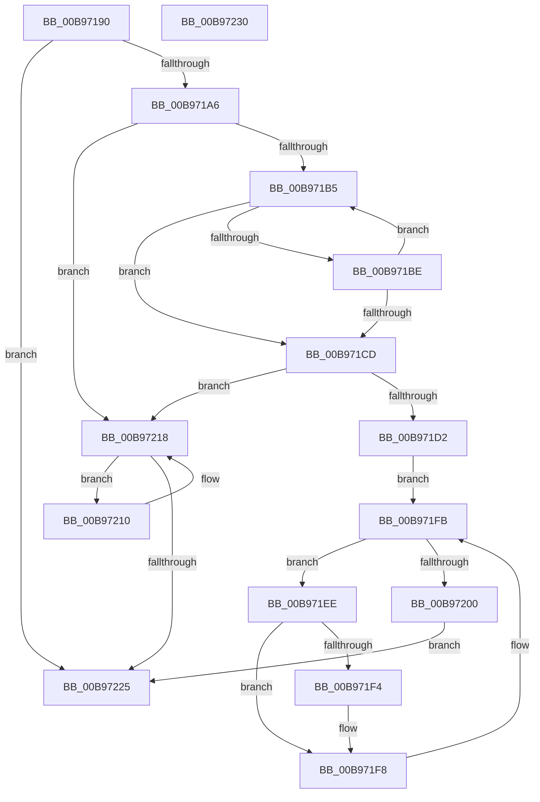

# VfHalDeleteDevice

- RVA: `0x00B97190`–`0x00B97231` (길이 `161` bytes)
- VA: `0x0000000140B97190`
- 실행 섹션: `PAGEVRFY`
- PDB 이름 있음: `예`; PDB Function 태그: `아니요`
- unwind 정보 RVA: `0x0005CAAC`
- 디코드: `45`개 명령, `161/161` bytes 표시
- 미해석 바이트: `0` (있으면 어셈블리에 `.byte`로 보존)

> 이 문서는 커널 이미지의 기계어와 PDB 기호를 분석해 생성했습니다. 4번과 5번은 함수 원형과 자료형을 바이너리 사용 방식에서 추정한 C 해석이며 원본 소스 복구 결과는 아닙니다.

## 1. Dependencies

- 직접 호출 지점: **4**; 고유 호출 대상: **4**
- 직접 호출자로 확인된 함수: **1**
- RIP 상대 이미지 참조: **3**

### Outgoing calls
- `0x00B971D9` → [KeAcquireSpinLockRaiseToDpc](../../text/20/KeAcquireSpinLockRaiseToDpc_function_00208470.md) (function, `0x00208470`)
- `0x00B97209` → [KeReleaseSpinLock](../../text/39/KeReleaseSpinLock_function_00392BA0.md) (function, `0x00392BA0`)
- `0x00B97213` → [ViReleaseDmaAdapter](ViReleaseDmaAdapter_function_00B99A0C.md) (function, `0x00B99A0C`)
- `0x00B9721B` → [VF_FIND_DEVICE_INFORMATION_AND_REMOVE](VF_FIND_DEVICE_INFORMATION_AND_REMOVE_function_00B9502C.md) (function, `0x00B9502C`)

### Direct callers
- [VfIoDeleteDevice](../BA/VfIoDeleteDevice_function_00BA221C.md) at `0x00BA2240`

### Static image references
- `0x00B9719A` → RVA `0x00F03FA4` (`.data`; read)
- `0x00B971D2` → RVA `0x00F03FD0` (`.data`; read)
- `0x00B971DE` → RVA `0x00F03FC0` (`.data`; read)

## 2. Other-region calls and transfers

- 다른 실행 섹션으로 향하는 call: **2**
  - `0x00B971D9` → [KeAcquireSpinLockRaiseToDpc](../../text/20/KeAcquireSpinLockRaiseToDpc_function_00208470.md) (`PAGEVRFY` → `.text`)
  - `0x00B97209` → [KeReleaseSpinLock](../../text/39/KeReleaseSpinLock_function_00392BA0.md) (`PAGEVRFY` → `.text`)
- 별도 외부 분기/꼬리 이동을 확인하지 못했습니다.

## 3. Assembly (complete function range)

```asm
00B97190  48 89 5C 24 08                  mov qword ptr [rsp + 8], rbx
00B97195  57                              push rdi
00B97196  48 83 EC 20                     sub rsp, 0x20
00B9719A  83 3D 03 CE 36 00 00            cmp dword ptr [rip + 0x36ce03], 0
00B971A1  48 8B D9                        mov rbx, rcx
00B971A4  74 7F                           je 0x140b97225
00B971A6  48 8B 81 38 01 00 00            mov rax, qword ptr [rcx + 0x138]
00B971AD  48 8B F9                        mov rdi, rcx
00B971B0  48 85 C0                        test rax, rax
00B971B3  74 63                           je 0x140b97218
00B971B5  48 8B 48 30                     mov rcx, qword ptr [rax + 0x30]
00B971B9  48 85 C9                        test rcx, rcx
00B971BC  74 0F                           je 0x140b971cd
00B971BE  48 8B 81 38 01 00 00            mov rax, qword ptr [rcx + 0x138]
00B971C5  48 8B F9                        mov rdi, rcx
00B971C8  48 85 C0                        test rax, rax
00B971CB  75 E8                           jne 0x140b971b5
00B971CD  48 3B FB                        cmp rdi, rbx
00B971D0  74 46                           je 0x140b97218
00B971D2  48 8D 0D F7 CD 36 00            lea rcx, [rip + 0x36cdf7]
00B971D9  E8 92 12 67 FF                  call 0x140208470
00B971DE  48 8B 15 DB CD 36 00            mov rdx, qword ptr [rip + 0x36cddb]
00B971E5  48 8D 0D D4 CD 36 00            lea rcx, [rip + 0x36cdd4]
00B971EC  EB 0D                           jmp 0x140b971fb
00B971EE  48 39 7A 40                     cmp qword ptr [rdx + 0x40], rdi
00B971F2  75 04                           jne 0x140b971f8
00B971F4  C6 42 48 01                     mov byte ptr [rdx + 0x48], 1
00B971F8  48 8B 12                        mov rdx, qword ptr [rdx]
00B971FB  48 3B CA                        cmp rcx, rdx
00B971FE  75 EE                           jne 0x140b971ee
00B97200  8A D0                           mov dl, al
00B97202  48 8D 0D C7 CD 36 00            lea rcx, [rip + 0x36cdc7]
00B97209  E8 92 B9 7F FF                  call 0x140392ba0
00B9720E  EB 15                           jmp 0x140b97225
00B97210  48 8B C8                        mov rcx, rax
00B97213  E8 F4 27 00 00                  call 0x140b99a0c
00B97218  48 8B CB                        mov rcx, rbx
00B9721B  E8 0C DE FF FF                  call 0x140b9502c
00B97220  48 85 C0                        test rax, rax
00B97223  75 EB                           jne 0x140b97210
00B97225  48 8B 5C 24 30                  mov rbx, qword ptr [rsp + 0x30]
00B9722A  48 83 C4 20                     add rsp, 0x20
00B9722E  5F                              pop rdi
00B9722F  C3                              ret
00B97230  CC                              int3
```

## 4. C-style interpretation (structured pseudocode)

```c
__int64 __fastcall VfHalDeleteDevice(__int64 a1)
{
    __int64 result;
    __int64 v_rsp;
    unsigned __int64 v_stack_p8;

    v_stack_p8 = v_rbx;
    v_rsp = (v_rsp) - (32);
    if ((*(unsigned int *)(v_rip + 3591683)) == 0) goto loc_00B97225;
    if (*(unsigned __int64 *)(a1 + 312) == 0) goto loc_00B97218;
loc_00B971B5:
    if (*(unsigned __int64 *)(*(unsigned __int64 *)(a1 + 312) + 48) == 0) goto loc_00B971CD;
    if (*(unsigned __int64 *)(*(unsigned __int64 *)(*(unsigned __int64 *)(a1 + 312) + 48) + 312) != 0) goto loc_00B971B5;
loc_00B971CD:
    if ((*(unsigned __int64 *)(*(unsigned __int64 *)(a1 + 312) + 48)) == a1) goto loc_00B97218;
    result = KeAcquireSpinLockRaiseToDpc(v_rip + 3591671, a2, a3, a4);
    goto loc_00B971FB;
loc_00B971EE:
    if ((*(unsigned __int64 *)(*(unsigned __int64 *)(v_rip + 3591643) + 64)) == (*(unsigned __int64 *)(*(unsigned __int64 *)(a1 + 312) + 48))) {
        *(unsigned __int8 *)(*(unsigned __int64 *)(v_rip + 3591643) + 72) = 1;
    }
loc_00B971FB:
    if ((v_rip + 3591636) != (*(unsigned __int64 *)(*(unsigned __int64 *)(v_rip + 3591643)))) goto loc_00B971EE;
    result = KeReleaseSpinLock(v_rip + 3591623, (unsigned __int8)(result), a3, a4);
    goto loc_00B97225;
loc_00B97210:
    result = ViReleaseDmaAdapter(result, (unsigned __int8)(result), a3, a4);
loc_00B97218:
    result = VF_FIND_DEVICE_INFORMATION_AND_REMOVE(a1, (unsigned __int8)(result), a3, a4);
    if (result != 0) goto loc_00B97210;
loc_00B97225:
    v_rsp = (v_rsp) + (32);
    return result;
}
```

## 5. (Beta) C Style

```c
int64_t VfHalDeleteDevice(void *Arg1)
{
    uint8_t *arg1 = (uint8_t *)Arg1;

    int64_t result;
    int64_t local_rsp;
    uint64_t v_stack_p8;

    v_stack_p8 = local_rbx;
    local_rsp = (local_rsp) - (32);
    if ((*(uint32_t *)(v_rip + 0x36CE03)) == 0) goto loc_00B97225;
    if (*(uint64_t *)(arg1 + 0x138) == 0) goto loc_00B97218;
loc_00B971B5:
    if (*(uint64_t *)(*(uint64_t *)(arg1 + 0x138) + 0x30) == 0) goto loc_00B971CD;
    if (*(uint64_t *)(*(uint64_t *)(*(uint64_t *)(arg1 + 0x138) + 0x30) + 0x138) != 0) goto loc_00B971B5;
loc_00B971CD:
    if ((*(uint64_t *)(*(uint64_t *)(arg1 + 0x138) + 0x30)) == Arg1) goto loc_00B97218;
    result = KeAcquireSpinLockRaiseToDpc(v_rip + 3591671, a2, a3, a4);
    goto loc_00B971FB;
loc_00B971EE:
    if ((*(uint64_t *)(*(uint64_t *)(v_rip + 0x36CDDB) + 0x40)) == (*(uint64_t *)(*(uint64_t *)(arg1 + 0x138) + 0x30))) {
        *(uint8_t *)(*(uint64_t *)(v_rip + 0x36CDDB) + 0x48) = 1;
    }
loc_00B971FB:
    if ((v_rip + 3591636) != (*(uint64_t *)(*(uint64_t *)(v_rip + 0x36CDDB)))) goto loc_00B971EE;
    result = KeReleaseSpinLock(v_rip + 3591623, (uint8_t)(result), a3, a4);
    goto loc_00B97225;
loc_00B97210:
    result = ViReleaseDmaAdapter(result, (uint8_t)(result), a3, a4);
loc_00B97218:
    result = VF_FIND_DEVICE_INFORMATION_AND_REMOVE(Arg1, (uint8_t)(result), a3, a4);
    if (result != 0) goto loc_00B97210;
loc_00B97225:
    local_rsp = (local_rsp) + (32);
    return result;
}
```

### 관측된 메모리 오프셋

구조체 형식이 확인되지 않은 접근은 인자 기준의 오프셋으로만 기록했습니다.

| 기준 인자 | 오프셋 표현 | 폭 (bit) | 접근 |
|---|---:|---:|---|
| `Arg1` | `+ 0x138` | `64` | `R` |

## 6. Execution-region graph

[열기: 2D/3D 그래프와 함수 탐색 컨트롤 패널](../../../control-panel.html?section=pagevrfy&rva=0x00B97190&view=graph)

- 2D 그래프는 위에서 아래로 흐르고, 3D 그래프는 빈 공간을 드래그해 회전합니다. Shift+드래그는 이동, 휠은 확대·축소, 함수 노드 선택은 대상 보고서 이동입니다.

### Static fallback


