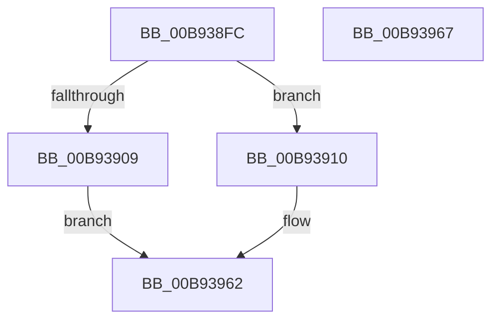

# VfInitDifWithoutReboot

- RVA: `0x00B938FC`–`0x00B93968` (길이 `108` bytes)
- VA: `0x0000000140B938FC`
- 실행 섹션: `PAGEVRFY`
- PDB 이름 있음: `예`; PDB Function 태그: `아니요`
- unwind 정보 RVA: `0x0005C788`
- 디코드: `21`개 명령, `108/108` bytes 표시
- 미해석 바이트: `0` (있으면 어셈블리에 `.byte`로 보존)

> 이 문서는 커널 이미지의 기계어와 PDB 기호를 분석해 생성했습니다. 4번과 5번은 함수 원형과 자료형을 바이너리 사용 방식에서 추정한 C 해석이며 원본 소스 복구 결과는 아닙니다.

## 1. Dependencies

- 직접 호출 지점: **2**; 고유 호출 대상: **1**
- 직접 호출자로 확인된 함수: **1**
- RIP 상대 이미지 참조: **11**

### Outgoing calls
- `0x00B93917` → [MmLockPagableDataSection](../../page/A7/MmLockPagableDataSection_function_00A73E80.md) (function, `0x00A73E80`)
- `0x00B9392A` → [MmLockPagableDataSection](../../page/A7/MmLockPagableDataSection_function_00A73E80.md) (function, `0x00A73E80`)

### Direct callers
- [VfVolatileSetDifRuleClass](../../text/61/VfVolatileSetDifRuleClass_function_00616AA4.md) at `0x00616BB9`

### Static image references
- `0x00B93900` → RVA `0x00F0437C` (`.data`; read)
- `0x00B93910` → RVA `0x00B93AC0` (`VfInitVerifierComponents`; read)
- `0x00B9391C` → RVA `0x00FF400C` (`PAGEVRFD`; read)
- `0x00B93923` → RVA `0x00F04358` (`.data`; write)
- `0x00B9392F` → RVA `0x00F04360` (`.data`; write)
- `0x00B93936` → RVA `0x00F04890` (`.data`; read)
- `0x00B9393D` → RVA `0x00F04898` (`.data`; write)
- `0x00B93944` → RVA `0x00F04890` (`.data`; write)
- `0x00B9394B` → RVA `0x00F048A0` (`.data`; read)
- `0x00B93952` → RVA `0x00F048A8` (`.data`; write)
- `0x00B93959` → RVA `0x00F048A0` (`.data`; write)

## 2. Other-region calls and transfers

- 다른 실행 섹션으로 향하는 call: **2**
  - `0x00B93917` → [MmLockPagableDataSection](../../page/A7/MmLockPagableDataSection_function_00A73E80.md) (`PAGEVRFY` → `PAGE`)
  - `0x00B9392A` → [MmLockPagableDataSection](../../page/A7/MmLockPagableDataSection_function_00A73E80.md) (`PAGEVRFY` → `PAGE`)
- 별도 외부 분기/꼬리 이동을 확인하지 못했습니다.

## 3. Assembly (complete function range)

```asm
00B938FC  48 83 EC 28                     sub rsp, 0x28
00B93900  83 3D 75 0A 37 00 00            cmp dword ptr [rip + 0x370a75], 0
00B93907  74 07                           je 0x140b93910
00B93909  B8 7E 0C 00 C0                  mov eax, 0xc0000c7e
00B9390E  EB 52                           jmp 0x140b93962
00B93910  48 8D 0D A9 01 00 00            lea rcx, [rip + 0x1a9]
00B93917  E8 64 05 EE FF                  call 0x140a73e80
00B9391C  48 8D 0D E9 06 46 00            lea rcx, [rip + 0x4606e9]
00B93923  48 89 05 2E 0A 37 00            mov qword ptr [rip + 0x370a2e], rax
00B9392A  E8 51 05 EE FF                  call 0x140a73e80
00B9392F  48 89 05 2A 0A 37 00            mov qword ptr [rip + 0x370a2a], rax
00B93936  48 8D 05 53 0F 37 00            lea rax, [rip + 0x370f53]
00B9393D  48 89 05 54 0F 37 00            mov qword ptr [rip + 0x370f54], rax
00B93944  48 89 05 45 0F 37 00            mov qword ptr [rip + 0x370f45], rax
00B9394B  48 8D 05 4E 0F 37 00            lea rax, [rip + 0x370f4e]
00B93952  48 89 05 4F 0F 37 00            mov qword ptr [rip + 0x370f4f], rax
00B93959  48 89 05 40 0F 37 00            mov qword ptr [rip + 0x370f40], rax
00B93960  33 C0                           xor eax, eax
00B93962  48 83 C4 28                     add rsp, 0x28
00B93966  C3                              ret
00B93967  CC                              int3
```

## 4. C-style interpretation (structured pseudocode)

```c
__int64 __fastcall VfInitDifWithoutReboot(void)
{
    __int64 result;
    __int64 v_rsp;

    v_rsp = (v_rsp) - (40);
    if ((*(unsigned int *)(v_rip + 3607157)) == 0) goto loc_00B93910;
    goto loc_00B93962;
loc_00B93910:
    result = MmLockPagableDataSection(v_rip + 425, a2, a3, a4);
    *(unsigned __int64 *)(v_rip + 3607086) = result;
    result = MmLockPagableDataSection(v_rip + 4589289, a2, a3, a4);
    *(unsigned __int64 *)(v_rip + 3607082) = result;
    *(unsigned __int64 *)(v_rip + 3608404) = v_rip + 3608403;
    *(unsigned __int64 *)(v_rip + 3608389) = v_rip + 3608403;
    *(unsigned __int64 *)(v_rip + 3608399) = v_rip + 3608398;
    *(unsigned __int64 *)(v_rip + 3608384) = v_rip + 3608398;
    result = 0;
loc_00B93962:
    v_rsp = (v_rsp) + (40);
    return result;
}
```

## 5. (Beta) C Style

```c
void VfInitDifWithoutReboot(void)
{
    int64_t result;
    int64_t local_rsp;

    local_rsp = (local_rsp) - (40);
    if ((*(uint32_t *)(v_rip + 0x370A75)) == 0) goto loc_00B93910;
    goto loc_00B93962;
loc_00B93910:
    result = MmLockPagableDataSection(v_rip + 425, a2, a3, a4);
    *(uint64_t *)(v_rip + 0x370A2E) = result;
    result = MmLockPagableDataSection(v_rip + 4589289, a2, a3, a4);
    *(uint64_t *)(v_rip + 0x370A2A) = result;
    *(uint64_t *)(v_rip + 0x370F54) = v_rip + 3608403;
    *(uint64_t *)(v_rip + 0x370F45) = v_rip + 3608403;
    *(uint64_t *)(v_rip + 0x370F4F) = v_rip + 3608398;
    *(uint64_t *)(v_rip + 0x370F40) = v_rip + 3608398;
    result = 0;
loc_00B93962:
    local_rsp = (local_rsp) + (40);
    return result;
}
```

## 6. Execution-region graph

[열기: 2D/3D 그래프와 함수 탐색 컨트롤 패널](../../../control-panel.html?section=pagevrfy&rva=0x00B938FC&view=graph)

- 2D 그래프는 위에서 아래로 흐르고, 3D 그래프는 빈 공간을 드래그해 회전합니다. Shift+드래그는 이동, 휠은 확대·축소, 함수 노드 선택은 대상 보고서 이동입니다.

### Static fallback


