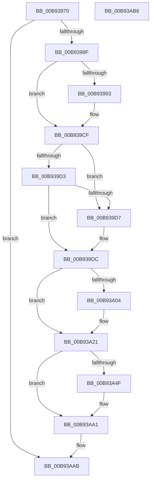

# VfInitSystemNoRebootNeeded

- RVA: `0x00B93970`–`0x00B93AB7` (길이 `327` bytes)
- VA: `0x0000000140B93970`
- 실행 섹션: `PAGEVRFY`
- PDB 이름 있음: `예`; PDB Function 태그: `아니요`
- unwind 정보 RVA: `0x0005CAAC`
- 디코드: `68`개 명령, `327/327` bytes 표시
- 미해석 바이트: `0` (있으면 어셈블리에 `.byte`로 보존)

> 이 문서는 커널 이미지의 기계어와 PDB 기호를 분석해 생성했습니다. 4번과 5번은 함수 원형과 자료형을 바이너리 사용 방식에서 추정한 C 해석이며 원본 소스 복구 결과는 아닙니다.

## 1. Dependencies

- 직접 호출 지점: **12**; 고유 호출 대상: **10**
- 직접 호출자로 확인된 함수: **3**
- RIP 상대 이미지 참조: **23**

### Outgoing calls
- `0x00B939A4` → [MmLockPagableDataSection](../../page/A7/MmLockPagableDataSection_function_00A73E80.md) (function, `0x00A73E80`)
- `0x00B939B7` → [MmLockPagableDataSection](../../page/A7/MmLockPagableDataSection_function_00A73E80.md) (function, `0x00A73E80`)
- `0x00B939CA` → [MmLockPagableDataSection](../../page/A7/MmLockPagableDataSection_function_00A73E80.md) (function, `0x00A73E80`)
- `0x00B939D7` → [ExDisableAllLookasideLists](../../text/65/ExDisableAllLookasideLists_function_0065911C.md) (function, `0x0065911C`)
- `0x00B93A1C` → [ExSetPoolFlags](../../text/65/ExSetPoolFlags_function_006567C4.md) (function, `0x006567C4`)
- `0x00B93A65` → [VfInitVerifierComponents](VfInitVerifierComponents_function_00B93AC0.md) (function, `0x00B93AC0`)
- `0x00B93A6A` → [VfFaultsInitPhase0](../BA/VfFaultsInitPhase0_function_00BA6328.md) (function, `0x00BA6328`)
- `0x00B93A6F` → [VfPoolInitPhase1](../BA/VfPoolInitPhase1_function_00BAA3E0.md) (function, `0x00BAA3E0`)
- `0x00B93A74` → [VfSettingsMiscellaneousChecksInitPhase1](../BA/VfSettingsMiscellaneousChecksInitPhase1_function_00BAB32C.md) (function, `0x00BAB32C`)
- `0x00B93A79` → [VfPendingInitPhase1](../BA/VfPendingInitPhase1_function_00BA1AA4.md) (function, `0x00BA1AA4`)
- `0x00B93A84` → [IoVerifierInit](IoVerifierInit_function_00B92314.md) (function, `0x00B92314`)
- `0x00B93A92` → [PsSetCreateProcessNotifyRoutine](../../page/78/PsSetCreateProcessNotifyRoutine_function_00787760.md) (function, `0x00787760`)

### Direct callers
- [VfAddVerifierEntry](../BA/VfAddVerifierEntry_function_00BAC31C.md) at `0x00BAC364`
- [VfSetVerifierInformation](../BA/VfSetVerifierInformation_function_00BAC4EC.md) at `0x00BAC57B`
- [ViInitSystemPhase0](../../init/C4/ViInitSystemPhase0_function_00C4C1B0.md) at `0x00C4C5C1`

### Static image references
- `0x00B9397A` → RVA `0x00F0437C` (`.data`; read)
- `0x00B93983` → RVA `0x00F04ABC` (`.data`; read)
- `0x00B93993` → RVA `0x00B93AC0` (`VfInitVerifierComponents`; read)
- `0x00B9399A` → RVA `0x00F04368` (`.data`; write)
- `0x00B939A9` → RVA `0x00FF400C` (`PAGEVRFD`; read)
- `0x00B939B0` → RVA `0x00F04358` (`.data`; write)
- `0x00B939BC` → RVA `0x00B8B030` (`ViShortTime`; read)
- `0x00B939C3` → RVA `0x00F04360` (`.data`; write)
- `0x00B939DC` → RVA `0x00E0E950` (`.data`; read)
- `0x00B939EA` → RVA `0x00F04384` (`.data`; write)
- `0x00B939F9` → RVA `0x00F04A20` (`.data`; write)
- `0x00B93A0D` → RVA `0x00E0E950` (`.data`; write)
- `0x00B93A21` → RVA `0x00F04890` (`.data`; read)
- `0x00B93A28` → RVA `0x00F04898` (`.data`; write)
- `0x00B93A2F` → RVA `0x00F04890` (`.data`; write)
- `0x00B93A36` → RVA `0x00F048A0` (`.data`; read)
- `0x00B93A3D` → RVA `0x00F048A8` (`.data`; write)
- `0x00B93A44` → RVA `0x00F048A0` (`.data`; write)
- `0x00B93A59` → RVA `0x00F04A04` (`.data`; read)
- `0x00B93A5F` → RVA `0x00F04A20` (`.data`; read)
- `0x00B93A8B` → RVA `0x00615F40` (`VfCreateProcessCallback`; read)
- `0x00B93A97` → RVA `0x00FFDA8C` (`PAGEVRFD`; write)
- `0x00B93AA1` → RVA `0x00F0437C` (`.data`; write)

## 2. Other-region calls and transfers

- 다른 실행 섹션으로 향하는 call: **6**
  - `0x00B939A4` → [MmLockPagableDataSection](../../page/A7/MmLockPagableDataSection_function_00A73E80.md) (`PAGEVRFY` → `PAGE`)
  - `0x00B939B7` → [MmLockPagableDataSection](../../page/A7/MmLockPagableDataSection_function_00A73E80.md) (`PAGEVRFY` → `PAGE`)
  - `0x00B939CA` → [MmLockPagableDataSection](../../page/A7/MmLockPagableDataSection_function_00A73E80.md) (`PAGEVRFY` → `PAGE`)
  - `0x00B939D7` → [ExDisableAllLookasideLists](../../text/65/ExDisableAllLookasideLists_function_0065911C.md) (`PAGEVRFY` → `.text`)
  - `0x00B93A1C` → [ExSetPoolFlags](../../text/65/ExSetPoolFlags_function_006567C4.md) (`PAGEVRFY` → `.text`)
  - `0x00B93A92` → [PsSetCreateProcessNotifyRoutine](../../page/78/PsSetCreateProcessNotifyRoutine_function_00787760.md) (`PAGEVRFY` → `PAGE`)
- 별도 외부 분기/꼬리 이동을 확인하지 못했습니다.

## 3. Assembly (complete function range)

```asm
00B93970  48 89 5C 24 08                  mov qword ptr [rsp + 8], rbx
00B93975  57                              push rdi
00B93976  48 83 EC 20                     sub rsp, 0x20
00B9397A  83 3D FB 09 37 00 00            cmp dword ptr [rip + 0x3709fb], 0
00B93981  8B DA                           mov ebx, edx
00B93983  8B 3D 33 11 37 00               mov edi, dword ptr [rip + 0x371133]
00B93989  0F 85 1C 01 00 00               jne 0x140b93aab
00B9398F  85 D2                           test edx, edx
00B93991  75 3C                           jne 0x140b939cf
00B93993  48 8D 0D 26 01 00 00            lea rcx, [rip + 0x126]
00B9399A  C7 05 C4 09 37 00 01 00 00 00   mov dword ptr [rip + 0x3709c4], 1
00B939A4  E8 D7 04 EE FF                  call 0x140a73e80
00B939A9  48 8D 0D 5C 06 46 00            lea rcx, [rip + 0x46065c]
00B939B0  48 89 05 A1 09 37 00            mov qword ptr [rip + 0x3709a1], rax
00B939B7  E8 C4 04 EE FF                  call 0x140a73e80
00B939BC  48 8D 0D 6D 76 FF FF            lea rcx, [rip - 0x8993]
00B939C3  48 89 05 96 09 37 00            mov qword ptr [rip + 0x370996], rax
00B939CA  E8 B1 04 EE FF                  call 0x140a73e80
00B939CF  85 FF                           test edi, edi
00B939D1  75 04                           jne 0x140b939d7
00B939D3  85 DB                           test ebx, ebx
00B939D5  75 05                           jne 0x140b939dc
00B939D7  E8 40 57 AC FF                  call 0x14065911c
00B939DC  8B 0D 6E AF 27 00               mov ecx, dword ptr [rip + 0x27af6e]
00B939E2  BA BB 09 00 00                  mov edx, 0x9bb
00B939E7  83 F9 FF                        cmp ecx, -1
00B939EA  C7 05 90 09 37 00 FF 1F 00 00   mov dword ptr [rip + 0x370990], 0x1fff
00B939F4  8B C1                           mov eax, ecx
00B939F6  0F 44 C2                        cmove eax, edx
00B939F9  89 05 21 10 37 00               mov dword ptr [rip + 0x371021], eax
00B939FF  83 FF 01                        cmp edi, 1
00B93A02  75 1D                           jne 0x140b93a21
00B93A04  BA DF FF FF FF                  mov edx, 0xffffffdf
00B93A09  23 CA                           and ecx, edx
00B93A0B  23 C2                           and eax, edx
00B93A0D  89 0D 3D AF 27 00               mov dword ptr [rip + 0x27af3d], ecx
00B93A13  8D 4F 07                        lea ecx, [rdi + 7]
00B93A16  89 05 04 10 37 00               mov dword ptr [rip + 0x371004], eax
00B93A1C  E8 A3 2D AC FF                  call 0x1406567c4
00B93A21  48 8D 05 68 0E 37 00            lea rax, [rip + 0x370e68]
00B93A28  48 89 05 69 0E 37 00            mov qword ptr [rip + 0x370e69], rax
00B93A2F  48 89 05 5A 0E 37 00            mov qword ptr [rip + 0x370e5a], rax
00B93A36  48 8D 05 63 0E 37 00            lea rax, [rip + 0x370e63]
00B93A3D  48 89 05 64 0E 37 00            mov qword ptr [rip + 0x370e64], rax
00B93A44  48 89 05 55 0E 37 00            mov qword ptr [rip + 0x370e55], rax
00B93A4B  85 DB                           test ebx, ebx
00B93A4D  75 52                           jne 0x140b93aa1
00B93A4F  44 8B 05 66 10 37 00            mov r8d, dword ptr [rip + 0x371066]
00B93A56  41 B1 01                        mov r9b, 1
00B93A59  8B 15 A5 0F 37 00               mov edx, dword ptr [rip + 0x370fa5]
00B93A5F  8B 0D BB 0F 37 00               mov ecx, dword ptr [rip + 0x370fbb]
00B93A65  E8 56 00 00 00                  call 0x140b93ac0
00B93A6A  E8 B9 28 01 00                  call 0x140ba6328
00B93A6F  E8 6C 69 01 00                  call 0x140baa3e0
00B93A74  E8 B3 78 01 00                  call 0x140bab32c
00B93A79  E8 26 E0 00 00                  call 0x140ba1aa4
00B93A7E  8B 0D 9C 0F 37 00               mov ecx, dword ptr [rip + 0x370f9c]
00B93A84  E8 8B E8 FF FF                  call 0x140b92314
00B93A89  33 D2                           xor edx, edx
00B93A8B  48 8D 0D AE 24 A8 FF            lea rcx, [rip - 0x57db52]
00B93A92  E8 C9 3C BF FF                  call 0x140787760
00B93A97  C7 05 EB 9F 46 00 01 00 00 00   mov dword ptr [rip + 0x469feb], 1
00B93AA1  C7 05 D1 08 37 00 01 00 00 00   mov dword ptr [rip + 0x3708d1], 1
00B93AAB  48 8B 5C 24 30                  mov rbx, qword ptr [rsp + 0x30]
00B93AB0  48 83 C4 20                     add rsp, 0x20
00B93AB4  5F                              pop rdi
00B93AB5  C3                              ret
00B93AB6  CC                              int3
```

## 4. C-style interpretation (structured pseudocode)

```c
__int64 __fastcall VfInitSystemNoRebootNeeded(__int64 a1, int a2)
{
    __int64 result;
    __int64 v_rsp;
    unsigned __int64 v_stack_p8;

    v_stack_p8 = v_rbx;
    v_rsp = (v_rsp) - (32);
    if ((*(unsigned int *)(v_rip + 3607035)) != 0) goto loc_00B93AAB;
    if (a2 == 0) {
        a1 = v_rip + 294;
        *(unsigned int *)(v_rip + 3606980) = 1;
        result = MmLockPagableDataSection(a1, a2, a3, a4);
        a1 = v_rip + 4589148;
        *(unsigned __int64 *)(v_rip + 3606945) = result;
        result = MmLockPagableDataSection(a1, a2, a3, a4);
        a1 = v_rip - 35219;
        *(unsigned __int64 *)(v_rip + 3606934) = result;
        result = MmLockPagableDataSection(a1, a2, a3, a4);
    }
    if ((unsigned int)((unsigned int)(*(unsigned int *)(v_rip + 3608883))) != 0) goto loc_00B939D7;
    if ((unsigned int)((unsigned int)(a2)) == 0) {
        result = ExDisableAllLookasideLists(a1, a2, a3, a4);
    }
    *(unsigned int *)(v_rip + 3606928) = 0x1FFFULL;
    result = (unsigned int)((unsigned int)((unsigned int)(*(unsigned int *)(v_rip + 2600814))));
    if (((unsigned int)((unsigned int)(*(unsigned int *)(v_rip + 2600814)))) == -1) { result = (unsigned int)((unsigned int)(0x9BBULL)); }
    *(unsigned int *)(v_rip + 3608609) = (unsigned int)(result);
    if (((unsigned int)((unsigned int)(*(unsigned int *)(v_rip + 3608883)))) == 1) {
        a2 = 0xFFFFFFDFULL;
        a1 = (unsigned int)(((unsigned int)(*(unsigned int *)(v_rip + 2600814))) & (a2));
        result = (unsigned int)((result) & (a2));
        *(unsigned int *)(v_rip + 2600765) = (unsigned int)(a1);
        a1 = (unsigned int)(*(unsigned int *)(v_rip + 3608883)) + 7;
        *(unsigned int *)(v_rip + 3608580) = (unsigned int)(result);
        result = ExSetPoolFlags(a1, a2, a3, a4);
    }
    *(unsigned __int64 *)(v_rip + 3608169) = v_rip + 3608168;
    *(unsigned __int64 *)(v_rip + 3608154) = v_rip + 3608168;
    *(unsigned __int64 *)(v_rip + 3608164) = v_rip + 3608163;
    *(unsigned __int64 *)(v_rip + 3608149) = v_rip + 3608163;
    result = v_rip + 3608163;
    if ((unsigned int)((unsigned int)(a2)) == 0) {
        a3 = *(unsigned int *)(v_rip + 3608678);
        a4 = 1;
        a2 = *(unsigned int *)(v_rip + 3608485);
        a1 = *(unsigned int *)(v_rip + 3608507);
        result = VfInitVerifierComponents(a1, a2, a3, a4);
        result = VfFaultsInitPhase0(a1, a2, a3, a4);
        result = VfPoolInitPhase1(a1, a2, a3, a4);
        result = VfSettingsMiscellaneousChecksInitPhase1(a1, a2, a3, a4);
        result = VfPendingInitPhase1(a1, a2, a3, a4);
        a1 = *(unsigned int *)(v_rip + 3608476);
        result = IoVerifierInit(a1, a2, a3, a4);
        a2 = 0;
        a1 = v_rip - 5757778;
        result = PsSetCreateProcessNotifyRoutine(a1, a2, a3, a4);
        *(unsigned int *)(v_rip + 4628459) = 1;
    }
    *(unsigned int *)(v_rip + 3606737) = 1;
loc_00B93AAB:
    v_rsp = (v_rsp) + (32);
    return result;
}
```

## 5. (Beta) C Style

```c
int64_t VfInitSystemNoRebootNeeded(int64_t Arg1, int32_t Arg2)
{
    int64_t result;
    int64_t local_rsp;
    uint64_t v_stack_p8;

    v_stack_p8 = local_rbx;
    local_rsp = (local_rsp) - (32);
    if ((*(uint32_t *)(v_rip + 0x3709FB)) != 0) goto loc_00B93AAB;
    if (Arg2 == 0) {
        Arg1 = v_rip + 294;
        *(uint32_t *)(v_rip + 0x3709C4) = 1;
        result = MmLockPagableDataSection(Arg1, Arg2, a3, a4);
        Arg1 = v_rip + 4589148;
        *(uint64_t *)(v_rip + 0x3709A1) = result;
        result = MmLockPagableDataSection(Arg1, Arg2, a3, a4);
        Arg1 = v_rip - 35219;
        *(uint64_t *)(v_rip + 0x370996) = result;
        result = MmLockPagableDataSection(Arg1, Arg2, a3, a4);
    }
    if ((uint32_t)((uint32_t)(*(uint32_t *)(v_rip + 0x371133))) != 0) goto loc_00B939D7;
    if ((uint32_t)((uint32_t)(Arg2)) == 0) {
        result = ExDisableAllLookasideLists(Arg1, Arg2, a3, a4);
    }
    *(uint32_t *)(v_rip + 0x370990) = 0x1FFFULL;
    result = (uint32_t)((uint32_t)((uint32_t)(*(uint32_t *)(v_rip + 0x27AF6E))));
    if (((uint32_t)((uint32_t)(*(uint32_t *)(v_rip + 0x27AF6E)))) == -1) { result = (uint32_t)((uint32_t)(0x9BBULL)); }
    *(uint32_t *)(v_rip + 0x371021) = (uint32_t)(result);
    if (((uint32_t)((uint32_t)(*(uint32_t *)(v_rip + 0x371133)))) == 1) {
        Arg2 = 0xFFFFFFDFULL;
        Arg1 = (uint32_t)(((uint32_t)(*(uint32_t *)(v_rip + 0x27AF6E))) & (Arg2));
        result = (uint32_t)((result) & (Arg2));
        *(uint32_t *)(v_rip + 0x27AF3D) = (uint32_t)(Arg1);
        Arg1 = (uint32_t)(*(uint32_t *)(v_rip + 0x371133)) + 7;
        *(uint32_t *)(v_rip + 0x371004) = (uint32_t)(result);
        result = ExSetPoolFlags(Arg1, Arg2, a3, a4);
    }
    *(uint64_t *)(v_rip + 0x370E69) = v_rip + 3608168;
    *(uint64_t *)(v_rip + 0x370E5A) = v_rip + 3608168;
    *(uint64_t *)(v_rip + 0x370E64) = v_rip + 3608163;
    *(uint64_t *)(v_rip + 0x370E55) = v_rip + 3608163;
    result = v_rip + 3608163;
    if ((uint32_t)((uint32_t)(Arg2)) == 0) {
        a3 = *(uint32_t *)(v_rip + 0x371066);
        a4 = 1;
        Arg2 = *(uint32_t *)(v_rip + 0x370FA5);
        Arg1 = *(uint32_t *)(v_rip + 0x370FBB);
        result = VfInitVerifierComponents(Arg1, Arg2, a3, a4);
        result = VfFaultsInitPhase0(Arg1, Arg2, a3, a4);
        result = VfPoolInitPhase1(Arg1, Arg2, a3, a4);
        result = VfSettingsMiscellaneousChecksInitPhase1(Arg1, Arg2, a3, a4);
        result = VfPendingInitPhase1(Arg1, Arg2, a3, a4);
        Arg1 = *(uint32_t *)(v_rip + 0x370F9C);
        result = IoVerifierInit(Arg1, Arg2, a3, a4);
        Arg2 = 0;
        Arg1 = v_rip - 5757778;
        result = PsSetCreateProcessNotifyRoutine(Arg1, Arg2, a3, a4);
        *(uint32_t *)(v_rip + 0x469FEB) = 1;
    }
    *(uint32_t *)(v_rip + 0x3708D1) = 1;
loc_00B93AAB:
    local_rsp = (local_rsp) + (32);
    return result;
}
```

## 6. Execution-region graph

[열기: 2D/3D 그래프와 함수 탐색 컨트롤 패널](../../../control-panel.html?section=pagevrfy&rva=0x00B93970&view=graph)

- 2D 그래프는 위에서 아래로 흐르고, 3D 그래프는 빈 공간을 드래그해 회전합니다. Shift+드래그는 이동, 휠은 확대·축소, 함수 노드 선택은 대상 보고서 이동입니다.

### Static fallback


