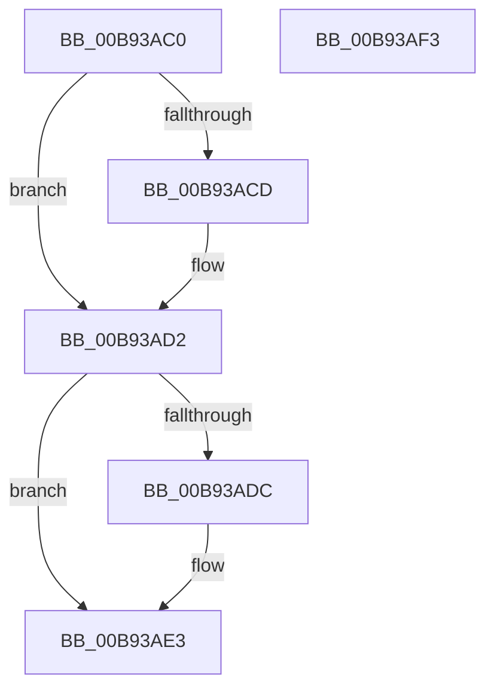

# VfInitVerifierComponents

- RVA: `0x00B93AC0`–`0x00B93AF4` (길이 `52` bytes)
- VA: `0x0000000140B93AC0`
- 실행 섹션: `PAGEVRFY`
- PDB 이름 있음: `예`; PDB Function 태그: `아니요`
- unwind 정보 RVA: `0x0005CF00`
- 디코드: `16`개 명령, `52/52` bytes 표시
- 미해석 바이트: `0` (있으면 어셈블리에 `.byte`로 보존)

> 이 문서는 커널 이미지의 기계어와 PDB 기호를 분석해 생성했습니다. 4번과 5번은 함수 원형과 자료형을 바이너리 사용 방식에서 추정한 C 해석이며 원본 소스 복구 결과는 아닙니다.

## 1. Dependencies

- 직접 호출 지점: **2**; 고유 호출 대상: **2**
- 직접 호출자로 확인된 함수: **2**
- RIP 상대 이미지 참조: **2**

### Outgoing calls
- `0x00B93ACD` → [VfKeCheckForChanges](../BA/VfKeCheckForChanges_function_00BA5FEC.md) (function, `0x00BA5FEC`)
- `0x00B93ADE` → [ViSettingsIoCheckForChanges](../BA/ViSettingsIoCheckForChanges_function_00BAB3BC.md) (function, `0x00BAB3BC`)

### Direct callers
- [VfInitSystemNoRebootNeeded](VfInitSystemNoRebootNeeded_function_00B93970.md) at `0x00B93A65`
- [VfInitBootDriversLoaded](../../init/C4/VfInitBootDriversLoaded_function_00C4BD0C.md) at `0x00C4BF3E`

### Static image references
- `0x00B93AD2` → RVA `0x00F04A20` (`.data`; read)
- `0x00B93AE3` → RVA `0x00F04984` (`.data`; write)

## 2. Other-region calls and transfers

- 다른 실행 섹션으로 향하는 call: **0**
- 별도 외부 분기/꼬리 이동을 확인하지 못했습니다.

## 3. Assembly (complete function range)

```asm
00B93AC0  40 53                           push rbx
00B93AC2  48 83 EC 20                     sub rsp, 0x20
00B93AC6  8B D9                           mov ebx, ecx
00B93AC8  45 84 C9                        test r9b, r9b
00B93ACB  74 05                           je 0x140b93ad2
00B93ACD  E8 1A 25 01 00                  call 0x140ba5fec
00B93AD2  8B 05 48 0F 37 00               mov eax, dword ptr [rip + 0x370f48]
00B93AD8  A8 10                           test al, 0x10
00B93ADA  74 07                           je 0x140b93ae3
00B93ADC  8B CB                           mov ecx, ebx
00B93ADE  E8 D9 78 01 00                  call 0x140bab3bc
00B93AE3  C7 05 97 0E 37 00 01 00 00 00   mov dword ptr [rip + 0x370e97], 1
00B93AED  48 83 C4 20                     add rsp, 0x20
00B93AF1  5B                              pop rbx
00B93AF2  C3                              ret
00B93AF3  CC                              int3
```

## 4. C-style interpretation (structured pseudocode)

```c
__int64 __fastcall VfInitVerifierComponents(int a1, __int64 a2, __int64 a3, unsigned __int8 a4)
{
    __int64 result;
    __int64 v_rsp;

    v_rsp = (v_rsp) - (32);
    if (a4 != 0) {
        result = VfKeCheckForChanges(a1, a2, a3, a4);
    }
    result = (unsigned int)(*(unsigned int *)(v_rip + 3608392));
    if ((((unsigned __int8)((unsigned int)(*(unsigned int *)(v_rip + 3608392)))) & (16)) != 0) {
        a1 = (unsigned int)((unsigned int)(a1));
        result = ViSettingsIoCheckForChanges(a1, a2, a3, a4);
    }
    *(unsigned int *)(v_rip + 3608215) = 1;
    v_rsp = (v_rsp) + (32);
    return result;
}
```

## 5. (Beta) C Style

```c
int64_t VfInitVerifierComponents(int32_t Arg1, int64_t Arg2, int64_t Arg3, uint8_t Arg4)
{
    int64_t result;
    int64_t local_rsp;

    local_rsp = (local_rsp) - (32);
    if (Arg4 != 0) {
        result = VfKeCheckForChanges(Arg1, Arg2, Arg3, Arg4);
    }
    result = (uint32_t)(*(uint32_t *)(v_rip + 0x370F48));
    if ((((uint8_t)((uint32_t)(*(uint32_t *)(v_rip + 0x370F48)))) & (16)) != 0) {
        Arg1 = (uint32_t)((uint32_t)(Arg1));
        result = ViSettingsIoCheckForChanges(Arg1, Arg2, Arg3, Arg4);
    }
    *(uint32_t *)(v_rip + 0x370E97) = 1;
    local_rsp = (local_rsp) + (32);
    return result;
}
```

## 6. Execution-region graph

[열기: 2D/3D 그래프와 함수 탐색 컨트롤 패널](../../../control-panel.html?section=pagevrfy&rva=0x00B93AC0&view=graph)

- 2D 그래프는 위에서 아래로 흐르고, 3D 그래프는 빈 공간을 드래그해 회전합니다. Shift+드래그는 이동, 휠은 확대·축소, 함수 노드 선택은 대상 보고서 이동입니다.

### Static fallback


