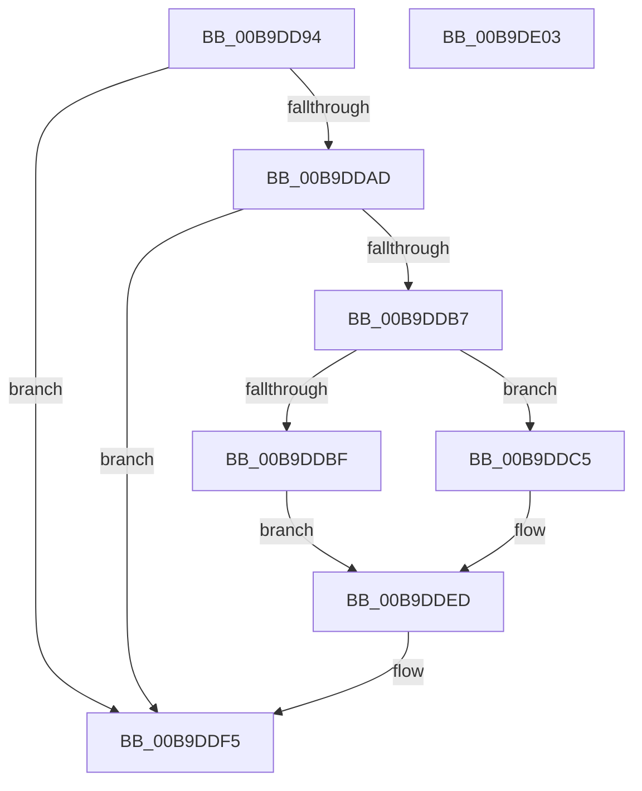

# VfIoAllocateIrp1

- RVA: `0x00B9DD94`–`0x00B9DE04` (길이 `112` bytes)
- VA: `0x0000000140B9DD94`
- 실행 섹션: `PAGEVRFY`
- PDB 이름 있음: `예`; PDB Function 태그: `아니요`
- unwind 정보 RVA: `0x0005CAAC`
- 디코드: `32`개 명령, `112/112` bytes 표시
- 미해석 바이트: `0` (있으면 어셈블리에 `.byte`로 보존)

> 이 문서는 커널 이미지의 기계어와 PDB 기호를 분석해 생성했습니다. 4번과 5번은 함수 원형과 자료형을 바이너리 사용 방식에서 추정한 C 해석이며 원본 소스 복구 결과는 아닙니다.

## 1. Dependencies

- 직접 호출 지점: **2**; 고유 호출 대상: **2**
- 직접 호출자로 확인된 함수: **1**
- RIP 상대 이미지 참조: **1**

### Outgoing calls
- `0x00B9DDAD` → [ViIrpAllocateLockedPacket](ViIrpAllocateLockedPacket_function_00B9E0AC.md) (function, `0x00B9E0AC`)
- `0x00B9DDF0` → [VfIrpDatabaseEntryReleaseLock](../BB/VfIrpDatabaseEntryReleaseLock_function_00BB3FD4.md) (function, `0x00BB3FD4`)

### Direct callers
- [IovAllocateIrp](../BB/IovAllocateIrp_function_00BB9540.md) at `0x00BB959C`

### Static image references
- `0x00B9DD9E` → RVA `0x00FF4000` (`PAGEVRFD`; read)

## 2. Other-region calls and transfers

- 다른 실행 섹션으로 향하는 call: **0**
- 별도 외부 분기/꼬리 이동을 확인하지 못했습니다.

## 3. Assembly (complete function range)

```asm
00B9DD94  48 89 5C 24 08                  mov qword ptr [rsp + 8], rbx
00B9DD99  57                              push rdi
00B9DD9A  48 83 EC 20                     sub rsp, 0x20
00B9DD9E  8B 05 5C 62 45 00               mov eax, dword ptr [rip + 0x45625c]
00B9DDA4  33 FF                           xor edi, edi
00B9DDA6  49 8B D9                        mov rbx, r9
00B9DDA9  85 C0                           test eax, eax
00B9DDAB  75 48                           jne 0x140b9ddf5
00B9DDAD  E8 FA 02 00 00                  call 0x140b9e0ac
00B9DDB2  48 85 C0                        test rax, rax
00B9DDB5  74 3E                           je 0x140b9ddf5
00B9DDB7  48 8B 38                        mov rdi, qword ptr [rax]
00B9DDBA  48 85 DB                        test rbx, rbx
00B9DDBD  75 06                           jne 0x140b9ddc5
00B9DDBF  48 21 58 78                     and qword ptr [rax + 0x78], rbx
00B9DDC3  EB 28                           jmp 0x140b9dded
00B9DDC5  0F 10 03                        movups xmm0, xmmword ptr [rbx]
00B9DDC8  0F 11 40 78                     movups xmmword ptr [rax + 0x78], xmm0
00B9DDCC  0F 10 4B 10                     movups xmm1, xmmword ptr [rbx + 0x10]
00B9DDD0  0F 11 88 88 00 00 00            movups xmmword ptr [rax + 0x88], xmm1
00B9DDD7  0F 10 43 20                     movups xmm0, xmmword ptr [rbx + 0x20]
00B9DDDB  0F 11 80 98 00 00 00            movups xmmword ptr [rax + 0x98], xmm0
00B9DDE2  0F 10 4B 30                     movups xmm1, xmmword ptr [rbx + 0x30]
00B9DDE6  0F 11 88 A8 00 00 00            movups xmmword ptr [rax + 0xa8], xmm1
00B9DDED  48 8B C8                        mov rcx, rax
00B9DDF0  E8 DF 61 01 00                  call 0x140bb3fd4
00B9DDF5  48 8B 5C 24 30                  mov rbx, qword ptr [rsp + 0x30]
00B9DDFA  48 8B C7                        mov rax, rdi
00B9DDFD  48 83 C4 20                     add rsp, 0x20
00B9DE01  5F                              pop rdi
00B9DE02  C3                              ret
00B9DE03  CC                              int3
```

## 4. C-style interpretation (structured pseudocode)

```c
__int64 __fastcall VfIoAllocateIrp1(__int64 a1, __int64 a2, __int64 a3, __int64 a4)
{
    __int64 result;
    __int64 v_rdi;
    __int64 v_rsp;
    unsigned __int64 v_stack_p8;

    v_stack_p8 = v_rbx;
    v_rsp = (v_rsp) - (32);
    v_rdi = 0;
    if ((unsigned int)((unsigned int)(*(unsigned int *)(v_rip + 4547164))) != 0) goto loc_00B9DDF5;
    result = ViIrpAllocateLockedPacket(a1, a2, a3, a4);
    if (result == 0) goto loc_00B9DDF5;
    if (a4 != 0) goto loc_00B9DDC5;
    goto loc_00B9DDED;
loc_00B9DDC5:
    *(unsigned __int64 *)(result + 120) = v_xmm0;
    *(unsigned __int64 *)(result + 136) = v_xmm1;
    *(unsigned __int64 *)(result + 152) = v_xmm0;
    *(unsigned __int64 *)(result + 168) = v_xmm1;
loc_00B9DDED:
    result = VfIrpDatabaseEntryReleaseLock(result, a2, a3, a4);
loc_00B9DDF5:
    v_rsp = (v_rsp) + (32);
    return *(unsigned __int64 *)(result);
}
```

## 5. (Beta) C Style

```c
int64_t VfIoAllocateIrp1(int64_t Arg1, int64_t Arg2, int64_t Arg3, int64_t Arg4)
{
    int64_t result;
    int64_t local_rdi;
    int64_t local_rsp;
    uint64_t v_stack_p8;

    v_stack_p8 = local_rbx;
    local_rsp = (local_rsp) - (32);
    local_rdi = 0;
    if ((uint32_t)((uint32_t)(*(uint32_t *)(v_rip + 0x45625C))) != 0) goto loc_00B9DDF5;
    result = ViIrpAllocateLockedPacket(Arg1, Arg2, Arg3, Arg4);
    if (result == 0) goto loc_00B9DDF5;
    if (Arg4 != 0) goto loc_00B9DDC5;
    goto loc_00B9DDED;
loc_00B9DDC5:
    *(uint64_t *)(result + 0x78) = v_xmm0;
    *(uint64_t *)(result + 0x88) = v_xmm1;
    *(uint64_t *)(result + 0x98) = v_xmm0;
    *(uint64_t *)(result + 0xA8) = v_xmm1;
loc_00B9DDED:
    result = VfIrpDatabaseEntryReleaseLock(result, Arg2, Arg3, Arg4);
loc_00B9DDF5:
    local_rsp = (local_rsp) + (32);
    return *(uint64_t *)(result);
}
```

## 6. Execution-region graph

[열기: 2D/3D 그래프와 함수 탐색 컨트롤 패널](../../../control-panel.html?section=pagevrfy&rva=0x00B9DD94&view=graph)

- 2D 그래프는 위에서 아래로 흐르고, 3D 그래프는 빈 공간을 드래그해 회전합니다. Shift+드래그는 이동, 휠은 확대·축소, 함수 노드 선택은 대상 보고서 이동입니다.

### Static fallback


