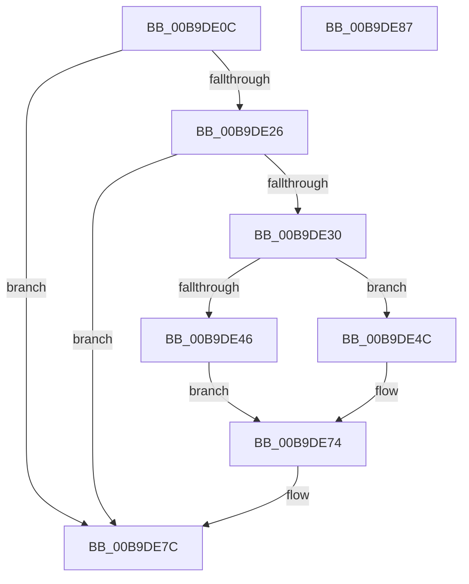

# VfIoAllocateIrp2

- RVA: `0x00B9DE0C`–`0x00B9DE88` (길이 `124` bytes)
- VA: `0x0000000140B9DE0C`
- 실행 섹션: `PAGEVRFY`
- PDB 이름 있음: `예`; PDB Function 태그: `아니요`
- unwind 정보 RVA: `0x0005CAAC`
- 디코드: `34`개 명령, `124/124` bytes 표시
- 미해석 바이트: `0` (있으면 어셈블리에 `.byte`로 보존)

> 이 문서는 커널 이미지의 기계어와 PDB 기호를 분석해 생성했습니다. 4번과 5번은 함수 원형과 자료형을 바이너리 사용 방식에서 추정한 C 해석이며 원본 소스 복구 결과는 아닙니다.

## 1. Dependencies

- 직접 호출 지점: **2**; 고유 호출 대상: **2**
- 직접 호출자로 확인된 함수: **1**
- RIP 상대 이미지 참조: **1**

### Outgoing calls
- `0x00B9DE26` → [VfPacketCreateAndLock](../BA/VfPacketCreateAndLock_function_00BAB420.md) (function, `0x00BAB420`)
- `0x00B9DE77` → [VfIrpDatabaseEntryReleaseLock](../BB/VfIrpDatabaseEntryReleaseLock_function_00BB3FD4.md) (function, `0x00BB3FD4`)

### Direct callers
- [IovAllocateIrp](../BB/IovAllocateIrp_function_00BB9540.md) at `0x00BB95C5`

### Static image references
- `0x00B9DE16` → RVA `0x00FF4000` (`PAGEVRFD`; read)

## 2. Other-region calls and transfers

- 다른 실행 섹션으로 향하는 call: **0**
- 별도 외부 분기/꼬리 이동을 확인하지 못했습니다.

## 3. Assembly (complete function range)

```asm
00B9DE0C  48 89 5C 24 08                  mov qword ptr [rsp + 8], rbx
00B9DE11  57                              push rdi
00B9DE12  48 83 EC 20                     sub rsp, 0x20
00B9DE16  8B 05 E4 61 45 00               mov eax, dword ptr [rip + 0x4561e4]
00B9DE1C  48 8B DA                        mov rbx, rdx
00B9DE1F  48 8B F9                        mov rdi, rcx
00B9DE22  85 C0                           test eax, eax
00B9DE24  75 56                           jne 0x140b9de7c
00B9DE26  E8 F5 D5 00 00                  call 0x140bab420
00B9DE2B  48 85 C0                        test rax, rax
00B9DE2E  74 4C                           je 0x140b9de7c
00B9DE30  F0 FF 40 14                     lock inc dword ptr [rax + 0x14]
00B9DE34  FF 40 18                        inc dword ptr [rax + 0x18]
00B9DE37  0F BA 68 38 15                  bts dword ptr [rax + 0x38], 0x15
00B9DE3C  0F BA 6F 10 1E                  bts dword ptr [rdi + 0x10], 0x1e
00B9DE41  48 85 DB                        test rbx, rbx
00B9DE44  75 06                           jne 0x140b9de4c
00B9DE46  48 21 58 78                     and qword ptr [rax + 0x78], rbx
00B9DE4A  EB 28                           jmp 0x140b9de74
00B9DE4C  0F 10 03                        movups xmm0, xmmword ptr [rbx]
00B9DE4F  0F 11 40 78                     movups xmmword ptr [rax + 0x78], xmm0
00B9DE53  0F 10 4B 10                     movups xmm1, xmmword ptr [rbx + 0x10]
00B9DE57  0F 11 88 88 00 00 00            movups xmmword ptr [rax + 0x88], xmm1
00B9DE5E  0F 10 43 20                     movups xmm0, xmmword ptr [rbx + 0x20]
00B9DE62  0F 11 80 98 00 00 00            movups xmmword ptr [rax + 0x98], xmm0
00B9DE69  0F 10 4B 30                     movups xmm1, xmmword ptr [rbx + 0x30]
00B9DE6D  0F 11 88 A8 00 00 00            movups xmmword ptr [rax + 0xa8], xmm1
00B9DE74  48 8B C8                        mov rcx, rax
00B9DE77  E8 58 61 01 00                  call 0x140bb3fd4
00B9DE7C  48 8B 5C 24 30                  mov rbx, qword ptr [rsp + 0x30]
00B9DE81  48 83 C4 20                     add rsp, 0x20
00B9DE85  5F                              pop rdi
00B9DE86  C3                              ret
00B9DE87  CC                              int3
```

## 4. C-style interpretation (structured pseudocode)

```c
__int64 __fastcall VfIoAllocateIrp2(__int64 a1, __int64 a2)
{
    __int64 result;
    __int64 v_rsp;
    unsigned __int64 v_stack_p8;

    v_stack_p8 = v_rbx;
    v_rsp = (v_rsp) - (32);
    if ((unsigned int)((unsigned int)(*(unsigned int *)(v_rip + 4547044))) != 0) goto loc_00B9DE7C;
    result = VfPacketCreateAndLock(a1, a2, a3, a4);
    if (result == 0) goto loc_00B9DE7C;
    if (a2 != 0) goto loc_00B9DE4C;
    goto loc_00B9DE74;
loc_00B9DE4C:
    *(unsigned __int64 *)(result + 120) = v_xmm0;
    *(unsigned __int64 *)(result + 136) = v_xmm1;
    *(unsigned __int64 *)(result + 152) = v_xmm0;
    *(unsigned __int64 *)(result + 168) = v_xmm1;
loc_00B9DE74:
    result = VfIrpDatabaseEntryReleaseLock(result, a2, a3, a4);
loc_00B9DE7C:
    v_rsp = (v_rsp) + (32);
    return result;
}
```

## 5. (Beta) C Style

```c
int64_t VfIoAllocateIrp2(void *Arg1, int64_t Arg2)
{
    uint8_t *arg1 = (uint8_t *)Arg1;

    int64_t result;
    int64_t local_rsp;
    uint64_t v_stack_p8;

    v_stack_p8 = local_rbx;
    local_rsp = (local_rsp) - (32);
    if ((uint32_t)((uint32_t)(*(uint32_t *)(v_rip + 0x4561E4))) != 0) goto loc_00B9DE7C;
    result = VfPacketCreateAndLock(Arg1, Arg2, a3, a4);
    if (result == 0) goto loc_00B9DE7C;
    if (Arg2 != 0) goto loc_00B9DE4C;
    goto loc_00B9DE74;
loc_00B9DE4C:
    *(uint64_t *)(result + 0x78) = v_xmm0;
    *(uint64_t *)(result + 0x88) = v_xmm1;
    *(uint64_t *)(result + 0x98) = v_xmm0;
    *(uint64_t *)(result + 0xA8) = v_xmm1;
loc_00B9DE74:
    result = VfIrpDatabaseEntryReleaseLock(result, Arg2, a3, a4);
loc_00B9DE7C:
    local_rsp = (local_rsp) + (32);
    return result;
}
```

### 관측된 메모리 오프셋

구조체 형식이 확인되지 않은 접근은 인자 기준의 오프셋으로만 기록했습니다.

| 기준 인자 | 오프셋 표현 | 폭 (bit) | 접근 |
|---|---:|---:|---|
| `Arg1` | `+ 0x10` | `32` | `R/W` |

## 6. Execution-region graph

[열기: 2D/3D 그래프와 함수 탐색 컨트롤 패널](../../../control-panel.html?section=pagevrfy&rva=0x00B9DE0C&view=graph)

- 2D 그래프는 위에서 아래로 흐르고, 3D 그래프는 빈 공간을 드래그해 회전합니다. Shift+드래그는 이동, 휠은 확대·축소, 함수 노드 선택은 대상 보고서 이동입니다.

### Static fallback


