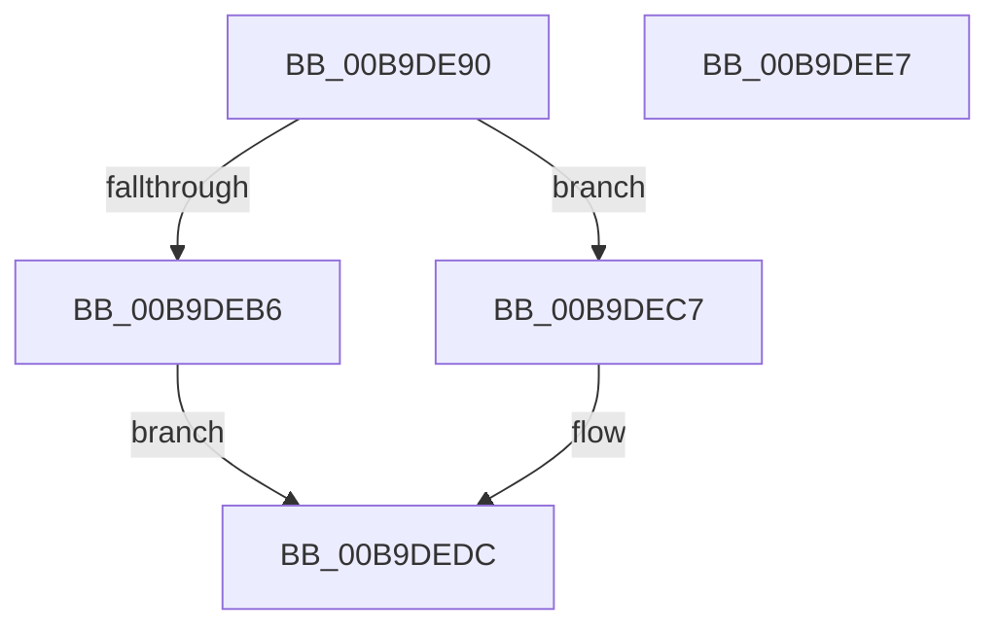

# VfIrpAllocateCallDriverData

- RVA: `0x00B9DE90`–`0x00B9DEE8` (길이 `88` bytes)
- VA: `0x0000000140B9DE90`
- 실행 섹션: `PAGEVRFY`
- PDB 이름 있음: `예`; PDB Function 태그: `아니요`
- unwind 정보 RVA: `0x0005CAAC`
- 디코드: `27`개 명령, `88/88` bytes 표시
- 미해석 바이트: `0` (있으면 어셈블리에 `.byte`로 보존)

> 이 문서는 커널 이미지의 기계어와 PDB 기호를 분석해 생성했습니다. 4번과 5번은 함수 원형과 자료형을 바이너리 사용 방식에서 추정한 C 해석이며 원본 소스 복구 결과는 아닙니다.

## 1. Dependencies

- 직접 호출 지점: **3**; 고유 호출 대상: **3**
- 직접 호출자로 확인된 함수: **1**
- RIP 상대 이미지 참조: **1**

### Outgoing calls
- `0x00B9DEA7` → [ExAllocateFromNPagedLookasideList](../../text/38/ExAllocateFromNPagedLookasideList_function_0038E6C0.md) (function, `0x0038E6C0`)
- `0x00B9DEB9` → [IovpCheckIrpForCriticalTracking](IovpCheckIrpForCriticalTracking_function_00B9D524.md) (function, `0x00B9D524`)
- `0x00B9DED2` → [memset](../../text/6C/memset_function_006C6C40.md) (function, `0x006C6C40`)

### Direct callers
- [sub_00BBC34E](../BB/Unknown_function_00BBC34E.md) at `0x00BBC356`

### Static image references
- `0x00B9DEA0` → RVA `0x00FFF500` (`PAGEVRFD`; read)

## 2. Other-region calls and transfers

- 다른 실행 섹션으로 향하는 call: **2**
  - `0x00B9DEA7` → [ExAllocateFromNPagedLookasideList](../../text/38/ExAllocateFromNPagedLookasideList_function_0038E6C0.md) (`PAGEVRFY` → `.text`)
  - `0x00B9DED2` → [memset](../../text/6C/memset_function_006C6C40.md) (`PAGEVRFY` → `.text`)
- 별도 외부 분기/꼬리 이동을 확인하지 못했습니다.

## 3. Assembly (complete function range)

```asm
00B9DE90  48 89 5C 24 08                  mov qword ptr [rsp + 8], rbx
00B9DE95  57                              push rdi
00B9DE96  48 83 EC 20                     sub rsp, 0x20
00B9DE9A  48 8B F9                        mov rdi, rcx
00B9DE9D  48 8B DA                        mov rbx, rdx
00B9DEA0  48 8D 0D 59 16 46 00            lea rcx, [rip + 0x461659]
00B9DEA7  E8 14 08 7F FF                  call 0x14038e6c0
00B9DEAC  48 89 03                        mov qword ptr [rbx], rax
00B9DEAF  33 DB                           xor ebx, ebx
00B9DEB1  48 85 C0                        test rax, rax
00B9DEB4  75 11                           jne 0x140b9dec7
00B9DEB6  48 8B CF                        mov rcx, rdi
00B9DEB9  E8 66 F6 FF FF                  call 0x140b9d524
00B9DEBE  85 C0                           test eax, eax
00B9DEC0  0F 94 C3                        sete bl
00B9DEC3  8B C3                           mov eax, ebx
00B9DEC5  EB 15                           jmp 0x140b9dedc
00B9DEC7  33 D2                           xor edx, edx
00B9DEC9  41 B8 C0 00 00 00               mov r8d, 0xc0
00B9DECF  48 8B C8                        mov rcx, rax
00B9DED2  E8 69 8D B2 FF                  call 0x1406c6c40
00B9DED7  B8 01 00 00 00                  mov eax, 1
00B9DEDC  48 8B 5C 24 30                  mov rbx, qword ptr [rsp + 0x30]
00B9DEE1  48 83 C4 20                     add rsp, 0x20
00B9DEE5  5F                              pop rdi
00B9DEE6  C3                              ret
00B9DEE7  CC                              int3
```

## 4. C-style interpretation (structured pseudocode)

```c
__int64 __fastcall VfIrpAllocateCallDriverData(__int64 a1, __int64 a2)
{
    __int64 result;
    __int64 v_rbx;
    __int64 v_rsp;
    unsigned __int64 v_stack_p8;

    v_stack_p8 = v_rbx;
    v_rsp = (v_rsp) - (32);
    result = ExAllocateFromNPagedLookasideList(v_rip + 4593241, a2, a3, a4);
    *(unsigned __int64 *)(a2) = result;
    v_rbx = 0;
    if (result != 0) goto loc_00B9DEC7;
    result = IovpCheckIrpForCriticalTracking(a1, a2, a3, a4);
    v_rbx = ((unsigned int)(result) == 0) ? 1 : 0;
    goto loc_00B9DEDC;
loc_00B9DEC7:
    a2 = 0;
    result = memset((unsigned int)((unsigned int)(v_rbx)), a2, 192, a4);
loc_00B9DEDC:
    v_rsp = (v_rsp) + (32);
    return 1;
}
```

## 5. (Beta) C Style

```c
int64_t VfIrpAllocateCallDriverData(int64_t Arg1, void *Arg2)
{
    uint8_t *arg2 = (uint8_t *)Arg2;

    int64_t result;
    int64_t local_rbx;
    int64_t local_rsp;
    uint64_t v_stack_p8;

    v_stack_p8 = local_rbx;
    local_rsp = (local_rsp) - (32);
    result = ExAllocateFromNPagedLookasideList(v_rip + 4593241, Arg2, a3, a4);
    *(uint64_t *)(arg2) = result;
    local_rbx = 0;
    if (result != 0) goto loc_00B9DEC7;
    result = IovpCheckIrpForCriticalTracking(Arg1, Arg2, a3, a4);
    local_rbx = ((uint32_t)(result) == 0) ? 1 : 0;
    goto loc_00B9DEDC;
loc_00B9DEC7:
    Arg2 = 0;
    result = memset((uint32_t)((uint32_t)(local_rbx)), Arg2, 192, a4);
loc_00B9DEDC:
    local_rsp = (local_rsp) + (32);
    return 1;
}
```

### 관측된 메모리 오프셋

구조체 형식이 확인되지 않은 접근은 인자 기준의 오프셋으로만 기록했습니다.

| 기준 인자 | 오프셋 표현 | 폭 (bit) | 접근 |
|---|---:|---:|---|
| `Arg2` | `+ 0x0` | `64` | `W` |

## 6. Execution-region graph

[열기: 2D/3D 그래프와 함수 탐색 컨트롤 패널](../../../control-panel.html?section=pagevrfy&rva=0x00B9DE90&view=graph)

- 2D 그래프는 위에서 아래로 흐르고, 3D 그래프는 빈 공간을 드래그해 회전합니다. Shift+드래그는 이동, 휠은 확대·축소, 함수 노드 선택은 대상 보고서 이동입니다.

### Static fallback


