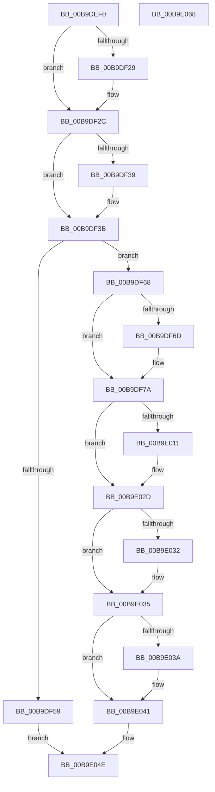

# VfIrpSendSynchronousIrp

- RVA: `0x00B9DEF0`–`0x00B9E069` (길이 `377` bytes)
- VA: `0x0000000140B9DEF0`
- 실행 섹션: `PAGEVRFY`
- PDB 이름 있음: `예`; PDB Function 태그: `아니요`
- unwind 정보 RVA: `0x0007EE78`
- 디코드: `99`개 명령, `377/377` bytes 표시
- 미해석 바이트: `0` (있으면 어셈블리에 `.byte`로 보존)

> 이 문서는 커널 이미지의 기계어와 PDB 기호를 분석해 생성했습니다. 4번과 5번은 함수 원형과 자료형을 바이너리 사용 방식에서 추정한 C 해석이며 원본 소스 복구 결과는 아닙니다.

## 1. Dependencies

- 직접 호출 지점: **9**; 고유 호출 대상: **8**
- 직접 호출자로 확인된 함수: **3**
- RIP 상대 이미지 참조: **1**

### Outgoing calls
- `0x00B9DF3B` → [IoGetAttachedDeviceReference](../../text/41/IoGetAttachedDeviceReference_function_0041D940.md) (function, `0x0041D940`)
- `0x00B9DF4C` → [IoAllocateIrpEx](../../text/20/IoAllocateIrpEx_function_00207510.md) (function, `0x00207510`)
- `0x00B9DF5C` → [ObfDereferenceObject](../../text/2F/ObfDereferenceObject_function_002F9350.md) (function, `0x002F9350`)
- `0x00B9DF75` → [IovUtilWatermarkIrp](../../text/48/IovUtilWatermarkIrp_function_0048E1A4.md) (function, `0x0048E1A4`)
- `0x00B9DF99` → [KeInitializeEvent](../../text/40/KeInitializeEvent_function_0040DD10.md) (function, `0x0040DD10`)
- `0x00B9DFF8` → [IofCallDriver](../../text/29/IofCallDriver_function_0029B4B0.md) (function, `0x0029B4B0`)
- `0x00B9E003` → [ObfDereferenceObject](../../text/2F/ObfDereferenceObject_function_002F9350.md) (function, `0x002F9350`)
- `0x00B9E024` → [KeWaitForSingleObject](../../text/20/KeWaitForSingleObject_function_0020E6B0.md) (function, `0x0020E6B0`)
- `0x00B9E044` → [IoFreeIrp](../../text/24/IoFreeIrp_function_0024DF70.md) (function, `0x0024DF70`)

### Direct callers
- [VfPnpTestStartedPdoStack](../BB/VfPnpTestStartedPdoStack_function_00BB5590.md) at `0x00BB55E2`
- [VfPnpTestStartedPdoStack](../BB/VfPnpTestStartedPdoStack_function_00BB5590.md) at `0x00BB560C`
- [VfPnpTestStartedPdoStack](../BB/VfPnpTestStartedPdoStack_function_00BB5590.md) at `0x00BB563C`
- [VfPnpTestStartedPdoStack](../BB/VfPnpTestStartedPdoStack_function_00BB5590.md) at `0x00BB5662`
- [VfPnpTestStartedPdoStack](../BB/VfPnpTestStartedPdoStack_function_00BB5590.md) at `0x00BB5688`
- [VfPnpTestStartedPdoStack](../BB/VfPnpTestStartedPdoStack_function_00BB5590.md) at `0x00BB56BD`
- [VfPnpTestStartedPdoStack](../BB/VfPnpTestStartedPdoStack_function_00BB5590.md) at `0x00BB5728`
- [VfPowerTestStartedPdoStack](../BB/VfPowerTestStartedPdoStack_function_00BB5EF0.md) at `0x00BB5F3A`
- [VfWmiTestStartedPdoStack](../BB/VfWmiTestStartedPdoStack_function_00BB6110.md) at `0x00BB615F`

### Static image references
- `0x00B9DFA5` → RVA `0x00B9E2C0` (`ViIrpSynchronousCompletionRoutine`; read)

## 2. Other-region calls and transfers

- 다른 실행 섹션으로 향하는 call: **9**
  - `0x00B9DF3B` → [IoGetAttachedDeviceReference](../../text/41/IoGetAttachedDeviceReference_function_0041D940.md) (`PAGEVRFY` → `.text`)
  - `0x00B9DF4C` → [IoAllocateIrpEx](../../text/20/IoAllocateIrpEx_function_00207510.md) (`PAGEVRFY` → `.text`)
  - `0x00B9DF5C` → [ObfDereferenceObject](../../text/2F/ObfDereferenceObject_function_002F9350.md) (`PAGEVRFY` → `.text`)
  - `0x00B9DF75` → [IovUtilWatermarkIrp](../../text/48/IovUtilWatermarkIrp_function_0048E1A4.md) (`PAGEVRFY` → `.text`)
  - `0x00B9DF99` → [KeInitializeEvent](../../text/40/KeInitializeEvent_function_0040DD10.md) (`PAGEVRFY` → `.text`)
  - `0x00B9DFF8` → [IofCallDriver](../../text/29/IofCallDriver_function_0029B4B0.md) (`PAGEVRFY` → `.text`)
  - `0x00B9E003` → [ObfDereferenceObject](../../text/2F/ObfDereferenceObject_function_002F9350.md) (`PAGEVRFY` → `.text`)
  - `0x00B9E024` → [KeWaitForSingleObject](../../text/20/KeWaitForSingleObject_function_0020E6B0.md) (`PAGEVRFY` → `.text`)
  - `0x00B9E044` → [IoFreeIrp](../../text/24/IoFreeIrp_function_0024DF70.md) (`PAGEVRFY` → `.text`)
- 별도 외부 분기/꼬리 이동을 확인하지 못했습니다.

## 3. Assembly (complete function range)

```asm
00B9DEF0  4C 8B DC                        mov r11, rsp
00B9DEF3  49 89 5B 08                     mov qword ptr [r11 + 8], rbx
00B9DEF7  49 89 6B 10                     mov qword ptr [r11 + 0x10], rbp
00B9DEFB  49 89 73 18                     mov qword ptr [r11 + 0x18], rsi
00B9DEFF  57                              push rdi
00B9DF00  41 56                           push r14
00B9DF02  41 57                           push r15
00B9DF04  48 83 EC 50                     sub rsp, 0x50
00B9DF08  48 8B B4 24 98 00 00 00         mov rsi, qword ptr [rsp + 0x98]
00B9DF10  33 C0                           xor eax, eax
00B9DF12  0F 57 C0                        xorps xmm0, xmm0
00B9DF15  45 8B F0                        mov r14d, r8d
00B9DF18  4C 8B FA                        mov r15, rdx
00B9DF1B  0F 11 44 24 30                  movups xmmword ptr [rsp + 0x30], xmm0
00B9DF20  49 89 43 D8                     mov qword ptr [r11 - 0x28], rax
00B9DF24  48 85 F6                        test rsi, rsi
00B9DF27  74 03                           je 0x140b9df2c
00B9DF29  48 21 06                        and qword ptr [rsi], rax
00B9DF2C  48 8B BC 24 A0 00 00 00         mov rdi, qword ptr [rsp + 0xa0]
00B9DF34  48 85 FF                        test rdi, rdi
00B9DF37  74 02                           je 0x140b9df3b
00B9DF39  21 07                           and dword ptr [rdi], eax
00B9DF3B  E8 00 FA 87 FF                  call 0x14041d940
00B9DF40  45 33 C0                        xor r8d, r8d
00B9DF43  48 8B C8                        mov rcx, rax
00B9DF46  48 8B E8                        mov rbp, rax
00B9DF49  8A 50 4C                        mov dl, byte ptr [rax + 0x4c]
00B9DF4C  E8 BF 95 66 FF                  call 0x140207510
00B9DF51  48 8B D8                        mov rbx, rax
00B9DF54  48 85 C0                        test rax, rax
00B9DF57  75 0F                           jne 0x140b9df68
00B9DF59  48 8B CD                        mov rcx, rbp
00B9DF5C  E8 EF B3 75 FF                  call 0x1402f9350
00B9DF61  33 C0                           xor eax, eax
00B9DF63  E9 E6 00 00 00                  jmp 0x140b9e04e
00B9DF68  45 85 F6                        test r14d, r14d
00B9DF6B  74 0D                           je 0x140b9df7a
00B9DF6D  BA 02 00 00 00                  mov edx, 2
00B9DF72  48 8B CB                        mov rcx, rbx
00B9DF75  E8 2A 02 8F FF                  call 0x14048e1a4
00B9DF7A  48 8B 84 24 90 00 00 00         mov rax, qword ptr [rsp + 0x90]
00B9DF82  48 8D 4C 24 30                  lea rcx, [rsp + 0x30]
00B9DF87  45 33 C0                        xor r8d, r8d
00B9DF8A  C7 43 30 BB 00 00 C0            mov dword ptr [rbx + 0x30], 0xc00000bb
00B9DF91  48 89 43 38                     mov qword ptr [rbx + 0x38], rax
00B9DF95  41 8D 50 01                     lea edx, [r8 + 1]
00B9DF99  E8 72 FD 86 FF                  call 0x14040dd10
00B9DF9E  48 8B 83 B8 00 00 00            mov rax, qword ptr [rbx + 0xb8]
00B9DFA5  48 8D 0D 14 03 00 00            lea rcx, [rip + 0x314]
00B9DFAC  41 0F 10 07                     movups xmm0, xmmword ptr [r15]
00B9DFB0  48 8B D3                        mov rdx, rbx
00B9DFB3  41 0F 10 4F 10                  movups xmm1, xmmword ptr [r15 + 0x10]
00B9DFB8  0F 11 40 B8                     movups xmmword ptr [rax - 0x48], xmm0
00B9DFBC  41 0F 10 47 20                  movups xmm0, xmmword ptr [r15 + 0x20]
00B9DFC1  0F 11 48 C8                     movups xmmword ptr [rax - 0x38], xmm1
00B9DFC5  41 0F 10 4F 30                  movups xmm1, xmmword ptr [r15 + 0x30]
00B9DFCA  0F 11 40 D8                     movups xmmword ptr [rax - 0x28], xmm0
00B9DFCE  F2 41 0F 10 47 40               movsd xmm0, qword ptr [r15 + 0x40]
00B9DFD4  0F 11 48 E8                     movups xmmword ptr [rax - 0x18], xmm1
00B9DFD8  F2 0F 11 40 F8                  movsd qword ptr [rax - 8], xmm0
00B9DFDD  48 8B 83 B8 00 00 00            mov rax, qword ptr [rbx + 0xb8]
00B9DFE4  48 89 48 F0                     mov qword ptr [rax - 0x10], rcx
00B9DFE8  48 8D 4C 24 30                  lea rcx, [rsp + 0x30]
00B9DFED  48 89 48 F8                     mov qword ptr [rax - 8], rcx
00B9DFF1  48 8B CD                        mov rcx, rbp
00B9DFF4  C6 40 BB E0                     mov byte ptr [rax - 0x45], 0xe0
00B9DFF8  E8 B3 D4 6F FF                  call 0x14029b4b0
00B9DFFD  48 8B CD                        mov rcx, rbp
00B9E000  44 8B F0                        mov r14d, eax
00B9E003  E8 48 B3 75 FF                  call 0x1402f9350
00B9E008  41 81 FE 03 01 00 00            cmp r14d, 0x103
00B9E00F  75 1C                           jne 0x140b9e02d
00B9E011  48 83 64 24 20 00               and qword ptr [rsp + 0x20], 0
00B9E017  48 8D 4C 24 30                  lea rcx, [rsp + 0x30]
00B9E01C  45 33 C9                        xor r9d, r9d
00B9E01F  45 33 C0                        xor r8d, r8d
00B9E022  33 D2                           xor edx, edx
00B9E024  E8 87 06 67 FF                  call 0x14020e6b0
00B9E029  44 8B 73 30                     mov r14d, dword ptr [rbx + 0x30]
00B9E02D  48 85 FF                        test rdi, rdi
00B9E030  74 03                           je 0x140b9e035
00B9E032  44 89 37                        mov dword ptr [rdi], r14d
00B9E035  48 85 F6                        test rsi, rsi
00B9E038  74 07                           je 0x140b9e041
00B9E03A  48 8B 4B 38                     mov rcx, qword ptr [rbx + 0x38]
00B9E03E  48 89 0E                        mov qword ptr [rsi], rcx
00B9E041  48 8B CB                        mov rcx, rbx
00B9E044  E8 27 FF 6A FF                  call 0x14024df70
00B9E049  B8 01 00 00 00                  mov eax, 1
00B9E04E  4C 8D 5C 24 50                  lea r11, [rsp + 0x50]
00B9E053  49 8B 5B 20                     mov rbx, qword ptr [r11 + 0x20]
00B9E057  49 8B 6B 28                     mov rbp, qword ptr [r11 + 0x28]
00B9E05B  49 8B 73 30                     mov rsi, qword ptr [r11 + 0x30]
00B9E05F  49 8B E3                        mov rsp, r11
00B9E062  41 5F                           pop r15
00B9E064  41 5E                           pop r14
00B9E066  5F                              pop rdi
00B9E067  C3                              ret
00B9E068  CC                              int3
```

## 4. C-style interpretation (structured pseudocode)

```c
__int64 __fastcall VfIrpSendSynchronousIrp(__int64 a1, __int64 a2, int a3, int a4, __int64 a5, __int64 a6, __int64 a7)
{
    __int64 result;
    __int64 v_r14;
    __int64 v_rsp;
    unsigned __int64 v_stack_m18;
    unsigned __int64 v_stack_m38;
    unsigned __int64 v_stack_m48;

    *(unsigned __int64 *)(v_rsp + 8) = v_rbx;
    *(unsigned __int64 *)(v_rsp + 16) = v_rbp;
    *(unsigned __int64 *)(v_rsp + 24) = v_rsi;
    v_rsp = (v_rsp) - (80);
    result = 0;
    v_stack_m38 = v_xmm0;
    *(unsigned __int64 *)(v_rsp - 40) = 0;
    if (a6 != 0) {
    }
    if (a7 != 0) {
    }
    result = IoGetAttachedDeviceReference(a1, a2, a3, a4);
    a3 = 0;
    result = IoAllocateIrpEx(result, *(unsigned __int8 *)(result + 76), a3, a4);
    if (result != 0) goto loc_00B9DF68;
    result = ObfDereferenceObject(result, *(unsigned __int8 *)(result + 76), a3, a4);
    result = 0;
    goto loc_00B9E04E;
loc_00B9DF68:
    if ((unsigned int)((unsigned int)(a3)) != 0) {
        a2 = 2;
        a1 = 0;
        result = IovUtilWatermarkIrp(a1, a2, a3, a4);
    }
    a3 = 0;
    *(unsigned int *)(result + 48) = 0xC00000BBULL;
    *(unsigned __int64 *)(result + 56) = a5;
    result = KeInitializeEvent(v_stack_m38, a3 + 1, a3, a4);
    *(unsigned __int64 *)(*(unsigned __int64 *)(result + 184) - 72) = v_xmm0;
    *(unsigned __int64 *)(*(unsigned __int64 *)(result + 184) - 56) = v_xmm1;
    *(unsigned __int64 *)(*(unsigned __int64 *)(result + 184) - 40) = v_xmm0;
    *(unsigned __int64 *)(*(unsigned __int64 *)(result + 184) - 24) = v_xmm1;
    *(unsigned __int64 *)(*(unsigned __int64 *)(result + 184) - 8) = v_xmm0;
    *(unsigned __int64 *)(*(unsigned __int64 *)(result + 184) - 16) = v_rip + 788;
    *(unsigned __int64 *)(*(unsigned __int64 *)(result + 184) - 8) = v_stack_m38;
    *(unsigned __int8 *)(*(unsigned __int64 *)(result + 184) - 69) = 224;
    result = IofCallDriver(result, result, a3, a4);
    result = ObfDereferenceObject(result, result, a3, a4);
    v_r14 = (unsigned int)((unsigned int)(result));
    if (((unsigned int)((unsigned int)((unsigned int)(result)))) == 259) {
        a1 = v_stack_m38;
        a4 = 0;
        a3 = 0;
        a2 = 0;
        result = KeWaitForSingleObject(a1, a2, a3, a4);
        v_r14 = *(unsigned int *)(result + 48);
    }
    if (a7 != 0) {
        *(unsigned int *)(a7) = (unsigned int)(v_r14);
    }
    if (a6 != 0) {
        a1 = *(unsigned __int64 *)(result + 56);
        *(unsigned __int64 *)(a6) = a1;
    }
    result = IoFreeIrp(result, a2, a3, a4);
loc_00B9E04E:
    return 1;
}
```

## 5. (Beta) C Style

```c
int64_t VfIrpSendSynchronousIrp(int64_t Arg1, void *Arg2, int32_t Arg3, int32_t Arg4, int64_t Arg5, int64_t Arg6, int64_t Arg7)
{
    uint8_t *arg2 = (uint8_t *)Arg2;

    int64_t result;
    int64_t local_r14;
    int64_t local_rsp;
    uint64_t v_stack_m18;
    uint64_t v_stack_m38;
    uint64_t v_stack_m48;

    *(uint64_t *)(local_rsp + 0x8) = local_rbx;
    *(uint64_t *)(local_rsp + 0x10) = local_rbp;
    *(uint64_t *)(local_rsp + 0x18) = local_rsi;
    local_rsp = (local_rsp) - (80);
    result = 0;
    v_stack_m38 = v_xmm0;
    *(uint64_t *)(local_rsp - 0x28) = 0;
    if (Arg6 != 0) {
    }
    if (Arg7 != 0) {
    }
    result = IoGetAttachedDeviceReference(Arg1, Arg2, Arg3, Arg4);
    Arg3 = 0;
    result = IoAllocateIrpEx(result, *(uint8_t *)(result + 0x4C), Arg3, Arg4);
    if (result != 0) goto loc_00B9DF68;
    result = ObfDereferenceObject(result, *(uint8_t *)(result + 0x4C), Arg3, Arg4);
    result = 0;
    goto loc_00B9E04E;
loc_00B9DF68:
    if ((uint32_t)((uint32_t)(Arg3)) != 0) {
        Arg2 = 2;
        Arg1 = 0;
        result = IovUtilWatermarkIrp(Arg1, Arg2, Arg3, Arg4);
    }
    Arg3 = 0;
    *(uint32_t *)(result + 0x30) = 0xC00000BBULL;
    *(uint64_t *)(result + 0x38) = Arg5;
    result = KeInitializeEvent(v_stack_m38, Arg3 + 1, Arg3, Arg4);
    *(uint64_t *)(*(uint64_t *)(result + 0xB8) - 0x48) = v_xmm0;
    *(uint64_t *)(*(uint64_t *)(result + 0xB8) - 0x38) = v_xmm1;
    *(uint64_t *)(*(uint64_t *)(result + 0xB8) - 0x28) = v_xmm0;
    *(uint64_t *)(*(uint64_t *)(result + 0xB8) - 0x18) = v_xmm1;
    *(uint64_t *)(*(uint64_t *)(result + 0xB8) - 0x8) = v_xmm0;
    *(uint64_t *)(*(uint64_t *)(result + 0xB8) - 0x10) = v_rip + 788;
    *(uint64_t *)(*(uint64_t *)(result + 0xB8) - 0x8) = v_stack_m38;
    *(uint8_t *)(*(uint64_t *)(result + 0xB8) - 0x45) = 224;
    result = IofCallDriver(result, result, Arg3, Arg4);
    result = ObfDereferenceObject(result, result, Arg3, Arg4);
    local_r14 = (uint32_t)((uint32_t)(result));
    if (((uint32_t)((uint32_t)((uint32_t)(result)))) == 259) {
        Arg1 = v_stack_m38;
        Arg4 = 0;
        Arg3 = 0;
        Arg2 = 0;
        result = KeWaitForSingleObject(Arg1, Arg2, Arg3, Arg4);
        local_r14 = *(uint32_t *)(result + 0x30);
    }
    if (Arg7 != 0) {
        *(uint32_t *)(Arg7) = (uint32_t)(local_r14);
    }
    if (Arg6 != 0) {
        Arg1 = *(uint64_t *)(result + 0x38);
        *(uint64_t *)(Arg6) = Arg1;
    }
    result = IoFreeIrp(result, Arg2, Arg3, Arg4);
loc_00B9E04E:
    return 1;
}
```

### 관측된 메모리 오프셋

구조체 형식이 확인되지 않은 접근은 인자 기준의 오프셋으로만 기록했습니다.

| 기준 인자 | 오프셋 표현 | 폭 (bit) | 접근 |
|---|---:|---:|---|
| `Arg2` | `+ 0x0` | `128` | `R` |
| `Arg2` | `+ 0x10` | `128` | `R` |
| `Arg2` | `+ 0x20` | `128` | `R` |
| `Arg2` | `+ 0x30` | `128` | `R` |
| `Arg2` | `+ 0x40` | `64` | `R` |

## 6. Execution-region graph

[열기: 2D/3D 그래프와 함수 탐색 컨트롤 패널](../../../control-panel.html?section=pagevrfy&rva=0x00B9DEF0&view=graph)

- 2D 그래프는 위에서 아래로 흐르고, 3D 그래프는 빈 공간을 드래그해 회전합니다. Shift+드래그는 이동, 휠은 확대·축소, 함수 노드 선택은 대상 보고서 이동입니다.

### Static fallback


