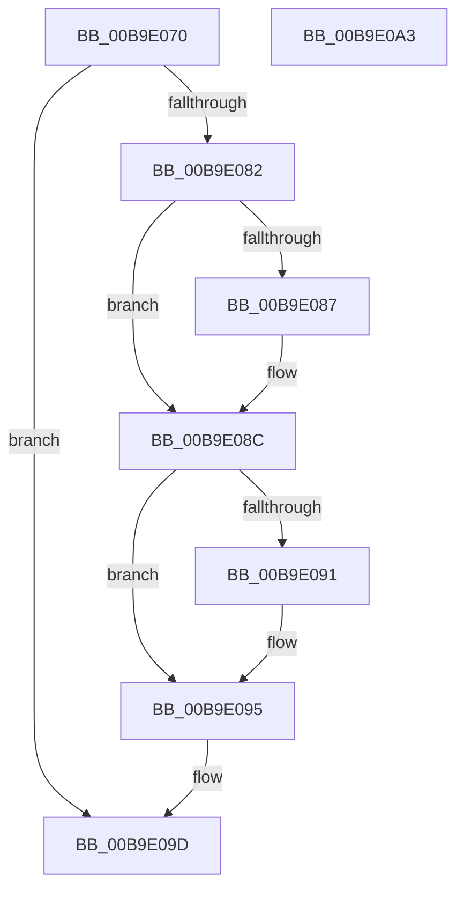

# VfIrpWatermark

- RVA: `0x00B9E070`–`0x00B9E0A4` (길이 `52` bytes)
- VA: `0x0000000140B9E070`
- 실행 섹션: `PAGEVRFY`
- PDB 이름 있음: `예`; PDB Function 태그: `아니요`
- unwind 정보 RVA: `0x0005CF00`
- 디코드: `18`개 명령, `52/52` bytes 표시
- 미해석 바이트: `0` (있으면 어셈블리에 `.byte`로 보존)

> 이 문서는 커널 이미지의 기계어와 PDB 기호를 분석해 생성했습니다. 4번과 5번은 함수 원형과 자료형을 바이너리 사용 방식에서 추정한 C 해석이며 원본 소스 복구 결과는 아닙니다.

## 1. Dependencies

- 직접 호출 지점: **2**; 고유 호출 대상: **2**
- 직접 호출자로 확인된 함수: **2**
- RIP 상대 이미지 참조: **0**

### Outgoing calls
- `0x00B9E078` → [VfIrpDatabaseEntryFindAndLock](../BB/VfIrpDatabaseEntryFindAndLock_function_00BB7074.md) (function, `0x00BB7074`)
- `0x00B9E098` → [VfIrpDatabaseEntryReleaseLock](../BB/VfIrpDatabaseEntryReleaseLock_function_00BB3FD4.md) (function, `0x00BB3FD4`)

### Direct callers
- [PopAllocateIrp](../../text/27/PopAllocateIrp_function_0027116C.md) at `0x002715F4`
- [IovUtilWatermarkIrp](../../text/48/IovUtilWatermarkIrp_function_0048E1A4.md) at `0x0048E1B7`

### Static image references
- 디코드된 RIP-relative 메모리 참조가 없습니다.

## 2. Other-region calls and transfers

- 다른 실행 섹션으로 향하는 call: **0**
- 별도 외부 분기/꼬리 이동을 확인하지 못했습니다.

## 3. Assembly (complete function range)

```asm
00B9E070  40 53                           push rbx
00B9E072  48 83 EC 20                     sub rsp, 0x20
00B9E076  8B DA                           mov ebx, edx
00B9E078  E8 F7 8F 01 00                  call 0x140bb7074
00B9E07D  48 85 C0                        test rax, rax
00B9E080  74 1B                           je 0x140b9e09d
00B9E082  F6 C3 01                        test bl, 1
00B9E085  74 05                           je 0x140b9e08c
00B9E087  0F BA 68 38 14                  bts dword ptr [rax + 0x38], 0x14
00B9E08C  F6 C3 02                        test bl, 2
00B9E08F  74 04                           je 0x140b9e095
00B9E091  83 48 38 20                     or dword ptr [rax + 0x38], 0x20
00B9E095  48 8B C8                        mov rcx, rax
00B9E098  E8 37 5F 01 00                  call 0x140bb3fd4
00B9E09D  48 83 C4 20                     add rsp, 0x20
00B9E0A1  5B                              pop rbx
00B9E0A2  C3                              ret
00B9E0A3  CC                              int3
```

## 4. C-style interpretation (structured pseudocode)

```c
__int64 __fastcall VfIrpWatermark(__int64 a1, int a2)
{
    __int64 result;
    __int64 v_rsp;

    v_rsp = (v_rsp) - (32);
    result = VfIrpDatabaseEntryFindAndLock(a1, a2, a3, a4);
    if (result == 0) goto loc_00B9E09D;
    if ((((unsigned __int8)((unsigned int)(a2))) & (1)) != 0) {
    }
    if ((((unsigned __int8)((unsigned int)(a2))) & (2)) != 0) {
    }
    result = VfIrpDatabaseEntryReleaseLock(result, a2, a3, a4);
loc_00B9E09D:
    v_rsp = (v_rsp) + (32);
    return result;
}
```

## 5. (Beta) C Style

```c
int64_t VfIrpWatermark(int64_t Arg1, int32_t Arg2)
{
    int64_t result;
    int64_t local_rsp;

    local_rsp = (local_rsp) - (32);
    result = VfIrpDatabaseEntryFindAndLock(Arg1, Arg2, a3, a4);
    if (result == 0) goto loc_00B9E09D;
    if ((((uint8_t)((uint32_t)(Arg2))) & (1)) != 0) {
    }
    if ((((uint8_t)((uint32_t)(Arg2))) & (2)) != 0) {
    }
    result = VfIrpDatabaseEntryReleaseLock(result, Arg2, a3, a4);
loc_00B9E09D:
    local_rsp = (local_rsp) + (32);
    return result;
}
```

## 6. Execution-region graph

[열기: 2D/3D 그래프와 함수 탐색 컨트롤 패널](../../../control-panel.html?section=pagevrfy&rva=0x00B9E070&view=graph)

- 2D 그래프는 위에서 아래로 흐르고, 3D 그래프는 빈 공간을 드래그해 회전합니다. Shift+드래그는 이동, 휠은 확대·축소, 함수 노드 선택은 대상 보고서 이동입니다.

### Static fallback


