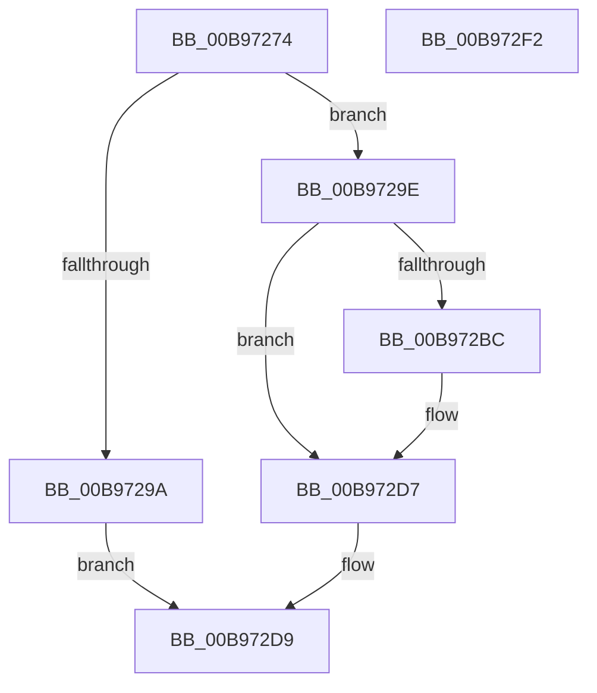

# VfIsPCIBus

- RVA: `0x00B97274`–`0x00B972F3` (길이 `127` bytes)
- VA: `0x0000000140B97274`
- 실행 섹션: `PAGEVRFY`
- PDB 이름 있음: `예`; PDB Function 태그: `아니요`
- unwind 정보 RVA: `0x000AF554`
- 디코드: `33`개 명령, `127/127` bytes 표시
- 미해석 바이트: `0` (있으면 어셈블리에 `.byte`로 보존)

> 이 문서는 커널 이미지의 기계어와 PDB 기호를 분석해 생성했습니다. 4번과 5번은 함수 원형과 자료형을 바이너리 사용 방식에서 추정한 C 해석이며 원본 소스 복구 결과는 아닙니다.

## 1. Dependencies

- 직접 호출 지점: **3**; 고유 호출 대상: **3**
- 직접 호출자로 확인된 함수: **1**
- RIP 상대 이미지 참조: **2**

### Outgoing calls
- `0x00B972B3` → [IoGetDeviceProperty](../../page/8F/IoGetDeviceProperty_function_008FA720.md) (function, `0x008FA720`)
- `0x00B972C8` → [wcsicmp](../../text/50/wcsicmp_function_00500080.md) (function, `0x00500080`)
- `0x00B972E4` → [_security_check_cookie](../../text/6A/_security_check_cookie_function_006AC640.md) (function, `0x006AC640`)

### Direct callers
- [VfGetDmaAdapter](VfGetDmaAdapter_function_00B96930.md) at `0x00B9696F`

### Static image references
- `0x00B9727D` → RVA `0x00E0A740` (`.data`; read)
- `0x00B972BC` → RVA `0x00BBA2D0` (` ?? ::JKADOLAD::`string'`; read)

## 2. Other-region calls and transfers

- 다른 실행 섹션으로 향하는 call: **3**
  - `0x00B972B3` → [IoGetDeviceProperty](../../page/8F/IoGetDeviceProperty_function_008FA720.md) (`PAGEVRFY` → `PAGE`)
  - `0x00B972C8` → [wcsicmp](../../text/50/wcsicmp_function_00500080.md) (`PAGEVRFY` → `.text`)
  - `0x00B972E4` → [_security_check_cookie](../../text/6A/_security_check_cookie_function_006AC640.md) (`PAGEVRFY` → `.text`)
- 별도 외부 분기/꼬리 이동을 확인하지 못했습니다.

## 3. Assembly (complete function range)

```asm
00B97274  40 53                           push rbx
00B97276  48 81 EC A0 00 00 00            sub rsp, 0xa0
00B9727D  48 8B 05 BC 34 27 00            mov rax, qword ptr [rip + 0x2734bc]
00B97284  48 33 C4                        xor rax, rsp
00B97287  48 89 84 24 90 00 00 00         mov qword ptr [rsp + 0x90], rax
00B9728F  33 DB                           xor ebx, ebx
00B97291  89 5C 24 30                     mov dword ptr [rsp + 0x30], ebx
00B97295  48 85 C9                        test rcx, rcx
00B97298  75 04                           jne 0x140b9729e
00B9729A  33 C0                           xor eax, eax
00B9729C  EB 3B                           jmp 0x140b972d9
00B9729E  33 D2                           xor edx, edx
00B972A0  48 8D 44 24 30                  lea rax, [rsp + 0x30]
00B972A5  4C 8D 4C 24 40                  lea r9, [rsp + 0x40]
00B972AA  48 89 44 24 20                  mov qword ptr [rsp + 0x20], rax
00B972AF  44 8D 42 50                     lea r8d, [rdx + 0x50]
00B972B3  E8 68 34 D6 FF                  call 0x1408fa720
00B972B8  85 C0                           test eax, eax
00B972BA  75 1B                           jne 0x140b972d7
00B972BC  48 8D 15 0D 30 02 00            lea rdx, [rip + 0x2300d]
00B972C3  48 8D 4C 24 40                  lea rcx, [rsp + 0x40]
00B972C8  E8 B3 8D 96 FF                  call 0x140500080
00B972CD  85 C0                           test eax, eax
00B972CF  B9 01 00 00 00                  mov ecx, 1
00B972D4  0F 44 D9                        cmove ebx, ecx
00B972D7  8B C3                           mov eax, ebx
00B972D9  48 8B 8C 24 90 00 00 00         mov rcx, qword ptr [rsp + 0x90]
00B972E1  48 33 CC                        xor rcx, rsp
00B972E4  E8 57 53 B1 FF                  call 0x1406ac640
00B972E9  48 81 C4 A0 00 00 00            add rsp, 0xa0
00B972F0  5B                              pop rbx
00B972F1  C3                              ret
00B972F2  CC                              int3
```

## 4. C-style interpretation (structured pseudocode)

```c
__int64 __fastcall VfIsPCIBus(__int64 a1, int a2)
{
    __int64 result;
    __int64 v_rbx;
    __int64 v_rsp;
    unsigned __int64 v_stack_m18;
    unsigned __int64 v_stack_m68;
    unsigned int v_stack_m78;
    unsigned __int64 v_stack_m88;

    v_rsp = (v_rsp) - (160);
    result = (*(unsigned __int64 *)(v_rip + 2569404)) ^ (v_rsp);
    v_stack_m18 = result;
    v_rbx = 0;
    v_stack_m78 = 0;
    if (a1 != 0) goto loc_00B9729E;
    result = 0;
    goto loc_00B972D9;
loc_00B9729E:
    a2 = 0;
    v_stack_m88 = v_stack_m78;
    result = IoGetDeviceProperty(a1, a2, a2 + 80, v_stack_m68);
    if ((unsigned int)(result) == 0) {
        a2 = v_rip + 143373;
        a1 = v_stack_m68;
        result = wcsicmp(a1, a2, a2 + 80, v_stack_m68);
        a1 = 1;
        if ((unsigned int)(result) == 0) { v_rbx = (unsigned int)(a1); }
    }
loc_00B972D9:
    a1 = (v_stack_m18) ^ (v_rsp);
    result = _security_check_cookie(a1, a2, a2 + 80, v_stack_m68);
    v_rsp = (v_rsp) + (160);
    return result;
}
```

## 5. (Beta) C Style

```c
int64_t VfIsPCIBus(int64_t Arg1, int32_t Arg2)
{
    int64_t result;
    int64_t local_rbx;
    int64_t local_rsp;
    uint64_t v_stack_m18;
    uint64_t v_stack_m68;
    uint32_t v_stack_m78;
    uint64_t v_stack_m88;

    local_rsp = (local_rsp) - (160);
    result = (*(uint64_t *)(v_rip + 0x2734BC)) ^ (local_rsp);
    v_stack_m18 = result;
    local_rbx = 0;
    v_stack_m78 = 0;
    if (Arg1 != 0) goto loc_00B9729E;
    result = 0;
    goto loc_00B972D9;
loc_00B9729E:
    Arg2 = 0;
    v_stack_m88 = v_stack_m78;
    result = IoGetDeviceProperty(Arg1, Arg2, Arg2 + 80, v_stack_m68);
    if ((uint32_t)(result) == 0) {
        Arg2 = v_rip + 143373;
        Arg1 = v_stack_m68;
        result = wcsicmp(Arg1, Arg2, Arg2 + 80, v_stack_m68);
        Arg1 = 1;
        if ((uint32_t)(result) == 0) { local_rbx = (uint32_t)(Arg1); }
    }
loc_00B972D9:
    Arg1 = (v_stack_m18) ^ (local_rsp);
    result = _security_check_cookie(Arg1, Arg2, Arg2 + 80, v_stack_m68);
    local_rsp = (local_rsp) + (160);
    return result;
}
```

## 6. Execution-region graph

[열기: 2D/3D 그래프와 함수 탐색 컨트롤 패널](../../../control-panel.html?section=pagevrfy&rva=0x00B97274&view=graph)

- 2D 그래프는 위에서 아래로 흐르고, 3D 그래프는 빈 공간을 드래그해 회전합니다. Shift+드래그는 이동, 휠은 확대·축소, 함수 노드 선택은 대상 보고서 이동입니다.

### Static fallback


