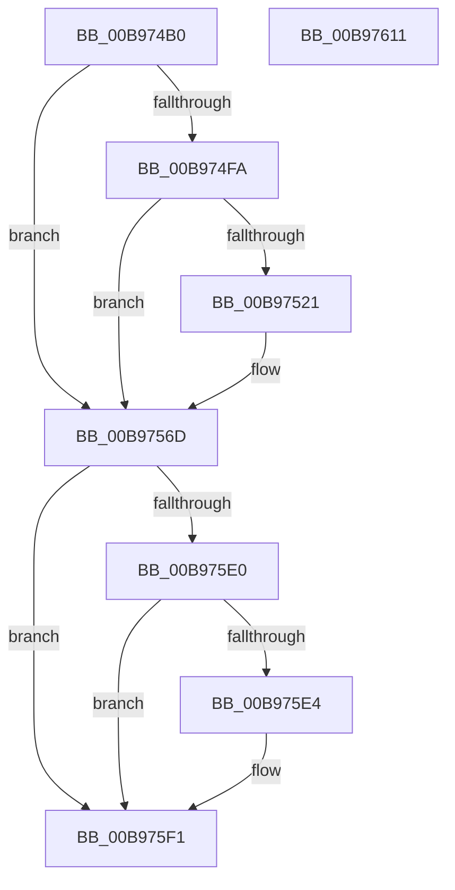

# VfMapTransferEx

- RVA: `0x00B974B0`–`0x00B97612` (길이 `354` bytes)
- VA: `0x0000000140B974B0`
- 실행 섹션: `PAGEVRFY`
- PDB 이름 있음: `예`; PDB Function 태그: `아니요`
- unwind 정보 RVA: `0x0008C11C`
- 디코드: `92`개 명령, `354/354` bytes 표시
- 미해석 바이트: `0` (있으면 어셈블리에 `.byte`로 보존)

> 이 문서는 커널 이미지의 기계어와 PDB 기호를 분석해 생성했습니다. 4번과 5번은 함수 원형과 자료형을 바이너리 사용 방식에서 추정한 C 해석이며 원본 소스 복구 결과는 아닙니다.

## 1. Dependencies

- 직접 호출 지점: **10**; 고유 호출 대상: **10**
- 직접 호출자로 확인된 함수: **0**
- RIP 상대 이미지 참조: **2**

### Outgoing calls
- `0x00B974D8` → [ViGetRealDmaAdapter](ViGetRealDmaAdapter_function_00B990DC.md) (function, `0x00B990DC`)
- `0x00B974E5` → [ViGetAdapterInformationInternal](ViGetAdapterInformationInternal_function_00B98E88.md) (function, `0x00B98E88`)
- `0x00B974FA` → [VF_ASSERT_MAX_IRQL](VF_ASSERT_MAX_IRQL_function_00B94FB0.md) (function, `0x00B94FB0`)
- `0x00B97502` → [VERIFY_BUFFER_LOCKED](VERIFY_BUFFER_LOCKED_function_00B94EA4.md) (function, `0x00B94EA4`)
- `0x00B9750A` → [ViCheckAdapterBuffers](ViCheckAdapterBuffers_function_00B98358.md) (function, `0x00B98358`)
- `0x00B97518` → [ViCheckMdlLength](ViCheckMdlLength_function_00B9841C.md) (function, `0x00B9841C`)
- `0x00B97549` → [ViHalPreprocessOptions](ViHalPreprocessOptions_function_00B9920C.md) (function, `0x00B9920C`)
- `0x00B97568` → [VfReportIssueWithOptions](../../text/61/VfReportIssueWithOptions_function_00614444.md) (function, `0x00614444`)
- `0x00B975D4` → [guard_dispatch_icall](../../text/6B/guard_dispatch_icall_function_006BAAD0.md) (function, `0x006BAAD0`)
- `0x00B975EC` → [INCREASE_MAPPED_TRANSFER_BYTE_COUNT](INCREASE_MAPPED_TRANSFER_BYTE_COUNT_function_00B94CD8.md) (function, `0x00B94CD8`)

### Direct callers
- 이 함수 시작 RVA로 연결되는 직접 call은 확인되지 않았습니다. 간접 호출은 완전히 역산할 수 없습니다.

### Static image references
- `0x00B97527` → RVA `0x00E0E9B4` (`.data`; read)
- `0x00B97534` → RVA `0x00BB9C20` (` ?? ::JKADOLAD::`string'`; read)

## 2. Other-region calls and transfers

- 다른 실행 섹션으로 향하는 call: **2**
  - `0x00B97568` → [VfReportIssueWithOptions](../../text/61/VfReportIssueWithOptions_function_00614444.md) (`PAGEVRFY` → `.text`)
  - `0x00B975D4` → [guard_dispatch_icall](../../text/6B/guard_dispatch_icall_function_006BAAD0.md) (`PAGEVRFY` → `.text`)
- 별도 외부 분기/꼬리 이동을 확인하지 못했습니다.

## 3. Assembly (complete function range)

```asm
00B974B0  48 89 5C 24 08                  mov qword ptr [rsp + 8], rbx
00B974B5  48 89 6C 24 10                  mov qword ptr [rsp + 0x10], rbp
00B974BA  48 89 74 24 18                  mov qword ptr [rsp + 0x18], rsi
00B974BF  57                              push rdi
00B974C0  41 54                           push r12
00B974C2  41 55                           push r13
00B974C4  41 56                           push r14
00B974C6  41 57                           push r15
00B974C8  48 83 EC 60                     sub rsp, 0x60
00B974CC  4D 8B F1                        mov r14, r9
00B974CF  4D 8B E0                        mov r12, r8
00B974D2  48 8B EA                        mov rbp, rdx
00B974D5  48 8B D9                        mov rbx, rcx
00B974D8  E8 FF 1B 00 00                  call 0x140b990dc
00B974DD  B2 01                           mov dl, 1
00B974DF  48 8B CB                        mov rcx, rbx
00B974E2  4C 8B F8                        mov r15, rax
00B974E5  E8 9E 19 00 00                  call 0x140b98e88
00B974EA  48 8B B4 24 B8 00 00 00         mov rsi, qword ptr [rsp + 0xb8]
00B974F2  48 8B F8                        mov rdi, rax
00B974F5  48 85 C0                        test rax, rax
00B974F8  74 73                           je 0x140b9756d
00B974FA  E8 B1 DA FF FF                  call 0x140b94fb0
00B974FF  48 8B CD                        mov rcx, rbp
00B97502  E8 9D D9 FF FF                  call 0x140b94ea4
00B97507  48 8B CF                        mov rcx, rdi
00B9750A  E8 49 0E 00 00                  call 0x140b98358
00B9750F  44 8B 06                        mov r8d, dword ptr [rsi]
00B97512  49 8B D6                        mov rdx, r14
00B97515  48 8B CD                        mov rcx, rbp
00B97518  E8 FF 0E 00 00                  call 0x140b9841c
00B9751D  85 C0                           test eax, eax
00B9751F  74 4C                           je 0x140b9756d
00B97521  48 83 64 24 28 00               and qword ptr [rsp + 0x28], 0
00B97527  4C 8D 2D 86 74 27 00            lea r13, [rip + 0x277486]
00B9752E  48 83 64 24 20 00               and qword ptr [rsp + 0x20], 0
00B97534  48 8D 15 E5 26 02 00            lea rdx, [rip + 0x226e5]
00B9753B  49 8B CD                        mov rcx, r13
00B9753E  44 8B C8                        mov r9d, eax
00B97541  41 B8 24 00 00 00               mov r8d, 0x24
00B97547  8B D8                           mov ebx, eax
00B97549  E8 BE 1C 00 00                  call 0x140b9920c
00B9754E  45 33 C9                        xor r9d, r9d
00B97551  4C 89 6C 24 28                  mov qword ptr [rsp + 0x28], r13
00B97556  48 83 64 24 20 00               and qword ptr [rsp + 0x20], 0
00B9755C  44 8B C3                        mov r8d, ebx
00B9755F  B9 E6 00 00 00                  mov ecx, 0xe6
00B97564  41 8D 51 24                     lea edx, [r9 + 0x24]
00B97568  E8 D7 CE A7 FF                  call 0x140614444
00B9756D  49 8B 47 08                     mov rax, qword ptr [r15 + 8]
00B97571  4D 8B CE                        mov r9, r14
00B97574  48 8B 8C 24 D8 00 00 00         mov rcx, qword ptr [rsp + 0xd8]
00B9757C  4D 8B C4                        mov r8, r12
00B9757F  48 8B D5                        mov rdx, rbp
00B97582  4C 8B 90 B8 00 00 00            mov r10, qword ptr [rax + 0xb8]
00B97589  48 8B 84 24 E0 00 00 00         mov rax, qword ptr [rsp + 0xe0]
00B97591  48 89 44 24 50                  mov qword ptr [rsp + 0x50], rax
00B97596  49 8B C2                        mov rax, r10
00B97599  48 89 4C 24 48                  mov qword ptr [rsp + 0x48], rcx
00B9759E  8B 8C 24 D0 00 00 00            mov ecx, dword ptr [rsp + 0xd0]
00B975A5  89 4C 24 40                     mov dword ptr [rsp + 0x40], ecx
00B975A9  48 8B 8C 24 C8 00 00 00         mov rcx, qword ptr [rsp + 0xc8]
00B975B1  48 89 4C 24 38                  mov qword ptr [rsp + 0x38], rcx
00B975B6  8A 8C 24 C0 00 00 00            mov cl, byte ptr [rsp + 0xc0]
00B975BD  88 4C 24 30                     mov byte ptr [rsp + 0x30], cl
00B975C1  8B 8C 24 B0 00 00 00            mov ecx, dword ptr [rsp + 0xb0]
00B975C8  48 89 74 24 28                  mov qword ptr [rsp + 0x28], rsi
00B975CD  89 4C 24 20                     mov dword ptr [rsp + 0x20], ecx
00B975D1  49 8B CF                        mov rcx, r15
00B975D4  E8 F7 34 B2 FF                  call 0x1406baad0
00B975D9  8B D8                           mov ebx, eax
00B975DB  48 85 FF                        test rdi, rdi
00B975DE  74 11                           je 0x140b975f1
00B975E0  85 C0                           test eax, eax
00B975E2  78 0D                           js 0x140b975f1
00B975E4  8B 16                           mov edx, dword ptr [rsi]
00B975E6  41 B0 01                        mov r8b, 1
00B975E9  48 8B CF                        mov rcx, rdi
00B975EC  E8 E7 D6 FF FF                  call 0x140b94cd8
00B975F1  4C 8D 5C 24 60                  lea r11, [rsp + 0x60]
00B975F6  8B C3                           mov eax, ebx
00B975F8  49 8B 5B 30                     mov rbx, qword ptr [r11 + 0x30]
00B975FC  49 8B 6B 38                     mov rbp, qword ptr [r11 + 0x38]
00B97600  49 8B 73 40                     mov rsi, qword ptr [r11 + 0x40]
00B97604  49 8B E3                        mov rsp, r11
00B97607  41 5F                           pop r15
00B97609  41 5E                           pop r14
00B9760B  41 5D                           pop r13
00B9760D  41 5C                           pop r12
00B9760F  5F                              pop rdi
00B97610  C3                              ret
00B97611  CC                              int3
```

## 4. C-style interpretation (structured pseudocode)

```c
__int64 __fastcall VfMapTransferEx(__int64 a1, __int64 a2, __int64 a3, __int64 a4, unsigned int a5, __int64 a6, unsigned __int8 a7, __int64 a8, unsigned int a9, __int64 a10, __int64 a11)
{
    __int64 result;
    __int64 v_r13;
    __int64 v_rbx;
    __int64 v_rsp;
    unsigned __int64 v_stack_m28;
    unsigned __int64 v_stack_m38;
    unsigned __int64 v_stack_m40;
    unsigned int v_stack_m48;
    unsigned __int64 v_stack_m50;
    unsigned __int8 v_stack_m58;
    unsigned __int64 v_stack_m60;
    unsigned __int64 v_stack_m68;
    unsigned __int64 v_stack_p10;
    unsigned __int64 v_stack_p18;
    unsigned __int64 v_stack_p8;

    v_stack_p8 = v_rbx;
    v_stack_p10 = v_rbp;
    v_stack_p18 = v_rsi;
    v_rsp = (v_rsp) - (96);
    result = ViGetRealDmaAdapter(a1, a2, a3, a4);
    result = ViGetAdapterInformationInternal(a1, 1, a3, a4);
    if (result == 0) goto loc_00B9756D;
    result = VF_ASSERT_MAX_IRQL(a1, 1, a3, a4);
    result = VERIFY_BUFFER_LOCKED(a2, 1, a3, a4);
    result = ViCheckAdapterBuffers(result, 1, a3, a4);
    result = ViCheckMdlLength(a2, a4, (unsigned int)(*(unsigned int *)(a6)), a4);
    v_rbx = a1;
    if ((unsigned int)(result) != 0) {
        v_r13 = v_rip + 2585734;
        a2 = v_rip + 141029;
        a1 = v_r13;
        a4 = (unsigned int)(result);
        a3 = 36;
        v_rbx = (unsigned int)(result);
        result = ViHalPreprocessOptions(a1, a2, a3, a4);
        a4 = 0;
        v_stack_m60 = v_r13;
        a3 = (unsigned int)(v_rbx);
        a1 = 230;
        a2 = a4 + 36;
        result = VfReportIssueWithOptions(a1, a2, a3, a4);
    }
    v_stack_m38 = a11;
    v_stack_m40 = a10;
    v_stack_m48 = (unsigned int)((unsigned int)(a9));
    v_stack_m50 = a8;
    v_stack_m58 = a7;
    v_stack_m60 = a6;
    v_stack_m68 = (unsigned int)((unsigned int)(a5));
    result = guard_dispatch_icall(result, a2, a3, 0);
    if (result == 0) goto loc_00B975F1;
    if (!(sign_flag)) {
        a2 = *(unsigned int *)(a6);
        a3 = 1;
        a1 = result;
        result = INCREASE_MAPPED_TRANSFER_BYTE_COUNT(a1, a2, a3, 0);
    }
    return (unsigned int)((unsigned int)((unsigned int)((unsigned int)(result))));
}
```

## 5. (Beta) C Style

```c
int64_t VfMapTransferEx(int64_t Arg1, int64_t Arg2, int64_t Arg3, int64_t Arg4, uint32_t Arg5, void *Arg6, uint8_t Arg7, int64_t Arg8, uint32_t Arg9, int64_t Arg10, int64_t Arg11)
{
    uint8_t *arg6 = (uint8_t *)Arg6;

    int64_t result;
    int64_t local_r13;
    int64_t local_rbx;
    int64_t local_rsp;
    uint64_t v_stack_m28;
    uint64_t v_stack_m38;
    uint64_t v_stack_m40;
    uint32_t v_stack_m48;
    uint64_t v_stack_m50;
    uint8_t v_stack_m58;
    uint64_t v_stack_m60;
    uint64_t v_stack_m68;
    uint64_t v_stack_p10;
    uint64_t v_stack_p18;
    uint64_t v_stack_p8;

    v_stack_p8 = local_rbx;
    v_stack_p10 = local_rbp;
    v_stack_p18 = local_rsi;
    local_rsp = (local_rsp) - (96);
    result = ViGetRealDmaAdapter(Arg1, Arg2, Arg3, Arg4);
    result = ViGetAdapterInformationInternal(Arg1, 1, Arg3, Arg4);
    if (result == 0) goto loc_00B9756D;
    result = VF_ASSERT_MAX_IRQL(Arg1, 1, Arg3, Arg4);
    result = VERIFY_BUFFER_LOCKED(Arg2, 1, Arg3, Arg4);
    result = ViCheckAdapterBuffers(result, 1, Arg3, Arg4);
    result = ViCheckMdlLength(Arg2, Arg4, (uint32_t)(*(uint32_t *)(arg6)), Arg4);
    local_rbx = Arg1;
    if ((uint32_t)(result) != 0) {
        local_r13 = v_rip + 2585734;
        Arg2 = v_rip + 141029;
        Arg1 = local_r13;
        Arg4 = (uint32_t)(result);
        Arg3 = 36;
        local_rbx = (uint32_t)(result);
        result = ViHalPreprocessOptions(Arg1, Arg2, Arg3, Arg4);
        Arg4 = 0;
        v_stack_m60 = local_r13;
        Arg3 = (uint32_t)(local_rbx);
        Arg1 = 230;
        Arg2 = Arg4 + 36;
        result = VfReportIssueWithOptions(Arg1, Arg2, Arg3, Arg4);
    }
    v_stack_m38 = Arg11;
    v_stack_m40 = Arg10;
    v_stack_m48 = (uint32_t)((uint32_t)(Arg9));
    v_stack_m50 = Arg8;
    v_stack_m58 = Arg7;
    v_stack_m60 = Arg6;
    v_stack_m68 = (uint32_t)((uint32_t)(Arg5));
    result = guard_dispatch_icall(result, Arg2, Arg3, 0);
    if (result == 0) goto loc_00B975F1;
    if (!(sign_flag)) {
        Arg2 = *(uint32_t *)(arg6);
        Arg3 = 1;
        Arg1 = result;
        result = INCREASE_MAPPED_TRANSFER_BYTE_COUNT(Arg1, Arg2, Arg3, 0);
    }
    return (uint32_t)((uint32_t)((uint32_t)((uint32_t)(result))));
}
```

### 관측된 메모리 오프셋

구조체 형식이 확인되지 않은 접근은 인자 기준의 오프셋으로만 기록했습니다.

| 기준 인자 | 오프셋 표현 | 폭 (bit) | 접근 |
|---|---:|---:|---|
| `Arg6` | `+ 0x0` | `32` | `R` |

## 6. Execution-region graph

[열기: 2D/3D 그래프와 함수 탐색 컨트롤 패널](../../../control-panel.html?section=pagevrfy&rva=0x00B974B0&view=graph)

- 2D 그래프는 위에서 아래로 흐르고, 3D 그래프는 빈 공간을 드래그해 회전합니다. Shift+드래그는 이동, 휠은 확대·축소, 함수 노드 선택은 대상 보고서 이동입니다.

### Static fallback


