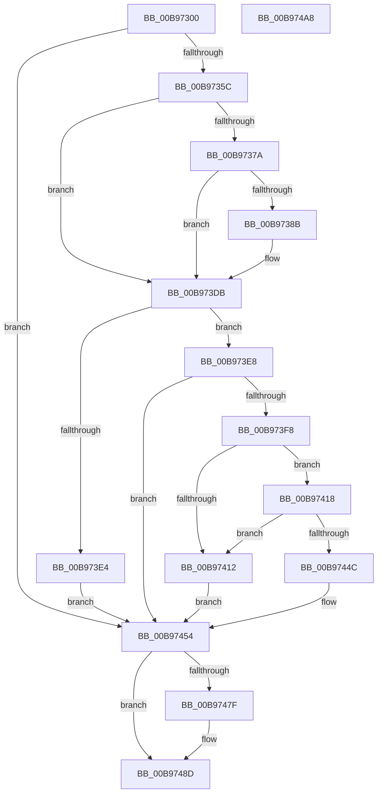

# VfMapTransfer

- RVA: `0x00B97300`–`0x00B974A9` (길이 `425` bytes)
- VA: `0x0000000140B97300`
- 실행 섹션: `PAGEVRFY`
- PDB 이름 있음: `예`; PDB Function 태그: `아니요`
- unwind 정보 RVA: `0x000D2368`
- 디코드: `113`개 명령, `425/425` bytes 표시
- 미해석 바이트: `0` (있으면 어셈블리에 `.byte`로 보존)

> 이 문서는 커널 이미지의 기계어와 PDB 기호를 분석해 생성했습니다. 4번과 5번은 함수 원형과 자료형을 바이너리 사용 방식에서 추정한 C 해석이며 원본 소스 복구 결과는 아닙니다.

## 1. Dependencies

- 직접 호출 지점: **13**; 고유 호출 대상: **13**
- 직접 호출자로 확인된 함수: **0**
- RIP 상대 이미지 참조: **2**

### Outgoing calls
- `0x00B9732E` → [ViGetRealDmaAdapter](ViGetRealDmaAdapter_function_00B990DC.md) (function, `0x00B990DC`)
- `0x00B9733B` → [ViGetAdapterInformationInternal](ViGetAdapterInformationInternal_function_00B98E88.md) (function, `0x00B98E88`)
- `0x00B9735C` → [VF_ASSERT_MAX_IRQL](VF_ASSERT_MAX_IRQL_function_00B94FB0.md) (function, `0x00B94FB0`)
- `0x00B97364` → [VERIFY_BUFFER_LOCKED](VERIFY_BUFFER_LOCKED_function_00B94EA4.md) (function, `0x00B94EA4`)
- `0x00B9736C` → [ViCheckAdapterBuffers](ViCheckAdapterBuffers_function_00B98358.md) (function, `0x00B98358`)
- `0x00B97382` → [ViCheckMdlLength](ViCheckMdlLength_function_00B9841C.md) (function, `0x00B9841C`)
- `0x00B973B0` → [ViHalPreprocessOptions](ViHalPreprocessOptions_function_00B9920C.md) (function, `0x00B9920C`)
- `0x00B973D6` → [VfReportIssueWithOptions](../../text/61/VfReportIssueWithOptions_function_00614444.md) (function, `0x00614444`)
- `0x00B973EB` → [ViGetMapRegisterFile](ViGetMapRegisterFile_function_00B98FA0.md) (function, `0x00B98FA0`)
- `0x00B97409` → [ViMapDoubleBuffer](ViMapDoubleBuffer_function_00B99640.md) (function, `0x00B99640`)
- `0x00B97433` → [ViSwap](ViSwap_function_00B99E54.md) (function, `0x00B99E54`)
- `0x00B97472` → [guard_dispatch_icall](../../text/6B/guard_dispatch_icall_function_006BAAD0.md) (function, `0x006BAAD0`)
- `0x00B97488` → [INCREASE_MAPPED_TRANSFER_BYTE_COUNT](INCREASE_MAPPED_TRANSFER_BYTE_COUNT_function_00B94CD8.md) (function, `0x00B94CD8`)

### Direct callers
- 이 함수 시작 RVA로 연결되는 직접 call은 확인되지 않았습니다. 간접 호출은 완전히 역산할 수 없습니다.

### Static image references
- `0x00B97391` → RVA `0x00BB9C20` (` ?? ::JKADOLAD::`string'`; read)
- `0x00B9739E` → RVA `0x00E0E9EC` (`.data`; read)

## 2. Other-region calls and transfers

- 다른 실행 섹션으로 향하는 call: **2**
  - `0x00B973D6` → [VfReportIssueWithOptions](../../text/61/VfReportIssueWithOptions_function_00614444.md) (`PAGEVRFY` → `.text`)
  - `0x00B97472` → [guard_dispatch_icall](../../text/6B/guard_dispatch_icall_function_006BAAD0.md) (`PAGEVRFY` → `.text`)
- 별도 외부 분기/꼬리 이동을 확인하지 못했습니다.

## 3. Assembly (complete function range)

```asm
00B97300  48 8B C4                        mov rax, rsp
00B97303  48 89 58 08                     mov qword ptr [rax + 8], rbx
00B97307  4C 89 48 20                     mov qword ptr [rax + 0x20], r9
00B9730B  4C 89 40 18                     mov qword ptr [rax + 0x18], r8
00B9730F  48 89 50 10                     mov qword ptr [rax + 0x10], rdx
00B97313  55                              push rbp
00B97314  56                              push rsi
00B97315  57                              push rdi
00B97316  41 54                           push r12
00B97318  41 55                           push r13
00B9731A  41 56                           push r14
00B9731C  41 57                           push r15
00B9731E  48 83 EC 40                     sub rsp, 0x40
00B97322  4D 8B F9                        mov r15, r9
00B97325  49 8B F8                        mov rdi, r8
00B97328  48 8B F2                        mov rsi, rdx
00B9732B  48 8B D9                        mov rbx, rcx
00B9732E  E8 A9 1D 00 00                  call 0x140b990dc
00B97333  B2 01                           mov dl, 1
00B97335  48 8B CB                        mov rcx, rbx
00B97338  4C 8B E8                        mov r13, rax
00B9733B  E8 48 1B 00 00                  call 0x140b98e88
00B97340  44 8A A4 24 A8 00 00 00         mov r12b, byte ptr [rsp + 0xa8]
00B97348  48 8B E8                        mov rbp, rax
00B9734B  4C 8B B4 24 A0 00 00 00         mov r14, qword ptr [rsp + 0xa0]
00B97353  48 85 C0                        test rax, rax
00B97356  0F 84 F8 00 00 00               je 0x140b97454
00B9735C  E8 4F DC FF FF                  call 0x140b94fb0
00B97361  48 8B CE                        mov rcx, rsi
00B97364  E8 3B DB FF FF                  call 0x140b94ea4
00B97369  48 8B CD                        mov rcx, rbp
00B9736C  E8 E7 0F 00 00                  call 0x140b98358
00B97371  83 BD E0 00 00 00 03            cmp dword ptr [rbp + 0xe0], 3
00B97378  75 61                           jne 0x140b973db
00B9737A  45 8B 06                        mov r8d, dword ptr [r14]
00B9737D  33 D2                           xor edx, edx
00B9737F  48 8B CE                        mov rcx, rsi
00B97382  E8 95 10 00 00                  call 0x140b9841c
00B97387  85 C0                           test eax, eax
00B97389  74 50                           je 0x140b973db
00B9738B  48 83 64 24 28 00               and qword ptr [rsp + 0x28], 0
00B97391  48 8D 15 88 28 02 00            lea rdx, [rip + 0x22888]
00B97398  48 83 64 24 20 00               and qword ptr [rsp + 0x20], 0
00B9739E  48 8D 0D 47 76 27 00            lea rcx, [rip + 0x277647]
00B973A5  44 8B C8                        mov r9d, eax
00B973A8  41 B8 24 00 00 00               mov r8d, 0x24
00B973AE  8B D8                           mov ebx, eax
00B973B0  E8 57 1E 00 00                  call 0x140b9920c
00B973B5  45 33 C9                        xor r9d, r9d
00B973B8  48 8D 05 2D 76 27 00            lea rax, [rip + 0x27762d]
00B973BF  48 89 44 24 28                  mov qword ptr [rsp + 0x28], rax
00B973C4  44 8B C3                        mov r8d, ebx
00B973C7  48 83 64 24 20 00               and qword ptr [rsp + 0x20], 0
00B973CD  B9 E6 00 00 00                  mov ecx, 0xe6
00B973D2  41 8D 51 24                     lea edx, [r9 + 0x24]
00B973D6  E8 69 D0 A7 FF                  call 0x140614444
00B973DB  48 81 FF 0D F0 AD DE            cmp rdi, -0x21520ff3
00B973E2  75 04                           jne 0x140b973e8
00B973E4  33 FF                           xor edi, edi
00B973E6  EB 6C                           jmp 0x140b97454
00B973E8  48 8B CF                        mov rcx, rdi
00B973EB  E8 B0 1B 00 00                  call 0x140b98fa0
00B973F0  48 8B D8                        mov rbx, rax
00B973F3  48 85 C0                        test rax, rax
00B973F6  74 5C                           je 0x140b97454
00B973F8  45 8B 0E                        mov r9d, dword ptr [r14]
00B973FB  4D 8B C7                        mov r8, r15
00B973FE  48 8B D6                        mov rdx, rsi
00B97401  44 88 64 24 20                  mov byte ptr [rsp + 0x20], r12b
00B97406  48 8B C8                        mov rcx, rax
00B97409  E8 32 22 00 00                  call 0x140b99640
00B9740E  85 C0                           test eax, eax
00B97410  75 06                           jne 0x140b97418
00B97412  48 8B 7B 30                     mov rdi, qword ptr [rbx + 0x30]
00B97416  EB 3C                           jmp 0x140b97454
00B97418  4C 8D 84 24 98 00 00 00         lea r8, [rsp + 0x98]
00B97420  41 89 06                        mov dword ptr [r14], eax
00B97423  48 8D 94 24 88 00 00 00         lea rdx, [rsp + 0x88]
00B9742B  48 8D 8C 24 90 00 00 00         lea rcx, [rsp + 0x90]
00B97433  E8 1C 2A 00 00                  call 0x140b99e54
00B97438  4C 8B BC 24 98 00 00 00         mov r15, qword ptr [rsp + 0x98]
00B97440  48 8B B4 24 88 00 00 00         mov rsi, qword ptr [rsp + 0x88]
00B97448  85 C0                           test eax, eax
00B9744A  74 C6                           je 0x140b97412
00B9744C  48 8B BC 24 90 00 00 00         mov rdi, qword ptr [rsp + 0x90]
00B97454  49 8B 45 08                     mov rax, qword ptr [r13 + 8]
00B97458  4D 8B CF                        mov r9, r15
00B9745B  44 88 64 24 28                  mov byte ptr [rsp + 0x28], r12b
00B97460  4C 8B C7                        mov r8, rdi
00B97463  48 8B D6                        mov rdx, rsi
00B97466  4C 89 74 24 20                  mov qword ptr [rsp + 0x20], r14
00B9746B  49 8B CD                        mov rcx, r13
00B9746E  48 8B 40 40                     mov rax, qword ptr [rax + 0x40]
00B97472  E8 59 36 B2 FF                  call 0x1406baad0
00B97477  48 8B D8                        mov rbx, rax
00B9747A  48 85 ED                        test rbp, rbp
00B9747D  74 0E                           je 0x140b9748d
00B9747F  41 8B 16                        mov edx, dword ptr [r14]
00B97482  45 33 C0                        xor r8d, r8d
00B97485  48 8B CD                        mov rcx, rbp
00B97488  E8 4B D8 FF FF                  call 0x140b94cd8
00B9748D  48 8B C3                        mov rax, rbx
00B97490  48 8B 9C 24 80 00 00 00         mov rbx, qword ptr [rsp + 0x80]
00B97498  48 83 C4 40                     add rsp, 0x40
00B9749C  41 5F                           pop r15
00B9749E  41 5E                           pop r14
00B974A0  41 5D                           pop r13
00B974A2  41 5C                           pop r12
00B974A4  5F                              pop rdi
00B974A5  5E                              pop rsi
00B974A6  5D                              pop rbp
00B974A7  C3                              ret
00B974A8  CC                              int3
```

## 4. C-style interpretation (structured pseudocode)

```c
__int64 __fastcall VfMapTransfer(__int64 a1, __int64 a2, __int64 a3, __int64 a4, __int64 a5, unsigned __int8 a6)
{
    __int64 result;
    __int64 v_rbx;
    __int64 v_rdi;
    __int64 v_rsp;
    unsigned __int64 v_stack_m50;
    unsigned __int64 v_stack_m58;
    unsigned __int64 v_stack_p10;
    unsigned __int64 v_stack_p18;
    unsigned __int64 v_stack_p20;
    unsigned __int64 v_stack_p8;

    *(unsigned __int64 *)(v_rsp + 8) = v_rbx;
    *(unsigned __int64 *)(v_rsp + 32) = a4;
    *(unsigned __int64 *)(v_rsp + 24) = a3;
    *(unsigned __int64 *)(v_rsp + 16) = a2;
    v_rsp = (v_rsp) - (64);
    result = ViGetRealDmaAdapter(a1, a2, a3, a4);
    result = ViGetAdapterInformationInternal(a1, 1, a3, a4);
    if (result == 0) goto loc_00B97454;
    result = VF_ASSERT_MAX_IRQL(a1, 1, a3, a4);
    result = VERIFY_BUFFER_LOCKED(a2, 1, a3, a4);
    result = ViCheckAdapterBuffers(result, 1, a3, a4);
    if ((*(unsigned int *)(result + 224)) != 3) goto loc_00B973DB;
    a2 = 0;
    result = ViCheckMdlLength(0, a2, (unsigned int)(*(unsigned int *)(a5)), a4);
    v_rbx = a1;
    if ((unsigned int)(result) != 0) {
        a2 = v_rip + 141448;
        a1 = v_rip + 2586183;
        a4 = (unsigned int)(result);
        a3 = 36;
        v_rbx = (unsigned int)(result);
        result = ViHalPreprocessOptions(a1, a2, a3, a4);
        a4 = 0;
        result = v_rip + 2586157;
        v_stack_m50 = result;
        a3 = (unsigned int)(v_rbx);
        a1 = 230;
        a2 = a4 + 36;
        result = VfReportIssueWithOptions(a1, a2, a3, a4);
    }
    if (a3 != 0xFFFFFFFFDEADF00DULL) goto loc_00B973E8;
    v_rdi = 0;
    goto loc_00B97454;
loc_00B973E8:
    result = ViGetMapRegisterFile(0, a2, a3, a4);
    if (result == 0) goto loc_00B97454;
    v_stack_m58 = a6;
    result = ViMapDoubleBuffer(result, a2, 0, (unsigned int)(*(unsigned int *)(a5)));
    if ((unsigned int)(result) != 0) goto loc_00B97418;
loc_00B97412:
    goto loc_00B97454;
loc_00B97418:
    *(unsigned int *)(a5) = (unsigned int)(result);
    result = ViSwap(v_stack_p18, v_stack_p10, v_stack_p20, (unsigned int)(*(unsigned int *)(a5)));
    if ((unsigned int)(result) == 0) goto loc_00B97412;
loc_00B97454:
    v_stack_m50 = a6;
    v_stack_m58 = a5;
    result = guard_dispatch_icall(result, v_stack_p10, v_stack_p18, v_stack_p20);
    if (result != 0) {
        a2 = *(unsigned int *)(a5);
        a3 = 0;
        a1 = result;
        result = INCREASE_MAPPED_TRANSFER_BYTE_COUNT(a1, a2, a3, v_stack_p20);
    }
    v_rsp = (v_rsp) + (64);
    return result;
}
```

## 5. (Beta) C Style

```c
int64_t VfMapTransfer(int64_t Arg1, int64_t Arg2, int64_t Arg3, int64_t Arg4, void *Arg5, uint8_t Arg6)
{
    uint8_t *arg5 = (uint8_t *)Arg5;

    int64_t result;
    int64_t local_rbx;
    int64_t local_rdi;
    int64_t local_rsp;
    uint64_t v_stack_m50;
    uint64_t v_stack_m58;
    uint64_t v_stack_p10;
    uint64_t v_stack_p18;
    uint64_t v_stack_p20;
    uint64_t v_stack_p8;

    *(uint64_t *)(local_rsp + 0x8) = local_rbx;
    *(uint64_t *)(local_rsp + 0x20) = Arg4;
    *(uint64_t *)(local_rsp + 0x18) = Arg3;
    *(uint64_t *)(local_rsp + 0x10) = Arg2;
    local_rsp = (local_rsp) - (64);
    result = ViGetRealDmaAdapter(Arg1, Arg2, Arg3, Arg4);
    result = ViGetAdapterInformationInternal(Arg1, 1, Arg3, Arg4);
    if (result == 0) goto loc_00B97454;
    result = VF_ASSERT_MAX_IRQL(Arg1, 1, Arg3, Arg4);
    result = VERIFY_BUFFER_LOCKED(Arg2, 1, Arg3, Arg4);
    result = ViCheckAdapterBuffers(result, 1, Arg3, Arg4);
    if ((*(uint32_t *)(result + 0xE0)) != 3) goto loc_00B973DB;
    Arg2 = 0;
    result = ViCheckMdlLength(0, Arg2, (uint32_t)(*(uint32_t *)(arg5)), Arg4);
    local_rbx = Arg1;
    if ((uint32_t)(result) != 0) {
        Arg2 = v_rip + 141448;
        Arg1 = v_rip + 2586183;
        Arg4 = (uint32_t)(result);
        Arg3 = 36;
        local_rbx = (uint32_t)(result);
        result = ViHalPreprocessOptions(Arg1, Arg2, Arg3, Arg4);
        Arg4 = 0;
        result = v_rip + 2586157;
        v_stack_m50 = result;
        Arg3 = (uint32_t)(local_rbx);
        Arg1 = 230;
        Arg2 = Arg4 + 36;
        result = VfReportIssueWithOptions(Arg1, Arg2, Arg3, Arg4);
    }
    if (Arg3 != 0xFFFFFFFFDEADF00DULL) goto loc_00B973E8;
    local_rdi = 0;
    goto loc_00B97454;
loc_00B973E8:
    result = ViGetMapRegisterFile(0, Arg2, Arg3, Arg4);
    if (result == 0) goto loc_00B97454;
    v_stack_m58 = Arg6;
    result = ViMapDoubleBuffer(result, Arg2, 0, (uint32_t)(*(uint32_t *)(arg5)));
    if ((uint32_t)(result) != 0) goto loc_00B97418;
loc_00B97412:
    goto loc_00B97454;
loc_00B97418:
    *(uint32_t *)(arg5) = (uint32_t)(result);
    result = ViSwap(v_stack_p18, v_stack_p10, v_stack_p20, (uint32_t)(*(uint32_t *)(arg5)));
    if ((uint32_t)(result) == 0) goto loc_00B97412;
loc_00B97454:
    v_stack_m50 = Arg6;
    v_stack_m58 = Arg5;
    result = guard_dispatch_icall(result, v_stack_p10, v_stack_p18, v_stack_p20);
    if (result != 0) {
        Arg2 = *(uint32_t *)(arg5);
        Arg3 = 0;
        Arg1 = result;
        result = INCREASE_MAPPED_TRANSFER_BYTE_COUNT(Arg1, Arg2, Arg3, v_stack_p20);
    }
    local_rsp = (local_rsp) + (64);
    return result;
}
```

### 관측된 메모리 오프셋

구조체 형식이 확인되지 않은 접근은 인자 기준의 오프셋으로만 기록했습니다.

| 기준 인자 | 오프셋 표현 | 폭 (bit) | 접근 |
|---|---:|---:|---|
| `Arg5` | `+ 0x0` | `32` | `R` |
| `Arg5` | `+ 0x0` | `32` | `W` |

## 6. Execution-region graph

[열기: 2D/3D 그래프와 함수 탐색 컨트롤 패널](../../../control-panel.html?section=pagevrfy&rva=0x00B97300&view=graph)

- 2D 그래프는 위에서 아래로 흐르고, 3D 그래프는 빈 공간을 드래그해 회전합니다. Shift+드래그는 이동, 휠은 확대·축소, 함수 노드 선택은 대상 보고서 이동입니다.

### Static fallback


