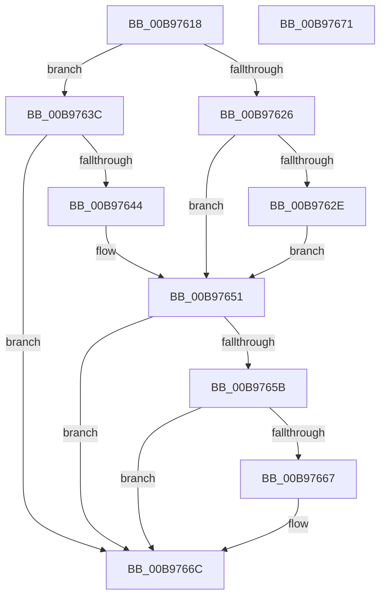

# VfNotifyOfHibernate

- RVA: `0x00B97618`–`0x00B97672` (길이 `90` bytes)
- VA: `0x0000000140B97618`
- 실행 섹션: `PAGEVRFY`
- PDB 이름 있음: `예`; PDB Function 태그: `아니요`
- unwind 정보 RVA: `0x0005C788`
- 디코드: `24`개 명령, `90/90` bytes 표시
- 미해석 바이트: `0` (있으면 어셈블리에 `.byte`로 보존)

> 이 문서는 커널 이미지의 기계어와 PDB 기호를 분석해 생성했습니다. 4번과 5번은 함수 원형과 자료형을 바이너리 사용 방식에서 추정한 C 해석이며 원본 소스 복구 결과는 아닙니다.

## 1. Dependencies

- 직접 호출 지점: **3**; 고유 호출 대상: **3**
- 직접 호출자로 확인된 함수: **1**
- RIP 상대 이미지 참조: **5**

### Outgoing calls
- `0x00B97635` → [VfDisableHalVerifier](../../text/61/VfDisableHalVerifier_function_00612C28.md) (function, `0x00612C28`)
- `0x00B97651` → [VfIsVerifierExtensionEnabled](../../text/61/VfIsVerifierExtensionEnabled_function_006121FC.md) (function, `0x006121FC`)
- `0x00B97667` → [guard_dispatch_icall](../../text/6B/guard_dispatch_icall_function_006BAAD0.md) (function, `0x006BAAD0`)

### Direct callers
- [PopInvokeSystemStateHandler](../../pagelk/B7/PopInvokeSystemStateHandler_function_00B76A6C.md) at `0x00B76DC6`
- [PopInvokeSystemStateHandler](../../pagelk/B7/PopInvokeSystemStateHandler_function_00B76A6C.md) at `0x00B77043`

### Static image references
- `0x00B97626` → RVA `0x00F03FA4` (`.data`; read)
- `0x00B9762E` → RVA `0x00FFDAF0` (`PAGEVRFD`; write)
- `0x00B9763C` → RVA `0x00FFDAF0` (`PAGEVRFD`; read)
- `0x00B97644` → RVA `0x00F03FA4` (`.data`; write)
- `0x00B9765B` → RVA `0x00FFDAD0` (`PAGEVRFD`; read)

## 2. Other-region calls and transfers

- 다른 실행 섹션으로 향하는 call: **3**
  - `0x00B97635` → [VfDisableHalVerifier](../../text/61/VfDisableHalVerifier_function_00612C28.md) (`PAGEVRFY` → `.text`)
  - `0x00B97651` → [VfIsVerifierExtensionEnabled](../../text/61/VfIsVerifierExtensionEnabled_function_006121FC.md) (`PAGEVRFY` → `.text`)
  - `0x00B97667` → [guard_dispatch_icall](../../text/6B/guard_dispatch_icall_function_006BAAD0.md) (`PAGEVRFY` → `.text`)
- 별도 외부 분기/꼬리 이동을 확인하지 못했습니다.

## 3. Assembly (complete function range)

```asm
00B97618  48 83 EC 28                     sub rsp, 0x28
00B9761C  33 D2                           xor edx, edx
00B9761E  44 8D 42 01                     lea r8d, [rdx + 1]
00B97622  84 C9                           test cl, cl
00B97624  74 16                           je 0x140b9763c
00B97626  39 15 78 C9 36 00               cmp dword ptr [rip + 0x36c978], edx
00B9762C  74 23                           je 0x140b97651
00B9762E  44 89 05 BB 64 46 00            mov dword ptr [rip + 0x4664bb], r8d
00B97635  E8 EE B5 A7 FF                  call 0x140612c28
00B9763A  EB 15                           jmp 0x140b97651
00B9763C  39 15 AE 64 46 00               cmp dword ptr [rip + 0x4664ae], edx
00B97642  74 28                           je 0x140b9766c
00B97644  44 89 05 59 C9 36 00            mov dword ptr [rip + 0x36c959], r8d
00B9764B  89 15 9F 64 46 00               mov dword ptr [rip + 0x46649f], edx
00B97651  E8 A6 AB A7 FF                  call 0x1406121fc
00B97656  41 3B C0                        cmp eax, r8d
00B97659  75 11                           jne 0x140b9766c
00B9765B  48 8B 05 6E 64 46 00            mov rax, qword ptr [rip + 0x46646e]
00B97662  48 85 C0                        test rax, rax
00B97665  74 05                           je 0x140b9766c
00B97667  E8 64 34 B2 FF                  call 0x1406baad0
00B9766C  48 83 C4 28                     add rsp, 0x28
00B97670  C3                              ret
00B97671  CC                              int3
```

## 4. C-style interpretation (structured pseudocode)

```c
__int64 __fastcall VfNotifyOfHibernate(unsigned __int8 a1, int a2)
{
    __int64 result;
    __int64 v_rsp;

    v_rsp = (v_rsp) - (40);
    a2 = 0;
    if (a1 == 0) goto loc_00B9763C;
    if ((*(unsigned int *)(v_rip + 3590520)) == 0) goto loc_00B97651;
    *(unsigned int *)(v_rip + 4613307) = (unsigned int)(a2 + 1);
    result = VfDisableHalVerifier(a1, a2, a2 + 1, a4);
    goto loc_00B97651;
loc_00B9763C:
    if ((*(unsigned int *)(v_rip + 4613294)) == 0) goto loc_00B9766C;
    *(unsigned int *)(v_rip + 3590489) = (unsigned int)(a2 + 1);
    *(unsigned int *)(v_rip + 4613279) = 0;
loc_00B97651:
    result = VfIsVerifierExtensionEnabled(a1, a2, a2 + 1, a4);
    if (((unsigned int)(result)) != ((unsigned int)(a2 + 1))) goto loc_00B9766C;
    result = *(unsigned __int64 *)(v_rip + 4613230);
    if (*(unsigned __int64 *)(v_rip + 4613230) != 0) {
        result = guard_dispatch_icall(a1, a2, a2 + 1, a4);
    }
    v_rsp = (v_rsp) + (40);
    return result;
}
```

## 5. (Beta) C Style

```c
int64_t VfNotifyOfHibernate(uint8_t Arg1, int32_t Arg2)
{
    int64_t result;
    int64_t local_rsp;

    local_rsp = (local_rsp) - (40);
    Arg2 = 0;
    if (Arg1 == 0) goto loc_00B9763C;
    if ((*(uint32_t *)(v_rip + 0x36C978)) == 0) goto loc_00B97651;
    *(uint32_t *)(v_rip + 0x4664BB) = (uint32_t)(Arg2 + 1);
    result = VfDisableHalVerifier(Arg1, Arg2, Arg2 + 1, a4);
    goto loc_00B97651;
loc_00B9763C:
    if ((*(uint32_t *)(v_rip + 0x4664AE)) == 0) goto loc_00B9766C;
    *(uint32_t *)(v_rip + 0x36C959) = (uint32_t)(Arg2 + 1);
    *(uint32_t *)(v_rip + 0x46649F) = 0;
loc_00B97651:
    result = VfIsVerifierExtensionEnabled(Arg1, Arg2, Arg2 + 1, a4);
    if (((uint32_t)(result)) != ((uint32_t)(Arg2 + 1))) goto loc_00B9766C;
    result = *(uint64_t *)(v_rip + 0x46646E);
    if (*(uint64_t *)(v_rip + 0x46646E) != 0) {
        result = guard_dispatch_icall(Arg1, Arg2, Arg2 + 1, a4);
    }
    local_rsp = (local_rsp) + (40);
    return result;
}
```

## 6. Execution-region graph

[열기: 2D/3D 그래프와 함수 탐색 컨트롤 패널](../../../control-panel.html?section=pagevrfy&rva=0x00B97618&view=graph)

- 2D 그래프는 위에서 아래로 흐르고, 3D 그래프는 빈 공간을 드래그해 회전합니다. Shift+드래그는 이동, 휠은 확대·축소, 함수 노드 선택은 대상 보고서 이동입니다.

### Static fallback


