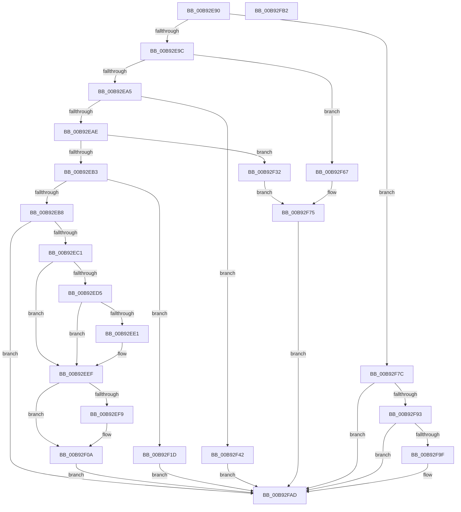

# VfNotifyVerifierOfEvent

- RVA: `0x00B92E90`–`0x00B92FB3` (길이 `291` bytes)
- VA: `0x0000000140B92E90`
- 실행 섹션: `PAGEVRFY`
- PDB 이름 있음: `예`; PDB Function 태그: `아니요`
- unwind 정보 RVA: `0x0005C788`
- 디코드: `65`개 명령, `291/291` bytes 표시
- 미해석 바이트: `0` (있으면 어셈블리에 `.byte`로 보존)

> 이 문서는 커널 이미지의 기계어와 PDB 기호를 분석해 생성했습니다. 4번과 5번은 함수 원형과 자료형을 바이너리 사용 방식에서 추정한 C 해석이며 원본 소스 복구 결과는 아닙니다.

## 1. Dependencies

- 직접 호출 지점: **11**; 고유 호출 대상: **7**
- 직접 호출자로 확인된 함수: **6**
- RIP 상대 이미지 참조: **13**

### Outgoing calls
- `0x00B92ECC` → [VfStartBranchTracing](../BA/VfStartBranchTracing_function_00BA3948.md) (function, `0x00BA3948`)
- `0x00B92EEA` → [VfUtilDbgPrint](../../text/61/VfUtilDbgPrint_function_006122AC.md) (function, `0x006122AC`)
- `0x00B92F00` → [VfUtilDbgPrint](../../text/61/VfUtilDbgPrint_function_006122AC.md) (function, `0x006122AC`)
- `0x00B92F05` → [VfClearVerifierSettings](../../text/61/VfClearVerifierSettings_function_00611DB0.md) (function, `0x00611DB0`)
- `0x00B92F0A` → [DifUpdatePluginState](../../text/61/DifUpdatePluginState_function_0061AF84.md) (function, `0x0061AF84`)
- `0x00B92F13` → [DifNotifyPluginSystemEvent](../../text/61/DifNotifyPluginSystemEvent_function_0061A9B8.md) (function, `0x0061A9B8`)
- `0x00B92F2B` → [VfStartBranchTracing](../BA/VfStartBranchTracing_function_00BA3948.md) (function, `0x00BA3948`)
- `0x00B92F59` → [VfStopBranchTracing](../BA/VfStopBranchTracing_function_00BA39D4.md) (function, `0x00BA39D4`)
- `0x00B92F75` → [VfStopBranchTracing](../BA/VfStopBranchTracing_function_00BA39D4.md) (function, `0x00BA39D4`)
- `0x00B92F8A` → [VfBranchTracingPluginEntry](../BA/VfBranchTracingPluginEntry_function_00BA37D0.md) (function, `0x00BA37D0`)
- `0x00B92FA8` → [VfUtilDbgPrint](../../text/61/VfUtilDbgPrint_function_006122AC.md) (function, `0x006122AC`)

### Direct callers
- [KeBugCheck2](../../text/5B/KeBugCheck2_function_005B27D0.md) at `0x005B2C47`
- [IoShutdownSystem](../../pagelk/B6/IoShutdownSystem_function_00B63B8C.md) at `0x00B63BBF`
- [KdExitDebugger](../../pagekd/B8/KdExitDebugger_function_00B85008.md) at `0x00B8514F`
- [KdEnterDebugger](../../pagekd/B8/KdEnterDebugger_function_00B8A96C.md) at `0x00B8A999`
- [IoInitSystem](../../init/C2/IoInitSystem_function_00C2ABB8.md) at `0x00C2AC1B`
- [Phase1InitializationIoReady](../../init/C7/Phase1InitializationIoReady_function_00C70458.md) at `0x00C70768`

### Static image references
- `0x00B92EC4` → RVA `0x00F04974` (`.data`; read/write)
- `0x00B92ED5` → RVA `0x00F04A20` (`.data`; read)
- `0x00B92EE3` → RVA `0x00BB98D0` (` ?? ::JKADOLAD::`string'`; read)
- `0x00B92EEF` → RVA `0x00F04980` (`.data`; read)
- `0x00B92EF9` → RVA `0x00BB9860` (` ?? ::JKADOLAD::`string'`; read)
- `0x00B92F23` → RVA `0x00F04970` (`.data`; read/write)
- `0x00B92F38` → RVA `0x00F0496C` (`.data`; read/write)
- `0x00B92F48` → RVA `0x00F04968` (`.data`; read/write)
- `0x00B92F53` → RVA `0x00FFDB84` (`PAGEVRFD`; read/write)
- `0x00B92F5E` → RVA `0x00FFDB04` (`PAGEVRFD`; read/write)
- `0x00B92F6D` → RVA `0x00F04964` (`.data`; read/write)
- `0x00B92F82` → RVA `0x00F04960` (`.data`; read/write)
- `0x00B92FA1` → RVA `0x00BB9820` (` ?? ::JKADOLAD::`string'`; read)

## 2. Other-region calls and transfers

- 다른 실행 섹션으로 향하는 call: **6**
  - `0x00B92EEA` → [VfUtilDbgPrint](../../text/61/VfUtilDbgPrint_function_006122AC.md) (`PAGEVRFY` → `.text`)
  - `0x00B92F00` → [VfUtilDbgPrint](../../text/61/VfUtilDbgPrint_function_006122AC.md) (`PAGEVRFY` → `.text`)
  - `0x00B92F05` → [VfClearVerifierSettings](../../text/61/VfClearVerifierSettings_function_00611DB0.md) (`PAGEVRFY` → `.text`)
  - `0x00B92F0A` → [DifUpdatePluginState](../../text/61/DifUpdatePluginState_function_0061AF84.md) (`PAGEVRFY` → `.text`)
  - `0x00B92F13` → [DifNotifyPluginSystemEvent](../../text/61/DifNotifyPluginSystemEvent_function_0061A9B8.md) (`PAGEVRFY` → `.text`)
  - `0x00B92FA8` → [VfUtilDbgPrint](../../text/61/VfUtilDbgPrint_function_006122AC.md) (`PAGEVRFY` → `.text`)
- 별도 외부 분기/꼬리 이동을 확인하지 못했습니다.

## 3. Assembly (complete function range)

```asm
00B92E90  48 83 EC 28                     sub rsp, 0x28
00B92E94  85 C9                           test ecx, ecx
00B92E96  0F 84 E0 00 00 00               je 0x140b92f7c
00B92E9C  83 E9 01                        sub ecx, 1
00B92E9F  0F 84 C2 00 00 00               je 0x140b92f67
00B92EA5  83 E9 01                        sub ecx, 1
00B92EA8  0F 84 94 00 00 00               je 0x140b92f42
00B92EAE  83 E9 01                        sub ecx, 1
00B92EB1  74 7F                           je 0x140b92f32
00B92EB3  83 E9 01                        sub ecx, 1
00B92EB6  74 65                           je 0x140b92f1d
00B92EB8  83 F9 01                        cmp ecx, 1
00B92EBB  0F 85 EC 00 00 00               jne 0x140b92fad
00B92EC1  44 8B C9                        mov r9d, ecx
00B92EC4  F0 44 01 0D A8 1A 37 00         lock add dword ptr [rip + 0x371aa8], r9d
00B92ECC  E8 77 0A 01 00                  call 0x140ba3948
00B92ED1  85 C0                           test eax, eax
00B92ED3  79 1A                           jns 0x140b92eef
00B92ED5  F7 05 41 1B 37 00 00 00 00 08   test dword ptr [rip + 0x371b41], 0x8000000
00B92EDF  74 0E                           je 0x140b92eef
00B92EE1  8B D0                           mov edx, eax
00B92EE3  48 8D 0D E6 69 02 00            lea rcx, [rip + 0x269e6]
00B92EEA  E8 BD F3 A7 FF                  call 0x1406122ac
00B92EEF  8B 05 8B 1A 37 00               mov eax, dword ptr [rip + 0x371a8b]
00B92EF5  A8 10                           test al, 0x10
00B92EF7  74 11                           je 0x140b92f0a
00B92EF9  48 8D 0D 60 69 02 00            lea rcx, [rip + 0x26960]
00B92F00  E8 A7 F3 A7 FF                  call 0x1406122ac
00B92F05  E8 A6 EE A7 FF                  call 0x140611db0
00B92F0A  E8 75 80 A8 FF                  call 0x14061af84
00B92F0F  33 D2                           xor edx, edx
00B92F11  33 C9                           xor ecx, ecx
00B92F13  E8 A0 7A A8 FF                  call 0x14061a9b8
00B92F18  E9 90 00 00 00                  jmp 0x140b92fad
00B92F1D  41 B9 01 00 00 00               mov r9d, 1
00B92F23  F0 44 01 0D 45 1A 37 00         lock add dword ptr [rip + 0x371a45], r9d
00B92F2B  E8 18 0A 01 00                  call 0x140ba3948
00B92F30  EB 7B                           jmp 0x140b92fad
00B92F32  41 B9 01 00 00 00               mov r9d, 1
00B92F38  F0 44 01 0D 2C 1A 37 00         lock add dword ptr [rip + 0x371a2c], r9d
00B92F40  EB 33                           jmp 0x140b92f75
00B92F42  41 B9 01 00 00 00               mov r9d, 1
00B92F48  F0 44 01 0D 18 1A 37 00         lock add dword ptr [rip + 0x371a18], r9d
00B92F50  41 8B C1                        mov eax, r9d
00B92F53  87 05 2B AC 46 00               xchg dword ptr [rip + 0x46ac2b], eax
00B92F59  E8 76 0A 01 00                  call 0x140ba39d4
00B92F5E  44 87 0D 9F AB 46 00            xchg dword ptr [rip + 0x46ab9f], r9d
00B92F65  EB 46                           jmp 0x140b92fad
00B92F67  41 B9 01 00 00 00               mov r9d, 1
00B92F6D  F0 44 01 0D EF 19 37 00         lock add dword ptr [rip + 0x3719ef], r9d
00B92F75  E8 5A 0A 01 00                  call 0x140ba39d4
00B92F7A  EB 31                           jmp 0x140b92fad
00B92F7C  41 B9 01 00 00 00               mov r9d, 1
00B92F82  F0 44 01 0D D6 19 37 00         lock add dword ptr [rip + 0x3719d6], r9d
00B92F8A  E8 41 08 01 00                  call 0x140ba37d0
00B92F8F  85 C0                           test eax, eax
00B92F91  79 1A                           jns 0x140b92fad
00B92F93  F7 05 83 1A 37 00 00 00 00 08   test dword ptr [rip + 0x371a83], 0x8000000
00B92F9D  74 0E                           je 0x140b92fad
00B92F9F  8B D0                           mov edx, eax
00B92FA1  48 8D 0D 78 68 02 00            lea rcx, [rip + 0x26878]
00B92FA8  E8 FF F2 A7 FF                  call 0x1406122ac
00B92FAD  48 83 C4 28                     add rsp, 0x28
00B92FB1  C3                              ret
00B92FB2  CC                              int3
```

## 4. C-style interpretation (structured pseudocode)

```c
__int64 __fastcall VfNotifyVerifierOfEvent(int a1)
{
    __int64 result;
    __int64 v_rsp;

    v_rsp = (v_rsp) - (40);
    if (a1 == 0) goto loc_00B92F7C;
    a1 = (unsigned int)((a1) - (1));
    if (condition_is_equal) goto loc_00B92F67;
    a1 = (unsigned int)((a1) - (1));
    if (condition_is_equal) goto loc_00B92F42;
    a1 = (unsigned int)((a1) - (1));
    if (condition_is_equal) goto loc_00B92F32;
    a1 = (unsigned int)((a1) - (1));
    if (condition_is_equal) goto loc_00B92F1D;
    if (a1 != 1) goto loc_00B92FAD;
    result = VfStartBranchTracing(a1, a2, a3, (unsigned int)(a1));
    if (!sign_flag) goto loc_00B92EEF;
    if (((*(unsigned int *)(v_rip + 3611457)) & (0x8000000ULL)) != 0) {
        a2 = (unsigned int)(result);
        a1 = v_rip + 158182;
        result = VfUtilDbgPrint(a1, a2, a3, (unsigned int)(a1));
    }
    result = (unsigned int)(*(unsigned int *)(v_rip + 3611275));
    if ((((unsigned __int8)((unsigned int)(*(unsigned int *)(v_rip + 3611275)))) & (16)) != 0) {
        a1 = v_rip + 158048;
        result = VfUtilDbgPrint(a1, a2, a3, (unsigned int)(a1));
        result = VfClearVerifierSettings(a1, a2, a3, (unsigned int)(a1));
    }
    result = DifUpdatePluginState(a1, a2, a3, (unsigned int)(a1));
    a2 = 0;
    a1 = 0;
    result = DifNotifyPluginSystemEvent(a1, a2, a3, (unsigned int)(a1));
    goto loc_00B92FAD;
loc_00B92F1D:
    result = VfStartBranchTracing(a1, a2, a3, 1);
    goto loc_00B92FAD;
loc_00B92F32:
    goto loc_00B92F75;
loc_00B92F42:
    result = VfStopBranchTracing(a1, a2, a3, 1);
    goto loc_00B92FAD;
loc_00B92F67:
loc_00B92F75:
    result = VfStopBranchTracing(a1, a2, a3, 1);
    goto loc_00B92FAD;
loc_00B92F7C:
    result = VfBranchTracingPluginEntry(a1, a2, a3, 1);
    if (!sign_flag) goto loc_00B92FAD;
    if (((*(unsigned int *)(v_rip + 3611267)) & (0x8000000ULL)) != 0) {
        a2 = (unsigned int)(result);
        a1 = v_rip + 157816;
        result = VfUtilDbgPrint(a1, a2, a3, 1);
    }
    v_rsp = (v_rsp) + (40);
    return result;
}
```

## 5. (Beta) C Style

```c
int64_t VfNotifyVerifierOfEvent(int32_t Arg1)
{
    int64_t result;
    int64_t local_rsp;

    local_rsp = (local_rsp) - (40);
    if (Arg1 == 0) goto loc_00B92F7C;
    Arg1 = (uint32_t)((Arg1) - (1));
    if (condition_is_equal) goto loc_00B92F67;
    Arg1 = (uint32_t)((Arg1) - (1));
    if (condition_is_equal) goto loc_00B92F42;
    Arg1 = (uint32_t)((Arg1) - (1));
    if (condition_is_equal) goto loc_00B92F32;
    Arg1 = (uint32_t)((Arg1) - (1));
    if (condition_is_equal) goto loc_00B92F1D;
    if (Arg1 != 1) goto loc_00B92FAD;
    result = VfStartBranchTracing(Arg1, a2, a3, (uint32_t)(Arg1));
    if (!sign_flag) goto loc_00B92EEF;
    if (((*(uint32_t *)(v_rip + 0x371B41)) & (0x8000000ULL)) != 0) {
        a2 = (uint32_t)(result);
        Arg1 = v_rip + 158182;
        result = VfUtilDbgPrint(Arg1, a2, a3, (uint32_t)(Arg1));
    }
    result = (uint32_t)(*(uint32_t *)(v_rip + 0x371A8B));
    if ((((uint8_t)((uint32_t)(*(uint32_t *)(v_rip + 0x371A8B)))) & (16)) != 0) {
        Arg1 = v_rip + 158048;
        result = VfUtilDbgPrint(Arg1, a2, a3, (uint32_t)(Arg1));
        result = VfClearVerifierSettings(Arg1, a2, a3, (uint32_t)(Arg1));
    }
    result = DifUpdatePluginState(Arg1, a2, a3, (uint32_t)(Arg1));
    a2 = 0;
    Arg1 = 0;
    result = DifNotifyPluginSystemEvent(Arg1, a2, a3, (uint32_t)(Arg1));
    goto loc_00B92FAD;
loc_00B92F1D:
    result = VfStartBranchTracing(Arg1, a2, a3, 1);
    goto loc_00B92FAD;
loc_00B92F32:
    goto loc_00B92F75;
loc_00B92F42:
    result = VfStopBranchTracing(Arg1, a2, a3, 1);
    goto loc_00B92FAD;
loc_00B92F67:
loc_00B92F75:
    result = VfStopBranchTracing(Arg1, a2, a3, 1);
    goto loc_00B92FAD;
loc_00B92F7C:
    result = VfBranchTracingPluginEntry(Arg1, a2, a3, 1);
    if (!sign_flag) goto loc_00B92FAD;
    if (((*(uint32_t *)(v_rip + 0x371A83)) & (0x8000000ULL)) != 0) {
        a2 = (uint32_t)(result);
        Arg1 = v_rip + 157816;
        result = VfUtilDbgPrint(Arg1, a2, a3, 1);
    }
    local_rsp = (local_rsp) + (40);
    return result;
}
```

## 6. Execution-region graph

[열기: 2D/3D 그래프와 함수 탐색 컨트롤 패널](../../../control-panel.html?section=pagevrfy&rva=0x00B92E90&view=graph)

- 2D 그래프는 위에서 아래로 흐르고, 3D 그래프는 빈 공간을 드래그해 회전합니다. Shift+드래그는 이동, 휠은 확대·축소, 함수 노드 선택은 대상 보고서 이동입니다.

### Static fallback


