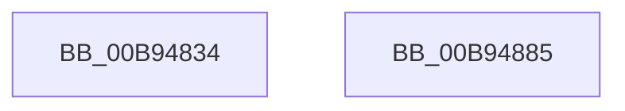

# VfObjectContextInit

- RVA: `0x00B94834`–`0x00B94886` (길이 `82` bytes)
- VA: `0x0000000140B94834`
- 실행 섹션: `PAGEVRFY`
- PDB 이름 있음: `예`; PDB Function 태그: `아니요`
- unwind 정보 RVA: `0x00063458`
- 디코드: `17`개 명령, `82/82` bytes 표시
- 미해석 바이트: `0` (있으면 어셈블리에 `.byte`로 보존)

> 이 문서는 커널 이미지의 기계어와 PDB 기호를 분석해 생성했습니다. 4번과 5번은 함수 원형과 자료형을 바이너리 사용 방식에서 추정한 C 해석이며 원본 소스 복구 결과는 아닙니다.

## 1. Dependencies

- 직접 호출 지점: **1**; 고유 호출 대상: **1**
- 직접 호출자로 확인된 함수: **1**
- RIP 상대 이미지 참조: **4**

### Outgoing calls
- `0x00B94870` → [ExInitializeNPagedLookasideListInternal](../../text/46/ExInitializeNPagedLookasideListInternal_function_00468720.md) (function, `0x00468720`)

### Direct callers
- [VfInitBootDriversLoaded](../../init/C4/VfInitBootDriversLoaded_function_00C4BD0C.md) at `0x00C4BE53`

### Static image references
- `0x00B94838` → RVA `0x00F04368` (`.data`; read)
- `0x00B9483E` → RVA `0x004C65D0` (`VfUtilFreePoolCheckIRQL`; read)
- `0x00B9485E` → RVA `0x00FFF600` (`PAGEVRFD`; read)
- `0x00B9487A` → RVA `0x00FFDD24` (`PAGEVRFD`; read/write)

## 2. Other-region calls and transfers

- 다른 실행 섹션으로 향하는 call: **1**
  - `0x00B94870` → [ExInitializeNPagedLookasideListInternal](../../text/46/ExInitializeNPagedLookasideListInternal_function_00468720.md) (`PAGEVRFY` → `.text`)
- 별도 외부 분기/꼬리 이동을 확인하지 못했습니다.

## 3. Assembly (complete function range)

```asm
00B94834  48 83 EC 48                     sub rsp, 0x48
00B94838  8B 05 2A FB 36 00               mov eax, dword ptr [rip + 0x36fb2a]
00B9483E  4C 8D 05 8B 1D 93 FF            lea r8, [rip - 0x6ce275]
00B94845  89 44 24 38                     mov dword ptr [rsp + 0x38], eax
00B94849  33 C9                           xor ecx, ecx
00B9484B  66 89 4C 24 30                  mov word ptr [rsp + 0x30], cx
00B94850  41 B9 00 02 00 00               mov r9d, 0x200
00B94856  C7 44 24 28 56 66 4F 63         mov dword ptr [rsp + 0x28], 0x634f6656
00B9485E  48 8D 0D 9B AD 46 00            lea rcx, [rip + 0x46ad9b]
00B94865  33 D2                           xor edx, edx
00B94867  48 C7 44 24 20 18 00 00 00      mov qword ptr [rsp + 0x20], 0x18
00B94870  E8 AB 3E 8D FF                  call 0x140468720
00B94875  B8 01 00 00 00                  mov eax, 1
00B9487A  87 05 A4 94 46 00               xchg dword ptr [rip + 0x4694a4], eax
00B94880  48 83 C4 48                     add rsp, 0x48
00B94884  C3                              ret
00B94885  CC                              int3
```

## 4. C-style interpretation (structured pseudocode)

```c
__int64 __fastcall VfObjectContextInit(int a1, int a2)
{
    __int64 result;
    __int64 v_rsp;
    unsigned int v_stack_m10;
    unsigned __int16 v_stack_m18;
    unsigned int v_stack_m20;
    unsigned __int64 v_stack_m28;

    v_rsp = (v_rsp) - (72);
    v_stack_m10 = (unsigned int)((unsigned int)(*(unsigned int *)(v_rip + 3603242)));
    a1 = 0;
    v_stack_m18 = 0;
    v_stack_m20 = 0x634F6656ULL;
    a2 = 0;
    v_stack_m28 = 24;
    result = ExInitializeNPagedLookasideListInternal(v_rip + 4631963, a2, v_rip - 7135861, 512);
    v_rsp = (v_rsp) + (72);
    return 1;
}
```

## 5. (Beta) C Style

```c
int64_t VfObjectContextInit(int32_t Arg1, int32_t Arg2)
{
    int64_t result;
    int64_t local_rsp;
    uint32_t v_stack_m10;
    uint16_t v_stack_m18;
    uint32_t v_stack_m20;
    uint64_t v_stack_m28;

    local_rsp = (local_rsp) - (72);
    v_stack_m10 = (uint32_t)((uint32_t)(*(uint32_t *)(v_rip + 0x36FB2A)));
    Arg1 = 0;
    v_stack_m18 = 0;
    v_stack_m20 = 0x634F6656ULL;
    Arg2 = 0;
    v_stack_m28 = 24;
    result = ExInitializeNPagedLookasideListInternal(v_rip + 4631963, Arg2, v_rip - 7135861, 512);
    local_rsp = (local_rsp) + (72);
    return 1;
}
```

## 6. Execution-region graph

[열기: 2D/3D 그래프와 함수 탐색 컨트롤 패널](../../../control-panel.html?section=pagevrfy&rva=0x00B94834&view=graph)

- 2D 그래프는 위에서 아래로 흐르고, 3D 그래프는 빈 공간을 드래그해 회전합니다. Shift+드래그는 이동, 휠은 확대·축소, 함수 노드 선택은 대상 보고서 이동입니다.

### Static fallback


