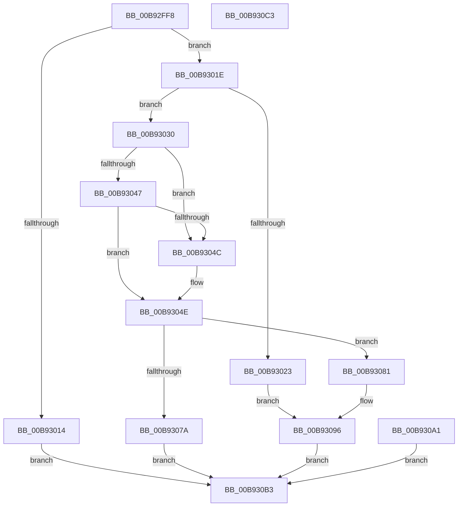

# VfProbeAndCaptureUnicodeStringBuffer

- RVA: `0x00B92FF8`–`0x00B930C4` (길이 `204` bytes)
- VA: `0x0000000140B92FF8`
- 실행 섹션: `PAGEVRFY`
- PDB 이름 있음: `예`; PDB Function 태그: `아니요`
- unwind 정보 RVA: `0x000D21B8`
- 디코드: `59`개 명령, `204/204` bytes 표시
- 미해석 바이트: `0` (있으면 어셈블리에 `.byte`로 보존)

> 이 문서는 커널 이미지의 기계어와 PDB 기호를 분석해 생성했습니다. 4번과 5번은 함수 원형과 자료형을 바이너리 사용 방식에서 추정한 C 해석이며 원본 소스 복구 결과는 아닙니다.

## 1. Dependencies

- 직접 호출 지점: **3**; 고유 호출 대상: **3**
- 직접 호출자로 확인된 함수: **2**
- RIP 상대 이미지 참조: **1**

### Outgoing calls
- `0x00B93068` → [ExAllocatePool2](../../poolcode/B8/ExAllocatePool2_function_00B820F0.md) (function, `0x00B820F0`)
- `0x00B9308C` → [memcpy](../../text/6C/memcpy_function_006C6840.md) (function, `0x006C6840`)
- `0x00B930AA` → [ExFreePoolWithTag](../../poolcode/B8/ExFreePoolWithTag_function_00B82870.md) (function, `0x00B82870`)

### Direct callers
- [NtSetSystemInformation](../../page/AF/NtSetSystemInformation_function_00AF4A60.md) at `0x00AF5950`
- [NtSetSystemInformation](../../page/AF/NtSetSystemInformation_function_00AF4A60.md) at `0x00AF5968`
- [NtSetSystemInformation](../../page/AF/NtSetSystemInformation_function_00AF4A60.md) at `0x00AF6242`
- [VfProbeAndCaptureUnicodeString](VfProbeAndCaptureUnicodeString_function_00B92FBC.md) at `0x00B92FE2`

### Static image references
- `0x00B93023` → RVA `0x00FC6C08` (`ALMOSTRO`; read)

## 2. Other-region calls and transfers

- 다른 실행 섹션으로 향하는 call: **3**
  - `0x00B93068` → [ExAllocatePool2](../../poolcode/B8/ExAllocatePool2_function_00B820F0.md) (`PAGEVRFY` → `POOLCODE`)
  - `0x00B9308C` → [memcpy](../../text/6C/memcpy_function_006C6840.md) (`PAGEVRFY` → `.text`)
  - `0x00B930AA` → [ExFreePoolWithTag](../../poolcode/B8/ExFreePoolWithTag_function_00B82870.md) (`PAGEVRFY` → `POOLCODE`)
- 별도 외부 분기/꼬리 이동을 확인하지 못했습니다.

## 3. Assembly (complete function range)

```asm
00B92FF8  48 89 5C 24 10                  mov qword ptr [rsp + 0x10], rbx
00B92FFD  48 89 74 24 18                  mov qword ptr [rsp + 0x18], rsi
00B93002  57                              push rdi
00B93003  48 83 EC 20                     sub rsp, 0x20
00B93007  44 8B C2                        mov r8d, edx
00B9300A  48 8B D9                        mov rbx, rcx
00B9300D  0F B7 01                        movzx eax, word ptr [rcx]
00B93010  A8 01                           test al, 1
00B93012  74 0A                           je 0x140b9301e
00B93014  B8 0D 00 00 C0                  mov eax, 0xc000000d
00B93019  E9 95 00 00 00                  jmp 0x140b930b3
00B9301E  66 85 C0                        test ax, ax
00B93021  75 0D                           jne 0x140b93030
00B93023  48 8B 05 DE 3B 43 00            mov rax, qword ptr [rip + 0x433bde]
00B9302A  48 89 41 08                     mov qword ptr [rcx + 8], rax
00B9302E  EB 66                           jmp 0x140b93096
00B93030  48 8B 49 08                     mov rcx, qword ptr [rcx + 8]
00B93034  48 8D 14 01                     lea rdx, [rcx + rax]
00B93038  48 B8 00 00 FF FF FF 7F 00 00   movabs rax, 0x7fffffff0000
00B93042  48 3B D0                        cmp rdx, rax
00B93045  77 05                           ja 0x140b9304c
00B93047  48 3B D1                        cmp rdx, rcx
00B9304A  73 02                           jae 0x140b9304e
00B9304C  8A 00                           mov al, byte ptr [rax]
00B9304E  0F B7 13                        movzx edx, word ptr [rbx]
00B93051  B9 00 01 00 00                  mov ecx, 0x100
00B93056  B8 40 00 00 00                  mov eax, 0x40
00B9305B  41 83 F8 01                     cmp r8d, 1
00B9305F  0F 45 C8                        cmovne ecx, eax
00B93062  41 B8 56 66 53 43               mov r8d, 0x43536656
00B93068  E8 83 F0 FE FF                  call 0x140b820f0
00B9306D  48 8B F8                        mov rdi, rax
00B93070  48 89 44 24 30                  mov qword ptr [rsp + 0x30], rax
00B93075  48 85 C0                        test rax, rax
00B93078  75 07                           jne 0x140b93081
00B9307A  B8 17 00 00 C0                  mov eax, 0xc0000017
00B9307F  EB 32                           jmp 0x140b930b3
00B93081  44 0F B7 03                     movzx r8d, word ptr [rbx]
00B93085  48 8B 53 08                     mov rdx, qword ptr [rbx + 8]
00B93089  48 8B CF                        mov rcx, rdi
00B9308C  E8 AF 37 B3 FF                  call 0x1406c6840
00B93091  90                              nop
00B93092  48 89 7B 08                     mov qword ptr [rbx + 8], rdi
00B93096  0F B7 03                        movzx eax, word ptr [rbx]
00B93099  66 89 43 02                     mov word ptr [rbx + 2], ax
00B9309D  33 C0                           xor eax, eax
00B9309F  EB 12                           jmp 0x140b930b3
00B930A1  8B D8                           mov ebx, eax
00B930A3  33 D2                           xor edx, edx
00B930A5  48 8B 4C 24 30                  mov rcx, qword ptr [rsp + 0x30]
00B930AA  E8 C1 F7 FE FF                  call 0x140b82870
00B930AF  8B C3                           mov eax, ebx
00B930B1  EB 00                           jmp 0x140b930b3
00B930B3  48 8B 5C 24 38                  mov rbx, qword ptr [rsp + 0x38]
00B930B8  48 8B 74 24 40                  mov rsi, qword ptr [rsp + 0x40]
00B930BD  48 83 C4 20                     add rsp, 0x20
00B930C1  5F                              pop rdi
00B930C2  C3                              ret
00B930C3  CC                              int3
```

## 4. C-style interpretation (structured pseudocode)

```c
__int64 __fastcall VfProbeAndCaptureUnicodeStringBuffer(__int64 a1, int a2)
{
    __int64 result;
    __int64 v_rsp;
    unsigned __int64 v_stack_p10;
    unsigned __int64 v_stack_p18;
    unsigned __int64 v_stack_p8;

    v_stack_p10 = v_rbx;
    v_stack_p18 = v_rsi;
    v_rsp = (v_rsp) - (32);
    if ((((unsigned __int8)(*(unsigned __int16 *)(a1))) & (1)) == 0) goto loc_00B9301E;
    goto loc_00B930B3;
loc_00B9301E:
    if ((unsigned __int16)((unsigned int)(0xC000000DULL)) != 0) goto loc_00B93030;
    *(unsigned __int64 *)(a1 + 8) = *(unsigned __int64 *)(v_rip + 4406238);
    goto loc_00B93096;
loc_00B93030:
    if ((*(unsigned __int64 *)(a1 + 8) + *(unsigned __int64 *)(v_rip + 4406238) * 1) > (*(unsigned __int64 *)(v_rip + 4406238))) goto loc_00B9304C;
    result = *(unsigned __int64 *)(v_rip + 4406238);
    if ((*(unsigned __int64 *)(a1 + 8) + *(unsigned __int64 *)(v_rip + 4406238) * 1) < (*(unsigned __int64 *)(a1 + 8))) {
        result = *(unsigned __int8 *)(*(unsigned __int64 *)(v_rip + 4406238));
    }
    a1 = 256;
    if (((unsigned int)((unsigned int)(a2))) != 1) { a1 = 64; }
    result = ExAllocatePool2(a1, *(unsigned __int16 *)(a1), (unsigned int)(0x43536656ULL), a4);
    v_stack_p8 = result;
    if (result != 0) goto loc_00B93081;
    goto loc_00B930B3;
loc_00B93081:
    result = memcpy(result, *(unsigned __int64 *)(a1 + 8), *(unsigned __int16 *)(a1), a4);
    *(unsigned __int64 *)(a1 + 8) = result;
loc_00B93096:
    *(unsigned __int16 *)(a1 + 2) = (unsigned __int16)(*(unsigned __int16 *)(a1));
    result = 0;
    goto loc_00B930B3;
loc_00B930B3:
    v_rsp = (v_rsp) + (32);
    return result;
}
```

## 5. (Beta) C Style

```c
int64_t VfProbeAndCaptureUnicodeStringBuffer(void *Arg1, int32_t Arg2)
{
    uint8_t *arg1 = (uint8_t *)Arg1;

    int64_t result;
    int64_t local_rsp;
    uint64_t v_stack_p10;
    uint64_t v_stack_p18;
    uint64_t v_stack_p8;

    v_stack_p10 = local_rbx;
    v_stack_p18 = local_rsi;
    local_rsp = (local_rsp) - (32);
    if ((((uint8_t)(*(uint16_t *)(arg1))) & (1)) == 0) goto loc_00B9301E;
    goto loc_00B930B3;
loc_00B9301E:
    if ((uint16_t)((uint32_t)(0xC000000DULL)) != 0) goto loc_00B93030;
    *(uint64_t *)(arg1 + 0x8) = *(uint64_t *)(v_rip + 0x433BDE);
    goto loc_00B93096;
loc_00B93030:
    if ((*(uint64_t *)(arg1 + 0x8) + *(uint64_t *)(v_rip + 0x433BDE) * 1) > (*(uint64_t *)(v_rip + 0x433BDE))) goto loc_00B9304C;
    result = *(uint64_t *)(v_rip + 0x433BDE);
    if ((*(uint64_t *)(arg1 + 0x8) + *(uint64_t *)(v_rip + 0x433BDE) * 1) < (*(uint64_t *)(arg1 + 0x8))) {
        result = *(uint8_t *)(*(uint64_t *)(v_rip + 0x433BDE));
    }
    Arg1 = 256;
    if (((uint32_t)((uint32_t)(Arg2))) != 1) { Arg1 = 64; }
    result = ExAllocatePool2(Arg1, *(uint16_t *)(arg1), (uint32_t)(0x43536656ULL), a4);
    v_stack_p8 = result;
    if (result != 0) goto loc_00B93081;
    goto loc_00B930B3;
loc_00B93081:
    result = memcpy(result, *(uint64_t *)(arg1 + 0x8), *(uint16_t *)(arg1), a4);
    *(uint64_t *)(arg1 + 0x8) = result;
loc_00B93096:
    *(uint16_t *)(arg1 + 0x2) = (uint16_t)(*(uint16_t *)(arg1));
    result = 0;
    goto loc_00B930B3;
loc_00B930B3:
    local_rsp = (local_rsp) + (32);
    return result;
}
```

### 관측된 메모리 오프셋

구조체 형식이 확인되지 않은 접근은 인자 기준의 오프셋으로만 기록했습니다.

| 기준 인자 | 오프셋 표현 | 폭 (bit) | 접근 |
|---|---:|---:|---|
| `Arg1` | `+ 0x0` | `16` | `R` |
| `Arg1` | `+ 0x2` | `16` | `W` |
| `Arg1` | `+ 0x8` | `64` | `R` |
| `Arg1` | `+ 0x8` | `64` | `W` |

## 6. Execution-region graph

[열기: 2D/3D 그래프와 함수 탐색 컨트롤 패널](../../../control-panel.html?section=pagevrfy&rva=0x00B92FF8&view=graph)

- 2D 그래프는 위에서 아래로 흐르고, 3D 그래프는 빈 공간을 드래그해 회전합니다. Shift+드래그는 이동, 휠은 확대·축소, 함수 노드 선택은 대상 보고서 이동입니다.

### Static fallback


