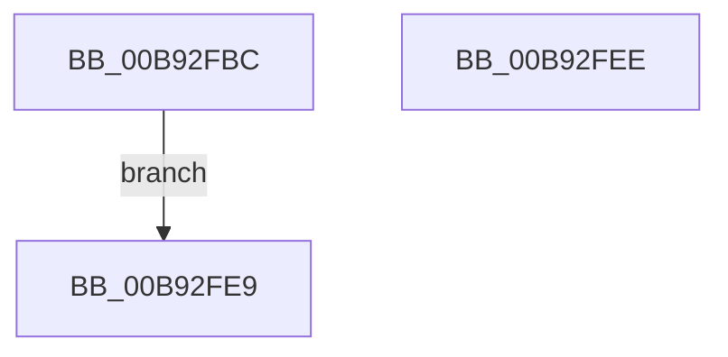

# VfProbeAndCaptureUnicodeString

- RVA: `0x00B92FBC`–`0x00B92FEF` (길이 `51` bytes)
- VA: `0x0000000140B92FBC`
- 실행 섹션: `PAGEVRFY`
- PDB 이름 있음: `예`; PDB Function 태그: `아니요`
- unwind 정보 RVA: `0x000D2194`
- 디코드: `15`개 명령, `51/51` bytes 표시
- 미해석 바이트: `0` (있으면 어셈블리에 `.byte`로 보존)

> 이 문서는 커널 이미지의 기계어와 PDB 기호를 분석해 생성했습니다. 4번과 5번은 함수 원형과 자료형을 바이너리 사용 방식에서 추정한 C 해석이며 원본 소스 복구 결과는 아닙니다.

## 1. Dependencies

- 직접 호출 지점: **1**; 고유 호출 대상: **1**
- 직접 호출자로 확인된 함수: **2**
- RIP 상대 이미지 참조: **0**

### Outgoing calls
- `0x00B92FE2` → [VfProbeAndCaptureUnicodeStringBuffer](VfProbeAndCaptureUnicodeStringBuffer_function_00B92FF8.md) (function, `0x00B92FF8`)

### Direct callers
- [NtSetSystemInformation](../../page/AF/NtSetSystemInformation_function_00AF4A60.md) at `0x00AF5285`
- [NtSetSystemInformation](../../page/AF/NtSetSystemInformation_function_00AF4A60.md) at `0x00AF6604`
- [VfSetVerifierInformationEx](../BA/VfSetVerifierInformationEx_function_00BAC624.md) at `0x00BAC696`

### Static image references
- 디코드된 RIP-relative 메모리 참조가 없습니다.

## 2. Other-region calls and transfers

- 다른 실행 섹션으로 향하는 call: **0**
- 별도 외부 분기/꼬리 이동을 확인하지 못했습니다.

## 3. Assembly (complete function range)

```asm
00B92FBC  48 83 EC 28                     sub rsp, 0x28
00B92FC0  49 B9 00 00 FF FF FF 7F 00 00   movabs r9, 0x7fffffff0000
00B92FCA  49 3B D1                        cmp rdx, r9
00B92FCD  4C 0F 42 CA                     cmovb r9, rdx
00B92FD1  90                              nop
00B92FD2  41 8B 01                        mov eax, dword ptr [r9]
00B92FD5  89 01                           mov dword ptr [rcx], eax
00B92FD7  49 8B 41 08                     mov rax, qword ptr [r9 + 8]
00B92FDB  48 89 41 08                     mov qword ptr [rcx + 8], rax
00B92FDF  41 8B D0                        mov edx, r8d
00B92FE2  E8 11 00 00 00                  call 0x140b92ff8
00B92FE7  EB 00                           jmp 0x140b92fe9
00B92FE9  48 83 C4 28                     add rsp, 0x28
00B92FED  C3                              ret
00B92FEE  CC                              int3
```

## 4. C-style interpretation (structured pseudocode)

```c
__int64 __fastcall VfProbeAndCaptureUnicodeString(__int64 a1, __int64 a2, int a3)
{
    __int64 result;
    __int64 v_rsp;

    v_rsp = (v_rsp) - (40);
    if (a2 < a4) { a4 = a2; }
    *(unsigned int *)(a1) = (unsigned int)((unsigned int)(*(unsigned int *)(a4)));
    *(unsigned __int64 *)(a1 + 8) = *(unsigned __int64 *)(a4 + 8);
    result = VfProbeAndCaptureUnicodeStringBuffer(a1, (unsigned int)(a3), a3, a4);
    goto loc_00B92FE9;
loc_00B92FE9:
    v_rsp = (v_rsp) + (40);
    return result;
}
```

## 5. (Beta) C Style

```c
int64_t VfProbeAndCaptureUnicodeString(void *Arg1, int64_t Arg2, int32_t Arg3)
{
    uint8_t *arg1 = (uint8_t *)Arg1;

    int64_t result;
    int64_t local_rsp;

    local_rsp = (local_rsp) - (40);
    if (Arg2 < a4) { a4 = Arg2; }
    *(uint32_t *)(arg1) = (uint32_t)((uint32_t)(*(uint32_t *)(a4)));
    *(uint64_t *)(arg1 + 0x8) = *(uint64_t *)(a4 + 0x8);
    result = VfProbeAndCaptureUnicodeStringBuffer(Arg1, (uint32_t)(Arg3), Arg3, a4);
    goto loc_00B92FE9;
loc_00B92FE9:
    local_rsp = (local_rsp) + (40);
    return result;
}
```

### 관측된 메모리 오프셋

구조체 형식이 확인되지 않은 접근은 인자 기준의 오프셋으로만 기록했습니다.

| 기준 인자 | 오프셋 표현 | 폭 (bit) | 접근 |
|---|---:|---:|---|
| `Arg1` | `+ 0x0` | `32` | `W` |
| `Arg1` | `+ 0x8` | `64` | `W` |

## 6. Execution-region graph

[열기: 2D/3D 그래프와 함수 탐색 컨트롤 패널](../../../control-panel.html?section=pagevrfy&rva=0x00B92FBC&view=graph)

- 2D 그래프는 위에서 아래로 흐르고, 3D 그래프는 빈 공간을 드래그해 회전합니다. Shift+드래그는 이동, 휠은 확대·축소, 함수 노드 선택은 대상 보고서 이동입니다.

### Static fallback


