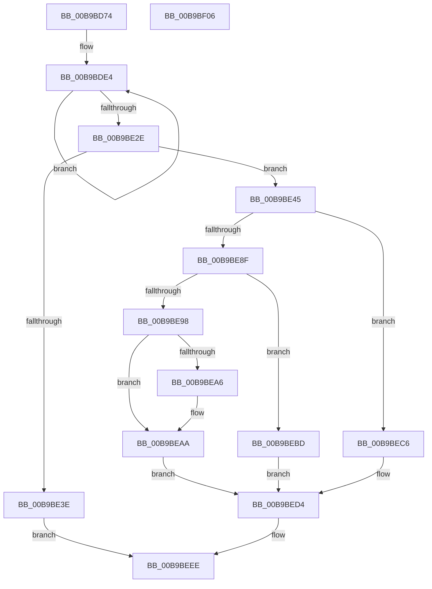

# VfPtAddStackInfoIfNotExist

- RVA: `0x00B9BD74`–`0x00B9BF07` (길이 `403` bytes)
- VA: `0x0000000140B9BD74`
- 실행 섹션: `PAGEVRFY`
- PDB 이름 있음: `예`; PDB Function 태그: `아니요`
- unwind 정보 RVA: `0x000D23F0`
- 디코드: `101`개 명령, `403/403` bytes 표시
- 미해석 바이트: `0` (있으면 어셈블리에 `.byte`로 보존)

> 이 문서는 커널 이미지의 기계어와 PDB 기호를 분석해 생성했습니다. 4번과 5번은 함수 원형과 자료형을 바이너리 사용 방식에서 추정한 C 해석이며 원본 소스 복구 결과는 아닙니다.

## 1. Dependencies

- 직접 호출 지점: **8**; 고유 호출 대상: **8**
- 직접 호출자로 확인된 함수: **1**
- RIP 상대 이미지 참조: **5**

### Outgoing calls
- `0x00B9BDB8` → [memset](../../text/6C/memset_function_006C6C40.md) (function, `0x006C6C40`)
- `0x00B9BE4A` → [ViPtInitializeLockContext](../../text/61/ViPtInitializeLockContext_function_00613958.md) (function, `0x00613958`)
- `0x00B9BE54` → [CarDbRaiseIrqlSafe](../../text/61/CarDbRaiseIrqlSafe_function_0061396C.md) (function, `0x0061396C`)
- `0x00B9BE68` → [ViPtAcquireTreeLockAtDpcLevelSafe](../../text/61/ViPtAcquireTreeLockAtDpcLevelSafe_function_0061388C.md) (function, `0x0061388C`)
- `0x00B9BE82` → [RtlInsertElementGenericTableAvl](../../text/3E/RtlInsertElementGenericTableAvl_function_003EE510.md) (function, `0x003EE510`)
- `0x00B9BE9B` → [MmDeterminePoolType](../../text/35/MmDeterminePoolType_function_0035F5B0.md) (function, `0x0035F5B0`)
- `0x00B9BEDC` → [ViPtReleaseTreeLockFromDpcLevel](../../text/61/ViPtReleaseTreeLockFromDpcLevel_function_006139C0.md) (function, `0x006139C0`)
- `0x00B9BEE6` → [ViPtCleanupLockContext](../../text/61/ViPtCleanupLockContext_function_006138FC.md) (function, `0x006138FC`)

### Direct callers
- [ViPtProcessApt](ViPtProcessApt_function_00B9CAB8.md) at `0x00B9CAF3`

### Static image references
- `0x00B9BE34` → RVA `0x00FFDA98` (`PAGEVRFD`; read)
- `0x00B9BE59` → RVA `0x00FFF080` (`PAGEVRFD`; read)
- `0x00B9BEAE` → RVA `0x00F04214` (`.data`; read/write)
- `0x00B9BEC6` → RVA `0x00FFDB88` (`PAGEVRFD`; read)
- `0x00B9BECE` → RVA `0x00FFDB88` (`PAGEVRFD`; write)

## 2. Other-region calls and transfers

- 다른 실행 섹션으로 향하는 call: **8**
  - `0x00B9BDB8` → [memset](../../text/6C/memset_function_006C6C40.md) (`PAGEVRFY` → `.text`)
  - `0x00B9BE4A` → [ViPtInitializeLockContext](../../text/61/ViPtInitializeLockContext_function_00613958.md) (`PAGEVRFY` → `.text`)
  - `0x00B9BE54` → [CarDbRaiseIrqlSafe](../../text/61/CarDbRaiseIrqlSafe_function_0061396C.md) (`PAGEVRFY` → `.text`)
  - `0x00B9BE68` → [ViPtAcquireTreeLockAtDpcLevelSafe](../../text/61/ViPtAcquireTreeLockAtDpcLevelSafe_function_0061388C.md) (`PAGEVRFY` → `.text`)
  - `0x00B9BE82` → [RtlInsertElementGenericTableAvl](../../text/3E/RtlInsertElementGenericTableAvl_function_003EE510.md) (`PAGEVRFY` → `.text`)
  - `0x00B9BE9B` → [MmDeterminePoolType](../../text/35/MmDeterminePoolType_function_0035F5B0.md) (`PAGEVRFY` → `.text`)
  - `0x00B9BEDC` → [ViPtReleaseTreeLockFromDpcLevel](../../text/61/ViPtReleaseTreeLockFromDpcLevel_function_006139C0.md) (`PAGEVRFY` → `.text`)
  - `0x00B9BEE6` → [ViPtCleanupLockContext](../../text/61/ViPtCleanupLockContext_function_006138FC.md) (`PAGEVRFY` → `.text`)
- 별도 외부 분기/꼬리 이동을 확인하지 못했습니다.

## 3. Assembly (complete function range)

```asm
00B9BD74  48 89 5C 24 08                  mov qword ptr [rsp + 8], rbx
00B9BD79  48 89 74 24 18                  mov qword ptr [rsp + 0x18], rsi
00B9BD7E  55                              push rbp
00B9BD7F  57                              push rdi
00B9BD80  41 56                           push r14
00B9BD82  48 8D AC 24 10 FF FF FF         lea rbp, [rsp - 0xf0]
00B9BD8A  48 81 EC F0 01 00 00            sub rsp, 0x1f0
00B9BD91  4D 8B F0                        mov r14, r8
00B9BD94  C6 85 18 01 00 00 00            mov byte ptr [rbp + 0x118], 0
00B9BD9B  8B DA                           mov ebx, edx
00B9BD9D  48 8B F1                        mov rsi, rcx
00B9BDA0  0F 57 C0                        xorps xmm0, xmm0
00B9BDA3  48 8D 4C 24 30                  lea rcx, [rsp + 0x30]
00B9BDA8  33 D2                           xor edx, edx
00B9BDAA  41 B8 B8 01 00 00               mov r8d, 0x1b8
00B9BDB0  0F 11 44 24 20                  movups xmmword ptr [rsp + 0x20], xmm0
00B9BDB5  41 8B F9                        mov edi, r9d
00B9BDB8  E8 83 AE B2 FF                  call 0x1406c6c40
00B9BDBD  48 83 64 24 50 00               and qword ptr [rsp + 0x50], 0
00B9BDC3  48 8D 44 24 58                  lea rax, [rsp + 0x58]
00B9BDC8  B9 03 00 00 00                  mov ecx, 3
00B9BDCD  89 7C 24 30                     mov dword ptr [rsp + 0x30], edi
00B9BDD1  48 8B BD 30 01 00 00            mov rdi, qword ptr [rbp + 0x130]
00B9BDD8  89 5C 24 34                     mov dword ptr [rsp + 0x34], ebx
00B9BDDC  48 89 7C 24 48                  mov qword ptr [rsp + 0x48], rdi
00B9BDE1  8D 51 7D                        lea edx, [rcx + 0x7d]
00B9BDE4  0F 10 06                        movups xmm0, xmmword ptr [rsi]
00B9BDE7  0F 10 4E 10                     movups xmm1, xmmword ptr [rsi + 0x10]
00B9BDEB  0F 11 00                        movups xmmword ptr [rax], xmm0
00B9BDEE  0F 10 46 20                     movups xmm0, xmmword ptr [rsi + 0x20]
00B9BDF2  0F 11 48 10                     movups xmmword ptr [rax + 0x10], xmm1
00B9BDF6  0F 10 4E 30                     movups xmm1, xmmword ptr [rsi + 0x30]
00B9BDFA  0F 11 40 20                     movups xmmword ptr [rax + 0x20], xmm0
00B9BDFE  0F 10 46 40                     movups xmm0, xmmword ptr [rsi + 0x40]
00B9BE02  0F 11 48 30                     movups xmmword ptr [rax + 0x30], xmm1
00B9BE06  0F 10 4E 50                     movups xmm1, xmmword ptr [rsi + 0x50]
00B9BE0A  0F 11 40 40                     movups xmmword ptr [rax + 0x40], xmm0
00B9BE0E  0F 10 46 60                     movups xmm0, xmmword ptr [rsi + 0x60]
00B9BE12  0F 11 48 50                     movups xmmword ptr [rax + 0x50], xmm1
00B9BE16  0F 10 4E 70                     movups xmm1, xmmword ptr [rsi + 0x70]
00B9BE1A  48 03 F2                        add rsi, rdx
00B9BE1D  0F 11 40 60                     movups xmmword ptr [rax + 0x60], xmm0
00B9BE21  48 03 C2                        add rax, rdx
00B9BE24  0F 11 48 F0                     movups xmmword ptr [rax - 0x10], xmm1
00B9BE28  48 83 E9 01                     sub rcx, 1
00B9BE2C  75 B6                           jne 0x140b9bde4
00B9BE2E  0F 10 06                        movups xmm0, xmmword ptr [rsi]
00B9BE31  0F 11 00                        movups xmmword ptr [rax], xmm0
00B9BE34  8B 05 5E 1C 46 00               mov eax, dword ptr [rip + 0x461c5e]
00B9BE3A  85 C0                           test eax, eax
00B9BE3C  75 07                           jne 0x140b9be45
00B9BE3E  33 C0                           xor eax, eax
00B9BE40  E9 A9 00 00 00                  jmp 0x140b9beee
00B9BE45  48 8D 4C 24 20                  lea rcx, [rsp + 0x20]
00B9BE4A  E8 09 7B A7 FF                  call 0x140613958
00B9BE4F  48 8D 4C 24 20                  lea rcx, [rsp + 0x20]
00B9BE54  E8 13 7B A7 FF                  call 0x14061396c
00B9BE59  48 8D 35 20 32 46 00            lea rsi, [rip + 0x463220]
00B9BE60  48 8B CE                        mov rcx, rsi
00B9BE63  48 8D 54 24 20                  lea rdx, [rsp + 0x20]
00B9BE68  E8 1F 7A A7 FF                  call 0x14061388c
00B9BE6D  4C 8D 8D 18 01 00 00            lea r9, [rbp + 0x118]
00B9BE74  41 B8 B8 01 00 00               mov r8d, 0x1b8
00B9BE7A  48 8D 54 24 30                  lea rdx, [rsp + 0x30]
00B9BE7F  48 8B CE                        mov rcx, rsi
00B9BE82  E8 89 26 85 FF                  call 0x1403ee510
00B9BE87  48 8B D8                        mov rbx, rax
00B9BE8A  48 85 C0                        test rax, rax
00B9BE8D  74 37                           je 0x140b9bec6
00B9BE8F  80 BD 18 01 00 00 00            cmp byte ptr [rbp + 0x118], 0
00B9BE96  74 25                           je 0x140b9bebd
00B9BE98  49 8B CE                        mov rcx, r14
00B9BE9B  E8 10 37 7C FF                  call 0x14035f5b0
00B9BEA0  48 83 F8 40                     cmp rax, 0x40
00B9BEA4  75 04                           jne 0x140b9beaa
00B9BEA6  83 4B 08 10                     or dword ptr [rbx + 8], 0x10
00B9BEAA  83 4B 08 01                     or dword ptr [rbx + 8], 1
00B9BEAE  FF 05 60 83 36 00               inc dword ptr [rip + 0x368360]
00B9BEB4  C7 43 0C 01 00 00 00            mov dword ptr [rbx + 0xc], 1
00B9BEBB  EB 17                           jmp 0x140b9bed4
00B9BEBD  48 01 78 18                     add qword ptr [rax + 0x18], rdi
00B9BEC1  FF 40 0C                        inc dword ptr [rax + 0xc]
00B9BEC4  EB 0E                           jmp 0x140b9bed4
00B9BEC6  8B 05 BC 1C 46 00               mov eax, dword ptr [rip + 0x461cbc]
00B9BECC  FF C0                           inc eax
00B9BECE  89 05 B4 1C 46 00               mov dword ptr [rip + 0x461cb4], eax
00B9BED4  48 8D 54 24 20                  lea rdx, [rsp + 0x20]
00B9BED9  48 8B CE                        mov rcx, rsi
00B9BEDC  E8 DF 7A A7 FF                  call 0x1406139c0
00B9BEE1  48 8D 4C 24 20                  lea rcx, [rsp + 0x20]
00B9BEE6  E8 11 7A A7 FF                  call 0x1406138fc
00B9BEEB  48 8B C3                        mov rax, rbx
00B9BEEE  4C 8D 9C 24 F0 01 00 00         lea r11, [rsp + 0x1f0]
00B9BEF6  49 8B 5B 20                     mov rbx, qword ptr [r11 + 0x20]
00B9BEFA  49 8B 73 30                     mov rsi, qword ptr [r11 + 0x30]
00B9BEFE  49 8B E3                        mov rsp, r11
00B9BF01  41 5E                           pop r14
00B9BF03  5F                              pop rdi
00B9BF04  5D                              pop rbp
00B9BF05  C3                              ret
00B9BF06  CC                              int3
```

## 4. C-style interpretation (structured pseudocode)

```c
__int64 __fastcall VfPtAddStackInfoIfNotExist(__int64 a1, int a2, __int64 a3, int a4, __int64 a5)
{
    __int64 result;
    __int64 v_rsi;
    __int64 v_rsp;
    unsigned __int64 v_stack_m108;
    unsigned __int64 v_stack_m18;
    unsigned __int64 v_stack_m1B0;
    unsigned __int64 v_stack_m1B8;
    unsigned __int64 v_stack_m1C0;
    unsigned int v_stack_m1D4;
    unsigned __int64 v_stack_m1D8;
    unsigned __int64 v_stack_m1E8;
    unsigned __int8 v_stack_p10;
    unsigned __int64 v_stack_p18;
    unsigned __int64 v_stack_p8;

    v_stack_p8 = v_rbx;
    v_stack_p18 = v_rsi;
    v_rsp = (v_rsp) - (496);
    v_stack_p10 = 0;
    a2 = 0;
    v_stack_m1E8 = v_xmm0;
    result = memset(v_stack_m1D8, a2, 440, a4);
    v_stack_m1D8 = (unsigned int)((unsigned int)(a4));
    v_stack_m1D4 = (unsigned int)((unsigned int)(a2));
    v_stack_m1C0 = a5;
loc_00B9BDE4:
    *(unsigned __int64 *)(v_stack_m1B0) = v_xmm0;
    *(unsigned __int64 *)(v_stack_m1B0 + 16) = v_xmm1;
    *(unsigned __int64 *)(v_stack_m1B0 + 32) = v_xmm0;
    *(unsigned __int64 *)(v_stack_m1B0 + 48) = v_xmm1;
    *(unsigned __int64 *)(v_stack_m1B0 + 64) = v_xmm0;
    *(unsigned __int64 *)(v_stack_m1B0 + 80) = v_xmm1;
    v_rsi = (a1) + (3 + 125);
    *(unsigned __int64 *)(v_stack_m1B0 + 96) = v_xmm0;
    result = (v_stack_m1B0) + (3 + 125);
    *(unsigned __int64 *)(result - 16) = v_xmm1;
    a1 = (3) - (1);
    if (condition_is_not_equal) goto loc_00B9BDE4;
    *(unsigned __int64 *)(result) = v_xmm0;
    if ((unsigned int)((unsigned int)(*(unsigned int *)(v_rip + 4594782))) != 0) goto loc_00B9BE45;
    result = 0;
    goto loc_00B9BEEE;
loc_00B9BE45:
    result = ViPtInitializeLockContext(v_stack_m1E8, 3 + 125, 440, a4);
    result = CarDbRaiseIrqlSafe(v_stack_m1E8, 3 + 125, 440, a4);
    result = ViPtAcquireTreeLockAtDpcLevelSafe(v_rip + 4600352, v_stack_m1E8, 440, a4);
    result = RtlInsertElementGenericTableAvl(v_rip + 4600352, v_stack_m1D8, 440, v_stack_p10);
    if (result == 0) goto loc_00B9BEC6;
    if (v_stack_p10 == 0) goto loc_00B9BEBD;
    result = MmDeterminePoolType(a3, v_stack_m1D8, 440, v_stack_p10);
    if (result == 64) {
    }
    *(unsigned int *)(result + 12) = 1;
    goto loc_00B9BED4;
loc_00B9BEBD:
    goto loc_00B9BED4;
loc_00B9BEC6:
    result = (unsigned int)(((unsigned int)(*(unsigned int *)(v_rip + 4594876))) + 1);
    *(unsigned int *)(v_rip + 4594868) = (unsigned int)(result);
loc_00B9BED4:
    result = ViPtReleaseTreeLockFromDpcLevel(v_rip + 4600352, v_stack_m1E8, 440, v_stack_p10);
    result = ViPtCleanupLockContext(v_stack_m1E8, v_stack_m1E8, 440, v_stack_p10);
loc_00B9BEEE:
    return result;
}
```

## 5. (Beta) C Style

```c
int64_t VfPtAddStackInfoIfNotExist(void *Arg1, int32_t Arg2, int64_t Arg3, int32_t Arg4, int64_t Arg5)
{
    uint8_t *arg1 = (uint8_t *)Arg1;

    int64_t result;
    int64_t local_rsi;
    int64_t local_rsp;
    uint64_t v_stack_m108;
    uint64_t v_stack_m18;
    uint64_t v_stack_m1B0;
    uint64_t v_stack_m1B8;
    uint64_t v_stack_m1C0;
    uint32_t v_stack_m1D4;
    uint64_t v_stack_m1D8;
    uint64_t v_stack_m1E8;
    uint8_t v_stack_p10;
    uint64_t v_stack_p18;
    uint64_t v_stack_p8;

    v_stack_p8 = local_rbx;
    v_stack_p18 = local_rsi;
    local_rsp = (local_rsp) - (496);
    v_stack_p10 = 0;
    Arg2 = 0;
    v_stack_m1E8 = v_xmm0;
    result = memset(v_stack_m1D8, Arg2, 440, Arg4);
    v_stack_m1D8 = (uint32_t)((uint32_t)(Arg4));
    v_stack_m1D4 = (uint32_t)((uint32_t)(Arg2));
    v_stack_m1C0 = Arg5;
loc_00B9BDE4:
    *(uint64_t *)(v_stack_m1B0) = v_xmm0;
    *(uint64_t *)(v_stack_m1B0 + 0x10) = v_xmm1;
    *(uint64_t *)(v_stack_m1B0 + 0x20) = v_xmm0;
    *(uint64_t *)(v_stack_m1B0 + 0x30) = v_xmm1;
    *(uint64_t *)(v_stack_m1B0 + 0x40) = v_xmm0;
    *(uint64_t *)(v_stack_m1B0 + 0x50) = v_xmm1;
    local_rsi = (Arg1) + (3 + 125);
    *(uint64_t *)(v_stack_m1B0 + 0x60) = v_xmm0;
    result = (v_stack_m1B0) + (3 + 125);
    *(uint64_t *)(result - 0x10) = v_xmm1;
    Arg1 = (3) - (1);
    if (condition_is_not_equal) goto loc_00B9BDE4;
    *(uint64_t *)(result) = v_xmm0;
    if ((uint32_t)((uint32_t)(*(uint32_t *)(v_rip + 0x461C5E))) != 0) goto loc_00B9BE45;
    result = 0;
    goto loc_00B9BEEE;
loc_00B9BE45:
    result = ViPtInitializeLockContext(v_stack_m1E8, 3 + 125, 440, Arg4);
    result = CarDbRaiseIrqlSafe(v_stack_m1E8, 3 + 125, 440, Arg4);
    result = ViPtAcquireTreeLockAtDpcLevelSafe(v_rip + 4600352, v_stack_m1E8, 440, Arg4);
    result = RtlInsertElementGenericTableAvl(v_rip + 4600352, v_stack_m1D8, 440, v_stack_p10);
    if (result == 0) goto loc_00B9BEC6;
    if (v_stack_p10 == 0) goto loc_00B9BEBD;
    result = MmDeterminePoolType(Arg3, v_stack_m1D8, 440, v_stack_p10);
    if (result == 64) {
    }
    *(uint32_t *)(result + 0xC) = 1;
    goto loc_00B9BED4;
loc_00B9BEBD:
    goto loc_00B9BED4;
loc_00B9BEC6:
    result = (uint32_t)(((uint32_t)(*(uint32_t *)(v_rip + 0x461CBC))) + 1);
    *(uint32_t *)(v_rip + 0x461CB4) = (uint32_t)(result);
loc_00B9BED4:
    result = ViPtReleaseTreeLockFromDpcLevel(v_rip + 4600352, v_stack_m1E8, 440, v_stack_p10);
    result = ViPtCleanupLockContext(v_stack_m1E8, v_stack_m1E8, 440, v_stack_p10);
loc_00B9BEEE:
    return result;
}
```

### 관측된 메모리 오프셋

구조체 형식이 확인되지 않은 접근은 인자 기준의 오프셋으로만 기록했습니다.

| 기준 인자 | 오프셋 표현 | 폭 (bit) | 접근 |
|---|---:|---:|---|
| `Arg1` | `+ 0x0` | `128` | `R` |
| `Arg1` | `+ 0x10` | `128` | `R` |
| `Arg1` | `+ 0x20` | `128` | `R` |
| `Arg1` | `+ 0x30` | `128` | `R` |
| `Arg1` | `+ 0x40` | `128` | `R` |
| `Arg1` | `+ 0x50` | `128` | `R` |
| `Arg1` | `+ 0x60` | `128` | `R` |
| `Arg1` | `+ 0x70` | `128` | `R` |

## 6. Execution-region graph

[열기: 2D/3D 그래프와 함수 탐색 컨트롤 패널](../../../control-panel.html?section=pagevrfy&rva=0x00B9BD74&view=graph)

- 2D 그래프는 위에서 아래로 흐르고, 3D 그래프는 빈 공간을 드래그해 회전합니다. Shift+드래그는 이동, 휠은 확대·축소, 함수 노드 선택은 대상 보고서 이동입니다.

### Static fallback


