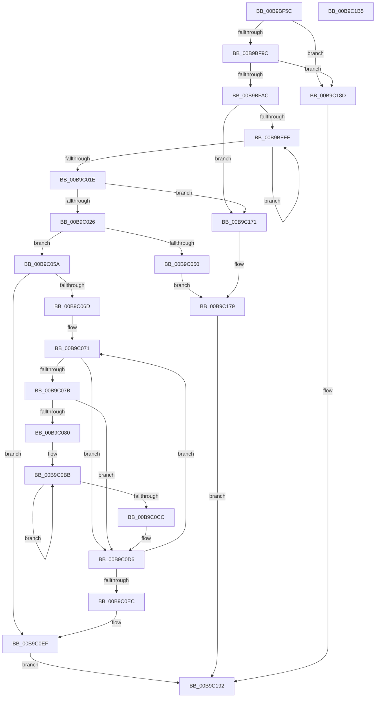

# VfPtGenerateTraceInformation

- RVA: `0x00B9BF5C`–`0x00B9C1B6` (길이 `602` bytes)
- VA: `0x0000000140B9BF5C`
- 실행 섹션: `PAGEVRFY`
- PDB 이름 있음: `예`; PDB Function 태그: `아니요`
- unwind 정보 RVA: `0x000D240C`
- 디코드: `159`개 명령, `602/602` bytes 표시
- 미해석 바이트: `0` (있으면 어셈블리에 `.byte`로 보존)

> 이 문서는 커널 이미지의 기계어와 PDB 기호를 분석해 생성했습니다. 4번과 5번은 함수 원형과 자료형을 바이너리 사용 방식에서 추정한 C 해석이며 원본 소스 복구 결과는 아닙니다.

## 1. Dependencies

- 직접 호출 지점: **15**; 고유 호출 대상: **10**
- 직접 호출자로 확인된 함수: **1**
- RIP 상대 이미지 참조: **7**

### Outgoing calls
- `0x00B9BFBD` → [RtlNumberGenericTableElementsAvl](../../text/46/RtlNumberGenericTableElementsAvl_function_004657E0.md) (function, `0x004657E0`)
- `0x00B9BFCB` → [ViPtInitializeLockContext](../../text/61/ViPtInitializeLockContext_function_00613958.md) (function, `0x00613958`)
- `0x00B9BFD4` → [CarDbRaiseIrqlSafe](../../text/61/CarDbRaiseIrqlSafe_function_0061396C.md) (function, `0x0061396C`)
- `0x00B9BFE7` → [ViPtAcquireTreeLockAtDpcLevelSafe](../../text/61/ViPtAcquireTreeLockAtDpcLevelSafe_function_0061388C.md) (function, `0x0061388C`)
- `0x00B9BFF1` → [RtlEnumerateGenericTableAvl](../../text/3E/RtlEnumerateGenericTableAvl_function_003E5AB0.md) (function, `0x003E5AB0`)
- `0x00B9C014` → [RtlEnumerateGenericTableAvl](../../text/3E/RtlEnumerateGenericTableAvl_function_003E5AB0.md) (function, `0x003E5AB0`)
- `0x00B9C03C` → [ExAllocatePool2](../../poolcode/B8/ExAllocatePool2_function_00B820F0.md) (function, `0x00B820F0`)
- `0x00B9C05C` → [RtlEnumerateGenericTableAvl](../../text/3E/RtlEnumerateGenericTableAvl_function_003E5AB0.md) (function, `0x003E5AB0`)
- `0x00B9C0DF` → [RtlEnumerateGenericTableAvl](../../text/3E/RtlEnumerateGenericTableAvl_function_003E5AB0.md) (function, `0x003E5AB0`)
- `0x00B9C0FA` → [ViPtReleaseTreeLockFromDpcLevel](../../text/61/ViPtReleaseTreeLockFromDpcLevel_function_006139C0.md) (function, `0x006139C0`)
- `0x00B9C103` → [ViPtCleanupLockContext](../../text/61/ViPtCleanupLockContext_function_006138FC.md) (function, `0x006138FC`)
- `0x00B9C15B` → [DbgkWerCaptureLiveKernelDump](../../page/AC/DbgkWerCaptureLiveKernelDump_function_00AC1E90.md) (function, `0x00AC1E90`)
- `0x00B9C16A` → [ExFreePoolWithTag](../../poolcode/B8/ExFreePoolWithTag_function_00B82870.md) (function, `0x00B82870`)
- `0x00B9C17D` → [ViPtReleaseTreeLockFromDpcLevel](../../text/61/ViPtReleaseTreeLockFromDpcLevel_function_006139C0.md) (function, `0x006139C0`)
- `0x00B9C186` → [ViPtCleanupLockContext](../../text/61/ViPtCleanupLockContext_function_006138FC.md) (function, `0x006138FC`)

### Direct callers
- [NtSetSystemInformation](../../page/AF/NtSetSystemInformation_function_00AF4A60.md) at `0x00AF6752`

### Static image references
- `0x00B9BF84` → RVA `0x00E681A0` (`.data`; read)
- `0x00B9BF9C` → RVA `0x00F04980` (`.data`; read)
- `0x00B9BFB3` → RVA `0x00FFF140` (`PAGEVRFD`; read)
- `0x00B9BFD9` → RVA `0x00FFF080` (`PAGEVRFD`; read)
- `0x00B9C108` → RVA `0x00F04214` (`.data`; read)
- `0x00B9C125` → RVA `0x00B9C6F0` (`ViPtCaptureTraceInformationCallBack`; read)
- `0x00B9C141` → RVA `0x00BBA840` (` ?? ::JKADOLAD::`string'`; read)

## 2. Other-region calls and transfers

- 다른 실행 섹션으로 향하는 call: **15**
  - `0x00B9BFBD` → [RtlNumberGenericTableElementsAvl](../../text/46/RtlNumberGenericTableElementsAvl_function_004657E0.md) (`PAGEVRFY` → `.text`)
  - `0x00B9BFCB` → [ViPtInitializeLockContext](../../text/61/ViPtInitializeLockContext_function_00613958.md) (`PAGEVRFY` → `.text`)
  - `0x00B9BFD4` → [CarDbRaiseIrqlSafe](../../text/61/CarDbRaiseIrqlSafe_function_0061396C.md) (`PAGEVRFY` → `.text`)
  - `0x00B9BFE7` → [ViPtAcquireTreeLockAtDpcLevelSafe](../../text/61/ViPtAcquireTreeLockAtDpcLevelSafe_function_0061388C.md) (`PAGEVRFY` → `.text`)
  - `0x00B9BFF1` → [RtlEnumerateGenericTableAvl](../../text/3E/RtlEnumerateGenericTableAvl_function_003E5AB0.md) (`PAGEVRFY` → `.text`)
  - `0x00B9C014` → [RtlEnumerateGenericTableAvl](../../text/3E/RtlEnumerateGenericTableAvl_function_003E5AB0.md) (`PAGEVRFY` → `.text`)
  - `0x00B9C03C` → [ExAllocatePool2](../../poolcode/B8/ExAllocatePool2_function_00B820F0.md) (`PAGEVRFY` → `POOLCODE`)
  - `0x00B9C05C` → [RtlEnumerateGenericTableAvl](../../text/3E/RtlEnumerateGenericTableAvl_function_003E5AB0.md) (`PAGEVRFY` → `.text`)
  - `0x00B9C0DF` → [RtlEnumerateGenericTableAvl](../../text/3E/RtlEnumerateGenericTableAvl_function_003E5AB0.md) (`PAGEVRFY` → `.text`)
  - `0x00B9C0FA` → [ViPtReleaseTreeLockFromDpcLevel](../../text/61/ViPtReleaseTreeLockFromDpcLevel_function_006139C0.md) (`PAGEVRFY` → `.text`)
  - `0x00B9C103` → [ViPtCleanupLockContext](../../text/61/ViPtCleanupLockContext_function_006138FC.md) (`PAGEVRFY` → `.text`)
  - `0x00B9C15B` → [DbgkWerCaptureLiveKernelDump](../../page/AC/DbgkWerCaptureLiveKernelDump_function_00AC1E90.md) (`PAGEVRFY` → `PAGE`)
  - `0x00B9C16A` → [ExFreePoolWithTag](../../poolcode/B8/ExFreePoolWithTag_function_00B82870.md) (`PAGEVRFY` → `POOLCODE`)
  - `0x00B9C17D` → [ViPtReleaseTreeLockFromDpcLevel](../../text/61/ViPtReleaseTreeLockFromDpcLevel_function_006139C0.md) (`PAGEVRFY` → `.text`)
  - `0x00B9C186` → [ViPtCleanupLockContext](../../text/61/ViPtCleanupLockContext_function_006138FC.md) (`PAGEVRFY` → `.text`)
- 별도 외부 분기/꼬리 이동을 확인하지 못했습니다.

## 3. Assembly (complete function range)

```asm
00B9BF5C  48 89 5C 24 08                  mov qword ptr [rsp + 8], rbx
00B9BF61  48 89 74 24 18                  mov qword ptr [rsp + 0x18], rsi
00B9BF66  48 89 7C 24 20                  mov qword ptr [rsp + 0x20], rdi
00B9BF6B  55                              push rbp
00B9BF6C  41 54                           push r12
00B9BF6E  41 55                           push r13
00B9BF70  41 56                           push r14
00B9BF72  41 57                           push r15
00B9BF74  48 8B EC                        mov rbp, rsp
00B9BF77  48 81 EC 80 00 00 00            sub rsp, 0x80
00B9BF7E  83 65 F4 00                     and dword ptr [rbp - 0xc], 0
00B9BF82  33 FF                           xor edi, edi
00B9BF84  8B 05 16 C2 2C 00               mov eax, dword ptr [rip + 0x2cc216]
00B9BF8A  45 33 FF                        xor r15d, r15d
00B9BF8D  0F 57 C0                        xorps xmm0, xmm0
00B9BF90  0F 11 45 D0                     movups xmmword ptr [rbp - 0x30], xmm0
00B9BF94  A8 08                           test al, 8
00B9BF96  0F 84 F1 01 00 00               je 0x140b9c18d
00B9BF9C  F7 05 DA 89 36 00 00 10 00 00   test dword ptr [rip + 0x3689da], 0x1000
00B9BFA6  0F 84 E1 01 00 00               je 0x140b9c18d
00B9BFAC  33 DB                           xor ebx, ebx
00B9BFAE  8D 47 02                        lea eax, [rdi + 2]
00B9BFB1  84 C9                           test cl, cl
00B9BFB3  48 8D 0D 86 31 46 00            lea rcx, [rip + 0x463186]
00B9BFBA  0F 45 D8                        cmovne ebx, eax
00B9BFBD  E8 1E 98 8C FF                  call 0x1404657e0
00B9BFC2  48 8D 4D D0                     lea rcx, [rbp - 0x30]
00B9BFC6  89 45 38                        mov dword ptr [rbp + 0x38], eax
00B9BFC9  8B F0                           mov esi, eax
00B9BFCB  E8 88 79 A7 FF                  call 0x140613958
00B9BFD0  48 8D 4D D0                     lea rcx, [rbp - 0x30]
00B9BFD4  E8 93 79 A7 FF                  call 0x14061396c
00B9BFD9  4C 8D 35 A0 30 46 00            lea r14, [rip + 0x4630a0]
00B9BFE0  49 8B CE                        mov rcx, r14
00B9BFE3  48 8D 55 D0                     lea rdx, [rbp - 0x30]
00B9BFE7  E8 A0 78 A7 FF                  call 0x14061388c
00B9BFEC  B2 01                           mov dl, 1
00B9BFEE  49 8B CE                        mov rcx, r14
00B9BFF1  E8 BA 9A 84 FF                  call 0x1403e5ab0
00B9BFF6  48 85 C0                        test rax, rax
00B9BFF9  0F 84 72 01 00 00               je 0x140b9c171
00B9BFFF  48 8B 48 18                     mov rcx, qword ptr [rax + 0x18]
00B9C003  8D 57 01                        lea edx, [rdi + 1]
00B9C006  48 3B 48 20                     cmp rcx, qword ptr [rax + 0x20]
00B9C00A  49 8B CE                        mov rcx, r14
00B9C00D  0F 46 D7                        cmovbe edx, edi
00B9C010  8B FA                           mov edi, edx
00B9C012  33 D2                           xor edx, edx
00B9C014  E8 97 9A 84 FF                  call 0x1403e5ab0
00B9C019  48 85 C0                        test rax, rax
00B9C01C  75 E1                           jne 0x140b9bfff
00B9C01E  85 FF                           test edi, edi
00B9C020  0F 84 4B 01 00 00               je 0x140b9c171
00B9C026  44 69 E7 B8 01 00 00            imul r12d, edi, 0x1b8
00B9C02D  8D 48 40                        lea ecx, [rax + 0x40]
00B9C030  41 B8 56 69 49 6E               mov r8d, 0x6e496956
00B9C036  41 8B D4                        mov edx, r12d
00B9C039  45 8B EC                        mov r13d, r12d
00B9C03C  E8 AF 60 FE FF                  call 0x140b820f0
00B9C041  48 8D 0D 38 30 46 00            lea rcx, [rip + 0x463038]
00B9C048  4C 8B F0                        mov r14, rax
00B9C04B  48 85 C0                        test rax, rax
00B9C04E  75 0A                           jne 0x140b9c05a
00B9C050  BB 17 00 00 C0                  mov ebx, 0xc0000017
00B9C055  E9 1F 01 00 00                  jmp 0x140b9c179
00B9C05A  B2 01                           mov dl, 1
00B9C05C  E8 4F 9A 84 FF                  call 0x1403e5ab0
00B9C061  48 8B D0                        mov rdx, rax
00B9C064  48 85 C0                        test rax, rax
00B9C067  0F 84 82 00 00 00               je 0x140b9c0ef
00B9C06D  49 8D 76 08                     lea rsi, [r14 + 8]
00B9C071  48 8B 4A 20                     mov rcx, qword ptr [rdx + 0x20]
00B9C075  48 39 4A 18                     cmp qword ptr [rdx + 0x18], rcx
00B9C079  76 5B                           jbe 0x140b9c0d6
00B9C07B  44 3B FF                        cmp r15d, edi
00B9C07E  73 56                           jae 0x140b9c0d6
00B9C080  8B 02                           mov eax, dword ptr [rdx]
00B9C082  48 8D 4E F8                     lea rcx, [rsi - 8]
00B9C086  89 01                           mov dword ptr [rcx], eax
00B9C088  4C 8D 46 20                     lea r8, [rsi + 0x20]
00B9C08C  8B 42 04                        mov eax, dword ptr [rdx + 4]
00B9C08F  89 46 FC                        mov dword ptr [rsi - 4], eax
00B9C092  8B 42 08                        mov eax, dword ptr [rdx + 8]
00B9C095  89 06                           mov dword ptr [rsi], eax
00B9C097  8B 42 0C                        mov eax, dword ptr [rdx + 0xc]
00B9C09A  89 46 04                        mov dword ptr [rsi + 4], eax
00B9C09D  8B 42 10                        mov eax, dword ptr [rdx + 0x10]
00B9C0A0  89 46 08                        mov dword ptr [rsi + 8], eax
00B9C0A3  48 8B 42 18                     mov rax, qword ptr [rdx + 0x18]
00B9C0A7  48 89 46 10                     mov qword ptr [rsi + 0x10], rax
00B9C0AB  48 8B 42 20                     mov rax, qword ptr [rdx + 0x20]
00B9C0AF  48 2B D1                        sub rdx, rcx
00B9C0B2  48 89 46 18                     mov qword ptr [rsi + 0x18], rax
00B9C0B6  B9 32 00 00 00                  mov ecx, 0x32
00B9C0BB  4A 8B 04 02                     mov rax, qword ptr [rdx + r8]
00B9C0BF  49 89 00                        mov qword ptr [r8], rax
00B9C0C2  4D 8D 40 08                     lea r8, [r8 + 8]
00B9C0C6  48 83 E9 01                     sub rcx, 1
00B9C0CA  75 EF                           jne 0x140b9c0bb
00B9C0CC  41 FF C7                        inc r15d
00B9C0CF  48 81 C6 B8 01 00 00            add rsi, 0x1b8
00B9C0D6  33 D2                           xor edx, edx
00B9C0D8  48 8D 0D A1 2F 46 00            lea rcx, [rip + 0x462fa1]
00B9C0DF  E8 CC 99 84 FF                  call 0x1403e5ab0
00B9C0E4  48 8B D0                        mov rdx, rax
00B9C0E7  48 85 C0                        test rax, rax
00B9C0EA  75 85                           jne 0x140b9c071
00B9C0EC  8B 75 38                        mov esi, dword ptr [rbp + 0x38]
00B9C0EF  48 8D 55 D0                     lea rdx, [rbp - 0x30]
00B9C0F3  48 8D 0D 86 2F 46 00            lea rcx, [rip + 0x462f86]
00B9C0FA  E8 C1 78 A7 FF                  call 0x1406139c0
00B9C0FF  48 8D 4D D0                     lea rcx, [rbp - 0x30]
00B9C103  E8 F4 77 A7 FF                  call 0x1406138fc
00B9C108  8B 05 06 81 36 00               mov eax, dword ptr [rip + 0x368106]
00B9C10E  4D 8B CD                        mov r9, r13
00B9C111  48 83 65 F8 00                  and qword ptr [rbp - 8], 0
00B9C116  44 8B C0                        mov r8d, eax
00B9C119  89 5C 24 40                     mov dword ptr [rsp + 0x40], ebx
00B9C11D  BA E5 01 00 00                  mov edx, 0x1e5
00B9C122  89 45 EC                        mov dword ptr [rbp - 0x14], eax
00B9C125  48 8D 05 C4 05 00 00            lea rax, [rip + 0x5c4]
00B9C12C  48 89 44 24 38                  mov qword ptr [rsp + 0x38], rax
00B9C131  48 8D 45 E0                     lea rax, [rbp - 0x20]
00B9C135  48 89 44 24 30                  mov qword ptr [rsp + 0x30], rax
00B9C13A  8B CE                           mov ecx, esi
00B9C13C  48 89 4C 24 28                  mov qword ptr [rsp + 0x28], rcx
00B9C141  48 8D 0D F8 E6 01 00            lea rcx, [rip + 0x1e6f8]
00B9C148  4C 89 44 24 20                  mov qword ptr [rsp + 0x20], r8
00B9C14D  4D 8B C6                        mov r8, r14
00B9C150  4C 89 75 E0                     mov qword ptr [rbp - 0x20], r14
00B9C154  44 89 65 E8                     mov dword ptr [rbp - 0x18], r12d
00B9C158  89 75 F0                        mov dword ptr [rbp - 0x10], esi
00B9C15B  E8 30 5D F2 FF                  call 0x140ac1e90
00B9C160  BA 56 69 49 6E                  mov edx, 0x6e496956
00B9C165  49 8B CE                        mov rcx, r14
00B9C168  8B D8                           mov ebx, eax
00B9C16A  E8 01 67 FE FF                  call 0x140b82870
00B9C16F  EB 21                           jmp 0x140b9c192
00B9C171  BB 73 0C 00 C0                  mov ebx, 0xc0000c73
00B9C176  49 8B CE                        mov rcx, r14
00B9C179  48 8D 55 D0                     lea rdx, [rbp - 0x30]
00B9C17D  E8 3E 78 A7 FF                  call 0x1406139c0
00B9C182  48 8D 4D D0                     lea rcx, [rbp - 0x30]
00B9C186  E8 71 77 A7 FF                  call 0x1406138fc
00B9C18B  EB 05                           jmp 0x140b9c192
00B9C18D  BB 7C 0C 00 C0                  mov ebx, 0xc0000c7c
00B9C192  4C 8D 9C 24 80 00 00 00         lea r11, [rsp + 0x80]
00B9C19A  8B C3                           mov eax, ebx
00B9C19C  49 8B 5B 30                     mov rbx, qword ptr [r11 + 0x30]
00B9C1A0  49 8B 73 40                     mov rsi, qword ptr [r11 + 0x40]
00B9C1A4  49 8B 7B 48                     mov rdi, qword ptr [r11 + 0x48]
00B9C1A8  49 8B E3                        mov rsp, r11
00B9C1AB  41 5F                           pop r15
00B9C1AD  41 5E                           pop r14
00B9C1AF  41 5D                           pop r13
00B9C1B1  41 5C                           pop r12
00B9C1B3  5D                              pop rbp
00B9C1B4  C3                              ret
00B9C1B5  CC                              int3
```

## 4. C-style interpretation (structured pseudocode)

```c
__int64 __fastcall VfPtGenerateTraceInformation(unsigned __int8 a1)
{
    __int64 result;
    __int64 v_r12;
    __int64 v_r15;
    __int64 v_rbx;
    __int64 v_rdi;
    __int64 v_rsi;
    __int64 v_rsp;
    unsigned __int64 v_stack_m28;
    unsigned __int64 v_stack_m30;
    unsigned int v_stack_m34;
    unsigned int v_stack_m38;
    unsigned int v_stack_m3C;
    unsigned int v_stack_m40;
    unsigned __int64 v_stack_m48;
    unsigned __int64 v_stack_m58;
    unsigned int v_stack_m68;
    unsigned __int64 v_stack_m70;
    unsigned __int64 v_stack_m78;
    unsigned __int64 v_stack_m80;
    unsigned __int64 v_stack_m88;
    unsigned int v_stack_p10;
    unsigned __int64 v_stack_p18;
    unsigned __int64 v_stack_p20;
    unsigned __int64 v_stack_p8;

    v_stack_p8 = v_rbx;
    v_stack_p18 = v_rsi;
    v_stack_p20 = v_rdi;
    v_rsp = (v_rsp) - (128);
    v_rdi = 0;
    v_r15 = 0;
    v_stack_m58 = v_xmm0;
    if ((((unsigned __int8)((unsigned int)(*(unsigned int *)(v_rip + 2933270)))) & (8)) == 0) goto loc_00B9C18D;
    if (((*(unsigned int *)(v_rip + 3574234)) & (0x1000ULL)) == 0) goto loc_00B9C18D;
    v_rbx = 0;
    if (a1 != 0) { v_rbx = (unsigned int)(v_rdi + 2); }
    result = RtlNumberGenericTableElementsAvl(v_rip + 4600198, a2, a3, a4);
    v_stack_p10 = (unsigned int)(result);
    result = ViPtInitializeLockContext(v_stack_m58, a2, a3, a4);
    result = CarDbRaiseIrqlSafe(v_stack_m58, a2, a3, a4);
    result = ViPtAcquireTreeLockAtDpcLevelSafe(v_rip + 4599968, v_stack_m58, a3, a4);
    result = RtlEnumerateGenericTableAvl(v_rip + 4599968, 1, a3, a4);
    if (result == 0) goto loc_00B9C171;
loc_00B9BFFF:
    a2 = v_rdi + 1;
    if ((*(unsigned __int64 *)(result + 24)) <= (*(unsigned __int64 *)(result + 32))) { a2 = 0; }
    a2 = 0;
    result = RtlEnumerateGenericTableAvl(v_rip + 4599968, a2, a3, a4);
    if (result != 0) goto loc_00B9BFFF;
    if ((unsigned int)((unsigned int)((unsigned int)(a2))) == 0) goto loc_00B9C171;
    v_r12 = (unsigned int)((v_r12) * ((unsigned int)((unsigned int)((unsigned int)(a2)))));
    result = ExAllocatePool2(result + 64, (unsigned int)((unsigned int)(v_r12)), (unsigned int)(0x6E496956ULL), a4);
    if (result != 0) goto loc_00B9C05A;
    goto loc_00B9C179;
loc_00B9C05A:
    result = RtlEnumerateGenericTableAvl(v_rip + 4599864, 1, (unsigned int)(0x6E496956ULL), a4);
    if (result == 0) goto loc_00B9C0EF;
loc_00B9C071:
    if ((*(unsigned __int64 *)(result + 24)) <= (*(unsigned __int64 *)(result + 32))) goto loc_00B9C0D6;
    if (0 >= ((unsigned int)((unsigned int)((unsigned int)(a2))))) goto loc_00B9C0D6;
    *(unsigned int *)(result + 8 - 8) = (unsigned int)((unsigned int)(*(unsigned int *)(result)));
    *(unsigned int *)(result + 8 - 4) = (unsigned int)((unsigned int)(*(unsigned int *)(result + 4)));
    *(unsigned int *)(result + 8) = (unsigned int)((unsigned int)(*(unsigned int *)(result + 8)));
    *(unsigned int *)(result + 8 + 4) = (unsigned int)((unsigned int)(*(unsigned int *)(result + 12)));
    *(unsigned int *)(result + 8 + 8) = (unsigned int)((unsigned int)(*(unsigned int *)(result + 16)));
    *(unsigned __int64 *)(result + 8 + 16) = *(unsigned __int64 *)(result + 24);
    a2 = (result) - (result + 8 - 8);
    *(unsigned __int64 *)(result + 8 + 24) = *(unsigned __int64 *)(result + 32);
loc_00B9C0BB:
    *(unsigned __int64 *)(result + 8 + 32) = *(unsigned __int64 *)(a2 + result + 8 + 32 * 1);
    a1 = (50) - (1);
    if (condition_is_not_equal) goto loc_00B9C0BB;
    v_r15 = (unsigned int)((v_r15) + 1);
    v_rsi = (result + 8) + (440);
loc_00B9C0D6:
    a2 = 0;
    result = RtlEnumerateGenericTableAvl(v_rip + 4599713, a2, result + 8 + 32 + 8, a4);
    if (result != 0) goto loc_00B9C071;
loc_00B9C0EF:
    result = ViPtReleaseTreeLockFromDpcLevel(v_rip + 4599686, v_stack_m58, result + 8 + 32 + 8, a4);
    result = ViPtCleanupLockContext(v_stack_m58, v_stack_m58, result + 8 + 32 + 8, a4);
    v_stack_m68 = (unsigned int)((unsigned int)(0xC0000017ULL));
    v_stack_m3C = (unsigned int)((unsigned int)(*(unsigned int *)(v_rip + 3571974)));
    v_stack_m70 = v_rip + 1476;
    v_stack_m78 = v_stack_m48;
    v_stack_m80 = (unsigned int)((unsigned int)((unsigned int)(v_stack_p10)));
    v_stack_m88 = (unsigned int)((unsigned int)((unsigned int)(*(unsigned int *)(v_rip + 3571974))));
    v_stack_m48 = result;
    v_stack_m40 = (unsigned int)(v_r12);
    v_stack_m38 = (unsigned int)((unsigned int)(v_stack_p10));
    result = DbgkWerCaptureLiveKernelDump(v_rip + 124664, 485, result, (unsigned int)((unsigned int)(v_r12)));
    result = ExFreePoolWithTag(result, (unsigned int)(0x6E496956ULL), result, (unsigned int)((unsigned int)(v_r12)));
    goto loc_00B9C192;
loc_00B9C171:
loc_00B9C179:
    result = ViPtReleaseTreeLockFromDpcLevel(result, v_stack_m58, result, (unsigned int)((unsigned int)(v_r12)));
    result = ViPtCleanupLockContext(v_stack_m58, v_stack_m58, result, (unsigned int)((unsigned int)(v_r12)));
    goto loc_00B9C192;
loc_00B9C18D:
loc_00B9C192:
    return (unsigned int)((unsigned int)((unsigned int)(0xC0000C7CULL)));
}
```

## 5. (Beta) C Style

```c
int64_t VfPtGenerateTraceInformation(uint8_t Arg1)
{
    int64_t result;
    int64_t local_r12;
    int64_t local_r15;
    int64_t local_rbx;
    int64_t local_rdi;
    int64_t local_rsi;
    int64_t local_rsp;
    uint64_t v_stack_m28;
    uint64_t v_stack_m30;
    uint32_t v_stack_m34;
    uint32_t v_stack_m38;
    uint32_t v_stack_m3C;
    uint32_t v_stack_m40;
    uint64_t v_stack_m48;
    uint64_t v_stack_m58;
    uint32_t v_stack_m68;
    uint64_t v_stack_m70;
    uint64_t v_stack_m78;
    uint64_t v_stack_m80;
    uint64_t v_stack_m88;
    uint32_t v_stack_p10;
    uint64_t v_stack_p18;
    uint64_t v_stack_p20;
    uint64_t v_stack_p8;

    v_stack_p8 = local_rbx;
    v_stack_p18 = local_rsi;
    v_stack_p20 = local_rdi;
    local_rsp = (local_rsp) - (128);
    local_rdi = 0;
    local_r15 = 0;
    v_stack_m58 = v_xmm0;
    if ((((uint8_t)((uint32_t)(*(uint32_t *)(v_rip + 0x2CC216)))) & (8)) == 0) goto loc_00B9C18D;
    if (((*(uint32_t *)(v_rip + 0x3689DA)) & (0x1000ULL)) == 0) goto loc_00B9C18D;
    local_rbx = 0;
    if (Arg1 != 0) { local_rbx = (uint32_t)(local_rdi + 2); }
    result = RtlNumberGenericTableElementsAvl(v_rip + 4600198, a2, a3, a4);
    v_stack_p10 = (uint32_t)(result);
    result = ViPtInitializeLockContext(v_stack_m58, a2, a3, a4);
    result = CarDbRaiseIrqlSafe(v_stack_m58, a2, a3, a4);
    result = ViPtAcquireTreeLockAtDpcLevelSafe(v_rip + 4599968, v_stack_m58, a3, a4);
    result = RtlEnumerateGenericTableAvl(v_rip + 4599968, 1, a3, a4);
    if (result == 0) goto loc_00B9C171;
loc_00B9BFFF:
    a2 = local_rdi + 1;
    if ((*(uint64_t *)(result + 0x18)) <= (*(uint64_t *)(result + 0x20))) { a2 = 0; }
    a2 = 0;
    result = RtlEnumerateGenericTableAvl(v_rip + 4599968, a2, a3, a4);
    if (result != 0) goto loc_00B9BFFF;
    if ((uint32_t)((uint32_t)((uint32_t)(a2))) == 0) goto loc_00B9C171;
    local_r12 = (uint32_t)((local_r12) * ((uint32_t)((uint32_t)((uint32_t)(a2)))));
    result = ExAllocatePool2(result + 64, (uint32_t)((uint32_t)(local_r12)), (uint32_t)(0x6E496956ULL), a4);
    if (result != 0) goto loc_00B9C05A;
    goto loc_00B9C179;
loc_00B9C05A:
    result = RtlEnumerateGenericTableAvl(v_rip + 4599864, 1, (uint32_t)(0x6E496956ULL), a4);
    if (result == 0) goto loc_00B9C0EF;
loc_00B9C071:
    if ((*(uint64_t *)(result + 0x18)) <= (*(uint64_t *)(result + 0x20))) goto loc_00B9C0D6;
    if (0 >= ((uint32_t)((uint32_t)((uint32_t)(a2))))) goto loc_00B9C0D6;
    *(uint32_t *)(result + 0x8 - 0x8) = (uint32_t)((uint32_t)(*(uint32_t *)(result)));
    *(uint32_t *)(result + 0x8 - 0x4) = (uint32_t)((uint32_t)(*(uint32_t *)(result + 0x4)));
    *(uint32_t *)(result + 0x8) = (uint32_t)((uint32_t)(*(uint32_t *)(result + 0x8)));
    *(uint32_t *)(result + 0x8 + 0x4) = (uint32_t)((uint32_t)(*(uint32_t *)(result + 0xC)));
    *(uint32_t *)(result + 0x8 + 0x8) = (uint32_t)((uint32_t)(*(uint32_t *)(result + 0x10)));
    *(uint64_t *)(result + 0x8 + 0x10) = *(uint64_t *)(result + 0x18);
    a2 = (result) - (result + 8 - 8);
    *(uint64_t *)(result + 0x8 + 0x18) = *(uint64_t *)(result + 0x20);
loc_00B9C0BB:
    *(uint64_t *)(result + 0x8 + 0x20) = *(uint64_t *)(a2 + result + 0x8 + 0x20 * 1);
    Arg1 = (50) - (1);
    if (condition_is_not_equal) goto loc_00B9C0BB;
    local_r15 = (uint32_t)((local_r15) + 1);
    local_rsi = (result + 8) + (440);
loc_00B9C0D6:
    a2 = 0;
    result = RtlEnumerateGenericTableAvl(v_rip + 4599713, a2, result + 8 + 32 + 8, a4);
    if (result != 0) goto loc_00B9C071;
loc_00B9C0EF:
    result = ViPtReleaseTreeLockFromDpcLevel(v_rip + 4599686, v_stack_m58, result + 8 + 32 + 8, a4);
    result = ViPtCleanupLockContext(v_stack_m58, v_stack_m58, result + 8 + 32 + 8, a4);
    v_stack_m68 = (uint32_t)((uint32_t)(0xC0000017ULL));
    v_stack_m3C = (uint32_t)((uint32_t)(*(uint32_t *)(v_rip + 0x368106)));
    v_stack_m70 = v_rip + 1476;
    v_stack_m78 = v_stack_m48;
    v_stack_m80 = (uint32_t)((uint32_t)((uint32_t)(v_stack_p10)));
    v_stack_m88 = (uint32_t)((uint32_t)((uint32_t)(*(uint32_t *)(v_rip + 0x368106))));
    v_stack_m48 = result;
    v_stack_m40 = (uint32_t)(local_r12);
    v_stack_m38 = (uint32_t)((uint32_t)(v_stack_p10));
    result = DbgkWerCaptureLiveKernelDump(v_rip + 124664, 485, result, (uint32_t)((uint32_t)(local_r12)));
    result = ExFreePoolWithTag(result, (uint32_t)(0x6E496956ULL), result, (uint32_t)((uint32_t)(local_r12)));
    goto loc_00B9C192;
loc_00B9C171:
loc_00B9C179:
    result = ViPtReleaseTreeLockFromDpcLevel(result, v_stack_m58, result, (uint32_t)((uint32_t)(local_r12)));
    result = ViPtCleanupLockContext(v_stack_m58, v_stack_m58, result, (uint32_t)((uint32_t)(local_r12)));
    goto loc_00B9C192;
loc_00B9C18D:
loc_00B9C192:
    return (uint32_t)((uint32_t)((uint32_t)(0xC0000C7CULL)));
}
```

## 6. Execution-region graph

[열기: 2D/3D 그래프와 함수 탐색 컨트롤 패널](../../../control-panel.html?section=pagevrfy&rva=0x00B9BF5C&view=graph)

- 2D 그래프는 위에서 아래로 흐르고, 3D 그래프는 빈 공간을 드래그해 회전합니다. Shift+드래그는 이동, 휠은 확대·축소, 함수 노드 선택은 대상 보고서 이동입니다.

### Static fallback


