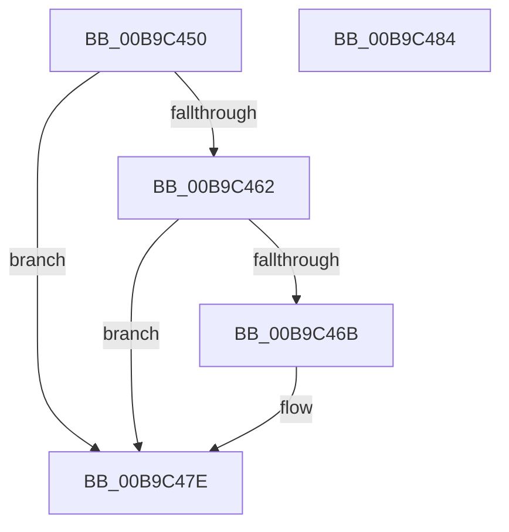

# VfPtMmCreateMdl_Exit

- RVA: `0x00B9C450`–`0x00B9C485` (길이 `53` bytes)
- VA: `0x0000000140B9C450`
- 실행 섹션: `PAGEVRFY`
- PDB 이름 있음: `예`; PDB Function 태그: `아니요`
- unwind 정보 RVA: `0x0005CF00`
- 디코드: `17`개 명령, `53/53` bytes 표시
- 미해석 바이트: `0` (있으면 어셈블리에 `.byte`로 보존)

> 이 문서는 커널 이미지의 기계어와 PDB 기호를 분석해 생성했습니다. 4번과 5번은 함수 원형과 자료형을 바이너리 사용 방식에서 추정한 C 해석이며 원본 소스 복구 결과는 아닙니다.

## 1. Dependencies

- 직접 호출 지점: **2**; 고유 호출 대상: **2**
- 직접 호출자로 확인된 함수: **0**
- RIP 상대 이미지 참조: **0**

### Outgoing calls
- `0x00B9C459` → [VfIsKernelVerificationOn](../../text/4F/VfIsKernelVerificationOn_function_004FCC90.md) (function, `0x004FCC90`)
- `0x00B9C479` → [VfPtMiscPoolNotification](../../text/3F/VfPtMiscPoolNotification_function_003FF310.md) (function, `0x003FF310`)

### Direct callers
- 이 함수 시작 RVA로 연결되는 직접 call은 확인되지 않았습니다. 간접 호출은 완전히 역산할 수 없습니다.

### Static image references
- 디코드된 RIP-relative 메모리 참조가 없습니다.

## 2. Other-region calls and transfers

- 다른 실행 섹션으로 향하는 call: **2**
  - `0x00B9C459` → [VfIsKernelVerificationOn](../../text/4F/VfIsKernelVerificationOn_function_004FCC90.md) (`PAGEVRFY` → `.text`)
  - `0x00B9C479` → [VfPtMiscPoolNotification](../../text/3F/VfPtMiscPoolNotification_function_003FF310.md) (`PAGEVRFY` → `.text`)
- 별도 외부 분기/꼬리 이동을 확인하지 못했습니다.

## 3. Assembly (complete function range)

```asm
00B9C450  40 53                           push rbx
00B9C452  48 83 EC 20                     sub rsp, 0x20
00B9C456  48 8B D9                        mov rbx, rcx
00B9C459  E8 32 08 96 FF                  call 0x1404fcc90
00B9C45E  84 C0                           test al, al
00B9C460  75 1C                           jne 0x140b9c47e
00B9C462  48 8B 4B 20                     mov rcx, qword ptr [rbx + 0x20]
00B9C466  48 85 C9                        test rcx, rcx
00B9C469  74 13                           je 0x140b9c47e
00B9C46B  48 0F BF 51 08                  movsx rdx, word ptr [rcx + 8]
00B9C470  45 33 C9                        xor r9d, r9d
00B9C473  41 B8 4D 6D 64 6C               mov r8d, 0x6c646d4d
00B9C479  E8 92 2E 86 FF                  call 0x1403ff310
00B9C47E  48 83 C4 20                     add rsp, 0x20
00B9C482  5B                              pop rbx
00B9C483  C3                              ret
00B9C484  CC                              int3
```

## 4. C-style interpretation (structured pseudocode)

```c
__int64 __fastcall VfPtMmCreateMdl_Exit(__int64 a1, __int64 a2, __int64 a3, int a4)
{
    __int64 result;
    __int64 v_rsp;

    v_rsp = (v_rsp) - (32);
    result = VfIsKernelVerificationOn(a1, a2, a3, a4);
    if ((unsigned __int8)(result) != 0) goto loc_00B9C47E;
    if (*(unsigned __int64 *)(a1 + 32) != 0) {
        a2 = (__int16)(*(unsigned __int16 *)(*(unsigned __int64 *)(a1 + 32) + 8));
        a4 = 0;
        a3 = 0x6C646D4DULL;
        result = VfPtMiscPoolNotification(*(unsigned __int64 *)(a1 + 32), a2, a3, a4);
    }
    v_rsp = (v_rsp) + (32);
    return result;
}
```

## 5. (Beta) C Style

```c
int64_t VfPtMmCreateMdl_Exit(void *Arg1, int64_t Arg2, int64_t Arg3, int32_t Arg4)
{
    uint8_t *arg1 = (uint8_t *)Arg1;

    int64_t result;
    int64_t local_rsp;

    local_rsp = (local_rsp) - (32);
    result = VfIsKernelVerificationOn(Arg1, Arg2, Arg3, Arg4);
    if ((uint8_t)(result) != 0) goto loc_00B9C47E;
    if (*(uint64_t *)(arg1 + 0x20) != 0) {
        Arg2 = (int16_t)(*(uint16_t *)(*(uint64_t *)(arg1 + 0x20) + 0x8));
        Arg4 = 0;
        Arg3 = 0x6C646D4DULL;
        result = VfPtMiscPoolNotification(*(uint64_t *)(arg1 + 0x20), Arg2, Arg3, Arg4);
    }
    local_rsp = (local_rsp) + (32);
    return result;
}
```

### 관측된 메모리 오프셋

구조체 형식이 확인되지 않은 접근은 인자 기준의 오프셋으로만 기록했습니다.

| 기준 인자 | 오프셋 표현 | 폭 (bit) | 접근 |
|---|---:|---:|---|
| `Arg1` | `+ 0x20` | `64` | `R` |

## 6. Execution-region graph

[열기: 2D/3D 그래프와 함수 탐색 컨트롤 패널](../../../control-panel.html?section=pagevrfy&rva=0x00B9C450&view=graph)

- 2D 그래프는 위에서 아래로 흐르고, 3D 그래프는 빈 공간을 드래그해 회전합니다. Shift+드래그는 이동, 휠은 확대·축소, 함수 노드 선택은 대상 보고서 이동입니다.

### Static fallback


