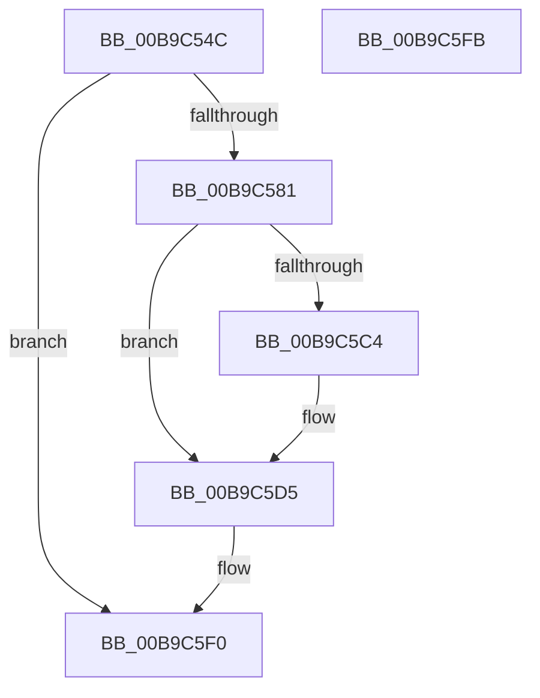

# VfPtProcessAllocPoolInfo

- RVA: `0x00B9C54C`–`0x00B9C5FC` (길이 `176` bytes)
- VA: `0x0000000140B9C54C`
- 실행 섹션: `PAGEVRFY`
- PDB 이름 있음: `예`; PDB Function 태그: `아니요`
- unwind 정보 RVA: `0x000BDDB4`
- 디코드: `45`개 명령, `176/176` bytes 표시
- 미해석 바이트: `0` (있으면 어셈블리에 `.byte`로 보존)

> 이 문서는 커널 이미지의 기계어와 PDB 기호를 분석해 생성했습니다. 4번과 5번은 함수 원형과 자료형을 바이너리 사용 방식에서 추정한 C 해석이며 원본 소스 복구 결과는 아닙니다.

## 1. Dependencies

- 직접 호출 지점: **6**; 고유 호출 대상: **6**
- 직접 호출자로 확인된 함수: **1**
- RIP 상대 이미지 참조: **4**

### Outgoing calls
- `0x00B9C585` → [ViPtInitializeLockContext](../../text/61/ViPtInitializeLockContext_function_00613958.md) (function, `0x00613958`)
- `0x00B9C58E` → [CarDbRaiseIrqlSafe](../../text/61/CarDbRaiseIrqlSafe_function_0061396C.md) (function, `0x0061396C`)
- `0x00B9C59E` → [ViPtAcquireTreeLockAtDpcLevelSafe](../../text/61/ViPtAcquireTreeLockAtDpcLevelSafe_function_0061388C.md) (function, `0x0061388C`)
- `0x00B9C5B8` → [RtlInsertElementGenericTableAvl](../../text/3E/RtlInsertElementGenericTableAvl_function_003EE510.md) (function, `0x003EE510`)
- `0x00B9C5E0` → [ViPtReleaseTreeLockFromDpcLevel](../../text/61/ViPtReleaseTreeLockFromDpcLevel_function_006139C0.md) (function, `0x006139C0`)
- `0x00B9C5E9` → [ViPtCleanupLockContext](../../text/61/ViPtCleanupLockContext_function_006138FC.md) (function, `0x006138FC`)

### Direct callers
- [ViPtProcessApt](ViPtProcessApt_function_00B9CAB8.md) at `0x00B9CB03`

### Static image references
- `0x00B9C56B` → RVA `0x00FFDAA0` (`PAGEVRFD`; read)
- `0x00B9C597` → RVA `0x00FFF140` (`PAGEVRFD`; read)
- `0x00B9C5C4` → RVA `0x00FFDB98` (`PAGEVRFD`; read)
- `0x00B9C5CF` → RVA `0x00FFDB98` (`PAGEVRFD`; write)

## 2. Other-region calls and transfers

- 다른 실행 섹션으로 향하는 call: **6**
  - `0x00B9C585` → [ViPtInitializeLockContext](../../text/61/ViPtInitializeLockContext_function_00613958.md) (`PAGEVRFY` → `.text`)
  - `0x00B9C58E` → [CarDbRaiseIrqlSafe](../../text/61/CarDbRaiseIrqlSafe_function_0061396C.md) (`PAGEVRFY` → `.text`)
  - `0x00B9C59E` → [ViPtAcquireTreeLockAtDpcLevelSafe](../../text/61/ViPtAcquireTreeLockAtDpcLevelSafe_function_0061388C.md) (`PAGEVRFY` → `.text`)
  - `0x00B9C5B8` → [RtlInsertElementGenericTableAvl](../../text/3E/RtlInsertElementGenericTableAvl_function_003EE510.md) (`PAGEVRFY` → `.text`)
  - `0x00B9C5E0` → [ViPtReleaseTreeLockFromDpcLevel](../../text/61/ViPtReleaseTreeLockFromDpcLevel_function_006139C0.md) (`PAGEVRFY` → `.text`)
  - `0x00B9C5E9` → [ViPtCleanupLockContext](../../text/61/ViPtCleanupLockContext_function_006138FC.md) (`PAGEVRFY` → `.text`)
- 별도 외부 분기/꼬리 이동을 확인하지 못했습니다.

## 3. Assembly (complete function range)

```asm
00B9C54C  48 89 5C 24 10                  mov qword ptr [rsp + 0x10], rbx
00B9C551  55                              push rbp
00B9C552  48 8B EC                        mov rbp, rsp
00B9C555  48 83 EC 50                     sub rsp, 0x50
00B9C559  48 8B 01                        mov rax, qword ptr [rcx]
00B9C55C  0F 57 C0                        xorps xmm0, xmm0
00B9C55F  48 89 45 E0                     mov qword ptr [rbp - 0x20], rax
00B9C563  48 8B 41 08                     mov rax, qword ptr [rcx + 8]
00B9C567  48 89 45 E8                     mov qword ptr [rbp - 0x18], rax
00B9C56B  8B 05 2F 15 46 00               mov eax, dword ptr [rip + 0x46152f]
00B9C571  C6 45 10 00                     mov byte ptr [rbp + 0x10], 0
00B9C575  48 89 55 F0                     mov qword ptr [rbp - 0x10], rdx
00B9C579  0F 11 45 D0                     movups xmmword ptr [rbp - 0x30], xmm0
00B9C57D  85 C0                           test eax, eax
00B9C57F  74 6F                           je 0x140b9c5f0
00B9C581  48 8D 4D D0                     lea rcx, [rbp - 0x30]
00B9C585  E8 CE 73 A7 FF                  call 0x140613958
00B9C58A  48 8D 4D D0                     lea rcx, [rbp - 0x30]
00B9C58E  E8 D9 73 A7 FF                  call 0x14061396c
00B9C593  48 8D 55 D0                     lea rdx, [rbp - 0x30]
00B9C597  48 8D 0D A2 2B 46 00            lea rcx, [rip + 0x462ba2]
00B9C59E  E8 E9 72 A7 FF                  call 0x14061388c
00B9C5A3  4C 8D 4D 10                     lea r9, [rbp + 0x10]
00B9C5A7  41 B8 18 00 00 00               mov r8d, 0x18
00B9C5AD  48 8D 55 E0                     lea rdx, [rbp - 0x20]
00B9C5B1  48 8D 0D 88 2B 46 00            lea rcx, [rip + 0x462b88]
00B9C5B8  E8 53 1F 85 FF                  call 0x1403ee510
00B9C5BD  8A 5D 10                        mov bl, byte ptr [rbp + 0x10]
00B9C5C0  84 DB                           test bl, bl
00B9C5C2  75 11                           jne 0x140b9c5d5
00B9C5C4  8B 05 CE 15 46 00               mov eax, dword ptr [rip + 0x4615ce]
00B9C5CA  8A 5D 10                        mov bl, byte ptr [rbp + 0x10]
00B9C5CD  FF C0                           inc eax
00B9C5CF  89 05 C3 15 46 00               mov dword ptr [rip + 0x4615c3], eax
00B9C5D5  48 8D 55 D0                     lea rdx, [rbp - 0x30]
00B9C5D9  48 8D 0D 60 2B 46 00            lea rcx, [rip + 0x462b60]
00B9C5E0  E8 DB 73 A7 FF                  call 0x1406139c0
00B9C5E5  48 8D 4D D0                     lea rcx, [rbp - 0x30]
00B9C5E9  E8 0E 73 A7 FF                  call 0x1406138fc
00B9C5EE  8A C3                           mov al, bl
00B9C5F0  48 8B 5C 24 68                  mov rbx, qword ptr [rsp + 0x68]
00B9C5F5  48 83 C4 50                     add rsp, 0x50
00B9C5F9  5D                              pop rbp
00B9C5FA  C3                              ret
00B9C5FB  CC                              int3
```

## 4. C-style interpretation (structured pseudocode)

```c
__int64 __fastcall VfPtProcessAllocPoolInfo(__int64 a1, __int64 a2)
{
    __int64 result;
    __int64 v_rbx;
    __int64 v_rsp;
    unsigned __int64 v_stack_m18;
    unsigned __int64 v_stack_m20;
    unsigned __int64 v_stack_m28;
    unsigned __int64 v_stack_m38;
    unsigned __int64 v_stack_p10;
    unsigned __int8 v_stack_p8;

    v_stack_p10 = v_rbx;
    v_rsp = (v_rsp) - (80);
    v_stack_m28 = *(unsigned __int64 *)(a1);
    v_stack_m20 = *(unsigned __int64 *)(a1 + 8);
    v_stack_p8 = 0;
    v_stack_m18 = a2;
    v_stack_m38 = v_xmm0;
    if ((unsigned int)((unsigned int)(*(unsigned int *)(v_rip + 4592943))) == 0) goto loc_00B9C5F0;
    result = ViPtInitializeLockContext(v_stack_m38, a2, a3, a4);
    result = CarDbRaiseIrqlSafe(v_stack_m38, a2, a3, a4);
    result = ViPtAcquireTreeLockAtDpcLevelSafe(v_rip + 4598690, v_stack_m38, a3, a4);
    result = RtlInsertElementGenericTableAvl(v_rip + 4598664, v_stack_m28, 24, v_stack_p8);
    v_rbx = v_stack_p8;
    if ((unsigned __int8)(v_stack_p8) == 0) {
        result = *(unsigned int *)(v_rip + 4593102);
        v_rbx = v_stack_p8;
        result = (unsigned int)((result) + 1);
        *(unsigned int *)(v_rip + 4593091) = (unsigned int)(result);
    }
    result = ViPtReleaseTreeLockFromDpcLevel(v_rip + 4598624, v_stack_m38, 24, v_stack_p8);
    result = ViPtCleanupLockContext(v_stack_m38, v_stack_m38, 24, v_stack_p8);
loc_00B9C5F0:
    v_rsp = (v_rsp) + (80);
    return (unsigned __int8)(v_rbx);
}
```

## 5. (Beta) C Style

```c
int64_t VfPtProcessAllocPoolInfo(void *Arg1, int64_t Arg2)
{
    uint8_t *arg1 = (uint8_t *)Arg1;

    int64_t result;
    int64_t local_rbx;
    int64_t local_rsp;
    uint64_t v_stack_m18;
    uint64_t v_stack_m20;
    uint64_t v_stack_m28;
    uint64_t v_stack_m38;
    uint64_t v_stack_p10;
    uint8_t v_stack_p8;

    v_stack_p10 = local_rbx;
    local_rsp = (local_rsp) - (80);
    v_stack_m28 = *(uint64_t *)(arg1);
    v_stack_m20 = *(uint64_t *)(arg1 + 0x8);
    v_stack_p8 = 0;
    v_stack_m18 = Arg2;
    v_stack_m38 = v_xmm0;
    if ((uint32_t)((uint32_t)(*(uint32_t *)(v_rip + 0x46152F))) == 0) goto loc_00B9C5F0;
    result = ViPtInitializeLockContext(v_stack_m38, Arg2, a3, a4);
    result = CarDbRaiseIrqlSafe(v_stack_m38, Arg2, a3, a4);
    result = ViPtAcquireTreeLockAtDpcLevelSafe(v_rip + 4598690, v_stack_m38, a3, a4);
    result = RtlInsertElementGenericTableAvl(v_rip + 4598664, v_stack_m28, 24, v_stack_p8);
    local_rbx = v_stack_p8;
    if ((uint8_t)(v_stack_p8) == 0) {
        result = *(uint32_t *)(v_rip + 0x4615CE);
        local_rbx = v_stack_p8;
        result = (uint32_t)((result) + 1);
        *(uint32_t *)(v_rip + 0x4615C3) = (uint32_t)(result);
    }
    result = ViPtReleaseTreeLockFromDpcLevel(v_rip + 4598624, v_stack_m38, 24, v_stack_p8);
    result = ViPtCleanupLockContext(v_stack_m38, v_stack_m38, 24, v_stack_p8);
loc_00B9C5F0:
    local_rsp = (local_rsp) + (80);
    return (uint8_t)(local_rbx);
}
```

### 관측된 메모리 오프셋

구조체 형식이 확인되지 않은 접근은 인자 기준의 오프셋으로만 기록했습니다.

| 기준 인자 | 오프셋 표현 | 폭 (bit) | 접근 |
|---|---:|---:|---|
| `Arg1` | `+ 0x0` | `64` | `R` |
| `Arg1` | `+ 0x8` | `64` | `R` |

## 6. Execution-region graph

[열기: 2D/3D 그래프와 함수 탐색 컨트롤 패널](../../../control-panel.html?section=pagevrfy&rva=0x00B9C54C&view=graph)

- 2D 그래프는 위에서 아래로 흐르고, 3D 그래프는 빈 공간을 드래그해 회전합니다. Shift+드래그는 이동, 휠은 확대·축소, 함수 노드 선택은 대상 보고서 이동입니다.

### Static fallback


