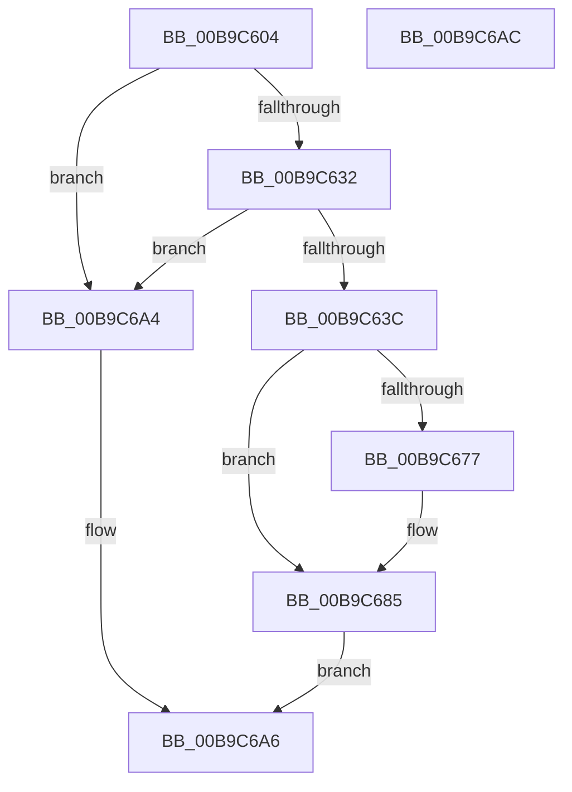

# VfPtProcessFreePoolInfo

- RVA: `0x00B9C604`–`0x00B9C6AD` (길이 `169` bytes)
- VA: `0x0000000140B9C604`
- 실행 섹션: `PAGEVRFY`
- PDB 이름 있음: `예`; PDB Function 태그: `아니요`
- unwind 정보 RVA: `0x000AF0B0`
- 디코드: `44`개 명령, `169/169` bytes 표시
- 미해석 바이트: `0` (있으면 어셈블리에 `.byte`로 보존)

> 이 문서는 커널 이미지의 기계어와 PDB 기호를 분석해 생성했습니다. 4번과 5번은 함수 원형과 자료형을 바이너리 사용 방식에서 추정한 C 해석이며 원본 소스 복구 결과는 아닙니다.

## 1. Dependencies

- 직접 호출 지점: **6**; 고유 호출 대상: **6**
- 직접 호출자로 확인된 함수: **1**
- RIP 상대 이미지 참조: **5**

### Outgoing calls
- `0x00B9C640` → [ViPtInitializeLockContext](../../text/61/ViPtInitializeLockContext_function_00613958.md) (function, `0x00613958`)
- `0x00B9C64A` → [CarDbRaiseIrqlSafe](../../text/61/CarDbRaiseIrqlSafe_function_0061396C.md) (function, `0x0061396C`)
- `0x00B9C65B` → [ViPtAcquireTreeLockAtDpcLevelSafe](../../text/61/ViPtAcquireTreeLockAtDpcLevelSafe_function_0061388C.md) (function, `0x0061388C`)
- `0x00B9C66C` → [RtlDeleteElementGenericTableAvl](../../text/3E/RtlDeleteElementGenericTableAvl_function_003EE750.md) (function, `0x003EE750`)
- `0x00B9C691` → [ViPtReleaseTreeLockFromDpcLevel](../../text/61/ViPtReleaseTreeLockFromDpcLevel_function_006139C0.md) (function, `0x006139C0`)
- `0x00B9C69B` → [ViPtCleanupLockContext](../../text/61/ViPtCleanupLockContext_function_006138FC.md) (function, `0x006138FC`)

### Direct callers
- [ViPtProcessApt](ViPtProcessApt_function_00B9CAB8.md) at `0x00B9CB0A`

### Static image references
- `0x00B9C623` → RVA `0x00FFDAA0` (`PAGEVRFD`; read)
- `0x00B9C632` → RVA `0x00FFDA98` (`PAGEVRFD`; read)
- `0x00B9C654` → RVA `0x00FFF140` (`PAGEVRFD`; read)
- `0x00B9C677` → RVA `0x00FFDB9C` (`PAGEVRFD`; read)
- `0x00B9C67F` → RVA `0x00FFDB9C` (`PAGEVRFD`; write)

## 2. Other-region calls and transfers

- 다른 실행 섹션으로 향하는 call: **6**
  - `0x00B9C640` → [ViPtInitializeLockContext](../../text/61/ViPtInitializeLockContext_function_00613958.md) (`PAGEVRFY` → `.text`)
  - `0x00B9C64A` → [CarDbRaiseIrqlSafe](../../text/61/CarDbRaiseIrqlSafe_function_0061396C.md) (`PAGEVRFY` → `.text`)
  - `0x00B9C65B` → [ViPtAcquireTreeLockAtDpcLevelSafe](../../text/61/ViPtAcquireTreeLockAtDpcLevelSafe_function_0061388C.md) (`PAGEVRFY` → `.text`)
  - `0x00B9C66C` → [RtlDeleteElementGenericTableAvl](../../text/3E/RtlDeleteElementGenericTableAvl_function_003EE750.md) (`PAGEVRFY` → `.text`)
  - `0x00B9C691` → [ViPtReleaseTreeLockFromDpcLevel](../../text/61/ViPtReleaseTreeLockFromDpcLevel_function_006139C0.md) (`PAGEVRFY` → `.text`)
  - `0x00B9C69B` → [ViPtCleanupLockContext](../../text/61/ViPtCleanupLockContext_function_006138FC.md) (`PAGEVRFY` → `.text`)
- 별도 외부 분기/꼬리 이동을 확인하지 못했습니다.

## 3. Assembly (complete function range)

```asm
00B9C604  4C 8B DC                        mov r11, rsp
00B9C607  53                              push rbx
00B9C608  48 83 EC 50                     sub rsp, 0x50
00B9C60C  48 8B 01                        mov rax, qword ptr [rcx]
00B9C60F  0F 57 C0                        xorps xmm0, xmm0
00B9C612  49 83 63 E8 00                  and qword ptr [r11 - 0x18], 0
00B9C617  49 89 43 D8                     mov qword ptr [r11 - 0x28], rax
00B9C61B  48 8B 41 08                     mov rax, qword ptr [rcx + 8]
00B9C61F  49 89 43 E0                     mov qword ptr [r11 - 0x20], rax
00B9C623  8B 05 77 14 46 00               mov eax, dword ptr [rip + 0x461477]
00B9C629  0F 11 44 24 20                  movups xmmword ptr [rsp + 0x20], xmm0
00B9C62E  85 C0                           test eax, eax
00B9C630  74 72                           je 0x140b9c6a4
00B9C632  8B 05 60 14 46 00               mov eax, dword ptr [rip + 0x461460]
00B9C638  85 C0                           test eax, eax
00B9C63A  74 68                           je 0x140b9c6a4
00B9C63C  49 8D 4B C8                     lea rcx, [r11 - 0x38]
00B9C640  E8 13 73 A7 FF                  call 0x140613958
00B9C645  48 8D 4C 24 20                  lea rcx, [rsp + 0x20]
00B9C64A  E8 1D 73 A7 FF                  call 0x14061396c
00B9C64F  48 8D 54 24 20                  lea rdx, [rsp + 0x20]
00B9C654  48 8D 0D E5 2A 46 00            lea rcx, [rip + 0x462ae5]
00B9C65B  E8 2C 72 A7 FF                  call 0x14061388c
00B9C660  48 8D 54 24 30                  lea rdx, [rsp + 0x30]
00B9C665  48 8D 0D D4 2A 46 00            lea rcx, [rip + 0x462ad4]
00B9C66C  E8 DF 20 85 FF                  call 0x1403ee750
00B9C671  8A D8                           mov bl, al
00B9C673  84 C0                           test al, al
00B9C675  75 0E                           jne 0x140b9c685
00B9C677  8B 15 1F 15 46 00               mov edx, dword ptr [rip + 0x46151f]
00B9C67D  FF C2                           inc edx
00B9C67F  89 15 17 15 46 00               mov dword ptr [rip + 0x461517], edx
00B9C685  48 8D 54 24 20                  lea rdx, [rsp + 0x20]
00B9C68A  48 8D 0D AF 2A 46 00            lea rcx, [rip + 0x462aaf]
00B9C691  E8 2A 73 A7 FF                  call 0x1406139c0
00B9C696  48 8D 4C 24 20                  lea rcx, [rsp + 0x20]
00B9C69B  E8 5C 72 A7 FF                  call 0x1406138fc
00B9C6A0  8A C3                           mov al, bl
00B9C6A2  EB 02                           jmp 0x140b9c6a6
00B9C6A4  32 C0                           xor al, al
00B9C6A6  48 83 C4 50                     add rsp, 0x50
00B9C6AA  5B                              pop rbx
00B9C6AB  C3                              ret
00B9C6AC  CC                              int3
```

## 4. C-style interpretation (structured pseudocode)

```c
__int64 __fastcall VfPtProcessFreePoolInfo(__int64 a1)
{
    __int64 result;
    __int64 v_rsp;
    unsigned __int64 v_stack_m28;
    unsigned __int64 v_stack_m38;

    v_rsp = (v_rsp) - (80);
    *(unsigned __int64 *)(v_rsp - 40) = *(unsigned __int64 *)(a1);
    *(unsigned __int64 *)(v_rsp - 32) = *(unsigned __int64 *)(a1 + 8);
    v_stack_m38 = v_xmm0;
    if ((unsigned int)((unsigned int)(*(unsigned int *)(v_rip + 4592759))) == 0) goto loc_00B9C6A4;
    if ((unsigned int)((unsigned int)(*(unsigned int *)(v_rip + 4592736))) == 0) goto loc_00B9C6A4;
    result = ViPtInitializeLockContext(v_rsp - 56, a2, a3, a4);
    result = CarDbRaiseIrqlSafe(v_stack_m38, a2, a3, a4);
    result = ViPtAcquireTreeLockAtDpcLevelSafe(v_rip + 4598501, v_stack_m38, a3, a4);
    result = RtlDeleteElementGenericTableAvl(v_rip + 4598484, v_stack_m28, a3, a4);
    if ((unsigned __int8)(result) == 0) {
        a2 = *(unsigned int *)(v_rip + 4592927);
        a2 = (unsigned int)((a2) + 1);
        *(unsigned int *)(v_rip + 4592919) = (unsigned int)(a2);
    }
    result = ViPtReleaseTreeLockFromDpcLevel(v_rip + 4598447, v_stack_m38, a3, a4);
    result = ViPtCleanupLockContext(v_stack_m38, v_stack_m38, a3, a4);
    goto loc_00B9C6A6;
loc_00B9C6A4:
    result = 0;
loc_00B9C6A6:
    v_rsp = (v_rsp) + (80);
    return result;
}
```

## 5. (Beta) C Style

```c
int64_t VfPtProcessFreePoolInfo(void *Arg1)
{
    uint8_t *arg1 = (uint8_t *)Arg1;

    int64_t result;
    int64_t local_rsp;
    uint64_t v_stack_m28;
    uint64_t v_stack_m38;

    local_rsp = (local_rsp) - (80);
    *(uint64_t *)(local_rsp - 0x28) = *(uint64_t *)(arg1);
    *(uint64_t *)(local_rsp - 0x20) = *(uint64_t *)(arg1 + 0x8);
    v_stack_m38 = v_xmm0;
    if ((uint32_t)((uint32_t)(*(uint32_t *)(v_rip + 0x461477))) == 0) goto loc_00B9C6A4;
    if ((uint32_t)((uint32_t)(*(uint32_t *)(v_rip + 0x461460))) == 0) goto loc_00B9C6A4;
    result = ViPtInitializeLockContext(local_rsp - 56, a2, a3, a4);
    result = CarDbRaiseIrqlSafe(v_stack_m38, a2, a3, a4);
    result = ViPtAcquireTreeLockAtDpcLevelSafe(v_rip + 4598501, v_stack_m38, a3, a4);
    result = RtlDeleteElementGenericTableAvl(v_rip + 4598484, v_stack_m28, a3, a4);
    if ((uint8_t)(result) == 0) {
        a2 = *(uint32_t *)(v_rip + 0x46151F);
        a2 = (uint32_t)((a2) + 1);
        *(uint32_t *)(v_rip + 0x461517) = (uint32_t)(a2);
    }
    result = ViPtReleaseTreeLockFromDpcLevel(v_rip + 4598447, v_stack_m38, a3, a4);
    result = ViPtCleanupLockContext(v_stack_m38, v_stack_m38, a3, a4);
    goto loc_00B9C6A6;
loc_00B9C6A4:
    result = 0;
loc_00B9C6A6:
    local_rsp = (local_rsp) + (80);
    return result;
}
```

### 관측된 메모리 오프셋

구조체 형식이 확인되지 않은 접근은 인자 기준의 오프셋으로만 기록했습니다.

| 기준 인자 | 오프셋 표현 | 폭 (bit) | 접근 |
|---|---:|---:|---|
| `Arg1` | `+ 0x0` | `64` | `R` |
| `Arg1` | `+ 0x8` | `64` | `R` |

## 6. Execution-region graph

[열기: 2D/3D 그래프와 함수 탐색 컨트롤 패널](../../../control-panel.html?section=pagevrfy&rva=0x00B9C604&view=graph)

- 2D 그래프는 위에서 아래로 흐르고, 3D 그래프는 빈 공간을 드래그해 회전합니다. Shift+드래그는 이동, 휠은 확대·축소, 함수 노드 선택은 대상 보고서 이동입니다.

### Static fallback


