# VfPutDmaAdapter

- RVA: `0x00B97680`–`0x00B97964` (길이 `740` bytes)
- VA: `0x0000000140B97680`
- 실행 섹션: `PAGEVRFY`
- PDB 이름 있음: `예`; PDB Function 태그: `아니요`
- unwind 정보 RVA: `0x000D2310`
- 디코드: `184`개 명령, `740/740` bytes 표시
- 미해석 바이트: `0` (있으면 어셈블리에 `.byte`로 보존)

> 이 문서는 커널 이미지의 기계어와 PDB 기호를 분석해 생성했습니다. 4번과 5번은 함수 원형과 자료형을 바이너리 사용 방식에서 추정한 C 해석이며 원본 소스 복구 결과는 아닙니다.

## 1. Dependencies

- 직접 호출 지점: **19**; 고유 호출 대상: **10**
- 직접 호출자로 확인된 함수: **0**
- RIP 상대 이미지 참조: **11**

### Outgoing calls
- `0x00B9769B` → [VF_ASSERT_MAX_IRQL](VF_ASSERT_MAX_IRQL_function_00B94FB0.md) (function, `0x00B94FB0`)
- `0x00B976AA` → [ViGetAdapterInformationInternal](ViGetAdapterInformationInternal_function_00B98E88.md) (function, `0x00B98E88`)
- `0x00B976F3` → [ViHalPreprocessOptions](ViHalPreprocessOptions_function_00B9920C.md) (function, `0x00B9920C`)
- `0x00B97711` → [VfReportIssueWithOptions](../../text/61/VfReportIssueWithOptions_function_00614444.md) (function, `0x00614444`)
- `0x00B97719` → [ViFlushZeroMapRegisterBaseWcbs](../../text/61/ViFlushZeroMapRegisterBaseWcbs_function_00612D2C.md) (function, `0x00612D2C`)
- `0x00B97754` → [ViHalPreprocessOptions](ViHalPreprocessOptions_function_00B9920C.md) (function, `0x00B9920C`)
- `0x00B9777C` → [VfReportIssueWithOptions](../../text/61/VfReportIssueWithOptions_function_00614444.md) (function, `0x00614444`)
- `0x00B977B7` → [ViHalPreprocessOptions](ViHalPreprocessOptions_function_00B9920C.md) (function, `0x00B9920C`)
- `0x00B977DF` → [VfReportIssueWithOptions](../../text/61/VfReportIssueWithOptions_function_00614444.md) (function, `0x00614444`)
- `0x00B97813` → [ViHalPreprocessOptions](ViHalPreprocessOptions_function_00B9920C.md) (function, `0x00B9920C`)
- `0x00B97834` → [VfReportIssueWithOptions](../../text/61/VfReportIssueWithOptions_function_00614444.md) (function, `0x00614444`)
- `0x00B97868` → [ViHalPreprocessOptions](ViHalPreprocessOptions_function_00B9920C.md) (function, `0x00B9920C`)
- `0x00B97889` → [VfReportIssueWithOptions](../../text/61/VfReportIssueWithOptions_function_00614444.md) (function, `0x00614444`)
- `0x00B97895` → [KeAcquireSpinLockRaiseToDpc](../../text/20/KeAcquireSpinLockRaiseToDpc_function_00208470.md) (function, `0x00208470`)
- `0x00B97902` → [KeReleaseSpinLock](../../text/39/KeReleaseSpinLock_function_00392BA0.md) (function, `0x00392BA0`)
- `0x00B97914` → [ViReleaseDmaAdapter](ViReleaseDmaAdapter_function_00B99A0C.md) (function, `0x00B99A0C`)
- `0x00B9791C` → [ViGetRealDmaAdapter](ViGetRealDmaAdapter_function_00B990DC.md) (function, `0x00B990DC`)
- `0x00B9792F` → [guard_dispatch_icall](../../text/6B/guard_dispatch_icall_function_006BAAD0.md) (function, `0x006BAAD0`)
- `0x00B97945` → [ViReleaseDmaAdapter](ViReleaseDmaAdapter_function_00B99A0C.md) (function, `0x00B99A0C`)

### Direct callers
- 이 함수 시작 RVA로 연결되는 직접 call은 확인되지 않았습니다. 간접 호출은 완전히 역산할 수 없습니다.

### Static image references
- `0x00B976D4` → RVA `0x00E0E9CC` (`.data`; read)
- `0x00B976E6` → RVA `0x00BB9B60` (` ?? ::JKADOLAD::`string'`; read)
- `0x00B97735` → RVA `0x00E0E9C8` (`.data`; read)
- `0x00B97744` → RVA `0x00BB9B10` (` ?? ::JKADOLAD::`string'`; read)
- `0x00B97798` → RVA `0x00E0E9D4` (`.data`; read)
- `0x00B977A7` → RVA `0x00BB9CF0` (` ?? ::JKADOLAD::`string'`; read)
- `0x00B977EF` → RVA `0x00E0E9D0` (`.data`; read)
- `0x00B97806` → RVA `0x00BB9CA0` (` ?? ::JKADOLAD::`string'`; read)
- `0x00B97844` → RVA `0x00E0E9E8` (`.data`; read)
- `0x00B9785B` → RVA `0x00BB9DB0` (` ?? ::JKADOLAD::`string'`; read)
- `0x00B9788E` → RVA `0x00F03FD0` (`.data`; read)

## 2. Other-region calls and transfers

- 다른 실행 섹션으로 향하는 call: **9**
  - `0x00B97711` → [VfReportIssueWithOptions](../../text/61/VfReportIssueWithOptions_function_00614444.md) (`PAGEVRFY` → `.text`)
  - `0x00B97719` → [ViFlushZeroMapRegisterBaseWcbs](../../text/61/ViFlushZeroMapRegisterBaseWcbs_function_00612D2C.md) (`PAGEVRFY` → `.text`)
  - `0x00B9777C` → [VfReportIssueWithOptions](../../text/61/VfReportIssueWithOptions_function_00614444.md) (`PAGEVRFY` → `.text`)
  - `0x00B977DF` → [VfReportIssueWithOptions](../../text/61/VfReportIssueWithOptions_function_00614444.md) (`PAGEVRFY` → `.text`)
  - `0x00B97834` → [VfReportIssueWithOptions](../../text/61/VfReportIssueWithOptions_function_00614444.md) (`PAGEVRFY` → `.text`)
  - `0x00B97889` → [VfReportIssueWithOptions](../../text/61/VfReportIssueWithOptions_function_00614444.md) (`PAGEVRFY` → `.text`)
  - `0x00B97895` → [KeAcquireSpinLockRaiseToDpc](../../text/20/KeAcquireSpinLockRaiseToDpc_function_00208470.md) (`PAGEVRFY` → `.text`)
  - `0x00B97902` → [KeReleaseSpinLock](../../text/39/KeReleaseSpinLock_function_00392BA0.md) (`PAGEVRFY` → `.text`)
  - `0x00B9792F` → [guard_dispatch_icall](../../text/6B/guard_dispatch_icall_function_006BAAD0.md) (`PAGEVRFY` → `.text`)
- 별도 외부 분기/꼬리 이동을 확인하지 못했습니다.

## 3. Assembly (complete function range)

```asm
00B97680  48 89 5C 24 08                  mov qword ptr [rsp + 8], rbx
00B97685  48 89 6C 24 10                  mov qword ptr [rsp + 0x10], rbp
00B9768A  48 89 74 24 18                  mov qword ptr [rsp + 0x18], rsi
00B9768F  57                              push rdi
00B97690  41 55                           push r13
00B97692  41 56                           push r14
00B97694  48 83 EC 30                     sub rsp, 0x30
00B97698  48 8B F1                        mov rsi, rcx
00B9769B  E8 10 D9 FF FF                  call 0x140b94fb0
00B976A0  33 D2                           xor edx, edx
00B976A2  48 8B CE                        mov rcx, rsi
00B976A5  40 32 ED                        xor bpl, bpl
00B976A8  33 FF                           xor edi, edi
00B976AA  E8 D9 17 00 00                  call 0x140b98e88
00B976AF  48 8B D8                        mov rbx, rax
00B976B2  48 85 C0                        test rax, rax
00B976B5  0F 84 5E 02 00 00               je 0x140b97919
00B976BB  83 CF FF                        or edi, 0xffffffff
00B976BE  F0 0F C1 78 4C                  lock xadd dword ptr [rax + 0x4c], edi
00B976C3  83 EF 01                        sub edi, 1
00B976C6  41 BD E6 00 00 00               mov r13d, 0xe6
00B976CC  79 48                           jns 0x140b97716
00B976CE  48 83 64 24 28 00               and qword ptr [rsp + 0x28], 0
00B976D4  4C 8D 35 F1 72 27 00            lea r14, [rip + 0x2772f1]
00B976DB  49 8B CE                        mov rcx, r14
00B976DE  48 89 44 24 20                  mov qword ptr [rsp + 0x20], rax
00B976E3  4C 8B CE                        mov r9, rsi
00B976E6  48 8D 15 73 24 02 00            lea rdx, [rip + 0x22473]
00B976ED  41 B8 18 00 00 00               mov r8d, 0x18
00B976F3  E8 14 1B 00 00                  call 0x140b9920c
00B976F8  4C 89 74 24 28                  mov qword ptr [rsp + 0x28], r14
00B976FD  4C 8B CB                        mov r9, rbx
00B97700  48 83 64 24 20 00               and qword ptr [rsp + 0x20], 0
00B97706  4C 8B C6                        mov r8, rsi
00B97709  BA 18 00 00 00                  mov edx, 0x18
00B9770E  41 8B CD                        mov ecx, r13d
00B97711  E8 2E CD A7 FF                  call 0x140614444
00B97716  48 8B CB                        mov rcx, rbx
00B97719  E8 0E B6 A7 FF                  call 0x140612d2c
00B9771E  8B 83 D4 00 00 00               mov eax, dword ptr [rbx + 0xd4]
00B97724  8B 8B D8 00 00 00               mov ecx, dword ptr [rbx + 0xd8]
00B9772A  3B C1                           cmp eax, ecx
00B9772C  74 53                           je 0x140b97781
00B9772E  2B C1                           sub eax, ecx
00B97730  48 89 5C 24 28                  mov qword ptr [rsp + 0x28], rbx
00B97735  4C 8D 35 8C 72 27 00            lea r14, [rip + 0x27728c]
00B9773C  48 89 44 24 20                  mov qword ptr [rsp + 0x20], rax
00B97741  49 8B CE                        mov rcx, r14
00B97744  48 8D 15 C5 23 02 00            lea rdx, [rip + 0x223c5]
00B9774B  4C 8B CE                        mov r9, rsi
00B9774E  41 B8 08 00 00 00               mov r8d, 8
00B97754  E8 B3 1A 00 00                  call 0x140b9920c
00B97759  44 8B 8B D4 00 00 00            mov r9d, dword ptr [rbx + 0xd4]
00B97760  4C 8B C6                        mov r8, rsi
00B97763  44 2B 8B D8 00 00 00            sub r9d, dword ptr [rbx + 0xd8]
00B9776A  BA 08 00 00 00                  mov edx, 8
00B9776F  4C 89 74 24 28                  mov qword ptr [rsp + 0x28], r14
00B97774  41 8B CD                        mov ecx, r13d
00B97777  48 89 5C 24 20                  mov qword ptr [rsp + 0x20], rbx
00B9777C  E8 C3 CC A7 FF                  call 0x140614444
00B97781  8B 83 CC 00 00 00               mov eax, dword ptr [rbx + 0xcc]
00B97787  8B 8B D0 00 00 00               mov ecx, dword ptr [rbx + 0xd0]
00B9778D  3B C1                           cmp eax, ecx
00B9778F  74 53                           je 0x140b977e4
00B97791  2B C1                           sub eax, ecx
00B97793  48 89 5C 24 28                  mov qword ptr [rsp + 0x28], rbx
00B97798  4C 8D 35 35 72 27 00            lea r14, [rip + 0x277235]
00B9779F  48 89 44 24 20                  mov qword ptr [rsp + 0x20], rax
00B977A4  49 8B CE                        mov rcx, r14
00B977A7  48 8D 15 42 25 02 00            lea rdx, [rip + 0x22542]
00B977AE  4C 8B CE                        mov r9, rsi
00B977B1  41 B8 07 00 00 00               mov r8d, 7
00B977B7  E8 50 1A 00 00                  call 0x140b9920c
00B977BC  44 8B 8B CC 00 00 00            mov r9d, dword ptr [rbx + 0xcc]
00B977C3  4C 8B C6                        mov r8, rsi
00B977C6  44 2B 8B D0 00 00 00            sub r9d, dword ptr [rbx + 0xd0]
00B977CD  BA 07 00 00 00                  mov edx, 7
00B977D2  4C 89 74 24 28                  mov qword ptr [rsp + 0x28], r14
00B977D7  41 8B CD                        mov ecx, r13d
00B977DA  48 89 5C 24 20                  mov qword ptr [rsp + 0x20], rbx
00B977DF  E8 60 CC A7 FF                  call 0x140614444
00B977E4  48 63 83 C0 00 00 00            movsxd rax, dword ptr [rbx + 0xc0]
00B977EB  85 C0                           test eax, eax
00B977ED  74 4A                           je 0x140b97839
00B977EF  4C 8D 35 DA 71 27 00            lea r14, [rip + 0x2771da]
00B977F6  48 89 5C 24 28                  mov qword ptr [rsp + 0x28], rbx
00B977FB  49 8B CE                        mov rcx, r14
00B977FE  48 89 44 24 20                  mov qword ptr [rsp + 0x20], rax
00B97803  4C 8B CE                        mov r9, rsi
00B97806  48 8D 15 93 24 02 00            lea rdx, [rip + 0x22493]
00B9780D  41 B8 09 00 00 00               mov r8d, 9
00B97813  E8 F4 19 00 00                  call 0x140b9920c
00B97818  4C 63 8B C0 00 00 00            movsxd r9, dword ptr [rbx + 0xc0]
00B9781F  4C 8B C6                        mov r8, rsi
00B97822  BA 09 00 00 00                  mov edx, 9
00B97827  4C 89 74 24 28                  mov qword ptr [rsp + 0x28], r14
00B9782C  41 8B CD                        mov ecx, r13d
00B9782F  48 89 5C 24 20                  mov qword ptr [rsp + 0x20], rbx
00B97834  E8 0B CC A7 FF                  call 0x140614444
00B97839  48 63 83 C8 00 00 00            movsxd rax, dword ptr [rbx + 0xc8]
00B97840  85 C0                           test eax, eax
00B97842  74 4A                           je 0x140b9788e
00B97844  4C 8D 35 9D 71 27 00            lea r14, [rip + 0x27719d]
00B9784B  48 89 5C 24 28                  mov qword ptr [rsp + 0x28], rbx
00B97850  49 8B CE                        mov rcx, r14
00B97853  48 89 44 24 20                  mov qword ptr [rsp + 0x20], rax
00B97858  4C 8B CE                        mov r9, rsi
00B9785B  48 8D 15 4E 25 02 00            lea rdx, [rip + 0x2254e]
00B97862  41 B8 0A 00 00 00               mov r8d, 0xa
00B97868  E8 9F 19 00 00                  call 0x140b9920c
00B9786D  4C 63 8B C8 00 00 00            movsxd r9, dword ptr [rbx + 0xc8]
00B97874  4C 8B C6                        mov r8, rsi
00B97877  BA 0A 00 00 00                  mov edx, 0xa
00B9787C  4C 89 74 24 28                  mov qword ptr [rsp + 0x28], r14
00B97881  41 8B CD                        mov ecx, r13d
00B97884  48 89 5C 24 20                  mov qword ptr [rsp + 0x20], rbx
00B97889  E8 B6 CB A7 FF                  call 0x140614444
00B9788E  48 8D 0D 3B C7 36 00            lea rcx, [rip + 0x36c73b]
00B97895  E8 D6 0B 67 FF                  call 0x140208470
00B9789A  48 83 7B 40 00                  cmp qword ptr [rbx + 0x40], 0
00B9789F  44 8A C0                        mov r8b, al
00B978A2  75 1B                           jne 0x140b978bf
00B978A4  48 8B 13                        mov rdx, qword ptr [rbx]
00B978A7  48 39 5A 08                     cmp qword ptr [rdx + 8], rbx
00B978AB  75 42                           jne 0x140b978ef
00B978AD  48 8B 4B 08                     mov rcx, qword ptr [rbx + 8]
00B978B1  48 39 19                        cmp qword ptr [rcx], rbx
00B978B4  75 39                           jne 0x140b978ef
00B978B6  48 89 11                        mov qword ptr [rcx], rdx
00B978B9  48 89 4A 08                     mov qword ptr [rdx + 8], rcx
00B978BD  EB 39                           jmp 0x140b978f8
00B978BF  40 38 6B 4A                     cmp byte ptr [rbx + 0x4a], bpl
00B978C3  74 1B                           je 0x140b978e0
00B978C5  48 8B 0B                        mov rcx, qword ptr [rbx]
00B978C8  48 39 59 08                     cmp qword ptr [rcx + 8], rbx
00B978CC  75 21                           jne 0x140b978ef
00B978CE  48 8B 43 08                     mov rax, qword ptr [rbx + 8]
00B978D2  48 39 18                        cmp qword ptr [rax], rbx
00B978D5  75 18                           jne 0x140b978ef
00B978D7  48 89 08                        mov qword ptr [rax], rcx
00B978DA  48 89 41 08                     mov qword ptr [rcx + 8], rax
00B978DE  EB 18                           jmp 0x140b978f8
00B978E0  40 38 6B 4B                     cmp byte ptr [rbx + 0x4b], bpl
00B978E4  74 10                           je 0x140b978f6
00B978E6  40 B5 01                        mov bpl, 1
00B978E9  85 FF                           test edi, edi
00B978EB  7F 0B                           jg 0x140b978f8
00B978ED  EB D6                           jmp 0x140b978c5
00B978EF  B9 03 00 00 00                  mov ecx, 3
00B978F4  CD 29                           int 0x29
00B978F6  33 DB                           xor ebx, ebx
00B978F8  41 8A D0                        mov dl, r8b
00B978FB  48 8D 0D CE C6 36 00            lea rcx, [rip + 0x36c6ce]
00B97902  E8 99 B2 7F FF                  call 0x140392ba0
00B97907  48 85 DB                        test rbx, rbx
00B9790A  74 0D                           je 0x140b97919
00B9790C  40 84 ED                        test bpl, bpl
00B9790F  75 08                           jne 0x140b97919
00B97911  48 8B CB                        mov rcx, rbx
00B97914  E8 F3 20 00 00                  call 0x140b99a0c
00B97919  48 8B CE                        mov rcx, rsi
00B9791C  E8 BB 17 00 00                  call 0x140b990dc
00B97921  48 8B D0                        mov rdx, rax
00B97924  48 8B 48 08                     mov rcx, qword ptr [rax + 8]
00B97928  48 8B 41 08                     mov rax, qword ptr [rcx + 8]
00B9792C  48 8B CA                        mov rcx, rdx
00B9792F  E8 9C 31 B2 FF                  call 0x1406baad0
00B97934  48 85 DB                        test rbx, rbx
00B97937  74 11                           je 0x140b9794a
00B97939  40 84 ED                        test bpl, bpl
00B9793C  74 0C                           je 0x140b9794a
00B9793E  85 FF                           test edi, edi
00B97940  7F 08                           jg 0x140b9794a
00B97942  48 8B CB                        mov rcx, rbx
00B97945  E8 C2 20 00 00                  call 0x140b99a0c
00B9794A  48 8B 5C 24 50                  mov rbx, qword ptr [rsp + 0x50]
00B9794F  48 8B 6C 24 58                  mov rbp, qword ptr [rsp + 0x58]
00B97954  48 8B 74 24 60                  mov rsi, qword ptr [rsp + 0x60]
00B97959  48 83 C4 30                     add rsp, 0x30
00B9795D  41 5E                           pop r14
00B9795F  41 5D                           pop r13
00B97961  5F                              pop rdi
00B97962  C3                              ret
00B97963  CC                              int3
```

## 4. C-style interpretation (structured pseudocode)

```c
__int64 __fastcall VfPutDmaAdapter(__int64 a1, int a2)
{
    __int64 result;
    __int64 v_r14;
    __int64 v_rbp;
    __int64 v_rbx;
    __int64 v_rdi;
    __int64 v_rsp;
    unsigned __int64 v_stack_m20;
    unsigned __int64 v_stack_m28;
    unsigned __int64 v_stack_p10;
    unsigned __int64 v_stack_p18;
    unsigned __int64 v_stack_p8;

    v_stack_p8 = v_rbx;
    v_stack_p10 = v_rbp;
    v_stack_p18 = v_rsi;
    v_rsp = (v_rsp) - (48);
    result = VF_ASSERT_MAX_IRQL(a1, a2, a3, a4);
    a2 = 0;
    v_rbp = 0;
    v_rdi = 0;
    result = ViGetAdapterInformationInternal(a1, a2, a3, a4);
    if (result == 0) goto loc_00B97919;
    v_rdi = (unsigned int)((v_rdi) | (0xFFFFFFFFULL));
    v_rdi = (unsigned int)((v_rdi) - (1));
    if (sign_flag) {
        v_r14 = v_rip + 2585329;
        a1 = v_r14;
        v_stack_m28 = result;
        a4 = a1;
        a2 = v_rip + 140403;
        a3 = 24;
        result = ViHalPreprocessOptions(a1, a2, a3, a4);
        v_stack_m20 = v_r14;
        a4 = result;
        a3 = a1;
        a2 = 24;
        a1 = 230;
        result = VfReportIssueWithOptions(a1, a2, a3, a4);
    }
    result = ViFlushZeroMapRegisterBaseWcbs(result, a2, a3, a4);
    result = (unsigned int)(*(unsigned int *)(result + 212));
    if (((unsigned int)((unsigned int)(*(unsigned int *)(result + 212)))) != ((unsigned int)((unsigned int)(*(unsigned int *)(result + 216))))) {
        result = (unsigned int)(((unsigned int)(*(unsigned int *)(result + 212))) - ((unsigned int)((unsigned int)(*(unsigned int *)(result + 216)))));
        v_stack_m20 = result;
        v_r14 = v_rip + 2585228;
        v_stack_m28 = result;
        a1 = v_r14;
        a2 = v_rip + 140229;
        a4 = a1;
        a3 = 8;
        result = ViHalPreprocessOptions(a1, a2, a3, a4);
        a4 = *(unsigned int *)(result + 212);
        a3 = a1;
        a4 = (unsigned int)((a4) - (*(unsigned int *)(result + 216)));
        a2 = 8;
        v_stack_m20 = v_r14;
        a1 = 230;
        v_stack_m28 = result;
        result = VfReportIssueWithOptions(a1, a2, a3, a4);
    }
    result = (unsigned int)(*(unsigned int *)(result + 204));
    if (((unsigned int)((unsigned int)(*(unsigned int *)(result + 204)))) != ((unsigned int)((unsigned int)(*(unsigned int *)(result + 208))))) {
        result = (unsigned int)(((unsigned int)(*(unsigned int *)(result + 204))) - ((unsigned int)((unsigned int)(*(unsigned int *)(result + 208)))));
        v_stack_m20 = result;
        v_r14 = v_rip + 2585141;
        v_stack_m28 = result;
        a1 = v_r14;
        a2 = v_rip + 140610;
        a4 = a1;
        a3 = 7;
        result = ViHalPreprocessOptions(a1, a2, a3, a4);
        a4 = *(unsigned int *)(result + 204);
        a3 = a1;
        a4 = (unsigned int)((a4) - (*(unsigned int *)(result + 208)));
        a2 = 7;
        v_stack_m20 = v_r14;
        a1 = 230;
        v_stack_m28 = result;
        result = VfReportIssueWithOptions(a1, a2, a3, a4);
    }
    result = (int)(*(unsigned int *)(result + 192));
    if ((unsigned int)((int)(*(unsigned int *)(result + 192))) != 0) {
        v_r14 = v_rip + 2585050;
        v_stack_m20 = result;
        a1 = v_r14;
        v_stack_m28 = (int)(*(unsigned int *)(result + 192));
        a4 = a1;
        a2 = v_rip + 140435;
        a3 = 9;
        result = ViHalPreprocessOptions(a1, a2, a3, a4);
        a4 = (int)(*(unsigned int *)(result + 192));
        a3 = a1;
        a2 = 9;
        v_stack_m20 = v_r14;
        a1 = 230;
        v_stack_m28 = result;
        result = VfReportIssueWithOptions(a1, a2, a3, a4);
    }
    result = (int)(*(unsigned int *)(result + 200));
    if ((unsigned int)((int)(*(unsigned int *)(result + 200))) != 0) {
        v_r14 = v_rip + 2584989;
        v_stack_m20 = result;
        a1 = v_r14;
        v_stack_m28 = (int)(*(unsigned int *)(result + 200));
        a4 = a1;
        a2 = v_rip + 140622;
        a3 = 10;
        result = ViHalPreprocessOptions(a1, a2, a3, a4);
        a4 = (int)(*(unsigned int *)(result + 200));
        a3 = a1;
        a2 = 10;
        v_stack_m20 = v_r14;
        a1 = 230;
        v_stack_m28 = result;
        result = VfReportIssueWithOptions(a1, a2, a3, a4);
    }
    result = KeAcquireSpinLockRaiseToDpc(v_rip + 3589947, a2, a3, a4);
    if ((*(unsigned __int64 *)(result + 64)) != 0) goto loc_00B978BF;
    if ((*(unsigned __int64 *)(*(unsigned __int64 *)(result) + 8)) != result) goto loc_00B978EF;
    if ((*(unsigned __int64 *)(*(unsigned __int64 *)(result + 8))) != result) goto loc_00B978EF;
    *(unsigned __int64 *)(*(unsigned __int64 *)(result + 8)) = *(unsigned __int64 *)(result);
    *(unsigned __int64 *)(*(unsigned __int64 *)(result) + 8) = *(unsigned __int64 *)(result + 8);
    goto loc_00B978F8;
loc_00B978BF:
    if ((*(unsigned __int8 *)(result + 74)) == 0) goto loc_00B978E0;
loc_00B978C5:
    if ((*(unsigned __int64 *)(*(unsigned __int64 *)(result) + 8)) != result) goto loc_00B978EF;
    if ((*(unsigned __int64 *)(*(unsigned __int64 *)(result + 8))) != result) goto loc_00B978EF;
    *(unsigned __int64 *)(*(unsigned __int64 *)(result + 8)) = *(unsigned __int64 *)(result);
    *(unsigned __int64 *)(*(unsigned __int64 *)(result) + 8) = *(unsigned __int64 *)(result + 8);
    goto loc_00B978F8;
loc_00B978E0:
    if ((*(unsigned __int8 *)(result + 75)) == 0) goto loc_00B978F6;
    if (condition_is_greater) goto loc_00B978F8;
    goto loc_00B978C5;
loc_00B978EF:
loc_00B978F6:
    v_rbx = 0;
loc_00B978F8:
    result = KeReleaseSpinLock(v_rip + 3589838, (unsigned __int8)((unsigned __int8)(result)), (unsigned __int8)(result), a4);
    if (0 == 0) goto loc_00B97919;
    if (1 == 0) {
        a1 = 0;
        result = ViReleaseDmaAdapter(a1, (unsigned __int8)((unsigned __int8)(result)), (unsigned __int8)(result), a4);
    }
    result = ViGetRealDmaAdapter(a1, (unsigned __int8)((unsigned __int8)(result)), (unsigned __int8)(result), a4);
    result = guard_dispatch_icall(result, result, (unsigned __int8)(result), a4);
    if (0 == 0) goto loc_00B9794A;
    if (1 == 0) goto loc_00B9794A;
    if (!(condition_is_greater)) {
        a1 = 0;
        result = ViReleaseDmaAdapter(a1, result, (unsigned __int8)(result), a4);
    }
    v_rsp = (v_rsp) + (48);
    return result;
}
```

## 5. (Beta) C Style

```c
int64_t VfPutDmaAdapter(int64_t Arg1, int32_t Arg2)
{
    int64_t result;
    int64_t local_r14;
    int64_t local_rbp;
    int64_t local_rbx;
    int64_t local_rdi;
    int64_t local_rsp;
    uint64_t v_stack_m20;
    uint64_t v_stack_m28;
    uint64_t v_stack_p10;
    uint64_t v_stack_p18;
    uint64_t v_stack_p8;

    v_stack_p8 = local_rbx;
    v_stack_p10 = local_rbp;
    v_stack_p18 = local_rsi;
    local_rsp = (local_rsp) - (48);
    result = VF_ASSERT_MAX_IRQL(Arg1, Arg2, a3, a4);
    Arg2 = 0;
    local_rbp = 0;
    local_rdi = 0;
    result = ViGetAdapterInformationInternal(Arg1, Arg2, a3, a4);
    if (result == 0) goto loc_00B97919;
    local_rdi = (uint32_t)((local_rdi) | (0xFFFFFFFFULL));
    local_rdi = (uint32_t)((local_rdi) - (1));
    if (sign_flag) {
        local_r14 = v_rip + 2585329;
        Arg1 = local_r14;
        v_stack_m28 = result;
        a4 = Arg1;
        Arg2 = v_rip + 140403;
        a3 = 24;
        result = ViHalPreprocessOptions(Arg1, Arg2, a3, a4);
        v_stack_m20 = local_r14;
        a4 = result;
        a3 = Arg1;
        Arg2 = 24;
        Arg1 = 230;
        result = VfReportIssueWithOptions(Arg1, Arg2, a3, a4);
    }
    result = ViFlushZeroMapRegisterBaseWcbs(result, Arg2, a3, a4);
    result = (uint32_t)(*(uint32_t *)(result + 0xD4));
    if (((uint32_t)((uint32_t)(*(uint32_t *)(result + 0xD4)))) != ((uint32_t)((uint32_t)(*(uint32_t *)(result + 0xD8))))) {
        result = (uint32_t)(((uint32_t)(*(uint32_t *)(result + 0xD4))) - ((uint32_t)((uint32_t)(*(uint32_t *)(result + 0xD8)))));
        v_stack_m20 = result;
        local_r14 = v_rip + 2585228;
        v_stack_m28 = result;
        Arg1 = local_r14;
        Arg2 = v_rip + 140229;
        a4 = Arg1;
        a3 = 8;
        result = ViHalPreprocessOptions(Arg1, Arg2, a3, a4);
        a4 = *(uint32_t *)(result + 0xD4);
        a3 = Arg1;
        a4 = (uint32_t)((a4) - (*(uint32_t *)(result + 0xD8)));
        Arg2 = 8;
        v_stack_m20 = local_r14;
        Arg1 = 230;
        v_stack_m28 = result;
        result = VfReportIssueWithOptions(Arg1, Arg2, a3, a4);
    }
    result = (uint32_t)(*(uint32_t *)(result + 0xCC));
    if (((uint32_t)((uint32_t)(*(uint32_t *)(result + 0xCC)))) != ((uint32_t)((uint32_t)(*(uint32_t *)(result + 0xD0))))) {
        result = (uint32_t)(((uint32_t)(*(uint32_t *)(result + 0xCC))) - ((uint32_t)((uint32_t)(*(uint32_t *)(result + 0xD0)))));
        v_stack_m20 = result;
        local_r14 = v_rip + 2585141;
        v_stack_m28 = result;
        Arg1 = local_r14;
        Arg2 = v_rip + 140610;
        a4 = Arg1;
        a3 = 7;
        result = ViHalPreprocessOptions(Arg1, Arg2, a3, a4);
        a4 = *(uint32_t *)(result + 0xCC);
        a3 = Arg1;
        a4 = (uint32_t)((a4) - (*(uint32_t *)(result + 0xD0)));
        Arg2 = 7;
        v_stack_m20 = local_r14;
        Arg1 = 230;
        v_stack_m28 = result;
        result = VfReportIssueWithOptions(Arg1, Arg2, a3, a4);
    }
    result = (int32_t)(*(uint32_t *)(result + 0xC0));
    if ((uint32_t)((int32_t)(*(uint32_t *)(result + 0xC0))) != 0) {
        local_r14 = v_rip + 2585050;
        v_stack_m20 = result;
        Arg1 = local_r14;
        v_stack_m28 = (int32_t)(*(uint32_t *)(result + 0xC0));
        a4 = Arg1;
        Arg2 = v_rip + 140435;
        a3 = 9;
        result = ViHalPreprocessOptions(Arg1, Arg2, a3, a4);
        a4 = (int32_t)(*(uint32_t *)(result + 0xC0));
        a3 = Arg1;
        Arg2 = 9;
        v_stack_m20 = local_r14;
        Arg1 = 230;
        v_stack_m28 = result;
        result = VfReportIssueWithOptions(Arg1, Arg2, a3, a4);
    }
    result = (int32_t)(*(uint32_t *)(result + 0xC8));
    if ((uint32_t)((int32_t)(*(uint32_t *)(result + 0xC8))) != 0) {
        local_r14 = v_rip + 2584989;
        v_stack_m20 = result;
        Arg1 = local_r14;
        v_stack_m28 = (int32_t)(*(uint32_t *)(result + 0xC8));
        a4 = Arg1;
        Arg2 = v_rip + 140622;
        a3 = 10;
        result = ViHalPreprocessOptions(Arg1, Arg2, a3, a4);
        a4 = (int32_t)(*(uint32_t *)(result + 0xC8));
        a3 = Arg1;
        Arg2 = 10;
        v_stack_m20 = local_r14;
        Arg1 = 230;
        v_stack_m28 = result;
        result = VfReportIssueWithOptions(Arg1, Arg2, a3, a4);
    }
    result = KeAcquireSpinLockRaiseToDpc(v_rip + 3589947, Arg2, a3, a4);
    if ((*(uint64_t *)(result + 0x40)) != 0) goto loc_00B978BF;
    if ((*(uint64_t *)(*(uint64_t *)(result) + 0x8)) != result) goto loc_00B978EF;
    if ((*(uint64_t *)(*(uint64_t *)(result + 0x8))) != result) goto loc_00B978EF;
    *(uint64_t *)(*(uint64_t *)(result + 0x8)) = *(uint64_t *)(result);
    *(uint64_t *)(*(uint64_t *)(result) + 0x8) = *(uint64_t *)(result + 0x8);
    goto loc_00B978F8;
loc_00B978BF:
    if ((*(uint8_t *)(result + 0x4A)) == 0) goto loc_00B978E0;
loc_00B978C5:
    if ((*(uint64_t *)(*(uint64_t *)(result) + 0x8)) != result) goto loc_00B978EF;
    if ((*(uint64_t *)(*(uint64_t *)(result + 0x8))) != result) goto loc_00B978EF;
    *(uint64_t *)(*(uint64_t *)(result + 0x8)) = *(uint64_t *)(result);
    *(uint64_t *)(*(uint64_t *)(result) + 0x8) = *(uint64_t *)(result + 0x8);
    goto loc_00B978F8;
loc_00B978E0:
    if ((*(uint8_t *)(result + 0x4B)) == 0) goto loc_00B978F6;
    if (condition_is_greater) goto loc_00B978F8;
    goto loc_00B978C5;
loc_00B978EF:
loc_00B978F6:
    local_rbx = 0;
loc_00B978F8:
    result = KeReleaseSpinLock(v_rip + 3589838, (uint8_t)((uint8_t)(result)), (uint8_t)(result), a4);
    if (0 == 0) goto loc_00B97919;
    if (1 == 0) {
        Arg1 = 0;
        result = ViReleaseDmaAdapter(Arg1, (uint8_t)((uint8_t)(result)), (uint8_t)(result), a4);
    }
    result = ViGetRealDmaAdapter(Arg1, (uint8_t)((uint8_t)(result)), (uint8_t)(result), a4);
    result = guard_dispatch_icall(result, result, (uint8_t)(result), a4);
    if (0 == 0) goto loc_00B9794A;
    if (1 == 0) goto loc_00B9794A;
    if (!(condition_is_greater)) {
        Arg1 = 0;
        result = ViReleaseDmaAdapter(Arg1, result, (uint8_t)(result), a4);
    }
    local_rsp = (local_rsp) + (48);
    return result;
}
```

## 6. Execution-region graph

[열기: 2D/3D 그래프와 함수 탐색 컨트롤 패널](../../../control-panel.html?section=pagevrfy&rva=0x00B97680&view=graph)

- 2D 그래프는 위에서 아래로 흐르고, 3D 그래프는 빈 공간을 드래그해 회전합니다. Shift+드래그는 이동, 휠은 확대·축소, 함수 노드 선택은 대상 보고서 이동입니다.

### Static fallback

```mermaid
flowchart TD
  bb_00B97680[BB_00B97680]
  bb_00B976BB[BB_00B976BB]
  bb_00B976CE[BB_00B976CE]
  bb_00B97716[BB_00B97716]
  bb_00B9772E[BB_00B9772E]
  bb_00B97781[BB_00B97781]
  bb_00B97791[BB_00B97791]
  bb_00B977E4[BB_00B977E4]
  bb_00B977EF[BB_00B977EF]
  bb_00B97839[BB_00B97839]
  bb_00B97844[BB_00B97844]
  bb_00B9788E[BB_00B9788E]
  bb_00B978A4[BB_00B978A4]
  bb_00B978AD[BB_00B978AD]
  bb_00B978B6[BB_00B978B6]
  bb_00B978BF[BB_00B978BF]
  bb_00B978C5[BB_00B978C5]
  bb_00B978CE[BB_00B978CE]
  bb_00B978D7[BB_00B978D7]
  bb_00B978E0[BB_00B978E0]
  bb_00B978E6[BB_00B978E6]
  bb_00B978ED[BB_00B978ED]
  bb_00B978EF[BB_00B978EF]
  bb_00B978F6[BB_00B978F6]
  bb_00B978F8[BB_00B978F8]
  bb_00B9790C[BB_00B9790C]
  bb_00B97911[BB_00B97911]
  bb_00B97919[BB_00B97919]
  bb_00B97939[BB_00B97939]
  bb_00B9793E[BB_00B9793E]
  bb_00B97942[BB_00B97942]
  bb_00B9794A[BB_00B9794A]
  bb_00B97963[BB_00B97963]
  bb_00B97680 -->|branch| bb_00B97919
  bb_00B97680 -->|fallthrough| bb_00B976BB
  bb_00B976BB -->|branch| bb_00B97716
  bb_00B976BB -->|fallthrough| bb_00B976CE
  bb_00B976CE -->|flow| bb_00B97716
  bb_00B97716 -->|branch| bb_00B97781
  bb_00B97716 -->|fallthrough| bb_00B9772E
  bb_00B9772E -->|flow| bb_00B97781
  bb_00B97781 -->|branch| bb_00B977E4
  bb_00B97781 -->|fallthrough| bb_00B97791
  bb_00B97791 -->|flow| bb_00B977E4
  bb_00B977E4 -->|branch| bb_00B97839
  bb_00B977E4 -->|fallthrough| bb_00B977EF
  bb_00B977EF -->|flow| bb_00B97839
  bb_00B97839 -->|branch| bb_00B9788E
  bb_00B97839 -->|fallthrough| bb_00B97844
  bb_00B97844 -->|flow| bb_00B9788E
  bb_00B9788E -->|branch| bb_00B978BF
  bb_00B9788E -->|fallthrough| bb_00B978A4
  bb_00B978A4 -->|branch| bb_00B978EF
  bb_00B978A4 -->|fallthrough| bb_00B978AD
  bb_00B978AD -->|branch| bb_00B978EF
  bb_00B978AD -->|fallthrough| bb_00B978B6
  bb_00B978B6 -->|branch| bb_00B978F8
  bb_00B978BF -->|branch| bb_00B978E0
  bb_00B978BF -->|fallthrough| bb_00B978C5
  bb_00B978C5 -->|branch| bb_00B978EF
  bb_00B978C5 -->|fallthrough| bb_00B978CE
  bb_00B978CE -->|branch| bb_00B978EF
  bb_00B978CE -->|fallthrough| bb_00B978D7
  bb_00B978D7 -->|branch| bb_00B978F8
  bb_00B978E0 -->|branch| bb_00B978F6
  bb_00B978E0 -->|fallthrough| bb_00B978E6
  bb_00B978E6 -->|branch| bb_00B978F8
  bb_00B978E6 -->|fallthrough| bb_00B978ED
  bb_00B978ED -->|branch| bb_00B978C5
  bb_00B978EF -->|flow| bb_00B978F6
  bb_00B978F6 -->|flow| bb_00B978F8
  bb_00B978F8 -->|branch| bb_00B97919
  bb_00B978F8 -->|fallthrough| bb_00B9790C
  bb_00B9790C -->|branch| bb_00B97919
  bb_00B9790C -->|fallthrough| bb_00B97911
  bb_00B97911 -->|flow| bb_00B97919
  bb_00B97919 -->|branch| bb_00B9794A
  bb_00B97919 -->|fallthrough| bb_00B97939
  bb_00B97939 -->|branch| bb_00B9794A
  bb_00B97939 -->|fallthrough| bb_00B9793E
  bb_00B9793E -->|branch| bb_00B9794A
  bb_00B9793E -->|fallthrough| bb_00B97942
  bb_00B97942 -->|flow| bb_00B9794A
```


