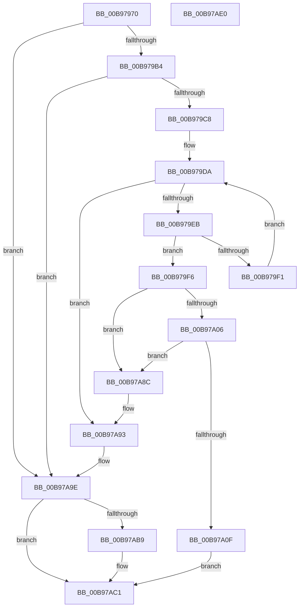

# VfPutScatterGatherList

- RVA: `0x00B97970`–`0x00B97AE1` (길이 `369` bytes)
- VA: `0x0000000140B97970`
- 실행 섹션: `PAGEVRFY`
- PDB 이름 있음: `예`; PDB Function 태그: `아니요`
- unwind 정보 RVA: `0x000847EC`
- 디코드: `102`개 명령, `369/369` bytes 표시
- 미해석 바이트: `0` (있으면 어셈블리에 `.byte`로 보존)

> 이 문서는 커널 이미지의 기계어와 PDB 기호를 분석해 생성했습니다. 4번과 5번은 함수 원형과 자료형을 바이너리 사용 방식에서 추정한 C 해석이며 원본 소스 복구 결과는 아닙니다.

## 1. Dependencies

- 직접 호출 지점: **15**; 고유 호출 대상: **12**
- 직접 호출자로 확인된 함수: **0**
- RIP 상대 이미지 참조: **1**

### Outgoing calls
- `0x00B97996` → [ViGetRealDmaAdapter](ViGetRealDmaAdapter_function_00B990DC.md) (function, `0x00B990DC`)
- `0x00B979A3` → [ViGetAdapterInformationInternal](ViGetAdapterInformationInternal_function_00B98E88.md) (function, `0x00B98E88`)
- `0x00B979B6` → [VF_ASSERT_IRQL](VF_ASSERT_IRQL_function_00B94F30.md) (function, `0x00B94F30`)
- `0x00B979CF` → [KeAcquireSpinLockRaiseToDpc](../../text/20/KeAcquireSpinLockRaiseToDpc_function_00208470.md) (function, `0x00208470`)
- `0x00B97A1C` → [KeReleaseSpinLock](../../text/39/KeReleaseSpinLock_function_00392BA0.md) (function, `0x00392BA0`)
- `0x00B97A28` → [VF_UNMARK_SCATTER_GATHER_LIST](VF_UNMARK_SCATTER_GATHER_LIST_function_00B95160.md) (function, `0x00B95160`)
- `0x00B97A3E` → [guard_dispatch_icall](../../text/6B/guard_dispatch_icall_function_006BAAD0.md) (function, `0x006BAAD0`)
- `0x00B97A48` → [SUBTRACT_MAP_REGISTERS](SUBTRACT_MAP_REGISTERS_function_00B94E10.md) (function, `0x00B94E10`)
- `0x00B97A50` → [DECREMENT_SCATTER_GATHER_LISTS](DECREMENT_SCATTER_GATHER_LISTS_function_00B94C44.md) (function, `0x00B94C44`)
- `0x00B97A6A` → [ViFlushDoubleBuffer](ViFlushDoubleBuffer_function_00B989D0.md) (function, `0x00B989D0`)
- `0x00B97A76` → [ViFreeMapRegisterFile](ViFreeMapRegisterFile_function_00B98B8C.md) (function, `0x00B98B8C`)
- `0x00B97A85` → [ExFreeToNPagedLookasideList](../../text/38/ExFreeToNPagedLookasideList_function_0038D9D0.md) (function, `0x0038D9D0`)
- `0x00B97A99` → [KeReleaseSpinLock](../../text/39/KeReleaseSpinLock_function_00392BA0.md) (function, `0x00392BA0`)
- `0x00B97AAF` → [guard_dispatch_icall](../../text/6B/guard_dispatch_icall_function_006BAAD0.md) (function, `0x006BAAD0`)
- `0x00B97ABC` → [DECREMENT_SCATTER_GATHER_LISTS](DECREMENT_SCATTER_GATHER_LISTS_function_00B94C44.md) (function, `0x00B94C44`)

### Direct callers
- 이 함수 시작 RVA로 연결되는 직접 call은 확인되지 않았습니다. 간접 호출은 완전히 역산할 수 없습니다.

### Static image references
- `0x00B97A7E` → RVA `0x00E28A80` (`.data`; read)

## 2. Other-region calls and transfers

- 다른 실행 섹션으로 향하는 call: **6**
  - `0x00B979CF` → [KeAcquireSpinLockRaiseToDpc](../../text/20/KeAcquireSpinLockRaiseToDpc_function_00208470.md) (`PAGEVRFY` → `.text`)
  - `0x00B97A1C` → [KeReleaseSpinLock](../../text/39/KeReleaseSpinLock_function_00392BA0.md) (`PAGEVRFY` → `.text`)
  - `0x00B97A3E` → [guard_dispatch_icall](../../text/6B/guard_dispatch_icall_function_006BAAD0.md) (`PAGEVRFY` → `.text`)
  - `0x00B97A85` → [ExFreeToNPagedLookasideList](../../text/38/ExFreeToNPagedLookasideList_function_0038D9D0.md) (`PAGEVRFY` → `.text`)
  - `0x00B97A99` → [KeReleaseSpinLock](../../text/39/KeReleaseSpinLock_function_00392BA0.md) (`PAGEVRFY` → `.text`)
  - `0x00B97AAF` → [guard_dispatch_icall](../../text/6B/guard_dispatch_icall_function_006BAAD0.md) (`PAGEVRFY` → `.text`)
- 별도 외부 분기/꼬리 이동을 확인하지 못했습니다.

## 3. Assembly (complete function range)

```asm
00B97970  48 8B C4                        mov rax, rsp
00B97973  48 89 58 08                     mov qword ptr [rax + 8], rbx
00B97977  48 89 68 10                     mov qword ptr [rax + 0x10], rbp
00B9797B  48 89 70 18                     mov qword ptr [rax + 0x18], rsi
00B9797F  48 89 78 20                     mov qword ptr [rax + 0x20], rdi
00B97983  41 54                           push r12
00B97985  41 56                           push r14
00B97987  41 57                           push r15
00B97989  48 83 EC 30                     sub rsp, 0x30
00B9798D  45 8A E0                        mov r12b, r8b
00B97990  4C 8B F2                        mov r14, rdx
00B97993  48 8B D9                        mov rbx, rcx
00B97996  E8 41 17 00 00                  call 0x140b990dc
00B9799B  B2 01                           mov dl, 1
00B9799D  48 8B CB                        mov rcx, rbx
00B979A0  4C 8B F8                        mov r15, rax
00B979A3  E8 E0 14 00 00                  call 0x140b98e88
00B979A8  48 8B F8                        mov rdi, rax
00B979AB  48 85 C0                        test rax, rax
00B979AE  0F 84 EA 00 00 00               je 0x140b97a9e
00B979B4  B1 02                           mov cl, 2
00B979B6  E8 75 D5 FF FF                  call 0x140b94f30
00B979BB  48 8D 77 58                     lea rsi, [rdi + 0x58]
00B979BF  48 39 36                        cmp qword ptr [rsi], rsi
00B979C2  0F 84 D6 00 00 00               je 0x140b97a9e
00B979C8  48 8D 6F 68                     lea rbp, [rdi + 0x68]
00B979CC  48 8B CD                        mov rcx, rbp
00B979CF  E8 9C 0A 67 FF                  call 0x140208470
00B979D4  48 8B 1E                        mov rbx, qword ptr [rsi]
00B979D7  44 8A C0                        mov r8b, al
00B979DA  48 83 EB 48                     sub rbx, 0x48
00B979DE  48 8D 4B 48                     lea rcx, [rbx + 0x48]
00B979E2  48 3B F1                        cmp rsi, rcx
00B979E5  0F 84 A8 00 00 00               je 0x140b97a93
00B979EB  4C 39 73 40                     cmp qword ptr [rbx + 0x40], r14
00B979EF  74 05                           je 0x140b979f6
00B979F1  48 8B 19                        mov rbx, qword ptr [rcx]
00B979F4  EB E4                           jmp 0x140b979da
00B979F6  48 8B 11                        mov rdx, qword ptr [rcx]
00B979F9  41 8B 36                        mov esi, dword ptr [r14]
00B979FC  48 39 4A 08                     cmp qword ptr [rdx + 8], rcx
00B97A00  0F 85 86 00 00 00               jne 0x140b97a8c
00B97A06  48 8B 41 08                     mov rax, qword ptr [rcx + 8]
00B97A0A  48 39 08                        cmp qword ptr [rax], rcx
00B97A0D  75 7D                           jne 0x140b97a8c
00B97A0F  48 89 10                        mov qword ptr [rax], rdx
00B97A12  48 8B CD                        mov rcx, rbp
00B97A15  48 89 42 08                     mov qword ptr [rdx + 8], rax
00B97A19  41 8A D0                        mov dl, r8b
00B97A1C  E8 7F B1 7F FF                  call 0x140392ba0
00B97A21  48 8B 53 60                     mov rdx, qword ptr [rbx + 0x60]
00B97A25  49 8B CE                        mov rcx, r14
00B97A28  E8 33 D7 FF FF                  call 0x140b95160
00B97A2D  49 8B 4F 08                     mov rcx, qword ptr [r15 + 8]
00B97A31  45 8A C4                        mov r8b, r12b
00B97A34  49 8B D6                        mov rdx, r14
00B97A37  48 8B 41 60                     mov rax, qword ptr [rcx + 0x60]
00B97A3B  49 8B CF                        mov rcx, r15
00B97A3E  E8 8D 30 B2 FF                  call 0x1406baad0
00B97A43  8B D6                           mov edx, esi
00B97A45  48 8B CF                        mov rcx, rdi
00B97A48  E8 C3 D3 FF FF                  call 0x140b94e10
00B97A4D  48 8B CF                        mov rcx, rdi
00B97A50  E8 EF D1 FF FF                  call 0x140b94c44
00B97A55  44 8B 4B 20                     mov r9d, dword ptr [rbx + 0x20]
00B97A59  4C 8B 43 18                     mov r8, qword ptr [rbx + 0x18]
00B97A5D  48 8B 53 10                     mov rdx, qword ptr [rbx + 0x10]
00B97A61  48 8B 4B 60                     mov rcx, qword ptr [rbx + 0x60]
00B97A65  44 88 64 24 20                  mov byte ptr [rsp + 0x20], r12b
00B97A6A  E8 61 0F 00 00                  call 0x140b989d0
00B97A6F  48 8B 53 60                     mov rdx, qword ptr [rbx + 0x60]
00B97A73  48 8B CF                        mov rcx, rdi
00B97A76  E8 11 11 00 00                  call 0x140b98b8c
00B97A7B  48 8B D3                        mov rdx, rbx
00B97A7E  48 8D 0D FB 0F 29 00            lea rcx, [rip + 0x290ffb]
00B97A85  E8 46 5F 7F FF                  call 0x14038d9d0
00B97A8A  EB 35                           jmp 0x140b97ac1
00B97A8C  B9 03 00 00 00                  mov ecx, 3
00B97A91  CD 29                           int 0x29
00B97A93  41 8A D0                        mov dl, r8b
00B97A96  48 8B CD                        mov rcx, rbp
00B97A99  E8 02 B1 7F FF                  call 0x140392ba0
00B97A9E  49 8B 47 08                     mov rax, qword ptr [r15 + 8]
00B97AA2  45 8A C4                        mov r8b, r12b
00B97AA5  49 8B D6                        mov rdx, r14
00B97AA8  49 8B CF                        mov rcx, r15
00B97AAB  48 8B 40 60                     mov rax, qword ptr [rax + 0x60]
00B97AAF  E8 1C 30 B2 FF                  call 0x1406baad0
00B97AB4  48 85 FF                        test rdi, rdi
00B97AB7  74 08                           je 0x140b97ac1
00B97AB9  48 8B CF                        mov rcx, rdi
00B97ABC  E8 83 D1 FF FF                  call 0x140b94c44
00B97AC1  48 8B 5C 24 50                  mov rbx, qword ptr [rsp + 0x50]
00B97AC6  48 8B 6C 24 58                  mov rbp, qword ptr [rsp + 0x58]
00B97ACB  48 8B 74 24 60                  mov rsi, qword ptr [rsp + 0x60]
00B97AD0  48 8B 7C 24 68                  mov rdi, qword ptr [rsp + 0x68]
00B97AD5  48 83 C4 30                     add rsp, 0x30
00B97AD9  41 5F                           pop r15
00B97ADB  41 5E                           pop r14
00B97ADD  41 5C                           pop r12
00B97ADF  C3                              ret
00B97AE0  CC                              int3
```

## 4. C-style interpretation (structured pseudocode)

```c
__int64 __fastcall VfPutScatterGatherList(__int64 a1, __int64 a2, unsigned __int8 a3)
{
    __int64 result;
    __int64 v_rbx;
    __int64 v_rsp;
    unsigned __int8 v_stack_m28;
    unsigned __int64 v_stack_p10;
    unsigned __int64 v_stack_p18;
    unsigned __int64 v_stack_p20;
    unsigned __int64 v_stack_p8;

    *(unsigned __int64 *)(v_rsp + 8) = v_rbx;
    *(unsigned __int64 *)(v_rsp + 16) = v_rbp;
    *(unsigned __int64 *)(v_rsp + 24) = v_rsi;
    *(unsigned __int64 *)(v_rsp + 32) = v_rdi;
    v_rsp = (v_rsp) - (48);
    result = ViGetRealDmaAdapter(a1, a2, a3, a4);
    result = ViGetAdapterInformationInternal(a1, 1, a3, a4);
    if (result == 0) goto loc_00B97A9E;
    result = VF_ASSERT_IRQL(2, 1, a3, a4);
    if ((*(unsigned __int64 *)(result + 88)) == (result + 88)) goto loc_00B97A9E;
    result = KeAcquireSpinLockRaiseToDpc(result + 104, 1, a3, a4);
loc_00B979DA:
    v_rbx = (*(unsigned __int64 *)(result + 88)) - (72);
    if ((result + 88) == (v_rbx + 72)) goto loc_00B97A93;
    if ((*(unsigned __int64 *)(v_rbx + 64)) == a2) goto loc_00B979F6;
    goto loc_00B979DA;
loc_00B979F6:
    if ((*(unsigned __int64 *)(*(unsigned __int64 *)(v_rbx + 72) + 8)) != (v_rbx + 72)) goto loc_00B97A8C;
    if ((*(unsigned __int64 *)(*(unsigned __int64 *)(v_rbx + 72 + 8))) != (v_rbx + 72)) goto loc_00B97A8C;
    *(unsigned __int64 *)(*(unsigned __int64 *)(v_rbx + 72 + 8)) = *(unsigned __int64 *)(v_rbx + 72);
    *(unsigned __int64 *)(*(unsigned __int64 *)(v_rbx + 72) + 8) = *(unsigned __int64 *)(v_rbx + 72 + 8);
    result = KeReleaseSpinLock(result + 104, (unsigned __int8)((unsigned __int8)(result)), (unsigned __int8)(result), a4);
    result = VF_UNMARK_SCATTER_GATHER_LIST(a2, *(unsigned __int64 *)(*(unsigned __int64 *)(v_rbx + 72) + 96), (unsigned __int8)(result), a4);
    result = guard_dispatch_icall(result, a2, a3, a4);
    result = SUBTRACT_MAP_REGISTERS(result, (unsigned int)((unsigned int)((unsigned int)(*(unsigned int *)(a2)))), a3, a4);
    result = DECREMENT_SCATTER_GATHER_LISTS(result, (unsigned int)((unsigned int)((unsigned int)(*(unsigned int *)(a2)))), a3, a4);
    v_stack_m28 = a3;
    result = ViFlushDoubleBuffer(*(unsigned __int64 *)(*(unsigned __int64 *)(v_rbx + 72) + 96), *(unsigned __int64 *)(*(unsigned __int64 *)(v_rbx + 72) + 16), *(unsigned __int64 *)(*(unsigned __int64 *)(v_rbx + 72) + 24), (unsigned int)(*(unsigned int *)(*(unsigned __int64 *)(v_rbx + 72) + 32)));
    result = ViFreeMapRegisterFile(result, *(unsigned __int64 *)(*(unsigned __int64 *)(v_rbx + 72) + 96), *(unsigned __int64 *)(*(unsigned __int64 *)(v_rbx + 72) + 24), (unsigned int)(*(unsigned int *)(*(unsigned __int64 *)(v_rbx + 72) + 32)));
    result = ExFreeToNPagedLookasideList(v_rip + 2691067, *(unsigned __int64 *)(v_rbx + 72), *(unsigned __int64 *)(*(unsigned __int64 *)(v_rbx + 72) + 24), (unsigned int)(*(unsigned int *)(*(unsigned __int64 *)(v_rbx + 72) + 32)));
    goto loc_00B97AC1;
loc_00B97A8C:
loc_00B97A93:
    result = KeReleaseSpinLock(result + 104, (unsigned __int8)(*(unsigned __int64 *)(*(unsigned __int64 *)(v_rbx + 72) + 24)), *(unsigned __int64 *)(*(unsigned __int64 *)(v_rbx + 72) + 24), (unsigned int)(*(unsigned int *)(*(unsigned __int64 *)(v_rbx + 72) + 32)));
loc_00B97A9E:
    result = guard_dispatch_icall(result, a2, a3, (unsigned int)(*(unsigned int *)(*(unsigned __int64 *)(v_rbx + 72) + 32)));
    if (result != 0) {
        a1 = result;
        result = DECREMENT_SCATTER_GATHER_LISTS(a1, a2, a3, (unsigned int)(*(unsigned int *)(*(unsigned __int64 *)(v_rbx + 72) + 32)));
    }
    v_rsp = (v_rsp) + (48);
    return result;
}
```

## 5. (Beta) C Style

```c
int64_t VfPutScatterGatherList(int64_t Arg1, void *Arg2, uint8_t Arg3)
{
    uint8_t *arg2 = (uint8_t *)Arg2;

    int64_t result;
    int64_t local_rbx;
    int64_t local_rsp;
    uint8_t v_stack_m28;
    uint64_t v_stack_p10;
    uint64_t v_stack_p18;
    uint64_t v_stack_p20;
    uint64_t v_stack_p8;

    *(uint64_t *)(local_rsp + 0x8) = local_rbx;
    *(uint64_t *)(local_rsp + 0x10) = local_rbp;
    *(uint64_t *)(local_rsp + 0x18) = local_rsi;
    *(uint64_t *)(local_rsp + 0x20) = local_rdi;
    local_rsp = (local_rsp) - (48);
    result = ViGetRealDmaAdapter(Arg1, Arg2, Arg3, a4);
    result = ViGetAdapterInformationInternal(Arg1, 1, Arg3, a4);
    if (result == 0) goto loc_00B97A9E;
    result = VF_ASSERT_IRQL(2, 1, Arg3, a4);
    if ((*(uint64_t *)(result + 0x58)) == (result + 88)) goto loc_00B97A9E;
    result = KeAcquireSpinLockRaiseToDpc(result + 104, 1, Arg3, a4);
loc_00B979DA:
    local_rbx = (*(uint64_t *)(result + 0x58)) - (72);
    if ((result + 88) == (local_rbx + 72)) goto loc_00B97A93;
    if ((*(uint64_t *)(local_rbx + 0x40)) == Arg2) goto loc_00B979F6;
    goto loc_00B979DA;
loc_00B979F6:
    if ((*(uint64_t *)(*(uint64_t *)(local_rbx + 0x48) + 0x8)) != (local_rbx + 72)) goto loc_00B97A8C;
    if ((*(uint64_t *)(*(uint64_t *)(local_rbx + 0x48 + 0x8))) != (local_rbx + 72)) goto loc_00B97A8C;
    *(uint64_t *)(*(uint64_t *)(local_rbx + 0x48 + 0x8)) = *(uint64_t *)(local_rbx + 0x48);
    *(uint64_t *)(*(uint64_t *)(local_rbx + 0x48) + 0x8) = *(uint64_t *)(local_rbx + 0x48 + 0x8);
    result = KeReleaseSpinLock(result + 104, (uint8_t)((uint8_t)(result)), (uint8_t)(result), a4);
    result = VF_UNMARK_SCATTER_GATHER_LIST(Arg2, *(uint64_t *)(*(uint64_t *)(local_rbx + 0x48) + 0x60), (uint8_t)(result), a4);
    result = guard_dispatch_icall(result, Arg2, Arg3, a4);
    result = SUBTRACT_MAP_REGISTERS(result, (uint32_t)((uint32_t)((uint32_t)(*(uint32_t *)(arg2)))), Arg3, a4);
    result = DECREMENT_SCATTER_GATHER_LISTS(result, (uint32_t)((uint32_t)((uint32_t)(*(uint32_t *)(arg2)))), Arg3, a4);
    v_stack_m28 = Arg3;
    result = ViFlushDoubleBuffer(*(uint64_t *)(*(uint64_t *)(local_rbx + 0x48) + 0x60), *(uint64_t *)(*(uint64_t *)(local_rbx + 0x48) + 0x10), *(uint64_t *)(*(uint64_t *)(local_rbx + 0x48) + 0x18), (uint32_t)(*(uint32_t *)(*(uint64_t *)(local_rbx + 0x48) + 0x20)));
    result = ViFreeMapRegisterFile(result, *(uint64_t *)(*(uint64_t *)(local_rbx + 0x48) + 0x60), *(uint64_t *)(*(uint64_t *)(local_rbx + 0x48) + 0x18), (uint32_t)(*(uint32_t *)(*(uint64_t *)(local_rbx + 0x48) + 0x20)));
    result = ExFreeToNPagedLookasideList(v_rip + 2691067, *(uint64_t *)(local_rbx + 0x48), *(uint64_t *)(*(uint64_t *)(local_rbx + 0x48) + 0x18), (uint32_t)(*(uint32_t *)(*(uint64_t *)(local_rbx + 0x48) + 0x20)));
    goto loc_00B97AC1;
loc_00B97A8C:
loc_00B97A93:
    result = KeReleaseSpinLock(result + 104, (uint8_t)(*(uint64_t *)(*(uint64_t *)(local_rbx + 0x48) + 0x18)), *(uint64_t *)(*(uint64_t *)(local_rbx + 0x48) + 0x18), (uint32_t)(*(uint32_t *)(*(uint64_t *)(local_rbx + 0x48) + 0x20)));
loc_00B97A9E:
    result = guard_dispatch_icall(result, Arg2, Arg3, (uint32_t)(*(uint32_t *)(*(uint64_t *)(local_rbx + 0x48) + 0x20)));
    if (result != 0) {
        Arg1 = result;
        result = DECREMENT_SCATTER_GATHER_LISTS(Arg1, Arg2, Arg3, (uint32_t)(*(uint32_t *)(*(uint64_t *)(local_rbx + 0x48) + 0x20)));
    }
    local_rsp = (local_rsp) + (48);
    return result;
}
```

### 관측된 메모리 오프셋

구조체 형식이 확인되지 않은 접근은 인자 기준의 오프셋으로만 기록했습니다.

| 기준 인자 | 오프셋 표현 | 폭 (bit) | 접근 |
|---|---:|---:|---|
| `Arg2` | `+ 0x0` | `32` | `R` |

## 6. Execution-region graph

[열기: 2D/3D 그래프와 함수 탐색 컨트롤 패널](../../../control-panel.html?section=pagevrfy&rva=0x00B97970&view=graph)

- 2D 그래프는 위에서 아래로 흐르고, 3D 그래프는 빈 공간을 드래그해 회전합니다. Shift+드래그는 이동, 휠은 확대·축소, 함수 노드 선택은 대상 보고서 이동입니다.

### Static fallback


