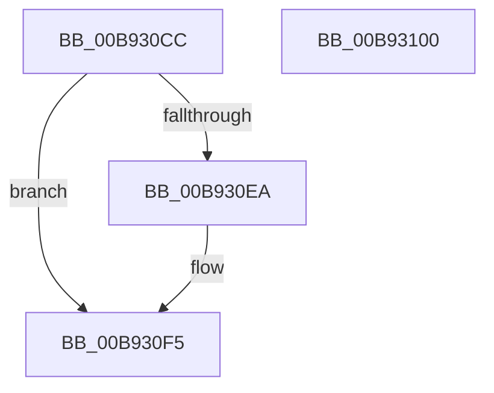

# VfRandomGetNumber

- RVA: `0x00B930CC`–`0x00B93101` (길이 `53` bytes)
- VA: `0x0000000140B930CC`
- 실행 섹션: `PAGEVRFY`
- PDB 이름 있음: `예`; PDB Function 태그: `아니요`
- unwind 정보 RVA: `0x0005CAAC`
- 디코드: `19`개 명령, `53/53` bytes 표시
- 미해석 바이트: `0` (있으면 어셈블리에 `.byte`로 보존)

> 이 문서는 커널 이미지의 기계어와 PDB 기호를 분석해 생성했습니다. 4번과 5번은 함수 원형과 자료형을 바이너리 사용 방식에서 추정한 C 해석이며 원본 소스 복구 결과는 아닙니다.

## 1. Dependencies

- 직접 호출 지점: **1**; 고유 호출 대상: **1**
- 직접 호출자로 확인된 함수: **4**
- RIP 상대 이미지 참조: **1**

### Outgoing calls
- `0x00B930E1` → [RtlRandomEx](../../text/41/RtlRandomEx_function_0041AFE0.md) (function, `0x0041AFE0`)

### Direct callers
- [VfPendingShouldForce](../BA/VfPendingShouldForce_function_00BA1BB8.md) at `0x00BA1C2C`
- [VfFaultsInjectResourceFailure](../BA/VfFaultsInjectResourceFailure_function_00BA6558.md) at `0x00BA65DC`
- [DifpLwSPProcessPrePoolAlloc](../BB/DifpLwSPProcessPrePoolAlloc_function_00BB4254.md) at `0x00BB42B1`
- [DifpLwSPProcessPrePoolAlloc](../BB/DifpLwSPProcessPrePoolAlloc_function_00BB4254.md) at `0x00BB42BF`
- [ViInitPickRandomTargets](../../init/C4/ViInitPickRandomTargets_function_00C4C064.md) at `0x00C4C0EA`

### Static image references
- `0x00B930DA` → RVA `0x00FFDBA4` (`PAGEVRFD`; read)

## 2. Other-region calls and transfers

- 다른 실행 섹션으로 향하는 call: **1**
  - `0x00B930E1` → [RtlRandomEx](../../text/41/RtlRandomEx_function_0041AFE0.md) (`PAGEVRFY` → `.text`)
- 별도 외부 분기/꼬리 이동을 확인하지 못했습니다.

## 3. Assembly (complete function range)

```asm
00B930CC  48 89 5C 24 08                  mov qword ptr [rsp + 8], rbx
00B930D1  57                              push rdi
00B930D2  48 83 EC 20                     sub rsp, 0x20
00B930D6  8B F9                           mov edi, ecx
00B930D8  8B DA                           mov ebx, edx
00B930DA  48 8D 0D C3 AA 46 00            lea rcx, [rip + 0x46aac3]
00B930E1  E8 FA 7E 88 FF                  call 0x14041afe0
00B930E6  3B DF                           cmp ebx, edi
00B930E8  72 0B                           jb 0x140b930f5
00B930EA  2B DF                           sub ebx, edi
00B930EC  33 D2                           xor edx, edx
00B930EE  FF C3                           inc ebx
00B930F0  F7 F3                           div ebx
00B930F2  8D 04 17                        lea eax, [rdi + rdx]
00B930F5  48 8B 5C 24 30                  mov rbx, qword ptr [rsp + 0x30]
00B930FA  48 83 C4 20                     add rsp, 0x20
00B930FE  5F                              pop rdi
00B930FF  C3                              ret
00B93100  CC                              int3
```

## 4. C-style interpretation (structured pseudocode)

```c
__int64 __fastcall VfRandomGetNumber(int a1, int a2)
{
    __int64 result;
    __int64 v_rbx;
    __int64 v_rsp;
    unsigned __int64 v_stack_p8;

    v_stack_p8 = v_rbx;
    v_rsp = (v_rsp) - (32);
    result = RtlRandomEx(v_rip + 4631235, a2, a3, a4);
    v_rbx = (unsigned int)(a2);
    if (((unsigned int)((unsigned int)(a2))) >= ((unsigned int)((unsigned int)(a1)))) {
        v_rbx = (unsigned int)(((unsigned int)(a2)) - ((unsigned int)((unsigned int)(a1))));
        a2 = 0;
        v_rbx = (unsigned int)((v_rbx) + 1);
        result = (unsigned int)(a1) + a2 * 1;
    }
    v_rsp = (v_rsp) + (32);
    return result;
}
```

## 5. (Beta) C Style

```c
int64_t VfRandomGetNumber(void *Arg1, int32_t Arg2)
{
    uint8_t *arg1 = (uint8_t *)Arg1;

    int64_t result;
    int64_t local_rbx;
    int64_t local_rsp;
    uint64_t v_stack_p8;

    v_stack_p8 = local_rbx;
    local_rsp = (local_rsp) - (32);
    result = RtlRandomEx(v_rip + 4631235, Arg2, a3, a4);
    local_rbx = (uint32_t)(Arg2);
    if (((uint32_t)((uint32_t)(Arg2))) >= ((uint32_t)((uint32_t)(Arg1)))) {
        local_rbx = (uint32_t)(((uint32_t)(Arg2)) - ((uint32_t)((uint32_t)(Arg1))));
        Arg2 = 0;
        local_rbx = (uint32_t)((local_rbx) + 1);
        result = (uint32_t)(Arg1) + Arg2 * 1;
    }
    local_rsp = (local_rsp) + (32);
    return result;
}
```

### 관측된 메모리 오프셋

구조체 형식이 확인되지 않은 접근은 인자 기준의 오프셋으로만 기록했습니다.

| 기준 인자 | 오프셋 표현 | 폭 (bit) | 접근 |
|---|---:|---:|---|
| `Arg1` | `+ 0x0 + rdx*1` | `32` | `R` |

## 6. Execution-region graph

[열기: 2D/3D 그래프와 함수 탐색 컨트롤 패널](../../../control-panel.html?section=pagevrfy&rva=0x00B930CC&view=graph)

- 2D 그래프는 위에서 아래로 흐르고, 3D 그래프는 빈 공간을 드래그해 회전합니다. Shift+드래그는 이동, 휠은 확대·축소, 함수 노드 선택은 대상 보고서 이동입니다.

### Static fallback


