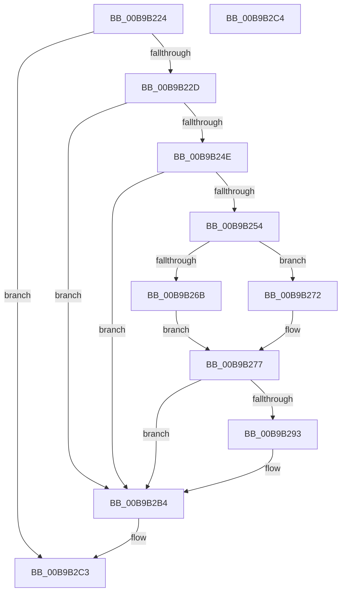

# VfTargetDriversAllocateFullName

- RVA: `0x00B9B224`–`0x00B9B2C5` (길이 `161` bytes)
- VA: `0x0000000140B9B224`
- 실행 섹션: `PAGEVRFY`
- PDB 이름 있음: `예`; PDB Function 태그: `아니요`
- unwind 정보 RVA: `0x000D23DC`
- 디코드: `45`개 명령, `161/161` bytes 표시
- 미해석 바이트: `0` (있으면 어셈블리에 `.byte`로 보존)

> 이 문서는 커널 이미지의 기계어와 PDB 기호를 분석해 생성했습니다. 4번과 5번은 함수 원형과 자료형을 바이너리 사용 방식에서 추정한 C 해석이며 원본 소스 복구 결과는 아닙니다.

## 1. Dependencies

- 직접 호출 지점: **3**; 고유 호출 대상: **3**
- 직접 호출자로 확인된 함수: **1**
- RIP 상대 이미지 참조: **0**

### Outgoing calls
- `0x00B9B25F` → [RtlUShortAdd](../../text/47/RtlUShortAdd_function_00474F70.md) (function, `0x00474F70`)
- `0x00B9B285` → [ExAllocatePool2](../../poolcode/B8/ExAllocatePool2_function_00B820F0.md) (function, `0x00B820F0`)
- `0x00B9B2AF` → [memcpy](../../text/6C/memcpy_function_006C6840.md) (function, `0x006C6840`)

### Direct callers
- [VfSuspectDriversLoadCallback](../BA/VfSuspectDriversLoadCallback_function_00BAAB2C.md) at `0x00BAADDD`

### Static image references
- 디코드된 RIP-relative 메모리 참조가 없습니다.

## 2. Other-region calls and transfers

- 다른 실행 섹션으로 향하는 call: **3**
  - `0x00B9B25F` → [RtlUShortAdd](../../text/47/RtlUShortAdd_function_00474F70.md) (`PAGEVRFY` → `.text`)
  - `0x00B9B285` → [ExAllocatePool2](../../poolcode/B8/ExAllocatePool2_function_00B820F0.md) (`PAGEVRFY` → `POOLCODE`)
  - `0x00B9B2AF` → [memcpy](../../text/6C/memcpy_function_006C6840.md) (`PAGEVRFY` → `.text`)
- 별도 외부 분기/꼬리 이동을 확인하지 못했습니다.

## 3. Assembly (complete function range)

```asm
00B9B224  48 85 C9                        test rcx, rcx
00B9B227  0F 84 96 00 00 00               je 0x140b9b2c3
00B9B22D  48 8B C4                        mov rax, rsp
00B9B230  48 89 58 10                     mov qword ptr [rax + 0x10], rbx
00B9B234  48 89 70 18                     mov qword ptr [rax + 0x18], rsi
00B9B238  57                              push rdi
00B9B239  48 83 EC 20                     sub rsp, 0x20
00B9B23D  33 F6                           xor esi, esi
00B9B23F  48 8B DA                        mov rbx, rdx
00B9B242  66 89 70 08                     mov word ptr [rax + 8], si
00B9B246  48 8B F9                        mov rdi, rcx
00B9B249  48 85 D2                        test rdx, rdx
00B9B24C  74 66                           je 0x140b9b2b4
00B9B24E  48 39 71 20                     cmp qword ptr [rcx + 0x20], rsi
00B9B252  75 60                           jne 0x140b9b2b4
00B9B254  0F B7 4B 48                     movzx ecx, word ptr [rbx + 0x48]
00B9B258  8D 56 02                        lea edx, [rsi + 2]
00B9B25B  4C 8D 40 08                     lea r8, [rax + 8]
00B9B25F  E8 0C 9D 8D FF                  call 0x140474f70
00B9B264  3D 95 00 00 C0                  cmp eax, 0xc0000095
00B9B269  75 07                           jne 0x140b9b272
00B9B26B  B8 FF FF 00 00                  mov eax, 0xffff
00B9B270  EB 05                           jmp 0x140b9b277
00B9B272  0F B7 44 24 30                  movzx eax, word ptr [rsp + 0x30]
00B9B277  0F B7 D0                        movzx edx, ax
00B9B27A  B9 40 00 00 00                  mov ecx, 0x40
00B9B27F  41 B8 56 66 53 44               mov r8d, 0x44536656
00B9B285  E8 66 6E FE FF                  call 0x140b820f0
00B9B28A  48 89 47 20                     mov qword ptr [rdi + 0x20], rax
00B9B28E  48 85 C0                        test rax, rax
00B9B291  74 21                           je 0x140b9b2b4
00B9B293  0F B7 4B 48                     movzx ecx, word ptr [rbx + 0x48]
00B9B297  66 89 4F 18                     mov word ptr [rdi + 0x18], cx
00B9B29B  0F B7 4B 4A                     movzx ecx, word ptr [rbx + 0x4a]
00B9B29F  66 89 4F 1A                     mov word ptr [rdi + 0x1a], cx
00B9B2A3  48 8B C8                        mov rcx, rax
00B9B2A6  44 0F B7 43 48                  movzx r8d, word ptr [rbx + 0x48]
00B9B2AB  48 8B 53 50                     mov rdx, qword ptr [rbx + 0x50]
00B9B2AF  E8 8C B5 B2 FF                  call 0x1406c6840
00B9B2B4  48 8B 5C 24 38                  mov rbx, qword ptr [rsp + 0x38]
00B9B2B9  48 8B 74 24 40                  mov rsi, qword ptr [rsp + 0x40]
00B9B2BE  48 83 C4 20                     add rsp, 0x20
00B9B2C2  5F                              pop rdi
00B9B2C3  C3                              ret
00B9B2C4  CC                              int3
```

## 4. C-style interpretation (structured pseudocode)

```c
__int64 __fastcall VfTargetDriversAllocateFullName(__int64 a1, __int64 a2)
{
    __int64 result;
    __int64 v_rsi;
    __int64 v_rsp;
    unsigned __int64 v_stack_p10;
    unsigned __int64 v_stack_p18;
    unsigned __int16 v_stack_p8;

    if (a1 == 0) goto loc_00B9B2C3;
    *(unsigned __int64 *)(v_rsp + 16) = v_rbx;
    *(unsigned __int64 *)(v_rsp + 24) = v_rsi;
    v_rsp = (v_rsp) - (32);
    v_rsi = 0;
    *(unsigned __int16 *)(v_rsp + 8) = 0;
    if (a2 == 0) goto loc_00B9B2B4;
    if ((*(unsigned __int64 *)(a1 + 32)) != 0) goto loc_00B9B2B4;
    result = RtlUShortAdd(*(unsigned __int16 *)(a2 + 72), v_rsi + 2, v_rsp + 8, a4);
    if (((unsigned int)(result)) != 0xC0000095ULL) goto loc_00B9B272;
    goto loc_00B9B277;
loc_00B9B272:
loc_00B9B277:
    result = ExAllocatePool2(64, (unsigned __int16)(v_stack_p8), (unsigned int)(0x44536656ULL), a4);
    *(unsigned __int64 *)(a1 + 32) = result;
    if (result != 0) {
        a1 = *(unsigned __int16 *)(a2 + 72);
        *(unsigned __int16 *)(a1 + 24) = (unsigned __int16)(a1);
        a1 = *(unsigned __int16 *)(a2 + 74);
        *(unsigned __int16 *)(a1 + 26) = (unsigned __int16)(a1);
        a1 = result;
        a3 = *(unsigned __int16 *)(a2 + 72);
        a2 = *(unsigned __int64 *)(a2 + 80);
        result = memcpy(a1, a2, a3, a4);
    }
    v_rsp = (v_rsp) + (32);
loc_00B9B2C3:
    return result;
}
```

## 5. (Beta) C Style

```c
int64_t VfTargetDriversAllocateFullName(int64_t Arg1, void *Arg2)
{
    uint8_t *arg2 = (uint8_t *)Arg2;

    int64_t result;
    int64_t local_rsi;
    int64_t local_rsp;
    uint64_t v_stack_p10;
    uint64_t v_stack_p18;
    uint16_t v_stack_p8;

    if (Arg1 == 0) goto loc_00B9B2C3;
    *(uint64_t *)(local_rsp + 0x10) = local_rbx;
    *(uint64_t *)(local_rsp + 0x18) = local_rsi;
    local_rsp = (local_rsp) - (32);
    local_rsi = 0;
    *(uint16_t *)(local_rsp + 0x8) = 0;
    if (Arg2 == NULL) goto loc_00B9B2B4;
    if ((*(uint64_t *)(Arg1 + 0x20)) != 0) goto loc_00B9B2B4;
    result = RtlUShortAdd(*(uint16_t *)(arg2 + 0x48), local_rsi + 2, local_rsp + 8, a4);
    if (((uint32_t)(result)) != 0xC0000095ULL) goto loc_00B9B272;
    goto loc_00B9B277;
loc_00B9B272:
loc_00B9B277:
    result = ExAllocatePool2(64, (uint16_t)(v_stack_p8), (uint32_t)(0x44536656ULL), a4);
    *(uint64_t *)(Arg1 + 0x20) = result;
    if (result != 0) {
        Arg1 = *(uint16_t *)(arg2 + 0x48);
        *(uint16_t *)(Arg1 + 0x18) = (uint16_t)(Arg1);
        Arg1 = *(uint16_t *)(arg2 + 0x4A);
        *(uint16_t *)(Arg1 + 0x1A) = (uint16_t)(Arg1);
        Arg1 = result;
        a3 = *(uint16_t *)(arg2 + 0x48);
        Arg2 = *(uint64_t *)(arg2 + 0x50);
        result = memcpy(Arg1, Arg2, a3, a4);
    }
    local_rsp = (local_rsp) + (32);
loc_00B9B2C3:
    return result;
}
```

### 관측된 메모리 오프셋

구조체 형식이 확인되지 않은 접근은 인자 기준의 오프셋으로만 기록했습니다.

| 기준 인자 | 오프셋 표현 | 폭 (bit) | 접근 |
|---|---:|---:|---|
| `Arg2` | `+ 0x48` | `16` | `R` |
| `Arg2` | `+ 0x4A` | `16` | `R` |
| `Arg2` | `+ 0x50` | `64` | `R` |

## 6. Execution-region graph

[열기: 2D/3D 그래프와 함수 탐색 컨트롤 패널](../../../control-panel.html?section=pagevrfy&rva=0x00B9B224&view=graph)

- 2D 그래프는 위에서 아래로 흐르고, 3D 그래프는 빈 공간을 드래그해 회전합니다. Shift+드래그는 이동, 휠은 확대·축소, 함수 노드 선택은 대상 보고서 이동입니다.

### Static fallback


