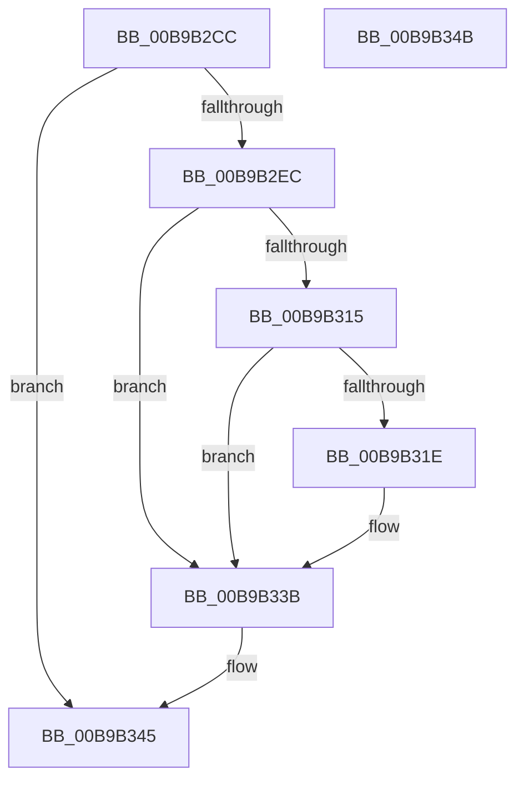

# VfTargetDriversDisableVerifier

- RVA: `0x00B9B2CC`–`0x00B9B34C` (길이 `128` bytes)
- VA: `0x0000000140B9B2CC`
- 실행 섹션: `PAGEVRFY`
- PDB 이름 있음: `예`; PDB Function 태그: `아니요`
- unwind 정보 RVA: `0x000697A4`
- 디코드: `34`개 명령, `128/128` bytes 표시
- 미해석 바이트: `0` (있으면 어셈블리에 `.byte`로 보존)

> 이 문서는 커널 이미지의 기계어와 PDB 기호를 분석해 생성했습니다. 4번과 5번은 함수 원형과 자료형을 바이너리 사용 방식에서 추정한 C 해석이며 원본 소스 복구 결과는 아닙니다.

## 1. Dependencies

- 직접 호출 지점: **5**; 고유 호출 대상: **5**
- 직접 호출자로 확인된 함수: **2**
- RIP 상대 이미지 참조: **3**

### Outgoing calls
- `0x00B9B2F3` → [VfAvlInitializeLockContext](../../text/4A/VfAvlInitializeLockContext_function_004A686C.md) (function, `0x004A686C`)
- `0x00B9B308` → [VfAvlLookupTreeNode](../../text/3E/VfAvlLookupTreeNode_function_003EF1B4.md) (function, `0x003EF1B4`)
- `0x00B9B322` → [DifRemovePerDriverDataForPlugins](../../text/61/DifRemovePerDriverDataForPlugins_function_00619AF0.md) (function, `0x00619AF0`)
- `0x00B9B32B` → [ViTargetDriversFreeVerifiedData](../../text/61/ViTargetDriversFreeVerifiedData_function_00613354.md) (function, `0x00613354`)
- `0x00B9B340` → [VfAvlCleanupLockContext](../../text/3E/VfAvlCleanupLockContext_function_003EF56C.md) (function, `0x003EF56C`)

### Direct callers
- [VfSuspectApplyDifVolatileVerification](../BA/VfSuspectApplyDifVolatileVerification_function_00BAA558.md) at `0x00BAA5D7`
- [VfSuspectRemoveDifVolatileVerification](../BA/VfSuspectRemoveDifVolatileVerification_function_00BAB128.md) at `0x00BAB157`

### Static image references
- `0x00B9B2D7` → RVA `0x00F044C0` (`.data`; read)
- `0x00B9B301` → RVA `0x00F049A0` (`.data`; read)
- `0x00B9B335` → RVA `0x00F049C0` (`.data`; read/write)

## 2. Other-region calls and transfers

- 다른 실행 섹션으로 향하는 call: **5**
  - `0x00B9B2F3` → [VfAvlInitializeLockContext](../../text/4A/VfAvlInitializeLockContext_function_004A686C.md) (`PAGEVRFY` → `.text`)
  - `0x00B9B308` → [VfAvlLookupTreeNode](../../text/3E/VfAvlLookupTreeNode_function_003EF1B4.md) (`PAGEVRFY` → `.text`)
  - `0x00B9B322` → [DifRemovePerDriverDataForPlugins](../../text/61/DifRemovePerDriverDataForPlugins_function_00619AF0.md) (`PAGEVRFY` → `.text`)
  - `0x00B9B32B` → [ViTargetDriversFreeVerifiedData](../../text/61/ViTargetDriversFreeVerifiedData_function_00613354.md) (`PAGEVRFY` → `.text`)
  - `0x00B9B340` → [VfAvlCleanupLockContext](../../text/3E/VfAvlCleanupLockContext_function_003EF56C.md) (`PAGEVRFY` → `.text`)
- 별도 외부 분기/꼬리 이동을 확인하지 못했습니다.

## 3. Assembly (complete function range)

```asm
00B9B2CC  40 53                           push rbx
00B9B2CE  48 83 EC 40                     sub rsp, 0x40
00B9B2D2  33 C0                           xor eax, eax
00B9B2D4  0F 57 C0                        xorps xmm0, xmm0
00B9B2D7  39 05 E3 91 36 00               cmp dword ptr [rip + 0x3691e3], eax
00B9B2DD  4C 8B C1                        mov r8, rcx
00B9B2E0  0F 11 44 24 20                  movups xmmword ptr [rsp + 0x20], xmm0
00B9B2E5  48 89 44 24 30                  mov qword ptr [rsp + 0x30], rax
00B9B2EA  75 59                           jne 0x140b9b345
00B9B2EC  33 D2                           xor edx, edx
00B9B2EE  48 8D 4C 24 20                  lea rcx, [rsp + 0x20]
00B9B2F3  E8 74 B5 90 FF                  call 0x1404a686c
00B9B2F8  44 8D 4A 01                     lea r9d, [rdx + 1]
00B9B2FC  48 8D 54 24 20                  lea rdx, [rsp + 0x20]
00B9B301  48 8D 0D 98 96 36 00            lea rcx, [rip + 0x369698]
00B9B308  E8 A7 3E 85 FF                  call 0x1403ef1b4
00B9B30D  48 8B D8                        mov rbx, rax
00B9B310  48 85 C0                        test rax, rax
00B9B313  74 26                           je 0x140b9b33b
00B9B315  48 8B 48 40                     mov rcx, qword ptr [rax + 0x40]
00B9B319  48 85 C9                        test rcx, rcx
00B9B31C  74 1D                           je 0x140b9b33b
00B9B31E  48 83 C1 60                     add rcx, 0x60
00B9B322  E8 C9 E7 A7 FF                  call 0x140619af0
00B9B327  48 8B 4B 40                     mov rcx, qword ptr [rbx + 0x40]
00B9B32B  E8 24 80 A7 FF                  call 0x140613354
00B9B330  48 83 63 40 00                  and qword ptr [rbx + 0x40], 0
00B9B335  FF 0D 85 96 36 00               dec dword ptr [rip + 0x369685]
00B9B33B  48 8D 4C 24 20                  lea rcx, [rsp + 0x20]
00B9B340  E8 27 42 85 FF                  call 0x1403ef56c
00B9B345  48 83 C4 40                     add rsp, 0x40
00B9B349  5B                              pop rbx
00B9B34A  C3                              ret
00B9B34B  CC                              int3
```

## 4. C-style interpretation (structured pseudocode)

```c
__int64 __fastcall VfTargetDriversDisableVerifier(__int64 a1, int a2)
{
    __int64 result;
    __int64 v_rsp;
    unsigned __int64 v_stack_m18;
    unsigned __int64 v_stack_m28;

    v_rsp = (v_rsp) - (64);
    result = 0;
    v_stack_m28 = v_xmm0;
    v_stack_m18 = 0;
    if ((*(unsigned int *)(v_rip + 3576291)) != 0) goto loc_00B9B345;
    a2 = 0;
    result = VfAvlInitializeLockContext(v_stack_m28, a2, a1, a4);
    result = VfAvlLookupTreeNode(v_rip + 3577496, v_stack_m28, a1, a2 + 1);
    if (result == 0) goto loc_00B9B33B;
    if (*(unsigned __int64 *)(result + 64) != 0) {
        a1 = (*(unsigned __int64 *)(result + 64)) + (96);
        result = DifRemovePerDriverDataForPlugins(a1, v_stack_m28, a1, a2 + 1);
        a1 = *(unsigned __int64 *)(result + 64);
        result = ViTargetDriversFreeVerifiedData(a1, v_stack_m28, a1, a2 + 1);
    }
    result = VfAvlCleanupLockContext(v_stack_m28, v_stack_m28, a1, a2 + 1);
loc_00B9B345:
    v_rsp = (v_rsp) + (64);
    return result;
}
```

## 5. (Beta) C Style

```c
int64_t VfTargetDriversDisableVerifier(int64_t Arg1, int32_t Arg2)
{
    int64_t result;
    int64_t local_rsp;
    uint64_t v_stack_m18;
    uint64_t v_stack_m28;

    local_rsp = (local_rsp) - (64);
    result = 0;
    v_stack_m28 = v_xmm0;
    v_stack_m18 = 0;
    if ((*(uint32_t *)(v_rip + 0x3691E3)) != 0) goto loc_00B9B345;
    Arg2 = 0;
    result = VfAvlInitializeLockContext(v_stack_m28, Arg2, Arg1, a4);
    result = VfAvlLookupTreeNode(v_rip + 3577496, v_stack_m28, Arg1, Arg2 + 1);
    if (result == 0) goto loc_00B9B33B;
    if (*(uint64_t *)(result + 0x40) != 0) {
        Arg1 = (*(uint64_t *)(result + 0x40)) + (96);
        result = DifRemovePerDriverDataForPlugins(Arg1, v_stack_m28, Arg1, Arg2 + 1);
        Arg1 = *(uint64_t *)(result + 0x40);
        result = ViTargetDriversFreeVerifiedData(Arg1, v_stack_m28, Arg1, Arg2 + 1);
    }
    result = VfAvlCleanupLockContext(v_stack_m28, v_stack_m28, Arg1, Arg2 + 1);
loc_00B9B345:
    local_rsp = (local_rsp) + (64);
    return result;
}
```

## 6. Execution-region graph

[열기: 2D/3D 그래프와 함수 탐색 컨트롤 패널](../../../control-panel.html?section=pagevrfy&rva=0x00B9B2CC&view=graph)

- 2D 그래프는 위에서 아래로 흐르고, 3D 그래프는 빈 공간을 드래그해 회전합니다. Shift+드래그는 이동, 휠은 확대·축소, 함수 노드 선택은 대상 보고서 이동입니다.

### Static fallback


