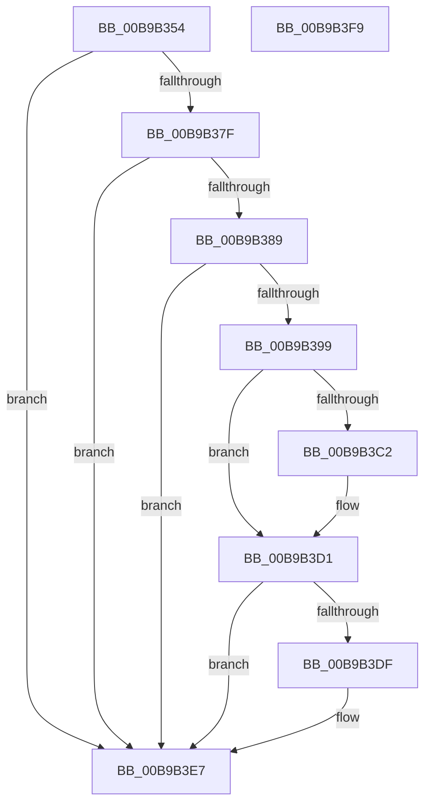

# VfTargetDriversEnableVerifier

- RVA: `0x00B9B354`–`0x00B9B3FA` (길이 `166` bytes)
- VA: `0x0000000140B9B354`
- 실행 섹션: `PAGEVRFY`
- PDB 이름 있음: `예`; PDB Function 태그: `아니요`
- unwind 정보 RVA: `0x00086C28`
- 디코드: `46`개 명령, `166/166` bytes 표시
- 미해석 바이트: `0` (있으면 어셈블리에 `.byte`로 보존)

> 이 문서는 커널 이미지의 기계어와 PDB 기호를 분석해 생성했습니다. 4번과 5번은 함수 원형과 자료형을 바이너리 사용 방식에서 추정한 C 해석이며 원본 소스 복구 결과는 아닙니다.

## 1. Dependencies

- 직접 호출 지점: **5**; 고유 호출 대상: **5**
- 직접 호출자로 확인된 함수: **1**
- RIP 상대 이미지 참조: **4**

### Outgoing calls
- `0x00B9B38C` → [ViTargetDriversAllocateVerifiedData](ViTargetDriversAllocateVerifiedData_function_00B9B984.md) (function, `0x00B9B984`)
- `0x00B9B3A0` → [VfAvlInitializeLockContext](../../text/4A/VfAvlInitializeLockContext_function_004A686C.md) (function, `0x004A686C`)
- `0x00B9B3B8` → [VfAvlLookupTreeNode](../../text/3E/VfAvlLookupTreeNode_function_003EF1B4.md) (function, `0x003EF1B4`)
- `0x00B9B3D6` → [VfAvlCleanupLockContext](../../text/3E/VfAvlCleanupLockContext_function_003EF56C.md) (function, `0x003EF56C`)
- `0x00B9B3E2` → [ViTargetDriversFreeVerifiedData](../../text/61/ViTargetDriversFreeVerifiedData_function_00613354.md) (function, `0x00613354`)

### Direct callers
- [VfSuspectApplyDifVolatileVerification](../BA/VfSuspectApplyDifVolatileVerification_function_00BAA558.md) at `0x00BAA581`

### Static image references
- `0x00B9B367` → RVA `0x00F044C0` (`.data`; read)
- `0x00B9B37F` → RVA `0x00F04954` (`.data`; read)
- `0x00B9B3B1` → RVA `0x00F049A0` (`.data`; read)
- `0x00B9B3CB` → RVA `0x00F049C0` (`.data`; read/write)

## 2. Other-region calls and transfers

- 다른 실행 섹션으로 향하는 call: **4**
  - `0x00B9B3A0` → [VfAvlInitializeLockContext](../../text/4A/VfAvlInitializeLockContext_function_004A686C.md) (`PAGEVRFY` → `.text`)
  - `0x00B9B3B8` → [VfAvlLookupTreeNode](../../text/3E/VfAvlLookupTreeNode_function_003EF1B4.md) (`PAGEVRFY` → `.text`)
  - `0x00B9B3D6` → [VfAvlCleanupLockContext](../../text/3E/VfAvlCleanupLockContext_function_003EF56C.md) (`PAGEVRFY` → `.text`)
  - `0x00B9B3E2` → [ViTargetDriversFreeVerifiedData](../../text/61/ViTargetDriversFreeVerifiedData_function_00613354.md) (`PAGEVRFY` → `.text`)
- 별도 외부 분기/꼬리 이동을 확인하지 못했습니다.

## 3. Assembly (complete function range)

```asm
00B9B354  48 89 5C 24 08                  mov qword ptr [rsp + 8], rbx
00B9B359  48 89 74 24 10                  mov qword ptr [rsp + 0x10], rsi
00B9B35E  57                              push rdi
00B9B35F  48 83 EC 40                     sub rsp, 0x40
00B9B363  33 C0                           xor eax, eax
00B9B365  33 DB                           xor ebx, ebx
00B9B367  39 05 53 91 36 00               cmp dword ptr [rip + 0x369153], eax
00B9B36D  0F 57 C0                        xorps xmm0, xmm0
00B9B370  48 8B F1                        mov rsi, rcx
00B9B373  48 89 44 24 30                  mov qword ptr [rsp + 0x30], rax
00B9B378  0F 11 44 24 20                  movups xmmword ptr [rsp + 0x20], xmm0
00B9B37D  75 68                           jne 0x140b9b3e7
00B9B37F  8B 05 CF 95 36 00               mov eax, dword ptr [rip + 0x3695cf]
00B9B385  85 C0                           test eax, eax
00B9B387  74 5E                           je 0x140b9b3e7
00B9B389  48 8B CA                        mov rcx, rdx
00B9B38C  E8 F3 05 00 00                  call 0x140b9b984
00B9B391  48 8B F8                        mov rdi, rax
00B9B394  48 85 C0                        test rax, rax
00B9B397  74 4E                           je 0x140b9b3e7
00B9B399  33 D2                           xor edx, edx
00B9B39B  48 8D 4C 24 20                  lea rcx, [rsp + 0x20]
00B9B3A0  E8 C7 B4 90 FF                  call 0x1404a686c
00B9B3A5  44 8D 4B 01                     lea r9d, [rbx + 1]
00B9B3A9  4C 8B C6                        mov r8, rsi
00B9B3AC  48 8D 54 24 20                  lea rdx, [rsp + 0x20]
00B9B3B1  48 8D 0D E8 95 36 00            lea rcx, [rip + 0x3695e8]
00B9B3B8  E8 F7 3D 85 FF                  call 0x1403ef1b4
00B9B3BD  48 85 C0                        test rax, rax
00B9B3C0  74 0F                           je 0x140b9b3d1
00B9B3C2  48 89 78 40                     mov qword ptr [rax + 0x40], rdi
00B9B3C6  BB 01 00 00 00                  mov ebx, 1
00B9B3CB  FF 05 EF 95 36 00               inc dword ptr [rip + 0x3695ef]
00B9B3D1  48 8D 4C 24 20                  lea rcx, [rsp + 0x20]
00B9B3D6  E8 91 41 85 FF                  call 0x1403ef56c
00B9B3DB  85 DB                           test ebx, ebx
00B9B3DD  75 08                           jne 0x140b9b3e7
00B9B3DF  48 8B CF                        mov rcx, rdi
00B9B3E2  E8 6D 7F A7 FF                  call 0x140613354
00B9B3E7  48 8B 74 24 58                  mov rsi, qword ptr [rsp + 0x58]
00B9B3EC  8B C3                           mov eax, ebx
00B9B3EE  48 8B 5C 24 50                  mov rbx, qword ptr [rsp + 0x50]
00B9B3F3  48 83 C4 40                     add rsp, 0x40
00B9B3F7  5F                              pop rdi
00B9B3F8  C3                              ret
00B9B3F9  CC                              int3
```

## 4. C-style interpretation (structured pseudocode)

```c
__int64 __fastcall VfTargetDriversEnableVerifier(__int64 a1, __int64 a2)
{
    __int64 result;
    __int64 v_rbx;
    __int64 v_rsp;
    unsigned __int64 v_stack_m18;
    unsigned __int64 v_stack_m28;
    unsigned __int64 v_stack_p10;
    unsigned __int64 v_stack_p8;

    v_stack_p8 = v_rbx;
    v_stack_p10 = v_rsi;
    v_rsp = (v_rsp) - (64);
    result = 0;
    v_rbx = 0;
    v_stack_m18 = 0;
    v_stack_m28 = v_xmm0;
    if ((*(unsigned int *)(v_rip + 3576147)) != 0) goto loc_00B9B3E7;
    if ((unsigned int)((unsigned int)(*(unsigned int *)(v_rip + 3577295))) == 0) goto loc_00B9B3E7;
    result = ViTargetDriversAllocateVerifiedData(a2, a2, a3, a4);
    if (result == 0) goto loc_00B9B3E7;
    a2 = 0;
    result = VfAvlInitializeLockContext(v_stack_m28, a2, a3, a4);
    result = VfAvlLookupTreeNode(v_rip + 3577320, v_stack_m28, a1, v_rbx + 1);
    if (result != 0) {
        *(unsigned __int64 *)(result + 64) = result;
        v_rbx = 1;
    }
    result = VfAvlCleanupLockContext(v_stack_m28, v_stack_m28, a1, v_rbx + 1);
    if ((unsigned int)(v_rbx) == 0) {
        a1 = result;
        result = ViTargetDriversFreeVerifiedData(a1, v_stack_m28, a1, v_rbx + 1);
    }
    v_rsp = (v_rsp) + (64);
    return (unsigned int)((unsigned int)(v_rbx));
}
```

## 5. (Beta) C Style

```c
int64_t VfTargetDriversEnableVerifier(int64_t Arg1, int64_t Arg2)
{
    int64_t result;
    int64_t local_rbx;
    int64_t local_rsp;
    uint64_t v_stack_m18;
    uint64_t v_stack_m28;
    uint64_t v_stack_p10;
    uint64_t v_stack_p8;

    v_stack_p8 = local_rbx;
    v_stack_p10 = local_rsi;
    local_rsp = (local_rsp) - (64);
    result = 0;
    local_rbx = 0;
    v_stack_m18 = 0;
    v_stack_m28 = v_xmm0;
    if ((*(uint32_t *)(v_rip + 0x369153)) != 0) goto loc_00B9B3E7;
    if ((uint32_t)((uint32_t)(*(uint32_t *)(v_rip + 0x3695CF))) == 0) goto loc_00B9B3E7;
    result = ViTargetDriversAllocateVerifiedData(Arg2, Arg2, a3, a4);
    if (result == 0) goto loc_00B9B3E7;
    Arg2 = 0;
    result = VfAvlInitializeLockContext(v_stack_m28, Arg2, a3, a4);
    result = VfAvlLookupTreeNode(v_rip + 3577320, v_stack_m28, Arg1, local_rbx + 1);
    if (result != 0) {
        *(uint64_t *)(result + 0x40) = result;
        local_rbx = 1;
    }
    result = VfAvlCleanupLockContext(v_stack_m28, v_stack_m28, Arg1, local_rbx + 1);
    if ((uint32_t)(local_rbx) == 0) {
        Arg1 = result;
        result = ViTargetDriversFreeVerifiedData(Arg1, v_stack_m28, Arg1, local_rbx + 1);
    }
    local_rsp = (local_rsp) + (64);
    return (uint32_t)((uint32_t)(local_rbx));
}
```

## 6. Execution-region graph

[열기: 2D/3D 그래프와 함수 탐색 컨트롤 패널](../../../control-panel.html?section=pagevrfy&rva=0x00B9B354&view=graph)

- 2D 그래프는 위에서 아래로 흐르고, 3D 그래프는 빈 공간을 드래그해 회전합니다. Shift+드래그는 이동, 휠은 확대·축소, 함수 노드 선택은 대상 보고서 이동입니다.

### Static fallback


