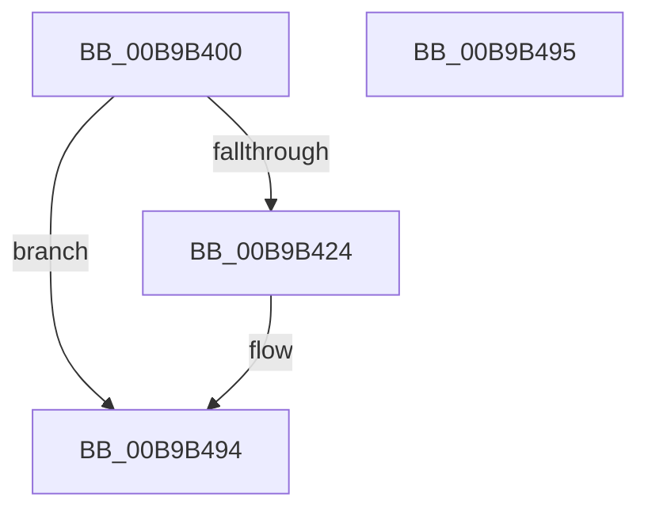

# VfTargetDriversGetZeroCounters

- RVA: `0x00B9B400`–`0x00B9B496` (길이 `150` bytes)
- VA: `0x0000000140B9B400`
- 실행 섹션: `PAGEVRFY`
- PDB 이름 있음: `예`; PDB Function 태그: `아니요`
- unwind 정보 RVA: `0x000DB714`
- 디코드: `27`개 명령, `150/150` bytes 표시
- 미해석 바이트: `0` (있으면 어셈블리에 `.byte`로 보존)

> 이 문서는 커널 이미지의 기계어와 PDB 기호를 분석해 생성했습니다. 4번과 5번은 함수 원형과 자료형을 바이너리 사용 방식에서 추정한 C 해석이며 원본 소스 복구 결과는 아닙니다.

## 1. Dependencies

- 직접 호출 지점: **0**; 고유 호출 대상: **0**
- 직접 호출자로 확인된 함수: **1**
- RIP 상대 이미지 참조: **0**

### Outgoing calls
- 직접 디코드된 call 명령이 없습니다.

### Direct callers
- [VfSuspectDriversGetVerifierInformation](../BA/VfSuspectDriversGetVerifierInformation_function_00BAA884.md) at `0x00BAAA19`
- [VfSuspectDriversGetVerifierInformation](../BA/VfSuspectDriversGetVerifierInformation_function_00BAA884.md) at `0x00BAAA63`

### Static image references
- 디코드된 RIP-relative 메모리 참조가 없습니다.

## 2. Other-region calls and transfers

- 다른 실행 섹션으로 향하는 call: **0**
- 별도 외부 분기/꼬리 이동을 확인하지 못했습니다.

## 3. Assembly (complete function range)

```asm
00B9B400  33 C0                           xor eax, eax
00B9B402  48 89 41 60                     mov qword ptr [rcx + 0x60], rax
00B9B406  48 89 41 68                     mov qword ptr [rcx + 0x68], rax
00B9B40A  48 89 41 70                     mov qword ptr [rcx + 0x70], rax
00B9B40E  48 89 41 78                     mov qword ptr [rcx + 0x78], rax
00B9B412  48 89 81 80 00 00 00            mov qword ptr [rcx + 0x80], rax
00B9B419  48 89 81 88 00 00 00            mov qword ptr [rcx + 0x88], rax
00B9B420  85 D2                           test edx, edx
00B9B422  74 70                           je 0x140b9b494
00B9B424  48 89 81 90 00 00 00            mov qword ptr [rcx + 0x90], rax
00B9B42B  48 89 81 98 00 00 00            mov qword ptr [rcx + 0x98], rax
00B9B432  48 89 81 A0 00 00 00            mov qword ptr [rcx + 0xa0], rax
00B9B439  48 89 81 A8 00 00 00            mov qword ptr [rcx + 0xa8], rax
00B9B440  48 89 81 B0 00 00 00            mov qword ptr [rcx + 0xb0], rax
00B9B447  48 89 81 B8 00 00 00            mov qword ptr [rcx + 0xb8], rax
00B9B44E  48 89 81 C0 00 00 00            mov qword ptr [rcx + 0xc0], rax
00B9B455  48 89 81 C8 00 00 00            mov qword ptr [rcx + 0xc8], rax
00B9B45C  48 89 81 D0 00 00 00            mov qword ptr [rcx + 0xd0], rax
00B9B463  48 89 81 D8 00 00 00            mov qword ptr [rcx + 0xd8], rax
00B9B46A  48 89 81 E0 00 00 00            mov qword ptr [rcx + 0xe0], rax
00B9B471  48 89 81 E8 00 00 00            mov qword ptr [rcx + 0xe8], rax
00B9B478  48 89 81 F0 00 00 00            mov qword ptr [rcx + 0xf0], rax
00B9B47F  48 89 81 F8 00 00 00            mov qword ptr [rcx + 0xf8], rax
00B9B486  48 89 81 00 01 00 00            mov qword ptr [rcx + 0x100], rax
00B9B48D  48 89 81 08 01 00 00            mov qword ptr [rcx + 0x108], rax
00B9B494  C3                              ret
00B9B495  CC                              int3
```

## 4. C-style interpretation (structured pseudocode)

```c
__int64 __fastcall VfTargetDriversGetZeroCounters(__int64 a1, int a2)
{
    __int64 result;

    result = 0;
    *(unsigned __int64 *)(a1 + 96) = 0;
    *(unsigned __int64 *)(a1 + 104) = 0;
    *(unsigned __int64 *)(a1 + 112) = 0;
    *(unsigned __int64 *)(a1 + 120) = 0;
    *(unsigned __int64 *)(a1 + 128) = 0;
    *(unsigned __int64 *)(a1 + 136) = 0;
    if (a2 != 0) {
        *(unsigned __int64 *)(a1 + 144) = 0;
        *(unsigned __int64 *)(a1 + 152) = 0;
        *(unsigned __int64 *)(a1 + 160) = 0;
        *(unsigned __int64 *)(a1 + 168) = 0;
        *(unsigned __int64 *)(a1 + 176) = 0;
        *(unsigned __int64 *)(a1 + 184) = 0;
        *(unsigned __int64 *)(a1 + 192) = 0;
        *(unsigned __int64 *)(a1 + 200) = 0;
        *(unsigned __int64 *)(a1 + 208) = 0;
        *(unsigned __int64 *)(a1 + 216) = 0;
        *(unsigned __int64 *)(a1 + 224) = 0;
        *(unsigned __int64 *)(a1 + 232) = 0;
        *(unsigned __int64 *)(a1 + 240) = 0;
        *(unsigned __int64 *)(a1 + 248) = 0;
        *(unsigned __int64 *)(a1 + 256) = 0;
        *(unsigned __int64 *)(a1 + 264) = 0;
    }
    return result;
}
```

## 5. (Beta) C Style

```c
int64_t VfTargetDriversGetZeroCounters(void *Arg1, int32_t Arg2)
{
    uint8_t *arg1 = (uint8_t *)Arg1;

    int64_t result;

    result = 0;
    *(uint64_t *)(arg1 + 0x60) = 0;
    *(uint64_t *)(arg1 + 0x68) = 0;
    *(uint64_t *)(arg1 + 0x70) = 0;
    *(uint64_t *)(arg1 + 0x78) = 0;
    *(uint64_t *)(arg1 + 0x80) = 0;
    *(uint64_t *)(arg1 + 0x88) = 0;
    if (Arg2 != 0) {
        *(uint64_t *)(arg1 + 0x90) = 0;
        *(uint64_t *)(arg1 + 0x98) = 0;
        *(uint64_t *)(arg1 + 0xA0) = 0;
        *(uint64_t *)(arg1 + 0xA8) = 0;
        *(uint64_t *)(arg1 + 0xB0) = 0;
        *(uint64_t *)(arg1 + 0xB8) = 0;
        *(uint64_t *)(arg1 + 0xC0) = 0;
        *(uint64_t *)(arg1 + 0xC8) = 0;
        *(uint64_t *)(arg1 + 0xD0) = 0;
        *(uint64_t *)(arg1 + 0xD8) = 0;
        *(uint64_t *)(arg1 + 0xE0) = 0;
        *(uint64_t *)(arg1 + 0xE8) = 0;
        *(uint64_t *)(arg1 + 0xF0) = 0;
        *(uint64_t *)(arg1 + 0xF8) = 0;
        *(uint64_t *)(arg1 + 0x100) = 0;
        *(uint64_t *)(arg1 + 0x108) = 0;
    }
    return result;
}
```

### 관측된 메모리 오프셋

구조체 형식이 확인되지 않은 접근은 인자 기준의 오프셋으로만 기록했습니다.

| 기준 인자 | 오프셋 표현 | 폭 (bit) | 접근 |
|---|---:|---:|---|
| `Arg1` | `+ 0x60` | `64` | `W` |
| `Arg1` | `+ 0x68` | `64` | `W` |
| `Arg1` | `+ 0x70` | `64` | `W` |
| `Arg1` | `+ 0x78` | `64` | `W` |
| `Arg1` | `+ 0x80` | `64` | `W` |
| `Arg1` | `+ 0x88` | `64` | `W` |
| `Arg1` | `+ 0x90` | `64` | `W` |
| `Arg1` | `+ 0x98` | `64` | `W` |
| `Arg1` | `+ 0xA0` | `64` | `W` |
| `Arg1` | `+ 0xA8` | `64` | `W` |
| `Arg1` | `+ 0xB0` | `64` | `W` |
| `Arg1` | `+ 0xB8` | `64` | `W` |
| `Arg1` | `+ 0xC0` | `64` | `W` |
| `Arg1` | `+ 0xC8` | `64` | `W` |
| `Arg1` | `+ 0xD0` | `64` | `W` |
| `Arg1` | `+ 0xD8` | `64` | `W` |
| `Arg1` | `+ 0xE0` | `64` | `W` |
| `Arg1` | `+ 0xE8` | `64` | `W` |
| `Arg1` | `+ 0xF0` | `64` | `W` |
| `Arg1` | `+ 0xF8` | `64` | `W` |
| `Arg1` | `+ 0x100` | `64` | `W` |
| `Arg1` | `+ 0x108` | `64` | `W` |

## 6. Execution-region graph

[열기: 2D/3D 그래프와 함수 탐색 컨트롤 패널](../../../control-panel.html?section=pagevrfy&rva=0x00B9B400&view=graph)

- 2D 그래프는 위에서 아래로 흐르고, 3D 그래프는 빈 공간을 드래그해 회전합니다. Shift+드래그는 이동, 휠은 확대·축소, 함수 노드 선택은 대상 보고서 이동입니다.

### Static fallback


