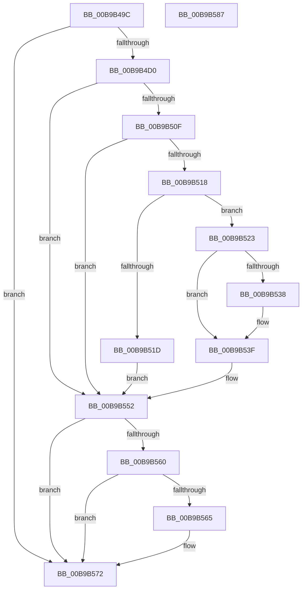

# VfTargetEtwRegister

- RVA: `0x00B9B49C`–`0x00B9B588` (길이 `236` bytes)
- VA: `0x0000000140B9B49C`
- 실행 섹션: `PAGEVRFY`
- PDB 이름 있음: `예`; PDB Function 태그: `아니요`
- unwind 정보 RVA: `0x0007D3C0`
- 디코드: `66`개 명령, `236/236` bytes 표시
- 미해석 바이트: `0` (있으면 어셈블리에 `.byte`로 보존)

> 이 문서는 커널 이미지의 기계어와 PDB 기호를 분석해 생성했습니다. 4번과 5번은 함수 원형과 자료형을 바이너리 사용 방식에서 추정한 C 해석이며 원본 소스 복구 결과는 아닙니다.

## 1. Dependencies

- 직접 호출 지점: **5**; 고유 호출 대상: **5**
- 직접 호출자로 확인된 함수: **2**
- RIP 상대 이미지 참조: **2**

### Outgoing calls
- `0x00B9B4DE` → [ExAllocatePool2](../../poolcode/B8/ExAllocatePool2_function_00B820F0.md) (function, `0x00B820F0`)
- `0x00B9B4ED` → [VfAvlInitializeLockContext](../../text/4A/VfAvlInitializeLockContext_function_004A686C.md) (function, `0x004A686C`)
- `0x00B9B505` → [VfAvlLookupTreeNode](../../text/3E/VfAvlLookupTreeNode_function_003EF1B4.md) (function, `0x003EF1B4`)
- `0x00B9B557` → [VfAvlCleanupLockContext](../../text/3E/VfAvlCleanupLockContext_function_003EF56C.md) (function, `0x003EF56C`)
- `0x00B9B56D` → [ExFreePoolWithTag](../../poolcode/B8/ExFreePoolWithTag_function_00B82870.md) (function, `0x00B82870`)

### Direct callers
- [VerifierEtwRegister](../BB/VerifierEtwRegister_function_00BB14C0.md) at `0x00BB14E7`
- [VerifierEtwRegisterClassicProvider](../BB/VerifierEtwRegisterClassicProvider_function_00BB1500.md) at `0x00BB152E`

### Static image references
- `0x00B9B4B5` → RVA `0x00F044C0` (`.data`; read)
- `0x00B9B4FE` → RVA `0x00F049A0` (`.data`; read)

## 2. Other-region calls and transfers

- 다른 실행 섹션으로 향하는 call: **5**
  - `0x00B9B4DE` → [ExAllocatePool2](../../poolcode/B8/ExAllocatePool2_function_00B820F0.md) (`PAGEVRFY` → `POOLCODE`)
  - `0x00B9B4ED` → [VfAvlInitializeLockContext](../../text/4A/VfAvlInitializeLockContext_function_004A686C.md) (`PAGEVRFY` → `.text`)
  - `0x00B9B505` → [VfAvlLookupTreeNode](../../text/3E/VfAvlLookupTreeNode_function_003EF1B4.md) (`PAGEVRFY` → `.text`)
  - `0x00B9B557` → [VfAvlCleanupLockContext](../../text/3E/VfAvlCleanupLockContext_function_003EF56C.md) (`PAGEVRFY` → `.text`)
  - `0x00B9B56D` → [ExFreePoolWithTag](../../poolcode/B8/ExFreePoolWithTag_function_00B82870.md) (`PAGEVRFY` → `POOLCODE`)
- 별도 외부 분기/꼬리 이동을 확인하지 못했습니다.

## 3. Assembly (complete function range)

```asm
00B9B49C  4C 8B DC                        mov r11, rsp
00B9B49F  49 89 5B 08                     mov qword ptr [r11 + 8], rbx
00B9B4A3  49 89 6B 10                     mov qword ptr [r11 + 0x10], rbp
00B9B4A7  49 89 73 18                     mov qword ptr [r11 + 0x18], rsi
00B9B4AB  57                              push rdi
00B9B4AC  48 83 EC 40                     sub rsp, 0x40
00B9B4B0  33 C0                           xor eax, eax
00B9B4B2  0F 57 C0                        xorps xmm0, xmm0
00B9B4B5  39 05 05 90 36 00               cmp dword ptr [rip + 0x369005], eax
00B9B4BB  48 8B F2                        mov rsi, rdx
00B9B4BE  0F 11 44 24 20                  movups xmmword ptr [rsp + 0x20], xmm0
00B9B4C3  49 89 43 E8                     mov qword ptr [r11 - 0x18], rax
00B9B4C7  48 8B E9                        mov rbp, rcx
00B9B4CA  0F 85 A2 00 00 00               jne 0x140b9b572
00B9B4D0  8D 50 20                        lea edx, [rax + 0x20]
00B9B4D3  41 B8 56 66 45 54               mov r8d, 0x54456656
00B9B4D9  8D 48 40                        lea ecx, [rax + 0x40]
00B9B4DC  33 FF                           xor edi, edi
00B9B4DE  E8 0D 6C FE FF                  call 0x140b820f0
00B9B4E3  33 D2                           xor edx, edx
00B9B4E5  48 8D 4C 24 20                  lea rcx, [rsp + 0x20]
00B9B4EA  48 8B D8                        mov rbx, rax
00B9B4ED  E8 7A B3 90 FF                  call 0x1404a686c
00B9B4F2  44 8D 4F 01                     lea r9d, [rdi + 1]
00B9B4F6  4C 8B C6                        mov r8, rsi
00B9B4F9  48 8D 54 24 20                  lea rdx, [rsp + 0x20]
00B9B4FE  48 8D 0D 9B 94 36 00            lea rcx, [rip + 0x36949b]
00B9B505  E8 AA 3C 85 FF                  call 0x1403ef1b4
00B9B50A  48 85 C0                        test rax, rax
00B9B50D  74 43                           je 0x140b9b552
00B9B50F  48 8B 40 40                     mov rax, qword ptr [rax + 0x40]
00B9B513  48 85 C0                        test rax, rax
00B9B516  74 3A                           je 0x140b9b552
00B9B518  48 85 DB                        test rbx, rbx
00B9B51B  75 06                           jne 0x140b9b523
00B9B51D  83 48 20 01                     or dword ptr [rax + 0x20], 1
00B9B521  EB 2F                           jmp 0x140b9b552
00B9B523  48 83 C0 10                     add rax, 0x10
00B9B527  48 89 6B 10                     mov qword ptr [rbx + 0x10], rbp
00B9B52B  48 89 73 18                     mov qword ptr [rbx + 0x18], rsi
00B9B52F  48 8B 48 08                     mov rcx, qword ptr [rax + 8]
00B9B533  48 39 01                        cmp qword ptr [rcx], rax
00B9B536  74 07                           je 0x140b9b53f
00B9B538  B9 03 00 00 00                  mov ecx, 3
00B9B53D  CD 29                           int 0x29
00B9B53F  48 89 03                        mov qword ptr [rbx], rax
00B9B542  BF 01 00 00 00                  mov edi, 1
00B9B547  48 89 4B 08                     mov qword ptr [rbx + 8], rcx
00B9B54B  48 89 19                        mov qword ptr [rcx], rbx
00B9B54E  48 89 58 08                     mov qword ptr [rax + 8], rbx
00B9B552  48 8D 4C 24 20                  lea rcx, [rsp + 0x20]
00B9B557  E8 10 40 85 FF                  call 0x1403ef56c
00B9B55C  85 FF                           test edi, edi
00B9B55E  75 12                           jne 0x140b9b572
00B9B560  48 85 DB                        test rbx, rbx
00B9B563  74 0D                           je 0x140b9b572
00B9B565  BA 56 66 45 54                  mov edx, 0x54456656
00B9B56A  48 8B CB                        mov rcx, rbx
00B9B56D  E8 FE 72 FE FF                  call 0x140b82870
00B9B572  48 8B 5C 24 50                  mov rbx, qword ptr [rsp + 0x50]
00B9B577  48 8B 6C 24 58                  mov rbp, qword ptr [rsp + 0x58]
00B9B57C  48 8B 74 24 60                  mov rsi, qword ptr [rsp + 0x60]
00B9B581  48 83 C4 40                     add rsp, 0x40
00B9B585  5F                              pop rdi
00B9B586  C3                              ret
00B9B587  CC                              int3
```

## 4. C-style interpretation (structured pseudocode)

```c
__int64 __fastcall VfTargetEtwRegister(__int64 a1, __int64 a2)
{
    __int64 result;
    __int64 v_rdi;
    __int64 v_rsp;
    unsigned __int64 v_stack_m28;
    unsigned __int64 v_stack_p10;
    unsigned __int64 v_stack_p18;
    unsigned __int64 v_stack_p8;

    *(unsigned __int64 *)(v_rsp + 8) = v_rbx;
    *(unsigned __int64 *)(v_rsp + 16) = v_rbp;
    *(unsigned __int64 *)(v_rsp + 24) = v_rsi;
    v_rsp = (v_rsp) - (64);
    result = 0;
    v_stack_m28 = v_xmm0;
    *(unsigned __int64 *)(v_rsp - 24) = 0;
    if ((*(unsigned int *)(v_rip + 3575813)) != 0) goto loc_00B9B572;
    v_rdi = 0;
    result = ExAllocatePool2(result + 64, result + 32, (unsigned int)(0x54456656ULL), a4);
    a2 = 0;
    result = VfAvlInitializeLockContext(v_stack_m28, a2, (unsigned int)(0x54456656ULL), a4);
    result = VfAvlLookupTreeNode(v_rip + 3576987, v_stack_m28, 0, v_rdi + 1);
    if (result == 0) goto loc_00B9B552;
    if (*(unsigned __int64 *)(result + 64) == 0) goto loc_00B9B552;
    if (result != 0) goto loc_00B9B523;
    goto loc_00B9B552;
loc_00B9B523:
    result = (*(unsigned __int64 *)(result + 64)) + (16);
    *(unsigned __int64 *)(result + 16) = a1;
    *(unsigned __int64 *)(result + 24) = 0;
    if ((*(unsigned __int64 *)(*(unsigned __int64 *)(result + 8))) != result) {
        a1 = 3;
    }
    *(unsigned __int64 *)(result) = result;
    *(unsigned __int64 *)(result + 8) = a1;
    *(unsigned __int64 *)(a1) = result;
    *(unsigned __int64 *)(result + 8) = result;
loc_00B9B552:
    result = VfAvlCleanupLockContext(v_stack_m28, v_stack_m28, 0, v_rdi + 1);
    if (1 != 0) goto loc_00B9B572;
    if (result != 0) {
        a2 = 0x54456656ULL;
        a1 = result;
        result = ExFreePoolWithTag(a1, a2, 0, v_rdi + 1);
    }
    v_rsp = (v_rsp) + (64);
    return result;
}
```

## 5. (Beta) C Style

```c
int64_t VfTargetEtwRegister(int64_t Arg1, int64_t Arg2)
{
    int64_t result;
    int64_t local_rdi;
    int64_t local_rsp;
    uint64_t v_stack_m28;
    uint64_t v_stack_p10;
    uint64_t v_stack_p18;
    uint64_t v_stack_p8;

    *(uint64_t *)(local_rsp + 0x8) = local_rbx;
    *(uint64_t *)(local_rsp + 0x10) = local_rbp;
    *(uint64_t *)(local_rsp + 0x18) = local_rsi;
    local_rsp = (local_rsp) - (64);
    result = 0;
    v_stack_m28 = v_xmm0;
    *(uint64_t *)(local_rsp - 0x18) = 0;
    if ((*(uint32_t *)(v_rip + 0x369005)) != 0) goto loc_00B9B572;
    local_rdi = 0;
    result = ExAllocatePool2(result + 64, result + 32, (uint32_t)(0x54456656ULL), a4);
    Arg2 = 0;
    result = VfAvlInitializeLockContext(v_stack_m28, Arg2, (uint32_t)(0x54456656ULL), a4);
    result = VfAvlLookupTreeNode(v_rip + 3576987, v_stack_m28, 0, local_rdi + 1);
    if (result == 0) goto loc_00B9B552;
    if (*(uint64_t *)(result + 0x40) == 0) goto loc_00B9B552;
    if (result != 0) goto loc_00B9B523;
    goto loc_00B9B552;
loc_00B9B523:
    result = (*(uint64_t *)(result + 0x40)) + (16);
    *(uint64_t *)(result + 0x10) = Arg1;
    *(uint64_t *)(result + 0x18) = 0;
    if ((*(uint64_t *)(*(uint64_t *)(result + 0x8))) != result) {
        Arg1 = 3;
    }
    *(uint64_t *)(result) = result;
    *(uint64_t *)(result + 0x8) = Arg1;
    *(uint64_t *)(Arg1) = result;
    *(uint64_t *)(result + 0x8) = result;
loc_00B9B552:
    result = VfAvlCleanupLockContext(v_stack_m28, v_stack_m28, 0, local_rdi + 1);
    if (1 != 0) goto loc_00B9B572;
    if (result != 0) {
        Arg2 = 0x54456656ULL;
        Arg1 = result;
        result = ExFreePoolWithTag(Arg1, Arg2, 0, local_rdi + 1);
    }
    local_rsp = (local_rsp) + (64);
    return result;
}
```

## 6. Execution-region graph

[열기: 2D/3D 그래프와 함수 탐색 컨트롤 패널](../../../control-panel.html?section=pagevrfy&rva=0x00B9B49C&view=graph)

- 2D 그래프는 위에서 아래로 흐르고, 3D 그래프는 빈 공간을 드래그해 회전합니다. Shift+드래그는 이동, 휠은 확대·축소, 함수 노드 선택은 대상 보고서 이동입니다.

### Static fallback


