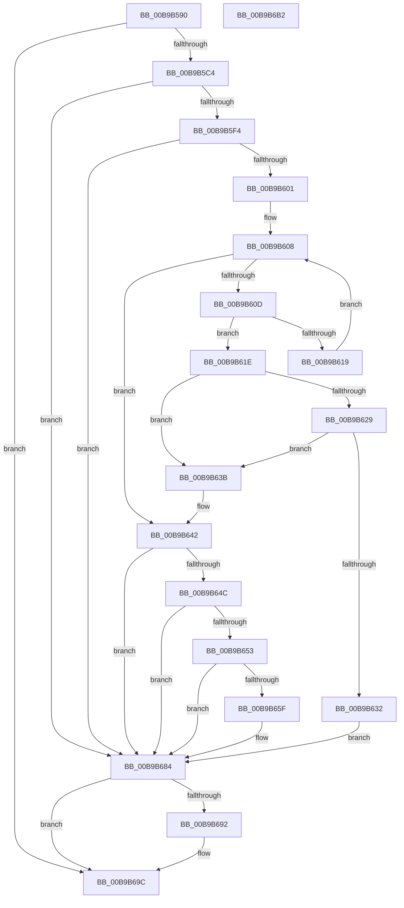

# VfTargetEtwUnregister

- RVA: `0x00B9B590`–`0x00B9B6B3` (길이 `291` bytes)
- VA: `0x0000000140B9B590`
- 실행 섹션: `PAGEVRFY`
- PDB 이름 있음: `예`; PDB Function 태그: `아니요`
- unwind 정보 RVA: `0x000BE9D0`
- 디코드: `81`개 명령, `291/291` bytes 표시
- 미해석 바이트: `0` (있으면 어셈블리에 `.byte`로 보존)

> 이 문서는 커널 이미지의 기계어와 PDB 기호를 분석해 생성했습니다. 4번과 5번은 함수 원형과 자료형을 바이너리 사용 방식에서 추정한 C 해석이며 원본 소스 복구 결과는 아닙니다.

## 1. Dependencies

- 직접 호출 지점: **5**; 고유 호출 대상: **5**
- 직접 호출자로 확인된 함수: **1**
- RIP 상대 이미지 참조: **4**

### Outgoing calls
- `0x00B9B5CE` → [VfAvlInitializeLockContext](../../text/4A/VfAvlInitializeLockContext_function_004A686C.md) (function, `0x004A686C`)
- `0x00B9B5E6` → [VfAvlLookupTreeNode](../../text/3E/VfAvlLookupTreeNode_function_003EF1B4.md) (function, `0x003EF1B4`)
- `0x00B9B67F` → [CarReportRuleViolationFromNt](CarReportRuleViolationFromNt_function_00B9D904.md) (function, `0x00B9D904`)
- `0x00B9B689` → [VfAvlCleanupLockContext](../../text/3E/VfAvlCleanupLockContext_function_003EF56C.md) (function, `0x003EF56C`)
- `0x00B9B697` → [ExFreePoolWithTag](../../poolcode/B8/ExFreePoolWithTag_function_00B82870.md) (function, `0x00B82870`)

### Direct callers
- [VerifierEtwUnregister](../BB/VerifierEtwUnregister_function_00BB1550.md) at `0x00BB1563`

### Static image references
- `0x00B9B5A9` → RVA `0x00F044C0` (`.data`; read)
- `0x00B9B5DF` → RVA `0x00F049A0` (`.data`; read)
- `0x00B9B642` → RVA `0x00F04AA0` (`.data`; read)
- `0x00B9B653` → RVA `0x00F04A20` (`.data`; read)

## 2. Other-region calls and transfers

- 다른 실행 섹션으로 향하는 call: **4**
  - `0x00B9B5CE` → [VfAvlInitializeLockContext](../../text/4A/VfAvlInitializeLockContext_function_004A686C.md) (`PAGEVRFY` → `.text`)
  - `0x00B9B5E6` → [VfAvlLookupTreeNode](../../text/3E/VfAvlLookupTreeNode_function_003EF1B4.md) (`PAGEVRFY` → `.text`)
  - `0x00B9B689` → [VfAvlCleanupLockContext](../../text/3E/VfAvlCleanupLockContext_function_003EF56C.md) (`PAGEVRFY` → `.text`)
  - `0x00B9B697` → [ExFreePoolWithTag](../../poolcode/B8/ExFreePoolWithTag_function_00B82870.md) (`PAGEVRFY` → `POOLCODE`)
- 별도 외부 분기/꼬리 이동을 확인하지 못했습니다.

## 3. Assembly (complete function range)

```asm
00B9B590  4C 8B DC                        mov r11, rsp
00B9B593  49 89 5B 08                     mov qword ptr [r11 + 8], rbx
00B9B597  49 89 6B 10                     mov qword ptr [r11 + 0x10], rbp
00B9B59B  49 89 73 18                     mov qword ptr [r11 + 0x18], rsi
00B9B59F  57                              push rdi
00B9B5A0  48 83 EC 60                     sub rsp, 0x60
00B9B5A4  33 C0                           xor eax, eax
00B9B5A6  0F 57 C0                        xorps xmm0, xmm0
00B9B5A9  39 05 11 8F 36 00               cmp dword ptr [rip + 0x368f11], eax
00B9B5AF  48 8B DA                        mov rbx, rdx
00B9B5B2  0F 11 44 24 40                  movups xmmword ptr [rsp + 0x40], xmm0
00B9B5B7  49 89 43 E8                     mov qword ptr [r11 - 0x18], rax
00B9B5BB  48 8B E9                        mov rbp, rcx
00B9B5BE  0F 85 D8 00 00 00               jne 0x140b9b69c
00B9B5C4  33 D2                           xor edx, edx
00B9B5C6  49 8D 4B D8                     lea rcx, [r11 - 0x28]
00B9B5CA  33 FF                           xor edi, edi
00B9B5CC  33 F6                           xor esi, esi
00B9B5CE  E8 99 B2 90 FF                  call 0x1404a686c
00B9B5D3  44 8D 4F 01                     lea r9d, [rdi + 1]
00B9B5D7  4C 8B C3                        mov r8, rbx
00B9B5DA  48 8D 54 24 40                  lea rdx, [rsp + 0x40]
00B9B5DF  48 8D 0D BA 93 36 00            lea rcx, [rip + 0x3693ba]
00B9B5E6  E8 C9 3B 85 FF                  call 0x1403ef1b4
00B9B5EB  48 85 C0                        test rax, rax
00B9B5EE  0F 84 90 00 00 00               je 0x140b9b684
00B9B5F4  48 8B 50 40                     mov rdx, qword ptr [rax + 0x40]
00B9B5F8  48 85 D2                        test rdx, rdx
00B9B5FB  0F 84 83 00 00 00               je 0x140b9b684
00B9B601  4C 8D 42 10                     lea r8, [rdx + 0x10]
00B9B605  49 8B 00                        mov rax, qword ptr [r8]
00B9B608  49 3B C0                        cmp rax, r8
00B9B60B  74 35                           je 0x140b9b642
00B9B60D  48 8B F0                        mov rsi, rax
00B9B610  48 8B 08                        mov rcx, qword ptr [rax]
00B9B613  48 39 68 10                     cmp qword ptr [rax + 0x10], rbp
00B9B617  74 05                           je 0x140b9b61e
00B9B619  48 8B C1                        mov rax, rcx
00B9B61C  EB EA                           jmp 0x140b9b608
00B9B61E  BF 01 00 00 00                  mov edi, 1
00B9B623  48 39 41 08                     cmp qword ptr [rcx + 8], rax
00B9B627  75 12                           jne 0x140b9b63b
00B9B629  48 8B 50 08                     mov rdx, qword ptr [rax + 8]
00B9B62D  48 39 02                        cmp qword ptr [rdx], rax
00B9B630  75 09                           jne 0x140b9b63b
00B9B632  48 89 0A                        mov qword ptr [rdx], rcx
00B9B635  48 89 51 08                     mov qword ptr [rcx + 8], rdx
00B9B639  EB 49                           jmp 0x140b9b684
00B9B63B  B9 03 00 00 00                  mov ecx, 3
00B9B640  CD 29                           int 0x29
00B9B642  8B 05 58 94 36 00               mov eax, dword ptr [rip + 0x369458]
00B9B648  85 C0                           test eax, eax
00B9B64A  75 38                           jne 0x140b9b684
00B9B64C  8B 42 20                        mov eax, dword ptr [rdx + 0x20]
00B9B64F  A8 01                           test al, 1
00B9B651  75 31                           jne 0x140b9b684
00B9B653  F7 05 C3 93 36 00 00 08 00 00   test dword ptr [rip + 0x3693c3], 0x800
00B9B65D  74 25                           je 0x140b9b684
00B9B65F  BA DC 00 00 00                  mov edx, 0xdc
00B9B664  48 89 5C 24 30                  mov qword ptr [rsp + 0x30], rbx
00B9B669  C7 44 24 28 0B 00 00 00         mov dword ptr [rsp + 0x28], 0xb
00B9B671  45 33 C9                        xor r9d, r9d
00B9B674  48 21 7C 24 20                  and qword ptr [rsp + 0x20], rdi
00B9B679  45 33 C0                        xor r8d, r8d
00B9B67C  8D 4A E8                        lea ecx, [rdx - 0x18]
00B9B67F  E8 80 22 00 00                  call 0x140b9d904
00B9B684  48 8D 4C 24 40                  lea rcx, [rsp + 0x40]
00B9B689  E8 DE 3E 85 FF                  call 0x1403ef56c
00B9B68E  85 FF                           test edi, edi
00B9B690  74 0A                           je 0x140b9b69c
00B9B692  33 D2                           xor edx, edx
00B9B694  48 8B CE                        mov rcx, rsi
00B9B697  E8 D4 71 FE FF                  call 0x140b82870
00B9B69C  4C 8D 5C 24 60                  lea r11, [rsp + 0x60]
00B9B6A1  49 8B 5B 10                     mov rbx, qword ptr [r11 + 0x10]
00B9B6A5  49 8B 6B 18                     mov rbp, qword ptr [r11 + 0x18]
00B9B6A9  49 8B 73 20                     mov rsi, qword ptr [r11 + 0x20]
00B9B6AD  49 8B E3                        mov rsp, r11
00B9B6B0  5F                              pop rdi
00B9B6B1  C3                              ret
00B9B6B2  CC                              int3
```

## 4. C-style interpretation (structured pseudocode)

```c
__int64 __fastcall VfTargetEtwUnregister(__int64 a1, __int64 a2)
{
    __int64 result;
    __int64 v_rdi;
    __int64 v_rsi;
    __int64 v_rsp;
    unsigned __int64 v_stack_m28;
    unsigned __int64 v_stack_m38;
    unsigned int v_stack_m40;
    unsigned __int64 v_stack_m48;
    unsigned __int64 v_stack_m8;

    *(unsigned __int64 *)(v_rsp + 8) = v_rbx;
    *(unsigned __int64 *)(v_rsp + 16) = v_rbp;
    *(unsigned __int64 *)(v_rsp + 24) = v_rsi;
    v_rsp = (v_rsp) - (96);
    result = 0;
    v_stack_m28 = v_xmm0;
    *(unsigned __int64 *)(v_rsp - 24) = 0;
    if ((*(unsigned int *)(v_rip + 3575569)) != 0) goto loc_00B9B69C;
    a2 = 0;
    v_rdi = 0;
    v_rsi = 0;
    result = VfAvlInitializeLockContext(v_rsp - 40, a2, a3, a4);
    result = VfAvlLookupTreeNode(v_rip + 3576762, v_stack_m28, 0, v_rdi + 1);
    if (result == 0) goto loc_00B9B684;
    if (*(unsigned __int64 *)(result + 64) == 0) goto loc_00B9B684;
loc_00B9B608:
    if ((*(unsigned __int64 *)(*(unsigned __int64 *)(result + 64) + 16)) == (*(unsigned __int64 *)(result + 64) + 16)) goto loc_00B9B642;
    if ((*(unsigned __int64 *)(*(unsigned __int64 *)(*(unsigned __int64 *)(result + 64) + 16) + 16)) == a1) goto loc_00B9B61E;
    goto loc_00B9B608;
loc_00B9B61E:
    if ((*(unsigned __int64 *)(*(unsigned __int64 *)(*(unsigned __int64 *)(*(unsigned __int64 *)(result + 64) + 16)) + 8)) != (*(unsigned __int64 *)(*(unsigned __int64 *)(*(unsigned __int64 *)(result + 64) + 16)))) goto loc_00B9B63B;
    if ((*(unsigned __int64 *)(*(unsigned __int64 *)(*(unsigned __int64 *)(*(unsigned __int64 *)(*(unsigned __int64 *)(result + 64) + 16)) + 8))) != (*(unsigned __int64 *)(*(unsigned __int64 *)(*(unsigned __int64 *)(result + 64) + 16)))) goto loc_00B9B63B;
    *(unsigned __int64 *)(*(unsigned __int64 *)(*(unsigned __int64 *)(*(unsigned __int64 *)(*(unsigned __int64 *)(result + 64) + 16)) + 8)) = *(unsigned __int64 *)(*(unsigned __int64 *)(*(unsigned __int64 *)(result + 64) + 16));
    *(unsigned __int64 *)(*(unsigned __int64 *)(*(unsigned __int64 *)(*(unsigned __int64 *)(result + 64) + 16)) + 8) = *(unsigned __int64 *)(*(unsigned __int64 *)(*(unsigned __int64 *)(*(unsigned __int64 *)(result + 64) + 16)) + 8);
    goto loc_00B9B684;
loc_00B9B63B:
loc_00B9B642:
    if ((unsigned int)((unsigned int)(*(unsigned int *)(v_rip + 3576920))) != 0) goto loc_00B9B684;
    if ((((unsigned __int8)((unsigned int)(*(unsigned int *)(*(unsigned __int64 *)(*(unsigned __int64 *)(*(unsigned __int64 *)(*(unsigned __int64 *)(result + 64) + 16)) + 8) + 32)))) & (1)) != 0) goto loc_00B9B684;
    result = (unsigned int)(*(unsigned int *)(*(unsigned __int64 *)(*(unsigned __int64 *)(*(unsigned __int64 *)(*(unsigned __int64 *)(result + 64) + 16)) + 8) + 32));
    if (((*(unsigned int *)(v_rip + 3576771)) & (0x800ULL)) != 0) {
        a2 = 220;
        v_stack_m38 = a2;
        v_stack_m40 = 11;
        a4 = 0;
        a3 = 0;
        a1 = a2 - 24;
        result = CarReportRuleViolationFromNt(a1, a2, a3, a4);
    }
    result = VfAvlCleanupLockContext(v_stack_m28, a2, a3, a4);
    if (1 != 0) {
        a2 = 0;
        a1 = *(unsigned __int64 *)(*(unsigned __int64 *)(result + 64) + 16);
        result = ExFreePoolWithTag(a1, a2, a3, a4);
    }
    return result;
}
```

## 5. (Beta) C Style

```c
int64_t VfTargetEtwUnregister(int64_t Arg1, int64_t Arg2)
{
    int64_t result;
    int64_t local_rdi;
    int64_t local_rsi;
    int64_t local_rsp;
    uint64_t v_stack_m28;
    uint64_t v_stack_m38;
    uint32_t v_stack_m40;
    uint64_t v_stack_m48;
    uint64_t v_stack_m8;

    *(uint64_t *)(local_rsp + 0x8) = local_rbx;
    *(uint64_t *)(local_rsp + 0x10) = local_rbp;
    *(uint64_t *)(local_rsp + 0x18) = local_rsi;
    local_rsp = (local_rsp) - (96);
    result = 0;
    v_stack_m28 = v_xmm0;
    *(uint64_t *)(local_rsp - 0x18) = 0;
    if ((*(uint32_t *)(v_rip + 0x368F11)) != 0) goto loc_00B9B69C;
    Arg2 = 0;
    local_rdi = 0;
    local_rsi = 0;
    result = VfAvlInitializeLockContext(local_rsp - 40, Arg2, a3, a4);
    result = VfAvlLookupTreeNode(v_rip + 3576762, v_stack_m28, 0, local_rdi + 1);
    if (result == 0) goto loc_00B9B684;
    if (*(uint64_t *)(result + 0x40) == 0) goto loc_00B9B684;
loc_00B9B608:
    if ((*(uint64_t *)(*(uint64_t *)(result + 0x40) + 0x10)) == (*(uint64_t *)(result + 0x40) + 16)) goto loc_00B9B642;
    if ((*(uint64_t *)(*(uint64_t *)(*(uint64_t *)(result + 0x40) + 0x10) + 0x10)) == Arg1) goto loc_00B9B61E;
    goto loc_00B9B608;
loc_00B9B61E:
    if ((*(uint64_t *)(*(uint64_t *)(*(uint64_t *)(*(uint64_t *)(result + 0x40) + 0x10)) + 0x8)) != (*(uint64_t *)(*(uint64_t *)(*(uint64_t *)(result + 0x40) + 0x10)))) goto loc_00B9B63B;
    if ((*(uint64_t *)(*(uint64_t *)(*(uint64_t *)(*(uint64_t *)(*(uint64_t *)(result + 0x40) + 0x10)) + 0x8))) != (*(uint64_t *)(*(uint64_t *)(*(uint64_t *)(result + 0x40) + 0x10)))) goto loc_00B9B63B;
    *(uint64_t *)(*(uint64_t *)(*(uint64_t *)(*(uint64_t *)(*(uint64_t *)(result + 0x40) + 0x10)) + 0x8)) = *(uint64_t *)(*(uint64_t *)(*(uint64_t *)(result + 0x40) + 0x10));
    *(uint64_t *)(*(uint64_t *)(*(uint64_t *)(*(uint64_t *)(result + 0x40) + 0x10)) + 0x8) = *(uint64_t *)(*(uint64_t *)(*(uint64_t *)(*(uint64_t *)(result + 0x40) + 0x10)) + 0x8);
    goto loc_00B9B684;
loc_00B9B63B:
loc_00B9B642:
    if ((uint32_t)((uint32_t)(*(uint32_t *)(v_rip + 0x369458))) != 0) goto loc_00B9B684;
    if ((((uint8_t)((uint32_t)(*(uint32_t *)(*(uint64_t *)(*(uint64_t *)(*(uint64_t *)(*(uint64_t *)(result + 0x40) + 0x10)) + 0x8) + 0x20)))) & (1)) != 0) goto loc_00B9B684;
    result = (uint32_t)(*(uint32_t *)(*(uint64_t *)(*(uint64_t *)(*(uint64_t *)(*(uint64_t *)(result + 0x40) + 0x10)) + 0x8) + 0x20));
    if (((*(uint32_t *)(v_rip + 0x3693C3)) & (0x800ULL)) != 0) {
        Arg2 = 220;
        v_stack_m38 = Arg2;
        v_stack_m40 = 11;
        a4 = 0;
        a3 = 0;
        Arg1 = Arg2 - 24;
        result = CarReportRuleViolationFromNt(Arg1, Arg2, a3, a4);
    }
    result = VfAvlCleanupLockContext(v_stack_m28, Arg2, a3, a4);
    if (1 != 0) {
        Arg2 = 0;
        Arg1 = *(uint64_t *)(*(uint64_t *)(result + 0x40) + 0x10);
        result = ExFreePoolWithTag(Arg1, Arg2, a3, a4);
    }
    return result;
}
```

## 6. Execution-region graph

[열기: 2D/3D 그래프와 함수 탐색 컨트롤 패널](../../../control-panel.html?section=pagevrfy&rva=0x00B9B590&view=graph)

- 2D 그래프는 위에서 아래로 흐르고, 3D 그래프는 빈 공간을 드래그해 회전합니다. Shift+드래그는 이동, 휠은 확대·축소, 함수 노드 선택은 대상 보고서 이동입니다.

### Static fallback


