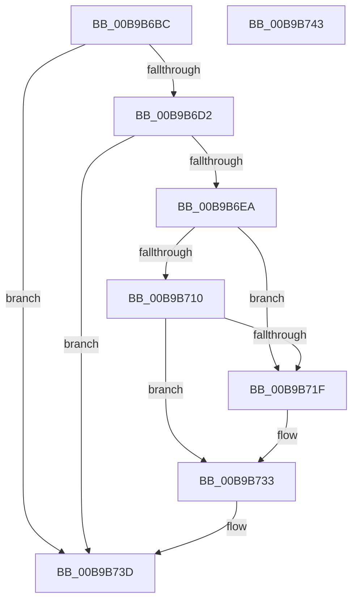

# VfTargetFreeContiguousMemory

- RVA: `0x00B9B6BC`–`0x00B9B744` (길이 `136` bytes)
- VA: `0x0000000140B9B6BC`
- 실행 섹션: `PAGEVRFY`
- PDB 이름 있음: `예`; PDB Function 태그: `아니요`
- unwind 정보 RVA: `0x000697A4`
- 디코드: `37`개 명령, `136/136` bytes 표시
- 미해석 바이트: `0` (있으면 어셈블리에 `.byte`로 보존)

> 이 문서는 커널 이미지의 기계어와 PDB 기호를 분석해 생성했습니다. 4번과 5번은 함수 원형과 자료형을 바이너리 사용 방식에서 추정한 C 해석이며 원본 소스 복구 결과는 아닙니다.

## 1. Dependencies

- 직접 호출 지점: **6**; 고유 호출 대상: **6**
- 직접 호출자로 확인된 함수: **3**
- RIP 상대 이미지 참조: **3**

### Outgoing calls
- `0x00B9B6E1` → [ViTargetUpdateTreeAllowed](ViTargetUpdateTreeAllowed_function_00B9BC04.md) (function, `0x00B9BC04`)
- `0x00B9B6F1` → [VfAvlInitializeLockContext](../../text/4A/VfAvlInitializeLockContext_function_004A686C.md) (function, `0x004A686C`)
- `0x00B9B706` → [VfAvlLookupTreeNode](../../text/3E/VfAvlLookupTreeNode_function_003EF1B4.md) (function, `0x003EF1B4`)
- `0x00B9B716` → [ViTargetFreeContiguousMemoryFromNode](ViTargetFreeContiguousMemoryFromNode_function_00B9BA38.md) (function, `0x00B9BA38`)
- `0x00B9B72E` → [VfAvlEnumerateNodes](VfAvlEnumerateNodes_function_00B93C14.md) (function, `0x00B93C14`)
- `0x00B9B738` → [VfAvlCleanupLockContext](../../text/3E/VfAvlCleanupLockContext_function_003EF56C.md) (function, `0x003EF56C`)

### Direct callers
- [VerifierMmFreeContiguousMemory](../BB/VerifierMmFreeContiguousMemory_function_00BB07A0.md) at `0x00BB07B1`
- [VerifierMmFreeContiguousMemorySpecifyCache](../BB/VerifierMmFreeContiguousMemorySpecifyCache_function_00BB07E0.md) at `0x00BB0800`
- [VerifierMmFreeNonCachedMemory](../BB/VerifierMmFreeNonCachedMemory_function_00BB0860.md) at `0x00BB0878`

### Static image references
- `0x00B9B6C2` → RVA `0x00F049C8` (`.data`; read)
- `0x00B9B6FF` → RVA `0x00F049A0` (`.data`; read)
- `0x00B9B722` → RVA `0x00B9BA10` (`ViTargetFreeContiguousMemoryCallback`; read)

## 2. Other-region calls and transfers

- 다른 실행 섹션으로 향하는 call: **3**
  - `0x00B9B6F1` → [VfAvlInitializeLockContext](../../text/4A/VfAvlInitializeLockContext_function_004A686C.md) (`PAGEVRFY` → `.text`)
  - `0x00B9B706` → [VfAvlLookupTreeNode](../../text/3E/VfAvlLookupTreeNode_function_003EF1B4.md) (`PAGEVRFY` → `.text`)
  - `0x00B9B738` → [VfAvlCleanupLockContext](../../text/3E/VfAvlCleanupLockContext_function_003EF56C.md) (`PAGEVRFY` → `.text`)
- 별도 외부 분기/꼬리 이동을 확인하지 못했습니다.

## 3. Assembly (complete function range)

```asm
00B9B6BC  40 53                           push rbx
00B9B6BE  48 83 EC 40                     sub rsp, 0x40
00B9B6C2  48 83 3D FE 92 36 00 00         cmp qword ptr [rip + 0x3692fe], 0
00B9B6CA  48 8B DA                        mov rbx, rdx
00B9B6CD  4C 8B C1                        mov r8, rcx
00B9B6D0  74 6B                           je 0x140b9b73d
00B9B6D2  33 C0                           xor eax, eax
00B9B6D4  0F 57 C0                        xorps xmm0, xmm0
00B9B6D7  0F 11 44 24 20                  movups xmmword ptr [rsp + 0x20], xmm0
00B9B6DC  48 89 44 24 30                  mov qword ptr [rsp + 0x30], rax
00B9B6E1  E8 1E 05 00 00                  call 0x140b9bc04
00B9B6E6  85 C0                           test eax, eax
00B9B6E8  74 53                           je 0x140b9b73d
00B9B6EA  33 D2                           xor edx, edx
00B9B6EC  48 8D 4C 24 20                  lea rcx, [rsp + 0x20]
00B9B6F1  E8 76 B1 90 FF                  call 0x1404a686c
00B9B6F6  44 8D 4A 01                     lea r9d, [rdx + 1]
00B9B6FA  48 8D 54 24 20                  lea rdx, [rsp + 0x20]
00B9B6FF  48 8D 0D 9A 92 36 00            lea rcx, [rip + 0x36929a]
00B9B706  E8 A9 3A 85 FF                  call 0x1403ef1b4
00B9B70B  48 85 C0                        test rax, rax
00B9B70E  74 0F                           je 0x140b9b71f
00B9B710  48 8B D0                        mov rdx, rax
00B9B713  48 8B CB                        mov rcx, rbx
00B9B716  E8 1D 03 00 00                  call 0x140b9ba38
00B9B71B  85 C0                           test eax, eax
00B9B71D  75 14                           jne 0x140b9b733
00B9B71F  4C 8B CB                        mov r9, rbx
00B9B722  4C 8D 05 E7 02 00 00            lea r8, [rip + 0x2e7]
00B9B729  48 8D 54 24 20                  lea rdx, [rsp + 0x20]
00B9B72E  E8 E1 84 FF FF                  call 0x140b93c14
00B9B733  48 8D 4C 24 20                  lea rcx, [rsp + 0x20]
00B9B738  E8 2F 3E 85 FF                  call 0x1403ef56c
00B9B73D  48 83 C4 40                     add rsp, 0x40
00B9B741  5B                              pop rbx
00B9B742  C3                              ret
00B9B743  CC                              int3
```

## 4. C-style interpretation (structured pseudocode)

```c
__int64 __fastcall VfTargetFreeContiguousMemory(__int64 a1, __int64 a2)
{
    __int64 result;
    __int64 v_rsp;
    unsigned __int64 v_stack_m18;
    unsigned __int64 v_stack_m28;

    v_rsp = (v_rsp) - (64);
    if ((*(unsigned __int64 *)(v_rip + 3576574)) == 0) goto loc_00B9B73D;
    result = 0;
    v_stack_m28 = v_xmm0;
    v_stack_m18 = 0;
    result = ViTargetUpdateTreeAllowed(a1, a2, a1, a4);
    if ((unsigned int)(result) == 0) goto loc_00B9B73D;
    a2 = 0;
    result = VfAvlInitializeLockContext(v_stack_m28, a2, a1, a4);
    result = VfAvlLookupTreeNode(v_rip + 3576474, v_stack_m28, a1, a2 + 1);
    if (result == 0) goto loc_00B9B71F;
    result = ViTargetFreeContiguousMemoryFromNode(0, result, a1, a2 + 1);
    if ((unsigned int)(result) == 0) {
        a4 = 0;
        a3 = v_rip + 743;
        a2 = v_stack_m28;
        result = VfAvlEnumerateNodes(0, a2, a3, a4);
    }
    result = VfAvlCleanupLockContext(v_stack_m28, a2, a3, a4);
loc_00B9B73D:
    v_rsp = (v_rsp) + (64);
    return result;
}
```

## 5. (Beta) C Style

```c
int64_t VfTargetFreeContiguousMemory(int64_t Arg1, int64_t Arg2)
{
    int64_t result;
    int64_t local_rsp;
    uint64_t v_stack_m18;
    uint64_t v_stack_m28;

    local_rsp = (local_rsp) - (64);
    if ((*(uint64_t *)(v_rip + 0x3692FE)) == 0) goto loc_00B9B73D;
    result = 0;
    v_stack_m28 = v_xmm0;
    v_stack_m18 = 0;
    result = ViTargetUpdateTreeAllowed(Arg1, Arg2, Arg1, a4);
    if ((uint32_t)(result) == 0) goto loc_00B9B73D;
    Arg2 = 0;
    result = VfAvlInitializeLockContext(v_stack_m28, Arg2, Arg1, a4);
    result = VfAvlLookupTreeNode(v_rip + 3576474, v_stack_m28, Arg1, Arg2 + 1);
    if (result == 0) goto loc_00B9B71F;
    result = ViTargetFreeContiguousMemoryFromNode(0, result, Arg1, Arg2 + 1);
    if ((uint32_t)(result) == 0) {
        a4 = 0;
        a3 = v_rip + 743;
        Arg2 = v_stack_m28;
        result = VfAvlEnumerateNodes(0, Arg2, a3, a4);
    }
    result = VfAvlCleanupLockContext(v_stack_m28, Arg2, a3, a4);
loc_00B9B73D:
    local_rsp = (local_rsp) + (64);
    return result;
}
```

## 6. Execution-region graph

[열기: 2D/3D 그래프와 함수 탐색 컨트롤 패널](../../../control-panel.html?section=pagevrfy&rva=0x00B9B6BC&view=graph)

- 2D 그래프는 위에서 아래로 흐르고, 3D 그래프는 빈 공간을 드래그해 회전합니다. Shift+드래그는 이동, 휠은 확대·축소, 함수 노드 선택은 대상 보고서 이동입니다.

### Static fallback


