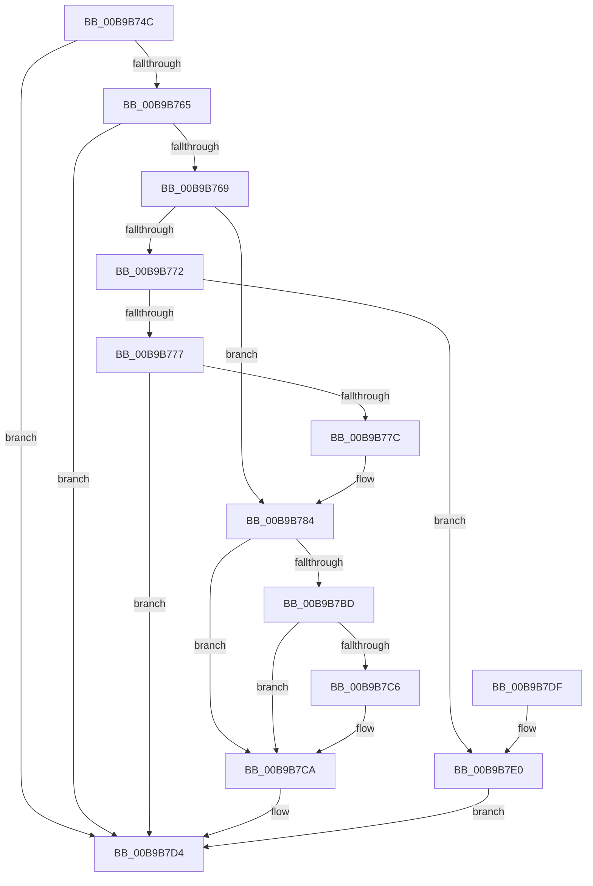

# VfTargetWMIRegistrationControl

- RVA: `0x00B9B74C`–`0x00B9B7EA` (길이 `158` bytes)
- VA: `0x0000000140B9B74C`
- 실행 섹션: `PAGEVRFY`
- PDB 이름 있음: `예`; PDB Function 태그: `아니요`
- unwind 정보 RVA: `0x0008A9AC`
- 디코드: `46`개 명령, `158/158` bytes 표시
- 미해석 바이트: `0` (있으면 어셈블리에 `.byte`로 보존)

> 이 문서는 커널 이미지의 기계어와 PDB 기호를 분석해 생성했습니다. 4번과 5번은 함수 원형과 자료형을 바이너리 사용 방식에서 추정한 C 해석이며 원본 소스 복구 결과는 아닙니다.

## 1. Dependencies

- 직접 호출 지점: **5**; 고유 호출 대상: **4**
- 직접 호출자로 확인된 함수: **1**
- RIP 상대 이미지 참조: **2**

### Outgoing calls
- `0x00B9B77F` → [ViTargetWMIDeregister](ViTargetWMIDeregister_function_00B9BC28.md) (function, `0x00B9BC28`)
- `0x00B9B79F` → [VfAvlInitializeLockContext](../../text/4A/VfAvlInitializeLockContext_function_004A686C.md) (function, `0x004A686C`)
- `0x00B9B7B3` → [VfAvlLookupTreeNode](../../text/3E/VfAvlLookupTreeNode_function_003EF1B4.md) (function, `0x003EF1B4`)
- `0x00B9B7CF` → [VfAvlCleanupLockContext](../../text/3E/VfAvlCleanupLockContext_function_003EF56C.md) (function, `0x003EF56C`)
- `0x00B9B7E3` → [ViTargetWMIDeregister](ViTargetWMIDeregister_function_00B9BC28.md) (function, `0x00B9BC28`)

### Direct callers
- [VerifierIoWMIRegistrationControl](../BB/VerifierIoWMIRegistrationControl_function_00BB1590.md) at `0x00BB15A4`

### Static image references
- `0x00B9B756` → RVA `0x00F044C0` (`.data`; read)
- `0x00B9B7AC` → RVA `0x00F049A0` (`.data`; read)

## 2. Other-region calls and transfers

- 다른 실행 섹션으로 향하는 call: **3**
  - `0x00B9B79F` → [VfAvlInitializeLockContext](../../text/4A/VfAvlInitializeLockContext_function_004A686C.md) (`PAGEVRFY` → `.text`)
  - `0x00B9B7B3` → [VfAvlLookupTreeNode](../../text/3E/VfAvlLookupTreeNode_function_003EF1B4.md) (`PAGEVRFY` → `.text`)
  - `0x00B9B7CF` → [VfAvlCleanupLockContext](../../text/3E/VfAvlCleanupLockContext_function_003EF56C.md) (`PAGEVRFY` → `.text`)
- 별도 외부 분기/꼬리 이동을 확인하지 못했습니다.

## 3. Assembly (complete function range)

```asm
00B9B74C  48 89 5C 24 08                  mov qword ptr [rsp + 8], rbx
00B9B751  57                              push rdi
00B9B752  48 83 EC 40                     sub rsp, 0x40
00B9B756  83 3D 63 8D 36 00 00            cmp dword ptr [rip + 0x368d63], 0
00B9B75D  49 8B F8                        mov rdi, r8
00B9B760  48 8B D9                        mov rbx, rcx
00B9B763  75 6F                           jne 0x140b9b7d4
00B9B765  85 D2                           test edx, edx
00B9B767  79 6B                           jns 0x140b9b7d4
00B9B769  0F BA F2 1F                     btr edx, 0x1f
00B9B76D  83 EA 01                        sub edx, 1
00B9B770  74 12                           je 0x140b9b784
00B9B772  83 EA 01                        sub edx, 1
00B9B775  74 69                           je 0x140b9b7e0
00B9B777  83 FA 01                        cmp edx, 1
00B9B77A  75 58                           jne 0x140b9b7d4
00B9B77C  49 8B D0                        mov rdx, r8
00B9B77F  E8 A4 04 00 00                  call 0x140b9bc28
00B9B784  33 C0                           xor eax, eax
00B9B786  48 8D 4C 24 20                  lea rcx, [rsp + 0x20]
00B9B78B  0F 57 C0                        xorps xmm0, xmm0
00B9B78E  48 89 44 24 30                  mov qword ptr [rsp + 0x30], rax
00B9B793  0F 11 44 24 20                  movups xmmword ptr [rsp + 0x20], xmm0
00B9B798  44 8D 48 01                     lea r9d, [rax + 1]
00B9B79C  41 8B D1                        mov edx, r9d
00B9B79F  E8 C8 B0 90 FF                  call 0x1404a686c
00B9B7A4  4C 8B C7                        mov r8, rdi
00B9B7A7  48 8D 54 24 20                  lea rdx, [rsp + 0x20]
00B9B7AC  48 8D 0D ED 91 36 00            lea rcx, [rip + 0x3691ed]
00B9B7B3  E8 FC 39 85 FF                  call 0x1403ef1b4
00B9B7B8  48 85 C0                        test rax, rax
00B9B7BB  74 0D                           je 0x140b9b7ca
00B9B7BD  48 8B 40 40                     mov rax, qword ptr [rax + 0x40]
00B9B7C1  48 85 C0                        test rax, rax
00B9B7C4  74 04                           je 0x140b9b7ca
00B9B7C6  48 89 58 08                     mov qword ptr [rax + 8], rbx
00B9B7CA  48 8D 4C 24 20                  lea rcx, [rsp + 0x20]
00B9B7CF  E8 98 3D 85 FF                  call 0x1403ef56c
00B9B7D4  48 8B 5C 24 50                  mov rbx, qword ptr [rsp + 0x50]
00B9B7D9  48 83 C4 40                     add rsp, 0x40
00B9B7DD  5F                              pop rdi
00B9B7DE  C3                              ret
00B9B7DF  CC                              int3
00B9B7E0  48 8B D7                        mov rdx, rdi
00B9B7E3  E8 40 04 00 00                  call 0x140b9bc28
00B9B7E8  EB EA                           jmp 0x140b9b7d4
```

## 4. C-style interpretation (structured pseudocode)

```c
__int64 __fastcall VfTargetWMIRegistrationControl(__int64 a1, int a2, __int64 a3)
{
    __int64 result;
    __int64 v_rsp;
    unsigned __int64 v_stack_m18;
    unsigned __int64 v_stack_m28;
    unsigned __int64 v_stack_p8;

    v_stack_p8 = v_rbx;
    v_rsp = (v_rsp) - (64);
    if ((*(unsigned int *)(v_rip + 3575139)) != 0) goto loc_00B9B7D4;
    if (!sign_flag) goto loc_00B9B7D4;
    a2 = (unsigned int)((a2) - (1));
    if (condition_is_equal) goto loc_00B9B784;
    a2 = (unsigned int)((a2) - (1));
    if (condition_is_equal) goto loc_00B9B7E0;
    if (a2 != 1) goto loc_00B9B7D4;
    result = ViTargetWMIDeregister(a1, a3, a3, a4);
loc_00B9B784:
    result = 0;
    v_stack_m18 = 0;
    v_stack_m28 = v_xmm0;
    result = VfAvlInitializeLockContext(v_stack_m28, (unsigned int)((unsigned int)(result + 1)), a3, result + 1);
    result = VfAvlLookupTreeNode(v_rip + 3576301, v_stack_m28, a3, result + 1);
    if (result == 0) goto loc_00B9B7CA;
    if (*(unsigned __int64 *)(result + 64) != 0) {
        *(unsigned __int64 *)(*(unsigned __int64 *)(result + 64) + 8) = a1;
    }
    result = VfAvlCleanupLockContext(v_stack_m28, v_stack_m28, a3, result + 1);
loc_00B9B7D4:
    v_rsp = (v_rsp) + (64);
    return result;
loc_00B9B7E0:
    result = ViTargetWMIDeregister(v_stack_m28, a3, a3, result + 1);
    goto loc_00B9B7D4;
}
```

## 5. (Beta) C Style

```c
int64_t VfTargetWMIRegistrationControl(int64_t Arg1, int32_t Arg2, int64_t Arg3)
{
    int64_t result;
    int64_t local_rsp;
    uint64_t v_stack_m18;
    uint64_t v_stack_m28;
    uint64_t v_stack_p8;

    v_stack_p8 = local_rbx;
    local_rsp = (local_rsp) - (64);
    if ((*(uint32_t *)(v_rip + 0x368D63)) != 0) goto loc_00B9B7D4;
    if (!sign_flag) goto loc_00B9B7D4;
    Arg2 = (uint32_t)((Arg2) - (1));
    if (condition_is_equal) goto loc_00B9B784;
    Arg2 = (uint32_t)((Arg2) - (1));
    if (condition_is_equal) goto loc_00B9B7E0;
    if (Arg2 != 1) goto loc_00B9B7D4;
    result = ViTargetWMIDeregister(Arg1, Arg3, Arg3, a4);
loc_00B9B784:
    result = 0;
    v_stack_m18 = 0;
    v_stack_m28 = v_xmm0;
    result = VfAvlInitializeLockContext(v_stack_m28, (uint32_t)((uint32_t)(result + 1)), Arg3, result + 1);
    result = VfAvlLookupTreeNode(v_rip + 3576301, v_stack_m28, Arg3, result + 1);
    if (result == 0) goto loc_00B9B7CA;
    if (*(uint64_t *)(result + 0x40) != 0) {
        *(uint64_t *)(*(uint64_t *)(result + 0x40) + 0x8) = Arg1;
    }
    result = VfAvlCleanupLockContext(v_stack_m28, v_stack_m28, Arg3, result + 1);
loc_00B9B7D4:
    local_rsp = (local_rsp) + (64);
    return result;
loc_00B9B7E0:
    result = ViTargetWMIDeregister(v_stack_m28, Arg3, Arg3, result + 1);
    goto loc_00B9B7D4;
}
```

## 6. Execution-region graph

[열기: 2D/3D 그래프와 함수 탐색 컨트롤 패널](../../../control-panel.html?section=pagevrfy&rva=0x00B9B74C&view=graph)

- 2D 그래프는 위에서 아래로 흐르고, 3D 그래프는 빈 공간을 드래그해 회전합니다. Shift+드래그는 이동, 휠은 확대·축소, 함수 노드 선택은 대상 보고서 이동입니다.

### Static fallback


