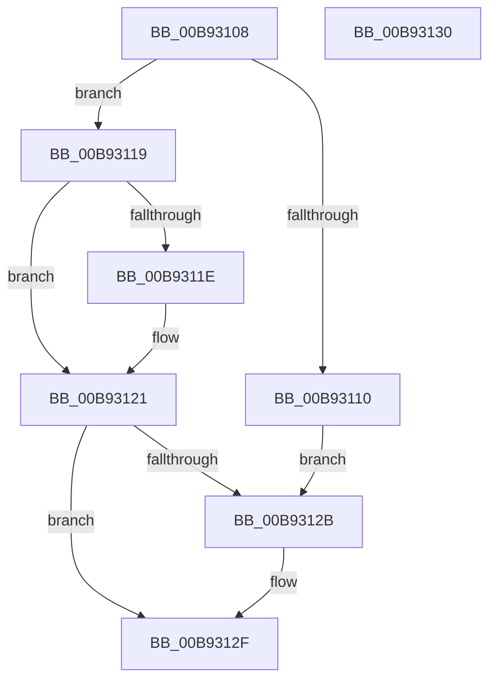

# VfUtilAddressRangeAdd

- RVA: `0x00B93108`–`0x00B93131` (길이 `41` bytes)
- VA: `0x0000000140B93108`
- 실행 섹션: `PAGEVRFY`
- PDB 이름 있음: `예`; PDB Function 태그: `아니요`
- unwind 정보 RVA: `0x000DB714`
- 디코드: `15`개 명령, `41/41` bytes 표시
- 미해석 바이트: `0` (있으면 어셈블리에 `.byte`로 보존)

> 이 문서는 커널 이미지의 기계어와 PDB 기호를 분석해 생성했습니다. 4번과 5번은 함수 원형과 자료형을 바이너리 사용 방식에서 추정한 C 해석이며 원본 소스 복구 결과는 아닙니다.

## 1. Dependencies

- 직접 호출 지점: **0**; 고유 호출 대상: **0**
- 직접 호출자로 확인된 함수: **3**
- RIP 상대 이미지 참조: **0**

### Outgoing calls
- 직접 디코드된 call 명령이 없습니다.

### Direct callers
- [ViDeadlockAddResource](../BA/ViDeadlockAddResource_function_00BA8870.md) at `0x00BA8A7F`
- [ViDeadlockAddThread](../BA/ViDeadlockAddThread_function_00BA8AB8.md) at `0x00BA8B5D`
- [VfIrpDatabaseEntryInsertAndLock](../BB/VfIrpDatabaseEntryInsertAndLock_function_00BB3F00.md) at `0x00BB3F9E`

### Static image references
- 디코드된 RIP-relative 메모리 참조가 없습니다.

## 2. Other-region calls and transfers

- 다른 실행 섹션으로 향하는 call: **0**
- 별도 외부 분기/꼬리 이동을 확인하지 못했습니다.

## 3. Assembly (complete function range)

```asm
00B93108  48 8B 01                        mov rax, qword ptr [rcx]
00B9310B  48 85 C0                        test rax, rax
00B9310E  75 09                           jne 0x140b93119
00B93110  48 89 11                        mov qword ptr [rcx], rdx
00B93113  4A 8D 04 02                     lea rax, [rdx + r8]
00B93117  EB 12                           jmp 0x140b9312b
00B93119  48 3B D0                        cmp rdx, rax
00B9311C  73 03                           jae 0x140b93121
00B9311E  48 89 11                        mov qword ptr [rcx], rdx
00B93121  4A 8D 04 02                     lea rax, [rdx + r8]
00B93125  48 3B 41 08                     cmp rax, qword ptr [rcx + 8]
00B93129  76 04                           jbe 0x140b9312f
00B9312B  48 89 41 08                     mov qword ptr [rcx + 8], rax
00B9312F  C3                              ret
00B93130  CC                              int3
```

## 4. C-style interpretation (structured pseudocode)

```c
__int64 __fastcall VfUtilAddressRangeAdd(__int64 a1, __int64 a2, __int64 a3)
{
    if (*(unsigned __int64 *)(a1) != 0) goto loc_00B93119;
    *(unsigned __int64 *)(a1) = a2;
    goto loc_00B9312B;
loc_00B93119:
    if (a2 < (a2 + a3 * 1)) {
        *(unsigned __int64 *)(a1) = a2;
    }
    if ((a2 + a3 * 1) >= = (*(unsigned __int64 *)(a1 + 8))) {
        *(unsigned __int64 *)(a1 + 8) = a2 + a3 * 1;
    }
    return a2 + a3 * 1;
}
```

## 5. (Beta) C Style

```c
int64_t VfUtilAddressRangeAdd(void *Arg1, void *Arg2, int64_t Arg3)
{
    uint8_t *arg1 = (uint8_t *)Arg1;
    uint8_t *arg2 = (uint8_t *)Arg2;

    if (*(uint64_t *)(arg1) != 0) goto loc_00B93119;
    *(void **)(arg1) = Arg2;
    goto loc_00B9312B;
loc_00B93119:
    if (Arg2 < (Arg2 + Arg3 * 1)) {
        *(void **)(arg1) = Arg2;
    }
    if ((Arg2 + Arg3 * 1) >= = (*(uint64_t *)(arg1 + 0x8))) {
        *(void **)(arg1 + 0x8) = Arg2 + Arg3 * 1;
    }
    return Arg2 + Arg3 * 1;
}
```

### 관측된 메모리 오프셋

구조체 형식이 확인되지 않은 접근은 인자 기준의 오프셋으로만 기록했습니다.

| 기준 인자 | 오프셋 표현 | 폭 (bit) | 접근 |
|---|---:|---:|---|
| `Arg1` | `+ 0x0` | `64` | `R` |
| `Arg1` | `+ 0x0` | `64` | `W` |
| `Arg1` | `+ 0x8` | `64` | `R` |
| `Arg1` | `+ 0x8` | `64` | `W` |
| `Arg2` | `+ 0x0 + r8*1` | `64` | `R` |

## 6. Execution-region graph

[열기: 2D/3D 그래프와 함수 탐색 컨트롤 패널](../../../control-panel.html?section=pagevrfy&rva=0x00B93108&view=graph)

- 2D 그래프는 위에서 아래로 흐르고, 3D 그래프는 빈 공간을 드래그해 회전합니다. Shift+드래그는 이동, 휠은 확대·축소, 함수 노드 선택은 대상 보고서 이동입니다.

### Static fallback


