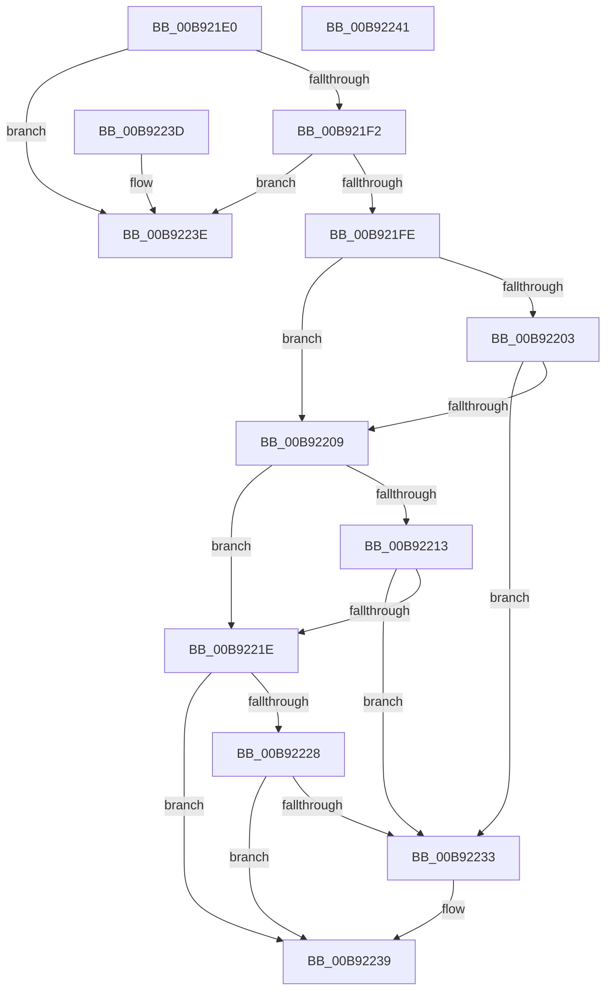

# VfUtilAddressRangeFitNoLock

- RVA: `0x00B921E0`–`0x00B92242` (길이 `98` bytes)
- VA: `0x0000000140B921E0`
- 실행 섹션: `PAGEVRFY`
- PDB 이름 있음: `예`; PDB Function 태그: `아니요`
- unwind 정보 RVA: `0x000DB714`
- 디코드: `33`개 명령, `98/98` bytes 표시
- 미해석 바이트: `0` (있으면 어셈블리에 `.byte`로 보존)

> 이 문서는 커널 이미지의 기계어와 PDB 기호를 분석해 생성했습니다. 4번과 5번은 함수 원형과 자료형을 바이너리 사용 방식에서 추정한 C 해석이며 원본 소스 복구 결과는 아닙니다.

## 1. Dependencies

- 직접 호출 지점: **0**; 고유 호출 대상: **0**
- 직접 호출자로 확인된 함수: **2**
- RIP 상대 이미지 참조: **0**

### Outgoing calls
- 직접 디코드된 call 명령이 없습니다.

### Direct callers
- [VfIrpDatabaseCheckExFreePool](../BB/VfIrpDatabaseCheckExFreePool_function_00BB3E54.md) at `0x00BB3E8E`
- [VfIrpDatabaseEntryFindAndLock](../BB/VfIrpDatabaseEntryFindAndLock_function_00BB7074.md) at `0x00BB70C1`

### Static image references
- 디코드된 RIP-relative 메모리 참조가 없습니다.

## 2. Other-region calls and transfers

- 다른 실행 섹션으로 향하는 call: **0**
- 별도 외부 분기/꼬리 이동을 확인하지 못했습니다.

## 3. Assembly (complete function range)

```asm
00B921E0  4C 8B DC                        mov r11, rsp
00B921E3  48 8B C1                        mov rax, rcx
00B921E6  45 33 D2                        xor r10d, r10d
00B921E9  49 89 4B 08                     mov qword ptr [r11 + 8], rcx
00B921ED  48 85 C0                        test rax, rax
00B921F0  74 4C                           je 0x140b9223e
00B921F2  4C 8B C9                        mov r9, rcx
00B921F5  48 8B 09                        mov rcx, qword ptr [rcx]
00B921F8  49 3B 49 08                     cmp rcx, qword ptr [r9 + 8]
00B921FC  73 40                           jae 0x140b9223e
00B921FE  48 3B 10                        cmp rdx, qword ptr [rax]
00B92201  77 06                           ja 0x140b92209
00B92203  4C 3B 40 08                     cmp r8, qword ptr [rax + 8]
00B92207  73 2A                           jae 0x140b92233
00B92209  48 8B 44 24 08                  mov rax, qword ptr [rsp + 8]
00B9220E  48 3B 10                        cmp rdx, qword ptr [rax]
00B92211  72 0B                           jb 0x140b9221e
00B92213  48 8B 44 24 08                  mov rax, qword ptr [rsp + 8]
00B92218  48 3B 50 08                     cmp rdx, qword ptr [rax + 8]
00B9221C  72 15                           jb 0x140b92233
00B9221E  48 8B 44 24 08                  mov rax, qword ptr [rsp + 8]
00B92223  4C 3B 00                        cmp r8, qword ptr [rax]
00B92226  76 11                           jbe 0x140b92239
00B92228  48 8B 44 24 08                  mov rax, qword ptr [rsp + 8]
00B9222D  4C 3B 40 08                     cmp r8, qword ptr [rax + 8]
00B92231  77 06                           ja 0x140b92239
00B92233  41 BA 01 00 00 00               mov r10d, 1
00B92239  41 8B C2                        mov eax, r10d
00B9223C  C3                              ret
00B9223D  CC                              int3
00B9223E  33 C0                           xor eax, eax
00B92240  C3                              ret
00B92241  CC                              int3
```

## 4. C-style interpretation (structured pseudocode)

```c
__int64 __fastcall VfUtilAddressRangeFitNoLock(__int64 a1, __int64 a2, __int64 a3)
{
    __int64 result;
    __int64 v_r10;
    unsigned __int64 v_stack_p8;

    v_r10 = 0;
    *(unsigned __int64 *)(v_rsp + 8) = a1;
    if (a1 == 0) goto loc_00B9223E;
    if ((*(unsigned __int64 *)(a1)) >= (*(unsigned __int64 *)(a1 + 8))) goto loc_00B9223E;
    if (a2 > (*(unsigned __int64 *)(a1))) goto loc_00B92209;
    if (a3 >= (*(unsigned __int64 *)(a1 + 8))) goto loc_00B92233;
loc_00B92209:
    if (a2 < (*(unsigned __int64 *)(v_stack_p8))) goto loc_00B9221E;
    if (a2 < (*(unsigned __int64 *)(v_stack_p8 + 8))) goto loc_00B92233;
loc_00B9221E:
    if (a3 <= (*(unsigned __int64 *)(v_stack_p8))) goto loc_00B92239;
    if (a3 <= (*(unsigned __int64 *)(v_stack_p8 + 8))) {
        v_r10 = 1;
    }
    return (unsigned int)((unsigned int)(v_r10));
loc_00B9223E:
    result = 0;
    return result;
}
```

## 5. (Beta) C Style

```c
int64_t VfUtilAddressRangeFitNoLock(void *Arg1, int64_t Arg2, int64_t Arg3)
{
    uint8_t *arg1 = (uint8_t *)Arg1;

    int64_t result;
    int64_t local_r10;
    uint64_t v_stack_p8;

    local_r10 = 0;
    *(void **)(local_rsp + 0x8) = Arg1;
    if (Arg1 == NULL) goto loc_00B9223E;
    if ((*(uint64_t *)(arg1)) >= (*(uint64_t *)(arg1 + 0x8))) goto loc_00B9223E;
    if (Arg2 > (*(uint64_t *)(arg1))) goto loc_00B92209;
    if (Arg3 >= (*(uint64_t *)(arg1 + 0x8))) goto loc_00B92233;
loc_00B92209:
    if (Arg2 < (*(uint64_t *)(v_stack_p8))) goto loc_00B9221E;
    if (Arg2 < (*(uint64_t *)(v_stack_p8 + 0x8))) goto loc_00B92233;
loc_00B9221E:
    if (Arg3 <= (*(uint64_t *)(v_stack_p8))) goto loc_00B92239;
    if (Arg3 <= (*(uint64_t *)(v_stack_p8 + 0x8))) {
        local_r10 = 1;
    }
    return (uint32_t)((uint32_t)(local_r10));
loc_00B9223E:
    result = 0;
    return result;
}
```

### 관측된 메모리 오프셋

구조체 형식이 확인되지 않은 접근은 인자 기준의 오프셋으로만 기록했습니다.

| 기준 인자 | 오프셋 표현 | 폭 (bit) | 접근 |
|---|---:|---:|---|
| `Arg1` | `+ 0x0` | `64` | `R` |
| `Arg1` | `+ 0x8` | `64` | `R` |

## 6. Execution-region graph

[열기: 2D/3D 그래프와 함수 탐색 컨트롤 패널](../../../control-panel.html?section=pagevrfy&rva=0x00B921E0&view=graph)

- 2D 그래프는 위에서 아래로 흐르고, 3D 그래프는 빈 공간을 드래그해 회전합니다. Shift+드래그는 이동, 휠은 확대·축소, 함수 노드 선택은 대상 보고서 이동입니다.

### Static fallback


