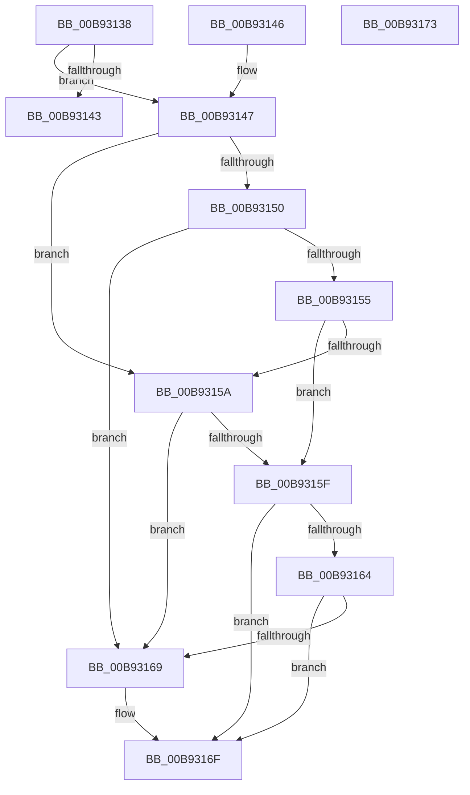

# VfUtilAddressRangeFit

- RVA: `0x00B93138`–`0x00B93174` (길이 `60` bytes)
- VA: `0x0000000140B93138`
- 실행 섹션: `PAGEVRFY`
- PDB 이름 있음: `예`; PDB Function 태그: `아니요`
- unwind 정보 RVA: `0x000DB714`
- 디코드: `24`개 명령, `60/60` bytes 표시
- 미해석 바이트: `0` (있으면 어셈블리에 `.byte`로 보존)

> 이 문서는 커널 이미지의 기계어와 PDB 기호를 분석해 생성했습니다. 4번과 5번은 함수 원형과 자료형을 바이너리 사용 방식에서 추정한 C 해석이며 원본 소스 복구 결과는 아닙니다.

## 1. Dependencies

- 직접 호출 지점: **0**; 고유 호출 대상: **0**
- 직접 호출자로 확인된 함수: **5**
- RIP 상대 이미지 참조: **0**

### Outgoing calls
- 직접 디코드된 call 명령이 없습니다.

### Direct callers
- [ViDeadlockRemoveMemoryRangeResources](../../text/61/ViDeadlockRemoveMemoryRangeResources_function_00615FE8.md) at `0x0061606A`
- [ViDeadlockRemoveMemoryRangeThreads](../../text/61/ViDeadlockRemoveMemoryRangeThreads_function_00616148.md) at `0x006161C8`
- [ViDeadlockSearchResource](../BA/ViDeadlockSearchResource_function_00BAA0D0.md) at `0x00BAA13E`
- [ViDeadlockSearchThread](../BA/ViDeadlockSearchThread_function_00BAA1AC.md) at `0x00BAA216`
- [ViIrpDatabaseFindPointer](../BB/ViIrpDatabaseFindPointer_function_00BB4140.md) at `0x00BB4170`

### Static image references
- 디코드된 RIP-relative 메모리 참조가 없습니다.

## 2. Other-region calls and transfers

- 다른 실행 섹션으로 향하는 call: **0**
- 별도 외부 분기/꼬리 이동을 확인하지 못했습니다.

## 3. Assembly (complete function range)

```asm
00B93138  4C 8B 09                        mov r9, qword ptr [rcx]
00B9313B  45 33 D2                        xor r10d, r10d
00B9313E  4D 85 C9                        test r9, r9
00B93141  75 04                           jne 0x140b93147
00B93143  33 C0                           xor eax, eax
00B93145  C3                              ret
00B93146  CC                              int3
00B93147  48 8D 41 08                     lea rax, [rcx + 8]
00B9314B  49 3B D1                        cmp rdx, r9
00B9314E  77 0A                           ja 0x140b9315a
00B93150  4C 3B 00                        cmp r8, qword ptr [rax]
00B93153  73 14                           jae 0x140b93169
00B93155  49 3B D1                        cmp rdx, r9
00B93158  72 05                           jb 0x140b9315f
00B9315A  48 3B 10                        cmp rdx, qword ptr [rax]
00B9315D  72 0A                           jb 0x140b93169
00B9315F  4D 3B C1                        cmp r8, r9
00B93162  76 0B                           jbe 0x140b9316f
00B93164  4C 3B 00                        cmp r8, qword ptr [rax]
00B93167  77 06                           ja 0x140b9316f
00B93169  41 BA 01 00 00 00               mov r10d, 1
00B9316F  41 8B C2                        mov eax, r10d
00B93172  C3                              ret
00B93173  CC                              int3
```

## 4. C-style interpretation (structured pseudocode)

```c
__int64 __fastcall VfUtilAddressRangeFit(__int64 a1, __int64 a2, __int64 a3)
{
    __int64 result;
    __int64 v_r10;

    v_r10 = 0;
    if (*(unsigned __int64 *)(a1) != 0) goto loc_00B93147;
    result = 0;
    return result;
loc_00B93147:
    if (a2 > (*(unsigned __int64 *)(a1))) goto loc_00B9315A;
    if (a3 >= (*(unsigned __int64 *)(a1 + 8))) goto loc_00B93169;
    if (a2 < (*(unsigned __int64 *)(a1))) goto loc_00B9315F;
loc_00B9315A:
    if (a2 < (*(unsigned __int64 *)(a1 + 8))) goto loc_00B93169;
loc_00B9315F:
    if (a3 <= (*(unsigned __int64 *)(a1))) goto loc_00B9316F;
    if (a3 <= (*(unsigned __int64 *)(a1 + 8))) {
        v_r10 = 1;
    }
    return (unsigned int)((unsigned int)(v_r10));
}
```

## 5. (Beta) C Style

```c
int64_t VfUtilAddressRangeFit(void *Arg1, int64_t Arg2, int64_t Arg3)
{
    uint8_t *arg1 = (uint8_t *)Arg1;

    int64_t result;
    int64_t local_r10;

    local_r10 = 0;
    if (*(uint64_t *)(arg1) != 0) goto loc_00B93147;
    result = 0;
    return result;
loc_00B93147:
    if (Arg2 > (*(uint64_t *)(arg1))) goto loc_00B9315A;
    if (Arg3 >= (*(uint64_t *)(arg1 + 0x8))) goto loc_00B93169;
    if (Arg2 < (*(uint64_t *)(arg1))) goto loc_00B9315F;
loc_00B9315A:
    if (Arg2 < (*(uint64_t *)(arg1 + 0x8))) goto loc_00B93169;
loc_00B9315F:
    if (Arg3 <= (*(uint64_t *)(arg1))) goto loc_00B9316F;
    if (Arg3 <= (*(uint64_t *)(arg1 + 0x8))) {
        local_r10 = 1;
    }
    return (uint32_t)((uint32_t)(local_r10));
}
```

### 관측된 메모리 오프셋

구조체 형식이 확인되지 않은 접근은 인자 기준의 오프셋으로만 기록했습니다.

| 기준 인자 | 오프셋 표현 | 폭 (bit) | 접근 |
|---|---:|---:|---|
| `Arg1` | `+ 0x0` | `64` | `R` |
| `Arg1` | `+ 0x8` | `64` | `R` |

## 6. Execution-region graph

[열기: 2D/3D 그래프와 함수 탐색 컨트롤 패널](../../../control-panel.html?section=pagevrfy&rva=0x00B93138&view=graph)

- 2D 그래프는 위에서 아래로 흐르고, 3D 그래프는 빈 공간을 드래그해 회전합니다. Shift+드래그는 이동, 휠은 확대·축소, 함수 노드 선택은 대상 보고서 이동입니다.

### Static fallback


