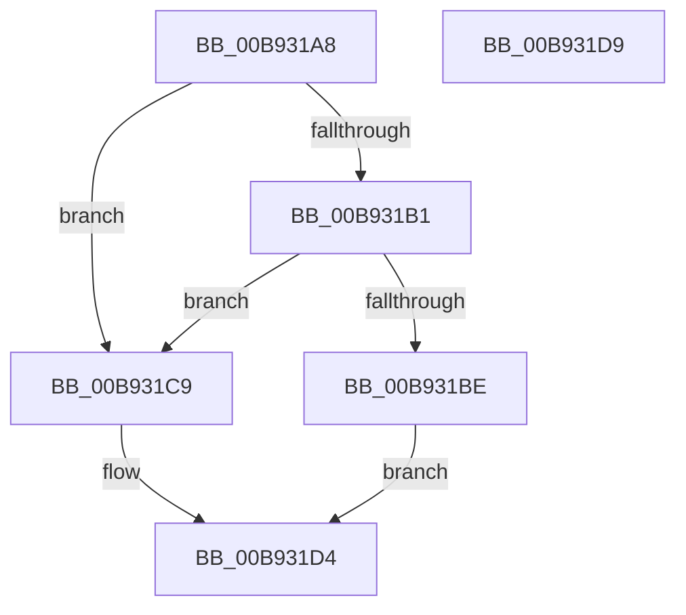

# VfUtilAddressRangeRemoveCheckEmpty

- RVA: `0x00B931A8`–`0x00B931DA` (길이 `50` bytes)
- VA: `0x0000000140B931A8`
- 실행 섹션: `PAGEVRFY`
- PDB 이름 있음: `예`; PDB Function 태그: `아니요`
- unwind 정보 RVA: `0x0005C788`
- 디코드: `14`개 명령, `50/50` bytes 표시
- 미해석 바이트: `0` (있으면 어셈블리에 `.byte`로 보존)

> 이 문서는 커널 이미지의 기계어와 PDB 기호를 분석해 생성했습니다. 4번과 5번은 함수 원형과 자료형을 바이너리 사용 방식에서 추정한 C 해석이며 원본 소스 복구 결과는 아닙니다.

## 1. Dependencies

- 직접 호출 지점: **1**; 고유 호출 대상: **1**
- 직접 호출자로 확인된 함수: **5**
- RIP 상대 이미지 참조: **0**

### Outgoing calls
- `0x00B931CF` → [VfUtilAddressRangeRemove](VfUtilAddressRangeRemove_function_00B9317C.md) (function, `0x00B9317C`)

### Direct callers
- [ViPendingCompleteAfterWait](../BA/ViPendingCompleteAfterWait_function_00BA1D18.md) at `0x00BA1DD2`
- [VfIrpDatabaseEntryReleaseLock](../BB/VfIrpDatabaseEntryReleaseLock_function_00BB3FD4.md) at `0x00BB4034`
- [sub_00BBBE00](../BB/Unknown_function_00BBBE00.md) at `0x00BBC040`
- [sub_00BBC0C8](../BB/Unknown_function_00BBC0C8.md) at `0x00BBC14F`
- [sub_00BBC0C8](../BB/Unknown_function_00BBC0C8.md) at `0x00BBC1DD`
- [sub_00BBC208](../BB/Unknown_function_00BBC208.md) at `0x00BBC293`

### Static image references
- 디코드된 RIP-relative 메모리 참조가 없습니다.

## 2. Other-region calls and transfers

- 다른 실행 섹션으로 향하는 call: **0**
- 별도 외부 분기/꼬리 이동을 확인하지 못했습니다.

## 3. Assembly (complete function range)

```asm
00B931A8  48 83 EC 28                     sub rsp, 0x28
00B931AC  48 3B 11                        cmp rdx, qword ptr [rcx]
00B931AF  75 18                           jne 0x140b931c9
00B931B1  48 8D 82 D0 00 00 00            lea rax, [rdx + 0xd0]
00B931B8  48 3B 41 08                     cmp rax, qword ptr [rcx + 8]
00B931BC  75 0B                           jne 0x140b931c9
00B931BE  48 83 21 00                     and qword ptr [rcx], 0
00B931C2  48 83 61 08 00                  and qword ptr [rcx + 8], 0
00B931C7  EB 0B                           jmp 0x140b931d4
00B931C9  41 B8 D0 00 00 00               mov r8d, 0xd0
00B931CF  E8 A8 FF FF FF                  call 0x140b9317c
00B931D4  48 83 C4 28                     add rsp, 0x28
00B931D8  C3                              ret
00B931D9  CC                              int3
```

## 4. C-style interpretation (structured pseudocode)

```c
__int64 __fastcall VfUtilAddressRangeRemoveCheckEmpty(__int64 a1, __int64 a2)
{
    __int64 result;
    __int64 v_rsp;

    v_rsp = (v_rsp) - (40);
    if (a2 != (*(unsigned __int64 *)(a1))) goto loc_00B931C9;
    if ((a2 + 208) != (*(unsigned __int64 *)(a1 + 8))) goto loc_00B931C9;
    goto loc_00B931D4;
loc_00B931C9:
    result = VfUtilAddressRangeRemove(a1, a2, 208, a4);
loc_00B931D4:
    v_rsp = (v_rsp) + (40);
    return result;
}
```

## 5. (Beta) C Style

```c
int64_t VfUtilAddressRangeRemoveCheckEmpty(void *Arg1, int64_t Arg2)
{
    uint8_t *arg1 = (uint8_t *)Arg1;

    int64_t result;
    int64_t local_rsp;

    local_rsp = (local_rsp) - (40);
    if (Arg2 != (*(uint64_t *)(arg1))) goto loc_00B931C9;
    if ((Arg2 + 208) != (*(uint64_t *)(arg1 + 0x8))) goto loc_00B931C9;
    goto loc_00B931D4;
loc_00B931C9:
    result = VfUtilAddressRangeRemove(Arg1, Arg2, 208, a4);
loc_00B931D4:
    local_rsp = (local_rsp) + (40);
    return result;
}
```

### 관측된 메모리 오프셋

구조체 형식이 확인되지 않은 접근은 인자 기준의 오프셋으로만 기록했습니다.

| 기준 인자 | 오프셋 표현 | 폭 (bit) | 접근 |
|---|---:|---:|---|
| `Arg1` | `+ 0x0` | `64` | `R` |
| `Arg1` | `+ 0x0` | `64` | `R/W` |
| `Arg1` | `+ 0x8` | `64` | `R` |
| `Arg1` | `+ 0x8` | `64` | `R/W` |

## 6. Execution-region graph

[열기: 2D/3D 그래프와 함수 탐색 컨트롤 패널](../../../control-panel.html?section=pagevrfy&rva=0x00B931A8&view=graph)

- 2D 그래프는 위에서 아래로 흐르고, 3D 그래프는 빈 공간을 드래그해 회전합니다. Shift+드래그는 이동, 휠은 확대·축소, 함수 노드 선택은 대상 보고서 이동입니다.

### Static fallback


