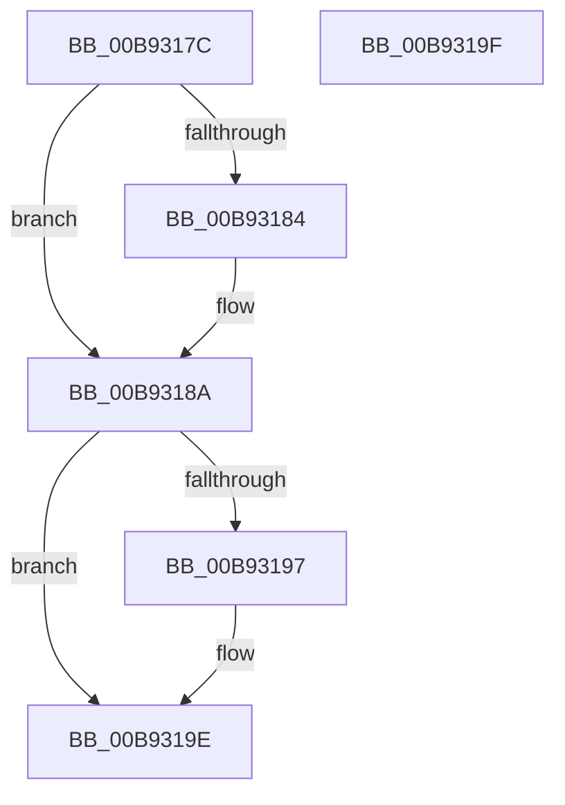

# VfUtilAddressRangeRemove

- RVA: `0x00B9317C`–`0x00B931A0` (길이 `36` bytes)
- VA: `0x0000000140B9317C`
- 실행 섹션: `PAGEVRFY`
- PDB 이름 있음: `예`; PDB Function 태그: `아니요`
- unwind 정보 RVA: `0x000DB714`
- 디코드: `13`개 명령, `36/36` bytes 표시
- 미해석 바이트: `0` (있으면 어셈블리에 `.byte`로 보존)

> 이 문서는 커널 이미지의 기계어와 PDB 기호를 분석해 생성했습니다. 4번과 5번은 함수 원형과 자료형을 바이너리 사용 방식에서 추정한 C 해석이며 원본 소스 복구 결과는 아닙니다.

## 1. Dependencies

- 직접 호출 지점: **0**; 고유 호출 대상: **0**
- 직접 호출자로 확인된 함수: **3**
- RIP 상대 이미지 참조: **0**

### Outgoing calls
- 직접 디코드된 call 명령이 없습니다.

### Direct callers
- [VfUtilAddressRangeRemoveCheckEmpty](VfUtilAddressRangeRemoveCheckEmpty_function_00B931A8.md) at `0x00B931CF`
- [ViDeadlockRemoveResource](../BA/ViDeadlockRemoveResource_function_00BA9DEC.md) at `0x00BA9F76`
- [ViDeadlockRemoveThread](../BA/ViDeadlockRemoveThread_function_00BA9F8C.md) at `0x00BAA0BA`

### Static image references
- 디코드된 RIP-relative 메모리 참조가 없습니다.

## 2. Other-region calls and transfers

- 다른 실행 섹션으로 향하는 call: **0**
- 별도 외부 분기/꼬리 이동을 확인하지 못했습니다.

## 3. Assembly (complete function range)

```asm
00B9317C  48 8B 01                        mov rax, qword ptr [rcx]
00B9317F  48 3B D0                        cmp rdx, rax
00B93182  75 06                           jne 0x140b9318a
00B93184  49 03 C0                        add rax, r8
00B93187  48 89 01                        mov qword ptr [rcx], rax
00B9318A  4C 8B 49 08                     mov r9, qword ptr [rcx + 8]
00B9318E  4A 8D 04 02                     lea rax, [rdx + r8]
00B93192  49 3B C1                        cmp rax, r9
00B93195  75 07                           jne 0x140b9319e
00B93197  4D 2B C8                        sub r9, r8
00B9319A  4C 89 49 08                     mov qword ptr [rcx + 8], r9
00B9319E  C3                              ret
00B9319F  CC                              int3
```

## 4. C-style interpretation (structured pseudocode)

```c
__int64 __fastcall VfUtilAddressRangeRemove(__int64 a1, __int64 a2, __int64 a3)
{
    __int64 result;

    result = *(unsigned __int64 *)(a1);
    if (a2 == (*(unsigned __int64 *)(a1))) {
        result = (*(unsigned __int64 *)(a1)) + (a3);
        *(unsigned __int64 *)(a1) = result;
    }
    if ((a2 + a3 * 1) == (*(unsigned __int64 *)(a1 + 8))) {
        a4 = (*(unsigned __int64 *)(a1 + 8)) - (a3);
        *(unsigned __int64 *)(a1 + 8) = a4;
    }
    return a2 + a3 * 1;
}
```

## 5. (Beta) C Style

```c
int64_t VfUtilAddressRangeRemove(void *Arg1, int64_t Arg2, int64_t Arg3)
{
    uint8_t *arg1 = (uint8_t *)Arg1;

    int64_t result;

    result = *(uint64_t *)(arg1);
    if (Arg2 == (*(uint64_t *)(arg1))) {
        result = (*(uint64_t *)(arg1)) + (Arg3);
        *(uint64_t *)(arg1) = result;
    }
    if ((Arg2 + Arg3 * 1) == (*(uint64_t *)(arg1 + 0x8))) {
        a4 = (*(uint64_t *)(arg1 + 0x8)) - (Arg3);
        *(uint64_t *)(arg1 + 0x8) = a4;
    }
    return Arg2 + Arg3 * 1;
}
```

### 관측된 메모리 오프셋

구조체 형식이 확인되지 않은 접근은 인자 기준의 오프셋으로만 기록했습니다.

| 기준 인자 | 오프셋 표현 | 폭 (bit) | 접근 |
|---|---:|---:|---|
| `Arg1` | `+ 0x0` | `64` | `R` |
| `Arg1` | `+ 0x0` | `64` | `W` |
| `Arg1` | `+ 0x8` | `64` | `R` |
| `Arg1` | `+ 0x8` | `64` | `W` |

## 6. Execution-region graph

[열기: 2D/3D 그래프와 함수 탐색 컨트롤 패널](../../../control-panel.html?section=pagevrfy&rva=0x00B9317C&view=graph)

- 2D 그래프는 위에서 아래로 흐르고, 3D 그래프는 빈 공간을 드래그해 회전합니다. Shift+드래그는 이동, 휠은 확대·축소, 함수 노드 선택은 대상 보고서 이동입니다.

### Static fallback


