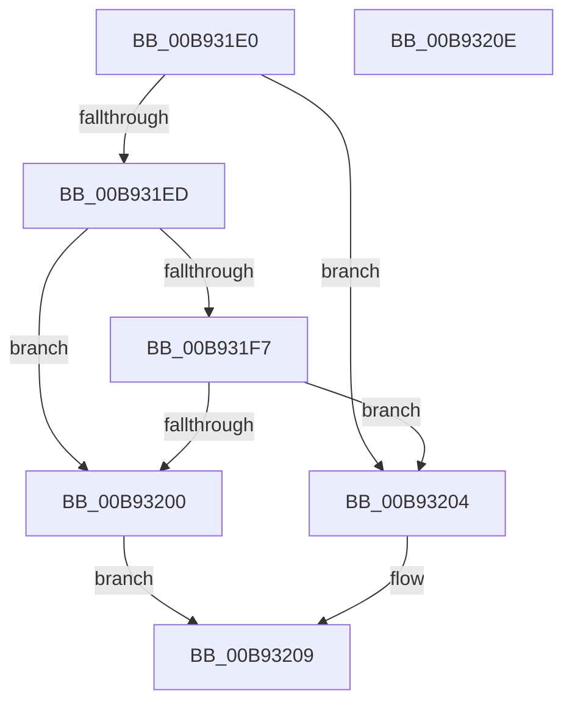

# VfUtilCheckRuleEnforcement

- RVA: `0x00B931E0`–`0x00B9320F` (길이 `47` bytes)
- VA: `0x0000000140B931E0`
- 실행 섹션: `PAGEVRFY`
- PDB 이름 있음: `예`; PDB Function 태그: `아니요`
- unwind 정보 RVA: `0x0005C788`
- 디코드: `16`개 명령, `47/47` bytes 표시
- 미해석 바이트: `0` (있으면 어셈블리에 `.byte`로 보존)

> 이 문서는 커널 이미지의 기계어와 PDB 기호를 분석해 생성했습니다. 4번과 5번은 함수 원형과 자료형을 바이너리 사용 방식에서 추정한 C 해석이며 원본 소스 복구 결과는 아닙니다.

## 1. Dependencies

- 직접 호출 지점: **1**; 고유 호출 대상: **1**
- 직접 호출자로 확인된 함수: **2**
- RIP 상대 이미지 참조: **1**

### Outgoing calls
- `0x00B931ED` → [VfTargetDriversGetVerifierData](../BB/VfTargetDriversGetVerifierData_function_00BB7E6C.md) (function, `0x00BB7E6C`)

### Direct callers
- [VfMiscMmBuildMdlForNonPagedPool_Exit](../BA/VfMiscMmBuildMdlForNonPagedPool_Exit_function_00BAE150.md) at `0x00BAE180`
- [VfMiscMmUnmapLockedPages_Entry](../BA/VfMiscMmUnmapLockedPages_Entry_function_00BAE1D0.md) at `0x00BAE3E4`

### Static image references
- `0x00B931E4` → RVA `0x00F049DC` (`.data`; read)

## 2. Other-region calls and transfers

- 다른 실행 섹션으로 향하는 call: **0**
- 별도 외부 분기/꼬리 이동을 확인하지 못했습니다.

## 3. Assembly (complete function range)

```asm
00B931E0  48 83 EC 28                     sub rsp, 0x28
00B931E4  83 3D F1 17 37 00 01            cmp dword ptr [rip + 0x3717f1], 1
00B931EB  75 17                           jne 0x140b93204
00B931ED  E8 7A 4C 02 00                  call 0x140bb7e6c
00B931F2  48 85 C0                        test rax, rax
00B931F5  74 09                           je 0x140b93200
00B931F7  8A 40 30                        mov al, byte ptr [rax + 0x30]
00B931FA  2C 08                           sub al, 8
00B931FC  A8 FB                           test al, 0xfb
00B931FE  75 04                           jne 0x140b93204
00B93200  33 C0                           xor eax, eax
00B93202  EB 05                           jmp 0x140b93209
00B93204  B8 01 00 00 00                  mov eax, 1
00B93209  48 83 C4 28                     add rsp, 0x28
00B9320D  C3                              ret
00B9320E  CC                              int3
```

## 4. C-style interpretation (structured pseudocode)

```c
__int64 __fastcall VfUtilCheckRuleEnforcement(void)
{
    __int64 result;
    __int64 v_rsp;

    v_rsp = (v_rsp) - (40);
    if ((*(unsigned int *)(v_rip + 3610609)) != 1) goto loc_00B93204;
    result = VfTargetDriversGetVerifierData(a1, a2, a3, a4);
    if (result == 0) goto loc_00B93200;
    result = (unsigned __int8)((*(unsigned __int8 *)(result + 48)) - (8));
    if ((((unsigned __int8)(result)) & (251)) != 0) goto loc_00B93204;
loc_00B93200:
    result = 0;
    goto loc_00B93209;
loc_00B93204:
loc_00B93209:
    v_rsp = (v_rsp) + (40);
    return 1;
}
```

## 5. (Beta) C Style

```c
void VfUtilCheckRuleEnforcement(void)
{
    int64_t result;
    int64_t local_rsp;

    local_rsp = (local_rsp) - (40);
    if ((*(uint32_t *)(v_rip + 0x3717F1)) != 1) goto loc_00B93204;
    result = VfTargetDriversGetVerifierData(a1, a2, a3, a4);
    if (result == 0) goto loc_00B93200;
    result = (uint8_t)((*(uint8_t *)(result + 0x30)) - (8));
    if ((((uint8_t)(result)) & (251)) != 0) goto loc_00B93204;
loc_00B93200:
    result = 0;
    goto loc_00B93209;
loc_00B93204:
loc_00B93209:
    local_rsp = (local_rsp) + (40);
    return 1;
}
```

## 6. Execution-region graph

[열기: 2D/3D 그래프와 함수 탐색 컨트롤 패널](../../../control-panel.html?section=pagevrfy&rva=0x00B931E0&view=graph)

- 2D 그래프는 위에서 아래로 흐르고, 3D 그래프는 빈 공간을 드래그해 회전합니다. Shift+드래그는 이동, 휠은 확대·축소, 함수 노드 선택은 대상 보고서 이동입니다.

### Static fallback


