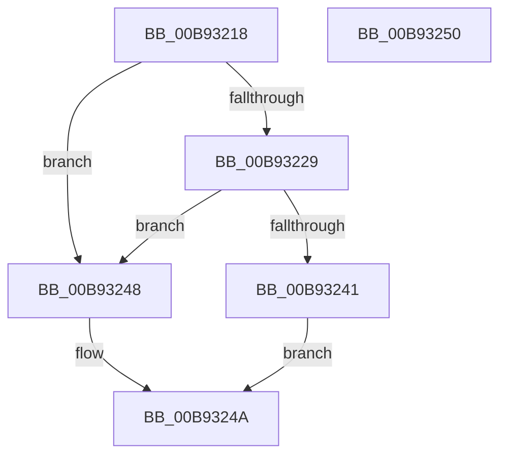

# VfUtilEqualUnicodeString

- RVA: `0x00B93218`–`0x00B93251` (길이 `57` bytes)
- VA: `0x0000000140B93218`
- 실행 섹션: `PAGEVRFY`
- PDB 이름 있음: `예`; PDB Function 태그: `아니요`
- unwind 정보 RVA: `0x0005CF00`
- 디코드: `20`개 명령, `57/57` bytes 표시
- 미해석 바이트: `0` (있으면 어셈블리에 `.byte`로 보존)

> 이 문서는 커널 이미지의 기계어와 PDB 기호를 분석해 생성했습니다. 4번과 5번은 함수 원형과 자료형을 바이너리 사용 방식에서 추정한 C 해석이며 원본 소스 복구 결과는 아닙니다.

## 1. Dependencies

- 직접 호출 지점: **1**; 고유 호출 대상: **1**
- 직접 호출자로 확인된 함수: **2**
- RIP 상대 이미지 참조: **0**

### Outgoing calls
- `0x00B93234` → [RtlCompareMemory](../../text/6B/RtlCompareMemory_function_006BA670.md) (function, `0x006BA670`)

### Direct callers
- [ViDifCheckCallbackInterception](ViDifCheckCallbackInterception_function_00B9A848.md) at `0x00B9A860`
- [ViDifCheckCallbackInterception](ViDifCheckCallbackInterception_function_00B9A848.md) at `0x00B9A873`
- [ViDifCheckCallbackInterception](ViDifCheckCallbackInterception_function_00B9A848.md) at `0x00B9A886`
- [ViDifCheckCallbackInterception](ViDifCheckCallbackInterception_function_00B9A848.md) at `0x00B9A899`
- [ViFaultsIsAppTarget](../BA/ViFaultsIsAppTarget_function_00BA6CE0.md) at `0x00BA6D1D`

### Static image references
- 디코드된 RIP-relative 메모리 참조가 없습니다.

## 2. Other-region calls and transfers

- 다른 실행 섹션으로 향하는 call: **1**
  - `0x00B93234` → [RtlCompareMemory](../../text/6B/RtlCompareMemory_function_006BA670.md) (`PAGEVRFY` → `.text`)
- 별도 외부 분기/꼬리 이동을 확인하지 못했습니다.

## 3. Assembly (complete function range)

```asm
00B93218  40 53                           push rbx
00B9321A  48 83 EC 20                     sub rsp, 0x20
00B9321E  0F B7 01                        movzx eax, word ptr [rcx]
00B93221  48 8B D9                        mov rbx, rcx
00B93224  66 3B 02                        cmp ax, word ptr [rdx]
00B93227  75 1F                           jne 0x140b93248
00B93229  48 8B 52 08                     mov rdx, qword ptr [rdx + 8]
00B9322D  44 8B C0                        mov r8d, eax
00B93230  48 8B 49 08                     mov rcx, qword ptr [rcx + 8]
00B93234  E8 37 74 B2 FF                  call 0x1406ba670
00B93239  0F B7 0B                        movzx ecx, word ptr [rbx]
00B9323C  48 3B C1                        cmp rax, rcx
00B9323F  75 07                           jne 0x140b93248
00B93241  B8 01 00 00 00                  mov eax, 1
00B93246  EB 02                           jmp 0x140b9324a
00B93248  33 C0                           xor eax, eax
00B9324A  48 83 C4 20                     add rsp, 0x20
00B9324E  5B                              pop rbx
00B9324F  C3                              ret
00B93250  CC                              int3
```

## 4. C-style interpretation (structured pseudocode)

```c
__int64 __fastcall VfUtilEqualUnicodeString(__int64 a1, __int64 a2)
{
    __int64 result;
    __int64 v_rsp;

    v_rsp = (v_rsp) - (32);
    if (((unsigned __int16)(*(unsigned __int16 *)(a1))) != (*(unsigned __int16 *)(a2))) goto loc_00B93248;
    result = RtlCompareMemory(*(unsigned __int64 *)(a1 + 8), *(unsigned __int64 *)(a2 + 8), (unsigned int)((unsigned int)(*(unsigned __int16 *)(a1))), a4);
    if (result != (*(unsigned __int16 *)(a1))) goto loc_00B93248;
    goto loc_00B9324A;
loc_00B93248:
    result = 0;
loc_00B9324A:
    v_rsp = (v_rsp) + (32);
    return result;
}
```

## 5. (Beta) C Style

```c
int64_t VfUtilEqualUnicodeString(void *Arg1, void *Arg2)
{
    uint8_t *arg1 = (uint8_t *)Arg1;
    uint8_t *arg2 = (uint8_t *)Arg2;

    int64_t result;
    int64_t local_rsp;

    local_rsp = (local_rsp) - (32);
    if (((uint16_t)(*(uint16_t *)(arg1))) != (*(uint16_t *)(arg2))) goto loc_00B93248;
    result = RtlCompareMemory(*(uint64_t *)(arg1 + 0x8), *(uint64_t *)(arg2 + 0x8), (uint32_t)((uint32_t)(*(uint16_t *)(arg1))), a4);
    if (result != (*(uint16_t *)(arg1))) goto loc_00B93248;
    goto loc_00B9324A;
loc_00B93248:
    result = 0;
loc_00B9324A:
    local_rsp = (local_rsp) + (32);
    return result;
}
```

### 관측된 메모리 오프셋

구조체 형식이 확인되지 않은 접근은 인자 기준의 오프셋으로만 기록했습니다.

| 기준 인자 | 오프셋 표현 | 폭 (bit) | 접근 |
|---|---:|---:|---|
| `Arg1` | `+ 0x0` | `16` | `R` |
| `Arg1` | `+ 0x8` | `64` | `R` |
| `Arg2` | `+ 0x0` | `16` | `R` |
| `Arg2` | `+ 0x8` | `64` | `R` |

## 6. Execution-region graph

[열기: 2D/3D 그래프와 함수 탐색 컨트롤 패널](../../../control-panel.html?section=pagevrfy&rva=0x00B93218&view=graph)

- 2D 그래프는 위에서 아래로 흐르고, 3D 그래프는 빈 공간을 드래그해 회전합니다. Shift+드래그는 이동, 휠은 확대·축소, 함수 노드 선택은 대상 보고서 이동입니다.

### Static fallback


